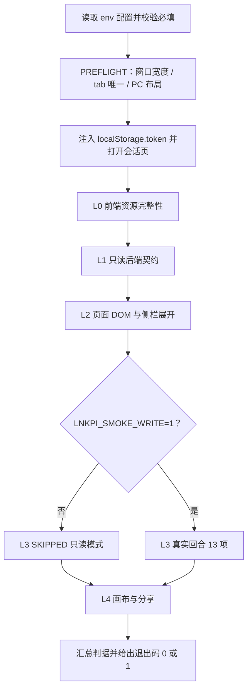

# CDP 五层冒烟参数化 ops runbook 设计规格（2026-11-09）

状态：待实施（路标 #4）
适用：生产会话页行为回归取证（Phase 3 / P0 之后的常备 ops 工具）
校验：`python3 scripts/verify-prod-cdp-runbook.py`、`pnpm verify-spec-figures --file <本文>`

> 一句话：把散落在 `/tmp` 的一次性取证脚本固化成仓库内可重复执行的只读入口，并让上一轮踩过的三条环境坑在**任何判据之前**以失败的方式暴露，而不是以「结果偏绿」的方式骗过验收。

---

## 0. 配图索引

| 图号 | 类型 | 位置 | 说明 |
| --- | --- | --- | --- |
| 图 1 | Mermaid `flowchart TD` 内嵌 | §5 | 参数化脚本从 env 配置到五层判据的执行顺序、三条 PREFLIGHT 的准入位置、L3 写操作默认关闭的分支 |

---

## 1. 目标（3 条以内，均可验收）

1. **参数化落地**：把 `/tmp/p0_probe.py` / `p0_cdp.mjs` / `p0_open_rail.mjs` / `p0_send.mjs` 四份一次性脚本固化为版本控制内的单一入口；生产地址、容器名、端口、JWT 来源、会话 id 全部来自环境变量，仓库内不出现这些值的字面量。
2. **前置自检可失败**：把「756px 移动端断点」「`Emulation.setDeviceMetricsOverride` 是 session-scoped」「残留同 URL tab 串台」三条坑做成 PREFLIGHT 硬闸门，先于全部五层判据执行，任一不成立即 `exit 1`。
3. **默认只读 + 判据可证伪**：L3 真实回合默认 `SKIPPED`（须显式 `LNKPI_SMOKE_WRITE=1` 才写生产），并由独立 verifier 的 7 组判据与逐条变异证明每个闸门真的能 RED。

---

## 2. 范围（含明确不做）

**做**

- 新增 `scripts/prod-cdp-smoke.mjs`（单一入口：config / cdp / preflight / layers 四段职责）。
- 新增 `scripts/verify-prod-cdp-runbook.py`（只读静态判据，可失败）。
- 新增 `docs/ops/2026-11-09-prod-cdp-smoke-runbook.md`（env SSOT、前置条件、五层判据、退出码、三条坑）。
- 新增本规格与 `docs/superpowers/plans/2026-11-09-prod-cdp-smoke-runbook.md`。
- 三处**只追加**衔接：#3 P4 规格 §12、P0+P3 规格 §12、P0 报告 §6。

**明确不做**

- 不改任何产品代码：`apps/**`、`services/**`、`charts/**` 一律不碰。
- 不改 `package.json`：`deploy.yml` 的 `push.paths` 含 `package.json`，只加一条 script 也会触发一次生产发布；本刀用 `node scripts/prod-cdp-smoke.mjs` 直接调用，不新增 npm script。
- 不改 `.github/workflows/**`，不挂 required check，不新增 CI job。
- 不合并、不修改并行会话的 PR #787（P1+P2，11 文件，当前 open 且 CI success）。
- 不把 `/tmp/p0_*` 历史脚本原样搬进仓库（它们硬编码生产地址与 token 路径）。
- 不追溯改写 `docs/ops/2026-11-08-phase3-prod-smoke.md` §6 的历史验收结论。

**门禁准入三问复核（结论：仍不挂 CI）**：① 依赖生产 SSH 私钥、容器内 `JWT_SECRET` 与本机 headless Chrome，非零外部依赖；② 页面渲染与真实回合结果非确定性；③ L3 会向生产写真实回合数据。故 #3 P4 拆包结论不变，本刀只交付 ops runbook。

---

## 3. 与既有规格的关系

| 来源 | 关系 | 本刀动作 |
| --- | --- | --- |
| `docs/superpowers/specs/2026-11-08-agent-siderail-p4-gates-design.md` §12 | #4 的来源；其追加条目已把三条坑列为前置自检准入项 | §12 只追加一条状态，不改写既有 #4 行 |
| `docs/ops/2026-11-08-phase3-prod-smoke.md` §6 第 3 条 | 明确「CDP 冒烟改由 #4 以参数化 ops runbook 交付，不挂 required check」 | 本刀是该条的执行落地；§6 追加一条索引，历史结论不动 |
| `docs/superpowers/specs/2026-11-08-agent-observer-refusal-exempt-design.md` §12 | 记录「#4 顺延到插队刀合并后」 | §12 只追加一条状态 |
| `docs/ops/2026-11-08-observer-refusal-exempt-prod-verify.md` | 三条取证坑的实证来源 | runbook 逐条引用并落成 PREFLIGHT |
| `docs/ops/2026-11-08-phase3-prod-smoke.md` §2 | **五层判据定义 SSOT**（L0 资源 / L1 只读契约 / L2 页面+侧栏 / L3 真实回合 / L4 画布+分享） | 忠实迁移 A 组 10 项、B 组 9 项、C 组 13 项；不擅自增删判据 |
| `docs/superpowers/specs/2026-11-08-web-dist-incremental-upload-design.md` | `deploy.yml` 的 `push.paths` 含 `package.json` | 本刀不改 `package.json` 的直接依据 |

---

## 4. 规范与判据（可复用规则）

| 编号 | 规则 | 可验收方式 |
| --- | --- | --- |
| R1 | 参数化：脚本内不得出现生产 IP / 站点端口 / 固定会话 id / 历史 token 路径字面量；本地调试端口与 token 落盘路径允许有默认值，但必须可由 env 覆盖 | verifier V1 正则扫描 |
| R2 | PREFLIGHT 先于判据且可失败：三条任一不成立 ⇒ `exit 1`，且 L0–L4 一条都不执行 | verifier V3 + 变异 M1/M2/M3 |
| R3 | 不静默降级：检测到移动端壳层直接 FAIL，禁止自动改走移动端判据（防假绿） | verifier V3 + 变异 M4 |
| R4 | 写操作 opt-in：L3 默认 `SKIPPED`；`SKIP` 不计入 PASS 数，须在汇总显式列出 | verifier V4 + 变异 M5 |
| R5 | 只追加：三份既有文档衔接只允许字符级 `insert`，禁 `delete` / `replace` | 推前核对用 `SequenceMatcher` 字符级判据 |
| R6 | 源级判据纪律：verifier 对脚本文本断言前一律 `stripComments`，并配「注释伪装」变异 | 变异 M7 |
| R7 | 变异不 RED 先怀疑伪变异，不得直接判门禁有效 | 变异 M8 伪变异对照必须仍全绿 |
| R8 | 推前逐路径裸 blob sha 核对 + 合并树逐文件核对；不追溯改写历史结论 | 推 PR 脚本 `--check` / 合并后 `--verify` |

---

## 5. 架构与契约

**模块边界**：一个可执行入口内部按四段职责组织，不拆多文件 —— 目的是让「改一处即可整体可跑」，且 verifier 只需读一个脚本文本即可完成全部源级判据。verifier 与入口解耦：前者只读文本、零外部依赖；后者依赖生产与 Chrome。

| 段 | 职责 | 对外接口 |
| --- | --- | --- |
| `config` | 读 env、必填校验、数字/布尔解析 | `readConfig(env) → cfg` |
| `cdp` | browser 级 WS 连接、tab 枚举/关闭、`send` / `evalJs`、事件收集 | `CdpSession` |
| `preflight` | 窗口宽度修正、tab 去重、PC 布局断言 | `runPreflight(cdp, cfg) → void`（失败抛错） |
| `layers` | L0–L4 判据，统一产出 `PASS` / `FAIL` / `SKIP` | `runLayers(...) → checks[]` |

**env 契约（SSOT = runbook §2 的表格，verifier V2 双向配对）**

| 变量 | 必填 | 默认 | 用途 |
| --- | --- | --- | --- |
| `LNKPI_BASE_URL` | 是 | — | 生产站点根地址 |
| `LNKPI_SESSION_ID` | 是 | — | 隔离测试会话 id |
| `LNKPI_JWT_SUB` | 是 | — | 自签 JWT 的 `sub` |
| `LNKPI_SSH_HOST` | 否 | `deploy-cvm` | 读 `JWT_SECRET` 的 SSH 别名 |
| `LNKPI_API_CONTAINER` | 否 | `lnkpi-api` | 承载 `JWT_SECRET` 的容器名 |
| `LNKPI_CDP_HOST` | 否 | `127.0.0.1` | Chrome 调试地址 |
| `LNKPI_CDP_PORT` | 否 | `9223` | Chrome 调试端口 |
| `LNKPI_VIEWPORT_WIDTH` | 否 | `1440` | browser 级窗口宽 |
| `LNKPI_VIEWPORT_HEIGHT` | 否 | `900` | browser 级窗口高 |
| `LNKPI_MIN_PC_WIDTH` | 否 | `767` | PC 布局断点下限 |
| `LNKPI_TOKEN_FILE` | 否 | `/tmp/lnkpi-smoke-token` | 短时 JWT 落盘路径，权限 0600 |
| `LNKPI_SHOT_DIR` | 否 | `/tmp/lnkpi-smoke-shots` | 截图输出目录 |
| `LNKPI_SMOKE_WRITE` | 否 | `0` | `1` 才执行 L3 写操作 |
| `LNKPI_PROBE_TEXT` | 否 | 固定探针文本 | L3 发送内容 |
| `LNKPI_POLL_LIMIT_MS` | 否 | `180000` | L3 终态轮询上限 |
| `LNKPI_SHARE_ID` | 否 | 空 | 提供时才执行 L4 分享静态页判据 |

**执行顺序见 图 1**。

*图 1 · 这张图说明参数化脚本从 env 配置到五层判据的先后约束：三条 PREFLIGHT 必须先于任何一层判据完成，L3 写操作默认关闭、仅在显式开关下进入真实回合。验收时用逐条变异证明 PREFLIGHT 与 opt-in 分支都不是恒绿装饰。*

---

## 6. 主场景规格（逐项可验收）

### PREFLIGHT（三条硬闸门，任一失败即终止）

- **P1 窗口宽度**：通过 browser 级 `Browser.setWindowBounds` 把窗口设为 `LNKPI_VIEWPORT_WIDTH × LNKPI_VIEWPORT_HEIGHT`，随后用**全新 CDP session** 复核 `innerWidth >= LNKPI_MIN_PC_WIDTH`。禁止使用 `Emulation.setDeviceMetricsOverride`（session-scoped，`ws.close()` 后失效）。
- **P2 tab 唯一**：枚举 `/json/list`，对 URL 含 `/workflow/<LNKPI_SESSION_ID>` 的 tab 只保留首个，其余逐个 `/json/close/<id>`；断言剩余恰好 1 个。禁止裸用 `list.find(...)` 直接取 tab。
- **P3 PC 布局**：页面加载后断言 `innerWidth >= LNKPI_MIN_PC_WIDTH`、`mobileShell === false`、`aside.agent-side-rail` 存在。若落在移动端壳层 ⇒ **FAIL**，不切换判据口径。`button.agent-fab` 的存在性只用于决定 L2 是否需要点击展开，不作为 PC 布局硬判据（复用的 Chrome profile 可能已记住展开态）。

### L0 前端资源完整性（公网 HTTP，只读）

`GET /` 200 且含 `
`；从 `index.html` 提取入口 JS 与 CSS 并各自 200；从入口 JS 提取至少一个 `CanvasPage-` 懒加载 chunk 并 200。合计 4 项。

### L1 只读后端契约（自签 HS256 Bearer）

`/api/health` 200；`/api/sessions` 200 且 `data` 为数组；`/api/agent/chat/threads` 200；`/api/agent/chat/user/messages` 200 且 `data` 为数组；`/api/agent/runtime-health` 200。合计 5 项。原报告已剔除生产不存在的 `/api/agent/thread-state`，本刀不重新纳入。

### L2 会话页 DOM / 侧栏可见性（CDP）

- A 组 10 项（页面加载）：SPA 挂载、非白屏、停留 `/workflow/`、零 `Runtime.exceptionThrown`、零 JSON 解析错误、零 304、token 已注入、无登录重定向、内容元素存在、无错误横幅。
- B 组 9 项（点 `button.agent-fab` 展开后）：侧栏宽 > 100、shell 可见、FAB 已被消费、turn / bubble / 消息操作按钮 / 聊天滚动区可见、composer 存在、发送按钮存在。

### L3 真实回合 / SSE 异步受理（默认 SKIPPED）

`LNKPI_SMOKE_WRITE=1` 时迁移 C 组 13 项：POST 发生、ack 2xx、mime 为 json 非 event-stream、`data.accepted === true`、轮询到终态、新 assistant 消息、新 user 回显、owner 流有数据、零 pageerror、零 console error、DOM turn 增长、侧栏保持展开、composer 清空。**必须先轮询到 owner 流 finalize 再取快照**（`chat/conversation` 为异步受理）。

### L4 画布 / 分享

画布 `.vue-flow__node` 与 `.vue-flow__edge` 可见数均 > 0；若提供 `LNKPI_SHARE_ID`，在 CVM 本机 curl `/share/<id>.html` 必须 200 且含 doctype 与内联 `<style>`，否则该子判据 `SKIP` 且**不计 PASS**。

### 汇总与退出码

每条判据输出 `PASS` / `FAIL` / `SKIP` 与汇总计数；任一 `FAIL` ⇒ `exit 1`，否则 `exit 0`。截图与诊断输出写入 `LNKPI_SHOT_DIR`，便于事后复核；JWT secret 永不打印、永不落盘。

---

## 7. 数据与状态变更

- **产品侧：零**。不修改 DB schema、不改前端产物、不改部署配置、不改运行时 env。
- **运行时临时产物**：`LNKPI_TOKEN_FILE`（1 小时短时 JWT，权限 0600）、`LNKPI_SHOT_DIR` 下 PNG，均落在 `/tmp`，不入库。
- **生产写入**：仅当 `LNKPI_SMOKE_WRITE=1` 时新增 1 个真实用户回合；默认关闭。这是把 #4 排除在 CI 之外的核心理由之一。

---

## 8. 纯函数与算法

| 函数 | 输入 → 输出 | 判据 |
| --- | --- | --- |
| `readConfig(env)` | env 对象 → `cfg` | 缺任一必填项抛错；数字项非数值抛错；`LNKPI_SMOKE_WRITE` 仅 `'1'` 为真 |
| `mintJwt(cfg)` | cfg → token 字符串 | `execFileSync('ssh', [host, 'docker exec', container, 'printenv JWT_SECRET'])` ⇒ secret 只在内存；HMAC-SHA256 + base64url；`iat/exp` 由 `Date.now()` 生成；secret 不回显 |
| `dedupeTabs(list, sessionId)` | tab 列表 → `{ keep, close[] }` | 匹配 URL 含 `/workflow/<id>`；`keep` 为首个，`close` 为其余全部；返回 `close.length` 供断言 |
| `assertPcViewport(probe, minWidth)` | DOM 探针 → void | `innerWidth >= minWidth && mobileShell === false && fabPresent && asidePresent`，否则抛错 |
| `summarize(checks)` | 判据数组 → `{ pass, fail, skip, exitCode }` | 任一 FAIL ⇒ `exitCode=1`；SKIP 不计入 pass |

---

## 9. 文件级改动清单（按内容锚点定位，不用行号）

| 路径 | 动作 | 内容锚点 |
| --- | --- | --- |
| `scripts/prod-cdp-smoke.mjs` | 新增 | `readConfig` / `mintJwt` / `dedupeTabs` / `assertPcViewport` / `runPreflight` / `runLayers` / `summarize` |
| `scripts/verify-prod-cdp-runbook.py` | 新增 | V1–V7 七组判据 + `stripComments` |
| `docs/ops/2026-11-09-prod-cdp-smoke-runbook.md` | 新增 | §2 env 表、§3 三条坑、§4 五层判据、§5 退出码 |
| `docs/superpowers/specs/2026-11-09-prod-cdp-smoke-runbook-design.md` | 新增 | 本文 |
| `docs/superpowers/plans/2026-11-09-prod-cdp-smoke-runbook.md` | 新增 | Task 1–7 |
| `docs/superpowers/specs/2026-11-08-agent-siderail-p4-gates-design.md` | 只追加 | §12 追加 #4 状态行 |
| `docs/superpowers/specs/2026-11-08-agent-observer-refusal-exempt-design.md` | 只追加 | §12 追加 #4 状态行 |
| `docs/ops/2026-11-08-phase3-prod-smoke.md` | 只追加 | §6 追加第 4 条索引 |
| `docs/ops/2026-11-09-prod-cdp-smoke-evidence.md` | 新增（归档 PR） | 真实只读验收实测记录 |

---

## 10. 测试策略与验收标准

### T1 verifier 七组判据（零外部依赖、确定性、可失败）

| 组 | 判据 | RED 触发方式 |
| --- | --- | --- |
| V1 | 脚本不含硬编码生产地址 / 端口 / 固定 session id / 固定 token 路径 | 塞回字面量 |
| V2 | `env.LNKPI_*` 集合与 runbook §2 表格变量集合**双向相等** | 改名或漏写 |
| V3 | 三条 PREFLIGHT 齐备：`Browser.setWindowBounds` + 全新 session 复核、`/json/close/`、PC 断点常量与 `mobileShell` 断言；且 PREFLIGHT 调用在 `runLayers` 之前 | 删任一 |
| V4 | L3 写路径仅在 `LNKPI_SMOKE_WRITE` 为真时可达；`SKIP` 不计 PASS | 把开关改成恒真 |
| V5 | 五层判据清单在脚本与 runbook 中一致（L0 4 / L1 5 / L2 19 / L3 13 / L4 3） | 删一条判据 |
| V6 | `.github/workflows/**` 不含本脚本命令；`package.json` 未被本刀改动 | 挂上 CI |
| V7 | runbook 逐条写明三条坑与「不挂 required check」 | 删一段 |

### T2 变异测试（每条恢复后裸 blob sha 全等）

M1 删 `Browser.setWindowBounds` ⇒ V3 RED；M2 删 `/json/close/` ⇒ V3 RED；M3 把 PREFLIGHT 调用移到 `runLayers` 之后 ⇒ V3 RED；M4 把移动端检测改成静默放行 ⇒ V3 RED；M5 把 `LNKPI_SMOKE_WRITE` 条件恒真 ⇒ V4 RED；M6 塞回硬编码生产地址 ⇒ V1 RED；M7 把关键锚点只写在注释里（注释伪装）⇒ V3 仍 RED（证明 `stripComments` 有效）；M8 把 runbook env 变量名改掉 ⇒ V2 RED；M9 删一条 L0 判据 ⇒ V5 RED；M10 把脚本命令挂进 CI ⇒ V6 RED；M11 删 runbook 的 756px 实证 ⇒ V7 RED；M12 只追加一行无关注释 ⇒ 全组仍绿（伪变异对照）。

**覆盖判据**：V1–V7 每组至少一条变异能精确 RED，且失败组集合与预期**完全相等**（不多红一组、不漏红一组）。M11 曾因 runbook 中 `756` 出现两处而只替换首处造成伪变异，据此把 V7 锚点从泛化字符串收紧为 `innerWidth=756` / `session-scoped` / `/json/close/` 等具体短语，并把变异改为全文替换 —— 这是 R7「变异不 RED 先怀疑伪变异」的实证。

### T3 行为级真实验收（默认只读）

重启独立 headless Chrome（`--headless=new --no-sandbox --remote-debugging-port=<LNKPI_CDP_PORT>`），仅设置必填 env 后执行 `node scripts/prod-cdp-smoke.mjs`：PREFLIGHT 三条全 PASS；L0/L1/L2/L4 全 PASS；L3 显示 `SKIPPED`；`exit 0`；截图落到 `LNKPI_SHOT_DIR`。**不向生产写回合数据**。

### T4 本地全量门禁

`pnpm verify-spec-figures`（全量 0 error + 本文 0 error / 0 warning）、`verify-links`、`verify-claims`、`verify-agent-rail-gates`、`verify-web-upload`、占位符扫描、推前 9 路径逐路径裸 blob sha 核对与三份文档字符级只追加校验。

### 实测汇总（2026-11-09）

T1 V1–V7 全 PASS；T2 12 组变异 11 组精确 RED + M12 伪变异对照绿，V1–V7 每组至少一条 RED，恢复后 3 文件裸 blob sha 全等；T3 生产只读 `VERDICT pass=30 fail=0 skip=2 total=32`、`exit 0`，PREFLIGHT 实测 `innerWidth=1440` / `pcLayout=true fab=true aside=true`，L3 与 L4 分享页判据 SKIPPED、零 POST 写操作，缺失必填 env 负向自检 `exit 1`；T4 全绿（规格 0 error / 0 warning、全量 203 篇 0 error、claims 7/7、rail-gates 11/11、web-upload 13/13、links 0 error）。逐项数值见 `docs/ops/2026-11-09-prod-cdp-smoke-evidence.md`。

### 完成定义

T1 全绿 + T2 十二条变异 11 RED / 1 对照绿且 V1–V7 每组至少一条精确 RED + T3 `exit 0` 且 L3 SKIPPED + T4 全绿 + CI 三必需（Verify spec figures / Build monorepo / Build API Docker image）全 pass + 合并树逐文件 blob sha 全等 ⇒ 本刀闭环。**不宣称**复现任何产品缺陷，也不宣称 #4 已成为 CI 门禁。

---

## 11. 风险

| 风险 | 表现 | 缓解 |
| --- | --- | --- |
| R1 参数化后脚本跑不通 | 只做静态判据、没人真跑过 | T3 真实只读验收为硬闸门；`exit 0` 才归档 |
| R2 PREFLIGHT 恒绿 | 三条闸门写在文档里、脚本里没检查 | verifier V3 源级 + M1/M2/M3 变异 |
| R3 移动端判据静默换轨 | 756px 下把 `asideWidth > 100` 换成移动端判据，结果偏绿 | R3 规则 + M4 变异；runbook 写明首轮 FAIL 的取证解释 |
| R4 误触生产发布 / 挂 CI | 改 `package.json` 或 workflow | 范围显式禁止 + V6 |
| R5 与并行 PR #787 冲突 | 本刀覆盖 `charts/` / `services/` 文件 | 推前核对只提交自己的 9 个路径，用 `base_tree` 只叠加自己文件 |
| R6 历史结论被追溯改写 | 把 P0 报告 §6 的「不宣告 ALL_PASS」改成通过 | R5 只追加字符级判据 + 推前核对 |

---

## 12. 后续包 / 路线图（本包外的东西也登记）

- **PR #787（P1+P2 固化）**：并行会话已推，`head=17d8377a`、11 文件、CI run `42489163788` success、当前 **open**。本刀不触碰、不合并，交由用户决定；合入后须按部署规程单独发 runtime 版本。
- **helm env 透传核实**：`charts/pi-lnk-runtime/templates/deployment.yaml` 的 `range $key, $value := .Values.env` 会通用映射 `ASK_USER_TIMEOUT_MS`，故日志中「template 未核对」的担忧可解除；`PI_RUNTIME_QUEUE_FRESHNESS_MS` 走代码默认值 600000，若需可调须显式写入 `env:`。
- **P1 / P2 生产验收**：合并发版后 curl 复现 P2 过期拦截与 P1-a 的 8min 收口，属独立刀。
- **原子 staging 发布**、**上传字节数写入 step summary**、**P2 状态写者收敛**（`scrollToBottom` / `taskProgress` 共享可变状态治理）：维持既有登记，未启动。
- 冻结边界不变：`sendMessage` / `handleEvent` / `canvas_command` / `defineExpose` 11 项。
- **收尾状态回填（2026-11-09 10:15，执行时点修订）**：PR #787（P1+P2 固化）已于 2026-11-08 17:18Z squash 合入 master `6d1f6936c9a2d56ed16e19300c075607dd84139d`，并已按部署规程单独发 runtime 版本。本节首条「当前 open」与设计计划文首的 `683b29eff…` 基线均为**写作时点记录**，按 R6「不追溯改写历史结论」原样保留。`gh api` 推前核对实证 9 个提交路径在 `683b29ef` → `6d1f6936` 之间 blob 完全一致（`MASTER_MOVED_SAFE`），故本刀改用新 HEAD 作 parent、`base_tree` 取新 master tree，不回退 #787 的 12 个改动文件；R5 的冲突风险据此关闭。
- **本轮明确排除、单列后续议题**：PR #625（SP-E 画布并发 CAS v2 规格，待评审）与 A-6 真机复测（需用户设备与确认）均不阻断 #4 收尾，不在本轮范围内，另立议题跟踪。

---

## 13. 配图规范自检

- §0 索引登记 图 1；§5 内嵌 Mermaid `flowchart TD`，共 11 个节点、标签全部引号包裹、无 ` `、无英文括号；图注写明「说明了什么、验收时怎么用」；§5 正文显式引用 图 1。
- 无 SVG 附件 ⇒ R1/R6/R8 不适用；R2/R3/R5/R7 由 `pnpm verify-spec-figures --file <本文>` 校验，结果在实施计划 Task 5 与证据文档记录。
- 本文不改 `docs/agent/*.md`，故不触发 `verify-claims` 的事实断言变更；本文不含产品代码改动，合并后不改前端产物。
