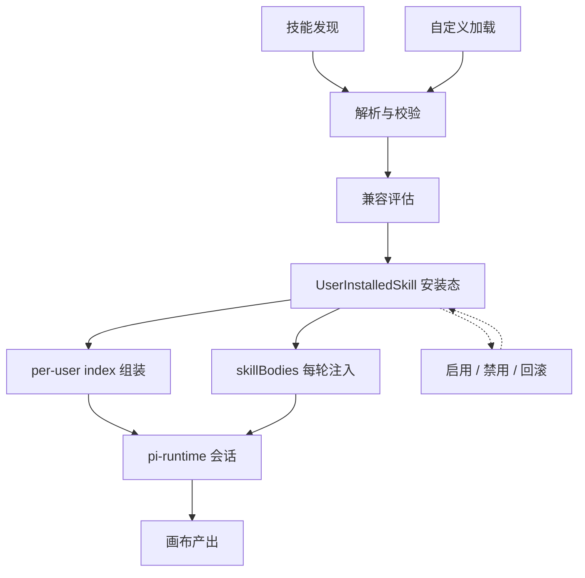
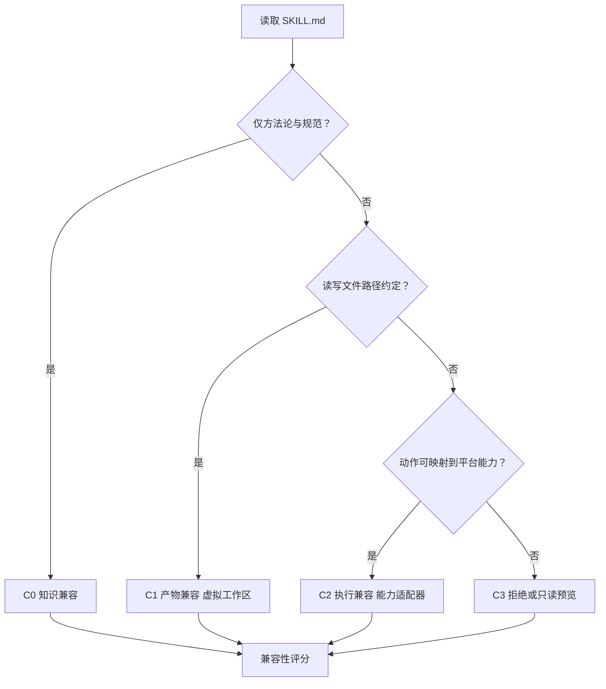
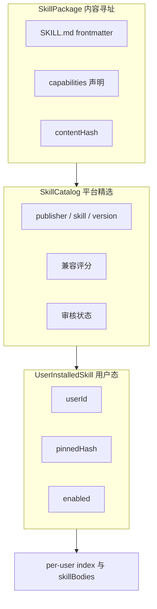
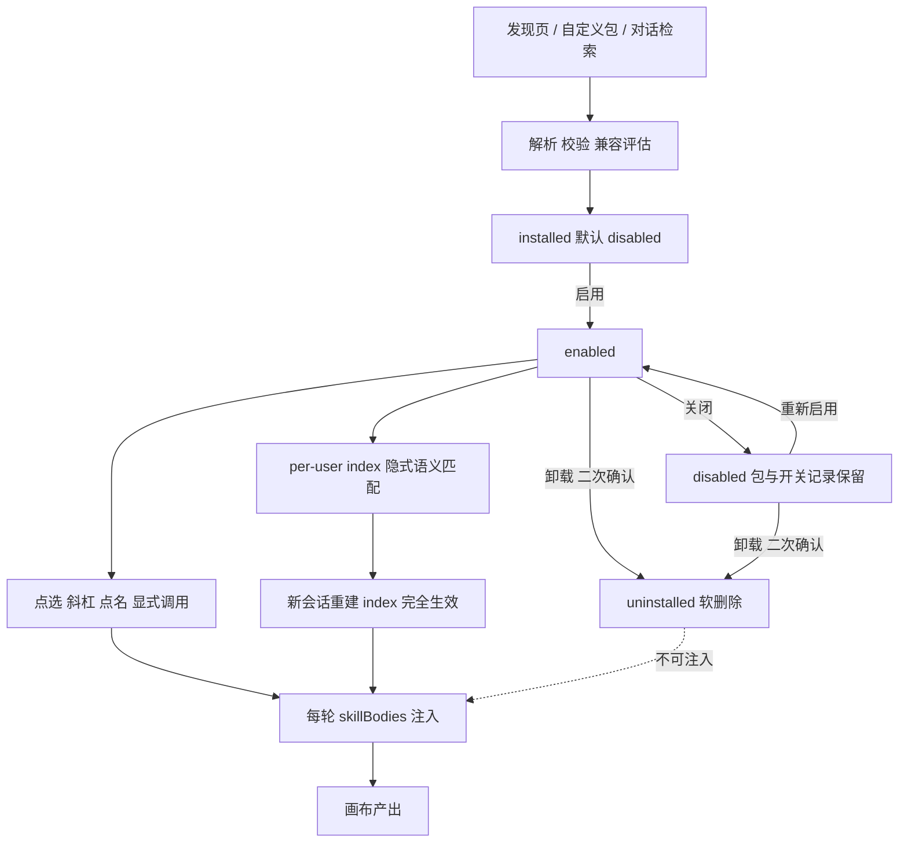

# 创作类 Skills 生态兼容：技能发现与双通路加载设计规格（13 章）

> **状态**：待评审（2026-11-10 产出，当晚补入 WorkBuddy 北极星）；**零代码改动、零生产发布**
> **前置**：`docs/adr/0016-creative-skills-ecosystem-compatibility.md`（Accepted）、ADR-0011（单一确认表面）、ADR-0003（提示词资产化）、ADR-0009（先查 vendor 能力面）
> **北极星**（发起人 2026-11-10 追加指令）：**以 WorkBuddy 当前对 skills 的设计为产品行为北极星，期望复刻其技能发现、用户自定义安装、删除/卸载、显式与隐式调用**。§3.9 是它的实现解剖证据，§4.7 是逐能力映射与「照搬 / 改写 / 不照搬」裁决，图 4 是生命周期基准，§10 的 M0/M1 判据按此对齐。复刻的是**用户可感知契约**，不是本地单用户文件系统的信任模型。
> **事实基线**：2026-11-08 与 2026-11-10 两轮 pi-lnk 本地源码只读核查 + 2026-11-08 公开资料检索 + **2026-11-10 第三轮 WorkBuddy 客户端/官方文档/本机落盘只读核查**。⚠️ 主仓工作树长期脏且本地 ref 落后 ⇒ 本规格所有「pi-lnk 现状」陈述**以 §3.1 列出的文件与行号为准**，不以本地 git ref / master HEAD 为准；生产行为未在本轮验证。
> **分支约定**：实现走 feature 分支 + PR + squash merge。本刀只产文档（ADR + 本规格 + 文档登记），实施计划另立 `docs/superpowers/plans/`。
> **配图**：4 张内嵌 Mermaid 结构图，符合 `docs/superpowers/SPEC-CONVENTIONS.md` R1–R8，自检结果见 §13。
> **阶段命名**：统一用 M0–M4（发起人 2026-11-10 口径）。11-08 第二轮分析曾写作 P0–P4，与本文逐项对应，不再另立编号。

---

## 0. 配图索引（结构与视觉两类，均随本文档演进）

本文档只含结构图，一律 Mermaid 内嵌；**无视觉稿、无 SVG 附件**（本文档表达的是判据与数据契约，不依赖真实比例/位置）。

| 编号 | 形式 | 内容 | 位置 | 用途 |
|---|---|---|---|---|
| 图 1 | 内嵌 Mermaid | 双通路归一、安装态与三粒度加载的总览数据流 | §5.1 | 验收时判定「发现」与「自定义加载」是否真共用一条流水线，以及安装态变更在哪一步生效 |
| 图 2 | 内嵌 Mermaid | C0/C1/C2/C3 兼容评估决策树 | §5.2 | 兼容评分实现与恶意/不兼容样本判定的唯一依据，§10 负例按此图分支设计 |
| 图 3 | 内嵌 Mermaid | SkillPackage / SkillCatalog / UserInstalledSkill 三层数据契约 | §5.3 | 数据模型与 API 字段评审基准；判定「内容寻址」「per-user 隔离」「版本钉住」是否有落点 |
| 图 4 | 内嵌 Mermaid | 北极星：WorkBuddy 技能生命周期（发现→安装→启停→卸载）与显式 / 隐式双调用通路 | §5.5 | 判定 M1 是否真的复刻了「关闭≠卸载、不改原文件、新会话完全生效、显式必达」这组语义；§10.3 的 M1-A7–A11 按此图节点设置断点 |

---

## 1. 目标（4 条，均可验收）

1. **G1 双通路可用且归一**：用户能通过「技能发现」与「自定义加载」两条通路获得并使用创作类 skills；两条通路只有 `sourceType` / `trustLevel` 之差，落到同一安装态、同一校验链、同一注入通道、同一回滚机制。验收锚点：§10.3 的 M1-A1 / M1-A3。
2. **G2 端到端产出而非仅加载**：短剧 / 音乐 / 图片 / HTML 动画网页四类垂类，各至少有一个技能被加载后**产出真实画布节点**（不只是 manifest 出现、模型触发）。验收锚点：§10.1 的 M0-A2（内置 golden）与 §12 北极星判据（真实社区技能）。
3. **G3 兼容可度量、风险可收敛**：每个技能有 C0–C3 兼容评分与可解释的降级/拒绝理由；所有第三方内容经服务端确定性校验，agent 不执行 SKILL.md 前置步骤。验收锚点：§10.1 的 M0-A3 与 §10.3 的 M1-A6。
4. **G4 对齐 WorkBuddy 北极星（发起人 11-10 追加）**：在「发现、自定义安装、启用/关闭、删除/卸载、显式调用、隐式调用」六个面达到 §4.7 全部 **Must** 项，生命周期语义与 图 4 一致；**复刻的是用户可感知行为契约**（含「关闭≠卸载」「开关不改 SKILL.md 原文件」「新会话完全生效」「显式点名必达」），不是本地目录安装与用户本人身份执行的信任模型。验收锚点：§10.1 的 M0-A6 / M0-A7 与 §10.3 的 M1-A7–A11；对照证据见 §3.9。

---

## 2. 范围（含明确不做）

### 2.1 本规格交付

`SkillPackage` / `CompatibilityProfile` 契约、能力词表、内置 9 个 golden skill 重写口径、控制面数据模型与 API、发现页与自定义加载交互、加载三粒度的注入实现判据、M0/M1 的行为级验收判据与可转红负例、M2–M4 的准入条件登记；**外加 WorkBuddy 北极星实现解剖（§3.9）、逐能力复刻映射（§4.7）、生命周期基准（图 4）与六面对齐判据（§10）**。

### 2.2 明确不做（本包外，登记在 §12 避免隐性范围）

| 不做项 | 理由 |
|---|---|
| 开放 UGC 发布 / 作者体系 / 评分评论 | 属 M4，依赖审核、签名、法务与真实使用数据 |
| agent 自主 clone / 解压 / 执行 `scripts/` 与「前置步骤」 | ADR-0016 第 5 条明令禁止，是 2026 年恶意技能战役的主感染向量 |
| 复刻 WorkBuddy 的**本地目录安装、`scripts/` 可执行、以用户本人身份执行系统命令、无审核 zip 直装** | 北极星只取行为契约（§4.7 Must）；信任模型是本地单用户（F35/F55），服务端多租户照搬会跨用户污染。详见 §4.7 的 Won't 列 |
| 把任意第三方 SKILL.md 直接 drop-in `skills/` 目录 | 能力鸿沟（§3.4），且镜像烘焙 + 启动扫描一次 ⇒ 装完不可用 |
| `setTools` / `setActiveTools` 动态增删工具 | 纯提示词 skill 模型下不需要（§3.5 纠正），主线 B 技能包化后再议 |
| 进程级脚本沙箱 / seccomp / MCP 连接器网关 / 子代理编排 | 既有 roadmap 明确 park（阶段二/三），本包不引入 |
| 企业 RBAC / 租户隔离 / 多技能自动并行调度 | M4；现有 `User` 表无 role，管理端靠 `AdminTokenGuard` |
| 对 §3.7 所列历史文档正文的追溯改写 | ADR-0008 纪律：只显式声明修订/推翻，不改历史原文 |

### 2.3 发布面与授权边界

本刀是 docs-only：`deploy.yml` 的 `push.paths` 不含 `docs/` ⇒ 零生产发布。但 **M0 重写 `skills/**` 会触发 `runtime-deploy`**（`AGENTS.md` 明写改 skills 必须手工 dispatch，tag = master 短 SHA）⇒ M0 的代码实施需单独授权 + 生产复测，不在本文档授权范围内。

---

## 3. 分析事实依据与既有规格关系（显式修订 / 显式推翻）

> 本章是本规格的**证据基座**：§3.1–§3.6 收纳 2026-11-08 / 11-10 四轮 pi-lnk 分析的全部结论，§3.7 据此逐份声明对既有判断的处置，§3.8 标明可信度边界，**§3.9（F38–F55）是 2026-11-10 追加的 WorkBuddy 北极星实现解剖**。后续章节的每条设计决定都应能回指本章某条事实；§4.7 的每项复刻裁决都标注了所依据的 F 号。

### 3.1 现状代码实证（本地只读核查）

| # | 事实 | 精确锚点 |
|---|---|---|
| F1 | 9 个 `SKILL.md` 是仓库资产，Dockerfile `COPY` 进镜像；部署清单无 skills 的 volumeMount / ConfigMap / `PI_RUNTIME_SKILLS_DIR` | `services/pi-runtime/Dockerfile:13,23`、`.dockerignore:7-9`、`charts/pi-lnk-runtime/templates/deployment.yaml:45-47,60-63` |
| F2 | `SkillRegistry` 进程启动扫描一次；`byName` Map 与 `toolEnsemble` 均缓存；无 `fs.watch` / mtime / 重扫 / reload | `services/pi-runtime/src/index.ts:78-82`、`skills/registry.ts:19-29`、`tools/skill-tool.ts:11-54`、`session-manager.ts:3124-3138` |
| F3 | 加载器手写 YAML：只取 `name`/`description`，`version` 解析后被丢弃；目录名必须等于 name；`_` 前缀跳过；坏 skill 跳过；多行 `description` 解析能力有限 | `services/pi-runtime/src/skills/loader.ts:23-53,65-71,144-154` |
| F4 | 渐进披露：index（name+description）常驻 systemPrompt 尾部，正文经 `load_skill` 按需读；`load_skill` 注释「只读本地文件，不走 Nest、不经 Gate」 | `skills/loader.ts:55-63`、`session-manager.ts:3115-3122`、`tools/skill-tool.ts:1-5` |
| F5 | 显式调用链：`/skill <name>` 与 dock `skillId` → `mapUiSkillId` → `listSkills()` 白名单 → `forceSkills` → 每轮把正文作为指令前缀注入；未知名 fail-soft，文案即「用户显式调用了未安装的 skill」 | `apps/server/src/agent/pi-runtime/skill-command.ts:2-8`、`agent-skill-map.ts:6-17`、`resolve-force-skills.ts:8-31`、`agent.service.ts:1922-1931`、`pi-runtime.client.ts:287-309`、`session-manager.ts:625-641,2365-2387` |
| F6 | 唯一技能列举端点是 pi-runtime 内网 `GET /skills`，无鉴权，只被 Nest 消费；前端拿不到清单 | `services/pi-runtime/src/app.ts:107,113`、`pi-runtime.client.ts:453-460` |
| F7 | `/prompt` body 是显式 TS 类型 `{ text, lane?, forceSkills?, turnContext?, images? }`，Fastify `bodyLimit: 4MB`；`/sessions` body 已含 `systemPrompt` 与 `userId` | `services/pi-runtime/src/app.ts:74,132-149,192-209` |
| F8 | **无安装/发现**：全库无 install/download 工具、无写 `skills/` 目录、无 POST `/skills`、无热加载；`web_search`/`web_fetch` 只读文本且拒私网、2MB/20k 上限 | `services/pi-runtime/src/tools/`（40 工具仅 `skill-tool.ts` 与 skill 相关）、`tools/web.ts` |
| F9 | **无数据模型**：`schema.prisma` 40 个 model、33 个 migration 中无 Skill / InstalledSkill / Marketplace / Plugin；`skillId` 仅 DTO 字段不落库 | `apps/server/prisma/schema.prisma`、`apps/server/src/agent/agent.controller.ts:85-88` |
| F10 | **UI 现状**：`DiscoverPane.vue` 的「专家 / 技能 / 连接器」是 disabled「敬请期待」预留位；`/community` 是作品流；`AGENT_SKILLS` 硬编码 1 项（`product-visual` → `ecommerce-product-photo`），空态文案「暂无已安装技能」 | `apps/web/src/components/mobile/DiscoverPane.vue`、`apps/web/src/constants/agentSkillMap.ts:17-24`、`apps/web/src/components/agent/AgentSideRail.vue:4107-4125,1734` |
| F11 | 工具集编译期硬编码数组；`tool_search` 曾有生产零触发史，下沉工具的准绳是「有没有资产按名字点名它」 | `services/pi-runtime/src/tools/config.ts:81-115`、`tools/tiering.ts:1-60`（含 2026-10-06 分级下发实验 6 次 hit 的实证） |
| F12 | HTML 产物有现成落点：`set_node_text` / `upsert_media_node` 支持 `format='html'`，工具描述硬编码要求先 `load_skill('html-craft')`；产物受 CSP 约束（单文件、白名单 CDN、无 fetch/localStorage/弹窗） | `services/pi-runtime/src/tools/canvas-write.ts:281,293,1121`、`skills/html-craft/SKILL.md:21-29`、`apps/server/src/agent/agent-canvas-tools.set-node-content.test.ts` |
| F13 | 平台已把「文件即创作状态」翻译成「画布文本节点即创作状态」 | `skills/drama-storyboard/SKILL.md`（「剧本：画布上的文本节点」「资产表写成文本节点，标题 `资产表 · <剧名>`」） |
| F14 | 能力词表雏形已存在：`StudioModality = text/image/video/audio`、`AudioKind = voice/design/music`、`ModelCatalogEntry` 为模型目录唯一真源 | `packages/shared/src/studioModelCatalog.ts:1-48`、`apps/server/src/admin/model-catalog.controller.ts` |
| F15 | per-user 隔离与「外部包导入」有成熟范式可抄 | `schema.prisma:126-143`（`UserWorkflowRecipe` `@@unique([userId, recipeId])`）、`:145-162`（`ProviderChannel` 密钥加密）、`apps/server/src/upload/upload.controller.ts`（AuthGuard + `req.user.sub` + 分片）、`apps/web/src/composables/useWorkflowExchange.ts`（JSZip → schema 校验 → ID 重映射）、`works.controller.ts`（fork 范式） |
| F16 | `prompt-registry` 与 skills 是两套独立机制（前者 Nest 侧、含 `version` + `contentHash` + lint 门禁 + 内嵌 fallback 逐字比对；后者 runtime 侧、无完整性校验） | `prompt-registry/MANIFEST.yaml`、`apps/server/src/agent/pi-runtime/prompt-registry.loader.ts`、`prompt-registry.fallback.ts` |
| F17 | 全局 `ValidationPipe({ transform:true, whitelist:true })` 会剥掉无装饰器的 DTO 属性 ⇒ 新增 DTO 必须写全装饰器并做同管道透传回归 | `apps/server/src/main.ts:31` |

### 3.2 供给侧与生态事实（2026-11-08 公开资料检索）

| # | 事实 | 性质 |
|---|---|---|
| F18 | `SKILL.md` 是 agentskills.io 开放标准（Anthropic 2025-12-18 发布），渐进披露三阶段 Discovery / Activation / Execution；目录可含 `scripts/`、`references/`、`assets/` | 公开标准 |
| F19 | 已被 Codex CLI、Cursor、GitHub Copilot、Gemini CLI、Claude Code、WorkBuddy 等采纳；社区目录（skills.sh、SkillsMP、SkillHub 等）索引量达十万量级；安装形态 `npx skills add <owner/repo> --skill <name> -a <agent>` | 公开资料，数量级随时间变化，不作为硬指标 |
| F20 | 短剧垂类供给最丰富：`awesome-short-drama-skills` 收录 **83 个技能包 / 7 大分类 / 16 个开源平台，其中 81 个是标准 SKILL.md**；`zenstory-ai/drama-skills` 13 个 SKILL.md、2.36 万合计安装、MIT，流水线为小说分析→改编→分集剧本→视觉资产→分镜→视频提示词→produce→剪辑审核 | 公开资料检索快照 |
| F21 | `drama-skills` 明确要求 **Python 3.9+、ffmpeg/ffprobe、npx、本地文件系统**；创作决策落在文件里；自带「付费任务先预览再显式确认、不接受之前的同意」的 confirmation gate | 公开资料，是 C1/C2 分级设计的直接依据 |
| F22 | `ZJU-REAL/Easel` 的 `short-drama` 走 `npx skills add`，frontmatter 含非标准字段 `layer: produce`；已有 repo 在 **README 开头放「要求 agent 直接执行流程」的指令** | 公开资料；⇒ 「只解析 SKILL.md、README 不进 prompt」的实证依据 |
| F23 | 社区 skill 大量针对具体模型写提示词（Seedance 2.5 / MiniMax H3 / 可灵 / 即梦），与本平台 `ModelCatalogEntry` 模型命名体系不一致 | 公开资料，⇒ 能力适配器需模型名映射 |

### 3.3 安全风险实证（作为 P0 硬约束的来源，不是否决理由）

| # | 事实 | 引发的约束 |
|---|---|---|
| F24 | Snyk ToxicSkills（2026-02，3,984 个技能）：**13.4% 含至少一个 critical 缺陷、36% 含提示注入手法、76 个确认恶意**；确认恶意样本 100% 同时含代码载荷与提示注入 | 正文进 prompt 前必须做注入扫描；不能只看 `scripts/` |
| F25 | USENIX Security '26（Liu et al.，98,380 个技能）：157 个确认恶意，**73.2% 实现用户不可见的 shadow features** | 兼容性评分要列出「声明能力 vs 实际要求」差异，不静默降级 |
| F26 | Orca 市场四原语：安装数可由未鉴权 GET 刷高；安全扫描非确定（创建时 + 达到热度时才扫）；**同名安装静默覆盖**；盲批量更新可把已审版本换成恶意版 | `<publisher>/<skill>` 命名空间 + `contentHash` 钉住 + 不可变版本；不以安装数/星数作为信任信号 |
| F27 | Unit 42 BIV：技能可在 metadata / 代码 / 自然语言三个表面分别声明良性能力、链式组合成凭据窃取；标准缺失签名、沙箱、来源追踪、权限执行层、审核门、哈希校验、路径边界 | 控制面统一校验 + 审计；生成动作统一走确认门 |
| F28 | ClawHavoc 战役：恶意技能以「Prerequisites」诱导用户/agent 下载运行 infostealer；agent 自动执行安装前置是主感染向量 | ADR-0016 第 5 条：agent 只检索与申请，不执行前置步骤 |
| F29 | 本平台放大项：skill 正文「不走 Nest、不经 Gate」直入 systemPrompt；`SkillRegistry` 是按 name 的全局 Map，无 namespace / 版本 / 签名；pi-runtime 内网端点无鉴权；runtime 容器 egress deny | 控制面集中校验；内网端点补 service token；出网白名单只给 Nest |

### 3.4 能力鸿沟与既有验收线漏洞

| # | 事实 |
|---|---|
| F30 | 本仓 9 个 SKILL.md 深度绑定私有工具名与平台语义：`run_audio_generation` / `run_image_generation` / `run_video_generation` / `propose_generation` / `upsert_media_node` / `set_node_text` / `tool_search` / `focus_node`，以及 HITL Gate 规则「确认前不调用 `run_*`」、模型目录、画布节点结构。社区通用 skill 引用的是 Bash / 文件系统 / CLI ⇒ **装进来能加载、能触发、按它执行必然失败** |
| F31 | 平台自带 skill 尚且随工具分层频繁漂移：`drama-qc-review` / `drama-storyboard` / `ecommerce-product-photo` / `drama-audio-design` 的 changelog 均有「点名撤改（读类工具下沉延迟集）」与「能力面回代码核实」记录 ⇒ 第三方 skill 更无法靠硬编码工具名稳定工作 |
| F32 | 现行验收线只验「加载 + 触发」，未验产出：`docs/superpowers/plans/2026-09-24-p1-roadmap-revision.md:91` 原文「**验收线 = 免改码 drop-in**：第三方 SKILL.md 放进 skills 目录 → 重启 → manifest 显示注入 → 模型仅凭 description 自然触发」；`:90` 的生态兼容目标仅到「格式对齐 Anthropic 事实标准」 |
| F33 | 老 LangGraph runtime 设计稿（`2026-07-23-agent-runtime-langgraph-design.md:294-303`）曾规划「市场安装」「mtime 热加载」，但该 runtime 已于 2026-09-27 退役删除；现行 `skills/loader.ts:4` 明写 `lnkpi.*` 扩展元数据与 prompt_version 机制「不迁」。⇒ **市场安装与热加载从未在现行代码落地，不得当作既有能力** |
| F34 | `2026-10-28-text-node-html-artifact-design.md:284` 明写「本仓 skill 无模块机制」；`skills/` 目录只有 9 个 SKILL.md，无 MANIFEST / package.json / 签名文件 |

### 3.5 形态差异与一处需要纠正的既有判断

| # | 事实 / 结论 |
|---|---|
| F35 | CLI / 桌面端（Codex、WorkBuddy、Claude Code）把 skill 落在用户本机 `~/.claude/skills`，信任边界由用户本人承担；pi-lnk 是服务端多租户，skill 正文进共享 runtime 进程与 systemPrompt，一个恶意技能影响所有会话与平台密钥 ⇒ 同样的功能，前者叫「安装到本机目录」，后者必须是「平台审核上架 + 用户订阅启用」 |
| F36 | `docs/discussion/2026-10-04-vendor-ext-review-registertool-pion.md:86` 原文「若用户中途装/卸 skill，工具集无法更新——只能重建会话」，并据此在 `:101-102` 把 `setTools` / `setActiveTools` 登记为待办。**该判断在纯提示词 skill 模型下不成立**：skill 只贡献一个 `load_skill` 工具（`tools/skill-tool.ts:11-54`），工具集与安装态无关；`setTools` 只有 roadmap 主线 B「技能包化 = activeToolNames 打包」落地后才是硬依赖。实证扩展点：`app.ts:194`（body 类型）、`pi-runtime.client.ts:287-309`（opts）、`session-manager.ts:2385`（`withForcedSkills` 的 `resolveBody` 已是回调） |
| F37 | 会话静态段在 create 时固化（`session-manager.ts:529-532`），但 `forceSkills` 是**每轮**注入 ⇒ 「点击即用」可即时生效；「自动语义触发」需要 index 改为按用户/按会话解析，二者实现代价不同，必须分开验收 |

### 3.6 可复用宿主清单（决定 M0/M1 是微创而非重构）

| 类别 | 现成宿主 |
|---|---|
| 技能解析与消费 | `services/pi-runtime/src/skills/loader.ts` / `registry.ts` / `tools/skill-tool.ts` / `index.ts:78-82` / `app.ts:107` |
| 每轮注入 | `/prompt` body 类型、`pi-runtime.client.ts.prompt()` opts、`withForcedSkills(text, forceSkills, resolveBody)`、`resolveForceSkills` 白名单 |
| per-user 隔离 | `UserWorkflowRecipe` / `ProviderChannel` / `UserAsset` 模型 + `AuthGuard` 的 `req.user.sub` |
| 外部包导入 | `upload.controller.ts`（单文件/分片/直传）、`useWorkflowExchange.ts` + `packages/shared/src/canvas/workflowExchange.ts`（zip → 校验 → 重映射） |
| 目录与版本治理 | `admin/model-catalog.controller.ts` + `ModelCatalogEntry` / `AdminAuditLog`；`prompt-registry.loader.ts` 的 `contentHash` + degraded fallback 范式 |
| 展示与「一键使用」 | `DiscoverPane.vue` disabled 技能位、`CommunityPage.vue` / `WorkCard.vue` / `works.controller.ts` 的 fork 范式、`AgentSideRail.vue` 技能下拉 |
| 四类垂类能力锚点 | 7 个 `drama-*` + `ecommerce-product-photo` + `html-craft`；`StudioModality` / `AudioKind` / `ModelCatalogEntry`；`set_node_text(format='html')` |

### 3.7 与既有规格的关系：显式修订 / 显式推翻

按 `SPEC-CONVENTIONS.md` §6 骨架 §3 的要求，逐份声明处置；**历史正文不追溯改写**（ADR-0008 纪律），本表即修订记录。

| 既有文档 | 原判断 | 处置 | 依据 |
|---|---|---|---|
| `docs/discussion/2026-09-25-workbuddy-alignment.md` §6 | 「阶段四：生态化（skill/连接器开放创建与分享）+ 企业权限/审计/租户隔离」；§6 表把「skill 版本管理/评审流」放阶段二 | **修订**：生态化提前为主线议题，但起步形态收窄为「策展发现 + 受控导入」；版本/评审流随之从阶段二提前到 M1 前置 | 发起人 2026-11-10 目标拍板 + ADR-0016 |
| `docs/superpowers/specs/2026-09-10-wave-a-delivery-program-design.md` §2.2 / §4 A5 | 「`/技能名` 斜杠技能市场、多 Skill 并行编排（超出 A5 贯通范围）」明确不做 | **推翻（仅对该不做项）**：技能发现与加载成为本规格目标；但「多 Skill 并行编排的自动调度」仍不在本包（§2.2） | ADR-0016 第 1 条 |
| `docs/superpowers/plans/2026-09-24-p1-roadmap-revision.md:90-91` | 生态兼容 = 格式对齐；验收线 = 免改码 drop-in 自然触发 | **修订**：验收线升级为「可发现 → 可加载 → **可产出**」三级；drop-in 只算第一级 | F30–F32 |
| `docs/discussion/2026-10-04-vendor-ext-review-registertool-pion.md:86,101-102` | 中途装卸 skill 只能重建会话；`setTools` 登记为热更新前置待办 | **纠正**：纯提示词 skill 下不成立；`setTools` 降级为主线 B 后的可选项 | F36 |
| `docs/superpowers/specs/2026-08-07-platform-route-skill-boundary-design.md` §2 不做项 / `docs/agent/tool-framework-roadmap.html` §7 阶段表 | 技能边界与阶段表按「阶段四生态化」编排 | **修订**：由 M0–M4 路标取代技能生态部分；工具框架主线 A/B/C 不变，本规格属 A 的延伸、不与 B 抢资源 | §12 |
| `docs/superpowers/specs/2026-10-28-text-node-html-artifact-design.md:284` | 「本仓 skill 无模块机制」 | **保留为事实，但不再作为「不做市场」的理由**：M0 引入 `SkillPackage` 契约后该事实失效，届时按只追加状态回填 | F34 |
| `docs/superpowers/specs/2026-07-23-agent-runtime-langgraph-design.md` §7 | 老 runtime 规划「市场安装 / mtime 热加载」 | **标注 superseded**：runtime 已退役，两条从未落地，禁止当作既有能力引用 | F33 |
| `docs/discussion/2026-09-19-pi-lnk-migration-discussion.md`（v1.1/v2 设想） | 「兼容安装 Claude Code 技能市场」列为 v1.1 杀手级功能 | **纳入但收窄**：格式兼容保留（C0），「直接兼容安装」由三档兼容分级取代 | F20–F23、F30 |

### 3.8 事实的可信度边界（含 §3.9 北极星证据）

- §3.1 全部来自本地磁盘只读核查，路径与行号可回查；**未做生产验证**，不得据此宣称线上行为已被证实。
- §3.2 / §3.3 来自 2026-11-08 公开资料检索，是设计输入而非仓库资产；数量级会随时间变化，不作为验收硬指标。
- §3.9 是 2026-11-10 第三轮独立核查，**证据分四级**：`A` 官方产品文档、`B` 本机客户端落盘实证（文件与字段可直接回查）、`C` 客户端内置工具契约与内置 `SKILL.md`（产品对外行为定义）、`D` 第三方使用文章（**仅作旁证，不单独作为验收判据**）。该轮核查的是 WorkBuddy 客户端当前版本在本机的表现，非服务器端实现，也非跨版本承诺；`D` 级与 `A` 级冲突时以 `A` 为准并在 §4.7 显式裁决。
- 主仓工作树脏且本地 ref 落后（本轮观察到 `docs/README.md` 已有并行窗口未提交改动）⇒ 本规格不引用任何本地 git 状态作为事实；实现开工前须用 `gh api` 复核 true master 并重建干净验证环境。

### 3.9 北极星：WorkBuddy 当前 skills 设计实现解剖（F38–F55）

> **定位**：本节回答「要复刻的到底是什么」。按发起人 2026-11-10 追加指令，WorkBuddy 的技能系统是本规格的**产品行为北极星**；复刻范围由 §4.7 逐能力裁决，生命周期基准见 图 4。本节只陈述可回查事实，不做价值判断。

**证据锚点缩写**：`官方文档 A1` = `https://www.codebuddy.cn/docs/workbuddy/From-Beginner-to-Expert-Guide/Function-Description/Skills-Market`；`官方文档 A2` = `https://www.workbuddy.ai/docs/workbuddy/From-Beginner-to-Expert-Guide/Function-Description/Skills`；`官方文档 A3` = `https://cloud.tencent.com/document/product/1831/134432`。本地路径均相对 `~/.workbuddy/` 或 WorkBuddy.app 内置插件目录。

#### 3.9.1 技能包格式与作用域（F38–F41）

| # | 事实 | 证据级 / 锚点 |
|---|---|---|
| F38 | 一个技能 = 一个目录，必需 `SKILL.md`（YAML frontmatter 至少 `name` + `description`）；可选 `scripts/`（可执行代码）、`references/`（按需载入上下文的文档）、`assets/`（产物模板/图标/字体）。**三级渐进披露**：metadata 常驻上下文（约 100 词）→ 触发时载入 `SKILL.md` 正文（< 5k 词）→ bundled resources 按需（脚本可不读入上下文直接执行） | `C` `.../workbuddy-builtin/skills/skill-creator/SKILL.md:27-42,81-89`；`A3` 上传包要求 |
| F39 | frontmatter 扩展字段实证：`description_zh` / `description_en`、`version`、`license`、`slug`、`displayName`、`summary`、`allowed-tools`、`disable`、`user-invocable`、`agent_created`、`disable-model-invocation`。包内还有市场元数据：`_meta.json`（ownerId / slug / version / publishedAt）、`_skillhub_meta.json`（source / namespace / canonicalName / installedAt / icon / userModified）、`install-source.json`、`_icon.png`；套件另有 `manifest.json`（display_name / entry / localized / tags / changelog） | `B` `skills/aigccerts__skillhub/`、`skills/beatra__skillhub/`、`skills/architecture-diagram/`；`C` `skill-creator/SKILL.md:44-48,226-259` |
| F40 | 身份与作用域：SkillHub 包用 `@<namespace>/<slug>`（实测 `@cic/aigccerts`、`@beatra-ai/beatra`），落地目录 `<slug>__skillhub`；内置包在 `buddy-skill-store/<user>/builtin--skill_<id>/_buddy_store_entry.json` 记 `source` / `sourceId`。**三级作用域**：用户级 `~/.workbuddy/skills/`（所有项目可调用）、项目级工作目录下的项目 skills 目录（仅该项目可见）、内置 / 插件 / 连接器各自目录 | `B` `_skillhub_meta.json`、`buddy-skill-store/`、`.skill-list-cache.json` 的 `scopeKey` / `watch.dirs`；`A2` 「Where are skills stored?」 |
| F41 | 套件（suite）是一等公民：一个 `manifest.json` 可携带多个子技能与 `agents/` `skills/` `references/` `scripts/`；管理面「一个套件是一项，其内部技能不单独列出或禁用」 | `B` `skills/beatra__skillhub/manifest.json`；`C` `skill_management` 工具契约；`A1` 市场按「推荐 / SkillHub / 套件」分类 |

#### 3.9.2 技能发现与获取（F42–F46）

| # | 事实 | 证据级 / 锚点 |
|---|---|---|
| F42 | 技能页分两区：**技能市场**（按推荐 / SkillHub / 套件分类，卡片展示**使用量与安装量**，支持综合 / 使用量 / 安装量 / 更新四维排序，默认综合降序）＋ **已安装**（可直接在对话中调用）；顶部有搜索框按关键词定位 | `A1` 「查看技能」「搜索技能」；`A2` 页面分区 |
| F43 | 获取技能有**五条通路**：① 市场卡片 `+` 一键安装；② **对话安装**（自然语言描述需求 → 自动搜市场 → 展示候选 → 用户确认后安装；仅支持市场技能）；③ **上传技能**（拖入本地技能包 zip / 文件夹，必须含 `SKILL.md` 且 frontmatter 有 `name` / `description`，导入后系统自动完成配置）；④ **创建技能**（描述任务，由 AI 生成）；⑤ **查找并安装技能**（描述任务 → 自动查找并安装） | `A1` 「获取技能」四小节；`A3`；`D` 蓝皮书 / 使用手册（上传 zip 要求） |
| F44 | 上传包有**分级安全检测**：非高风险自动继续安装；高风险始终需手动确认；检测未通过时先核实技能来源再由用户决定是否继续 | `A2` §2「Uploaded skills undergo a security check first」 |
| F45 | 安装与管理被**工具化且权限收窄**：`search_and_install_skills` 只有 `search` / `install` —— 每次安装前必须重新搜索、`skill_names` 必须逐字复制当前会话最近一次搜索结果、只装用户明确要求或看到候选后同意的技能、**不升级已安装技能**；`skill_management` 只有 `list` / `disable` —— 仅作用于「用户安装且当前启用」的独立技能或套件，不含内置 / 插件 / 连接器提供、**不含 uninstall、不含 enable**（重新启用须去设置页开关）。内置 `marketplace-skill-installer` 技能把「一句话安装」封装成标准流程，自身声明 `allowed-tools: search_and_install_skills` 与 `user-invocable: false` | `C` 两个工具的 JSON Schema；`.../workbuddy-builtin/skills/marketplace-skill-installer/SKILL.md:1-33` |
| F46 | 开源生态发现另有 `find-skills` 通路：SkillHub 语义搜索 API（`https://lightmake.site/api/v1/search?q=&limit=`，返回 slug / name / description / score / homepage / downloads / installs / stars），回退 `npx skills find`、`npx clawhub search`；三层扫描（内置 → 本地已装 → 远程市场）；下载前**必须先查本地市场镜像** `~/.workbuddy/skills-marketplace/skills` 并优先复制，否则按 `api/v1/download?slug=&version=` 下载 zip 解压到 `~/.workbuddy/skills/<slug>`；安装后必须校验目标目录存在，同名冲突须显式处理（skip / replace / rename） | `C` `plugins/cache/codebuddy-plugins-official/find-skills/1.0.0/skills/find-skills/SKILL.md:33-45,120-139,141-204`。⚠️ 本机 `skills-marketplace/` 当前为空 ⇒ 该路径是**契约存在**，不是「已缓存」事实 |

#### 3.9.3 安装态与生命周期（F47–F50）

| # | 事实 | 证据级 / 锚点 |
|---|---|---|
| F47 | **启用 / 关闭**：开关状态记在用户全局配置、多端同步；**不改动技能包原 `SKILL.md`**（从 `.agents` 等目录复制安装的技能始终保持原始内容）；关闭只暂停模型调用，技能文件与配置保留；**已加载到当前会话的技能本会话内仍可使用，新发起的会话才完全生效**；重新开启立即恢复；已关闭技能不出现在对话查询结果中。官方建议只启用当前任务所需技能以降低误调用与上下文开销 | `A1` 「启用 / 关闭技能」；`B` `.skill-list-cache.json` 每条的 `disable` / `overrideKey`（覆盖键与正文分离） |
| F48 | **卸载**：从本机彻底移除技能包**及其开关记录**，需确认；支持「批量管理」勾选后批量卸载；**关闭 ≠ 卸载**（关闭是暂停，卸载后须重装）。工具层无 uninstall（F45）⇒ agent 不能自主卸载 | `A1`/`A2`「卸载技能」与「difference」；`C` `skill_management` schema |
| F49 | **更新 / 回滚 / 用户改写保护**：已安装列表提示新版本并支持版本更新与回滚（更新前看 changelog）；用户编辑过市场技能后写 `_skillhub_meta.json` 的 `userModified: true`，防止后续市场更新静默覆盖用户改动；对话安装工具明确「不升级已安装技能」 | `C` `skill-creator/SKILL.md:226-259`、`marketplace-skill-installer/SKILL.md:33`；`D` 第三方使用手册的「更新 / 回滚」条目（旁证，不单独作判据） |
| F50 | **契约有版本化迁移**：`skills/` 目录下存在 `.disable_to_model_invocation_migration.json`、`.model_invocation_to_override_migration.json`、`_bm_skillid_migration.json`，均带 `version` / `migratedAt` / 扫描计数 ⇒ 触发控制语义曾从「disable」演进到「model invocation」，再演进到「override 覆盖键」 | `B` 三个迁移标记文件（本机实测 `scanned=0, migrated=0`，说明迁移已完成且幂等） |

#### 3.9.4 索引缓存与免重启生效（F51）

| # | 事实 | 证据级 / 锚点 |
|---|---|---|
| F51 | `.skill-list-cache.json`（`version: 6`）是技能索引的落盘快照：本机 **103 条 results**，统一字段 `name / filePath / description / source / type / disable / disableModelInvocation / overrideKey / iconSource`；市场条目另带 `version / installedAt / marketplaceSource / isMarketContentEdited / skillId / iconUrl / iconRemoteUrl / license / slug / namespace / canonicalName / description_en / userInvocable / allowedTools / nested / pluginId`。缓存带 `watch.dirs`（74 个）与 `watch.files`（约 80 个 `SKILL.md`）、`signature`（ok / missing / sum / xor）、`scopeKey`（用户级 / 内置 / 插件 / 连接器作用域与排除列表）、`savedAt` ⇒ **文件监听 + 签名失效重扫，安装后无需重启进程**。本机分布实测：`source` = userSettings 81 / builtin 21 / plugin 1；`type` 全为 `prompt`；`disable` 全 false；`disableModelInvocation` = true 31 / false 72；`userInvocable` 仅 26 条有值（true 2 / false 24） | `B` `~/.workbuddy/.skill-list-cache.json`（2026-11-10 只读解析）；`B` 三个迁移标记（F50） |

> **对既有判断的补强**：F51 说明「技能目录可在运行时增删并被重新索引」在 CLI/桌面形态下是成熟能力；本仓 F2（启动扫描一次）是**实现选择**而非固有限制，F36 关于「无需 `setTools` 即可装卸」的纠正由此再获一条旁证。pi-lnk 不照搬 `fs.watch`，改用 DB 订阅集 + 每轮解析 + 缓存签名（§7.3 / §8）。

#### 3.9.5 显式调用与隐式调用（F52–F54）

| # | 事实 | 证据级 / 锚点 |
|---|---|---|
| F52 | **隐式（自动）调用**：每轮把全部**已启用**技能的 `name + description` 放进上下文，模型依据 description 的「用途 + 触发词」自动匹配，命中后加载该技能 `SKILL.md` 正文（F38 第二级）；不适配则不调用。属**概率成功**而非必达，同类技能过多会加大误匹配与 token 开销 | `A1` 使用建议「仅启用当前任务所需的技能，减少无关干扰并降低误调用概率」；`C` `find-skills/SKILL.md:3-21`（description 写满触发场景）；`D` 微信公众号「技能的两种调用方式」与腾讯云蓝皮书（旁证） |
| F53 | **显式调用三种入口**：① 指令框「+ → 技能」点选或搜索后点选；② 输入 `/` 唤出技能列表（斜杠命令 `/<技能名>`）；③ 指令里明确点名「用 X 技能」。三种都会把技能确定性注入，名称前显示锤子图标。另有 `Skill` 工具 / `/skill-name` 形式 | `D` 微信公众号文章（三种入口，逐一截图说明）、第三方使用手册（四种调用方式）、蓝皮书（`/` 唤出去 AI 味工具）—— **均为 D 级旁证**，故 §4.7 把「显式必达」定为 Must，但不照抄「未启用技能也可显式调用」这一条 |
| F54 | **触发控制开关**：`disable-model-invocation: true` ⇒ 禁止模型自动调用，只能手动点名或斜杠；`user-invocable: false` ⇒ 不作为用户可点选的命令出现，但仍可被路由触发（如 `marketplace-skill-installer`）；`allowed-tools` 是技能级工具白名单（installer 仅允许 `search_and_install_skills`，skill-creator 为空数组）；`overrideKey` 承载用户级覆盖，开关与正文分离（F47） | `B` `.skill-list-cache.json` 的 `disableModelInvocation` / `userInvocable` / `overrideKey`；`C` `marketplace-skill-installer/SKILL.md:8-11`、`skill-creator/SKILL.md:5-7`；`D` 第三方手册「触发控制字段」表 |

#### 3.9.6 安全与信任边界（F55）

| # | 事实 | 证据级 / 锚点 |
|---|---|---|
| F55 | 官方明示：优先使用官方推荐技能；非官方 Skill 可能有**恶意提示词注入、越权访问、后门程序**；Skill 可能使用账户信息 / 用户输入 / 第三方凭证 / 本地文件读写等数据，**可能把输入发往第三方**；调用第三方、修改本地文件、执行系统命令时**均以用户本人身份执行**；安装前请查看权限申请、来源说明与脚本内容，涉及删除 / 批量写入 / 系统配置 / 资金类操作先小范围验证；与第三方服务的纠纷由技能提供方负责 | `A1` 「注意事项与重点提示」「安全提示」「使用建议」；`A2` 上传安全检测（F44） |

**北极星能力清单（六面 + 三项横切）**：发现、自定义安装、启用 / 关闭、删除 / 卸载、显式调用、隐式调用；横切为版本更新与回滚、多级作用域（用户 / 项目 / 内置）、安装态与正文分离。

**两处需在 §4.7 裁决的口径冲突**：① `D` 级资料称「显式调用连未启用技能也能调」，`A1` 则称「关闭后不再参与新任务的调用 / 已关闭技能不出现在对话查询结果」⇒ 本规格按平台安全取严；② `F46` 的 `find-skills` 通路直接 `curl` 下载 zip 并解压到 skills 目录，而 `F44` 的安全检测只在 UI 上传通路 ⇒ 本地单用户信任模型与服务端多租户不可等同，正是 F35 的实证。

---

## 4. 规范与判据（可复用规则）

### 4.1 三条产品契约

1. **双通路归一**：`sourceType ∈ {catalog, github, skills.sh, url, zip, paste}` 只是来源标签；两条通路共用解析 → 校验 → 兼容评估 → 内容寻址存储 → 注入 → 回滚，禁止分叉实现。
2. **兼容分级**：任何技能必须落 C0/C1/C2/C3 之一，评分与理由在发现页可见；不得把「格式能解析」当作「能在此平台创作」。
3. **加载三粒度**：订阅启用（长期）/ 会话内临时 / 单轮显式；粒度不同、注入通道不同、验收分开。

### 4.2 兼容分级判据

| 档 | 判定条件 | 平台动作 | UI 呈现 |
|---|---|---|---|
| **C0 知识** | 仅方法论、规范、提示词模板、质检标准，无文件读写/执行要求 | 正文直入上下文，零适配 | 「完整可用」 |
| **C1 产物** | 声明了 `ep01/`、`storyboard.md`、`assets/` 等创作状态路径 | 虚拟工作区把路径映射到画布文本节点 / `UserAsset`，读写由平台工具代理 | 「可用，产物落在画布」+ 路径映射表 |
| **C2 执行** | 要求脚本 / CLI / 外部模型 API / 付费生成任务 | 能力适配器把动作翻译成 `propose_generation` → 用户确认 → `run_*` → 节点回填；模型名映射 `ModelCatalogEntry` | 「部分可用」+ 已映射/未映射动作清单 |
| **C3 拒绝** | 要求宿主机权限、安装依赖、出网执行、凭据读取 | 拒绝安装或只读预览，写明原因 | 「此技能需本地运行时，本平台不可用」 |

**兼容性评分 = 可映射动作数 / 声明动作数**，与「声明能力 vs 静态扫描出的实际要求」差异一并展示（F25/F27）。

### 4.3 命名、版本与完整性

- 身份：`<publisher>/<skill>@<contentHash>`；`skill` 名沿用 `loader.ts` 的 `^[a-z0-9]+(-[a-z0-9]+)*$` 且必须等于目录名。
- 版本**不可变**：内容变即新 `contentHash`，禁止原地覆盖；用户订阅钉住 `pinnedHash`，回滚 = 改指针。
- `contentHash` 口径照抄 `prompt-registry`：`sha256(body.trimEnd())`，正文按 hash 内容寻址存 Nest 控制面；`SKILL.md` 交付时逐字比对，不一致即拒绝注入。
- frontmatter 白名单：`name` / `description`（必需），`version` / `license` / `source` / `capabilities` / `lnkpi.minRuntime`（可选）。非标字段（如 `layer`）容忍但**不解析为指令**；多行 `description` 必须正确解析（修复 F3 已知限制）。

### 4.4 P0 安全硬约束（不可协商）

1. 只解析 `SKILL.md`；README / 安装说明只作展示文本，**绝不进 prompt**（F22）。
2. 禁 `scripts/` 执行、禁「前置命令」文本诱导、禁外链资源自动加载；注入模式扫描覆盖 Markdown 正文而非仅代码。
3. 出网白名单只给 Nest 控制面（审核过的 registry 域名）；runtime 容器保持 egress deny；内网 `GET /skills` 等端点补 service token。
4. 命名空间 + `contentHash` 钉住 + 不可变版本（防 F26 同名覆盖与盲更新）；不以安装数/星数作为信任信号。
5. 所有生成动作统一走 `propose_generation` 确认门（ADR-0011 单一表面）；社区 confirmation gate 语义与之对齐，**不接受预览或历史同意作为付费任务授权**（F21）。
6. 未审技能默认 `enabled=false`，启用需单一确认表面；安装/启用/回滚全链路写 `AdminAuditLog` / 审计事件。
7. 内容合规与许可证：导入时记录 `license` / `source`，无许可证的社区内容不得进入公开精选目录。

### 4.5 prompt 预算与冲突规则

- 常驻 index 每用户 **≤ 12 行**，按 `enabled` + 显式订阅顺序取；显式选择优先于语义匹配。
- description 冲突（两条语义近似）在兼容评估阶段提示，不做静默去重。
- skills 是独立 prompt 通道（不占 `AGENTS.md` 的 L6 3200 字符预算），但每轮 `skillBodies` 受 `app.ts:74` 的 **4MB bodyLimit** 约束 ⇒ 单技能正文设上限并在导入时拒绝超限。
- 显式 `forceSkills` 命中时不再追加语义匹配正文，避免同轮重复注入。

### 4.6 判据纪律（沿用项目既有规范）

行为级判据优先于静态 grep；守卫须扫全目录；每条判据必须做**变异自检**（阳性/阴性样本证明判据非恒真/恒假）；静态 ratchet 的定位符必须带唯一锚点；防「伪变异」（注入点被下游过滤/余量吞掉）与「判据自匹配恒绿」（断言锚点写在判据函数自身 ⇒ 用 `implementation_code()` 剔除判据体）；测试断言禁 `as never`（CI `pnpm -r build` 编译 `*.test.ts`）；改 `*.test.ts` 后跑 `npx tsc --noEmit`，改组件后 `vue-tsc -b`；vitest 用 node24 + `--maxWorkers=1 --no-file-parallelism`；**未闭环项不得宣告 ALL_PASS**。

### 4.7 北极星逐能力映射：照搬 / 改写 / 不照搬（发起人 11-10 追加）

**裁决口径**：`Must` = M1 结束前必须复刻的用户可感知契约，且 §10 必须有对应行为级判据与可转红负例；`Should` = 形态允许但排到 M2–M4，需在 §12 登记准入；`Won't` = **因信任边界/安全而明确不照搬**，必须在 §10 有负例证明没有回潮。每条都能回指 §3.9 的 F 号。**「复刻」的定义是本表的 Must 项全绿，不是把 WorkBuddy 的目录结构或脚本执行能力搬进服务端**（F35/F55）。

| # | 北极星能力 | 用户可感知契约 | pi-lnk 落点 | 处置 | 验收锚点 |
|---|---|---|---|---|---|
| P1 | 技能包格式与渐进披露（F38） | 一个目录一份 `SKILL.md`；只把 name+description 常驻，正文命中才加载 | `SkillPackage` + per-user index（第一级）+ `skillBodies`（第二级）；`references/` / `assets/` 映射进 C1 虚拟工作区属 M2 | **Must** 照搬 | M0-A5 / M1-A2 |
| P2 | 发现页两区、排序与搜索（F42） | 上半「技能市场」按垂类/推荐分类、可排序可搜，下半「我的技能」 | `GET /api/skills/catalog`（q / vertical / tag / sort）+ 发现页 + 「我的技能」 | **Must** 照搬交互；热度只作展示、不作信任信号（F26） | M0-A1 / M1-A10 |
| P3 | 五条获取通路（F43） | 市场一键装、上传/粘贴自定义包、对话找、AI 创建、查找并安装 | M1 落地前两条；对话检索申请与查找并安装归 M3；AI 创建技能归 M4 | **Must**（前两条）/ **Should**（后三条） | M1-A1 / M1-A3 / M1-A10 |
| P4 | 上传分级安全检测（F44） | 非高风险自动继续、高风险须手动确认、检测失败须核实来源 | `verifyImport` 分级：平台已审来源自动放行；未审/命中高风险规则一律 `enabled=false` + 单一确认；检测失败拒绝并给出可见理由 | **Must** 改写（平台默认从严，见 §4.4 第 6 条） | M1-A6 |
| P5 | 安装与管理工具权限收窄（F45） | 安装前重搜、名称逐字来自最近候选、只装用户同意的；agent 不能自主卸载、不能自主重新启用 | agent 侧仅暴露 `skill_search` / `skill_apply_install` / `skill_disable`；`uninstall` 与「重新启用」只在用户 UI，且不在 runtime 工具清单 | **Must** 照搬 | M1-A8 / M1-A10 |
| P6 | 开源生态发现（F46） | 语义检索返回候选与来源信息；本地镜像优先；可指定版本；安装后校验；同名冲突显式处理 | `SourceAdapter`（skillhub / github / skills.sh / zip / url）走 Nest 出网白名单；只取 `SKILL.md`；本地已装优先命中；冲突显式拒绝而非覆盖 | **Should**（M3）；其中「安装后校验 + 冲突显式处理」提前到 **Must** | M1-A6 / M1-A10；M3 准入 |
| P7 | 启用 / 关闭语义（F47） | 开关不改 `SKILL.md` 原文件；关闭只暂停、包与配置保留；已加载到当前会话的技能本会话仍可用；**新会话完全生效**；重新开启立即恢复 | `UserInstalledSkill.enabled` + `override` 列，正文按 `contentHash` 只读；§7.2 的会话生效矩阵；缓存签名失效重算 | **Must** 照搬语义、改写实现（DB 代替本地配置） | M1-A7 |
| P8 | 卸载 ≠ 关闭（F48） | 卸载删除安装态与开关记录、需确认、支持批量；卸载后不可再调用 | `DELETE /api/skills/:id` 软删除 + `uninstalledAt` + 二次确认 + 审计 + 保留期；批量接口；已卸载技能从 index 与显式白名单同时移除 | **Must** 照搬 | M1-A8 |
| P9 | 更新 / 回滚 / 用户改写保护（F49） | 更新不静默覆盖用户改动；可回滚到旧版本 | `pinnedHash` 不可变版本 + `userModified` 标记 + `POST /rollback`；市场更新只新增 `SkillPackage` 行，不改用户指针 | **Must** 照搬 | M1-A4 / M1-A11 |
| P10 | 隐式调用（F52） | 只凭任务描述自动匹配已启用技能，命中后加载正文 | 会话创建时按 `enabled ∪ allowAuto` 组装 per-user index（≤12 行，§4.5）；命中后由 `skillBodies` 注入正文 | **Must** 照搬 | M0-A6 / M1-A5 |
| P11 | 显式调用（F53） | 点选 / 斜杠 / 指令点名三种入口，技能**确定性**被调用 | 发现页卡片与技能下拉、`/skill <name>`（已有 F5）、指令里点名 → 统一收敛到 `forceSkills` | **Must** 照搬「必达」语义 | M0-A7 / M1-A9 |
| P12 | 触发控制字段（F54） | 作者可声明「禁止自动调用」「不可由用户点选」「所需工具白名单」 | frontmatter `disableModelInvocation` / `userInvocable` / `capabilities`（能力名，非私有工具名）；用户级 `override` 不改正文；`allowedCapabilities` 对齐 §4.4 权限收敛 | **Must** 照搬 | M0-A6 / M1-A9 |
| P13 | 三级作用域（F40） | 用户级跨项目、项目级仅本项目、内置全平台 | M1 只有 user + platform 内置；workspace（画布项目级）随 M4 租户治理 | **Should** | §12 M4 准入 |
| P14 | 索引缓存与免重启生效（F51） | 装完即可用，无需重启客户端 | 不用 `fs.watch`：DB 订阅集 + `skillIndexSignature` + 每轮解析；签名变更 ⇒ 新会话重建 index | **Must** 改写 | M1-A11 |
| P15 | 套件（suite）（F41） | 一个包含多个技能，作为一个管理项启停 | `SkillSuite` 与包级选装归 M3 | **Should** | §12 M3 准入 |
| P16 | 安全与信任模型（F55 / F35） | 技能以用户本人身份执行系统命令、可直连第三方 | 平台侧：正文进共享 runtime 与 systemPrompt，必须审核 + 内容寻址 + 能力适配 + 确认门 | **Won't** 不照搬 | M1-A6 / M1-N5 |
| P17 | 未启用技能也可显式调用（F53 的 D 级口径） | 关闭的技能被点名时仍能调用 | **平台取严**：已关闭技能可被点名，但**未审 / 已卸载技能一律拒绝**（§4.4 第 6 条）；口径冲突见 §3.9 末 | **Won't** 有意偏离，需在 UI 明示 | M1-A9 阴性样本 |
| P18 | runtime 直连社区 registry（F46 的实现方式） | 客户端直接下载 zip 解压到技能目录 | 只有 Nest 控制面可出网白名单域名，runtime 保持 egress deny（§4.4 第 3 条） | **Won't** | M1-A6 / §11 |
| P19 | 安装量 / 使用量作为信任信号（F42 / F26） | 卡片热度帮助选择 | 只作排序与展示，不参与 `trustLevel` 与自动放行判定 | **Won't** | M1-A10 阴性样本 |

**复刻度验收线**：M1 收口时 P1–P12、P14 全部 Must 项须在 §10 有 GREEN 的行为级判据，且对应负例可转红；每条 Won't 至少有一个负例证明实现没有回潮；Should 项在 §12 有明确阶段与准入。**Must 全绿也不等于生态兼容完成**——产出北极星仍是 §12 的 M2 四类真实社区技能端到端判据。

---

## 5. 架构与契约

### 5.1 三层与双通路总览

控制面（Nest）负责目录、安装态、校验、内容寻址与审计；交付面负责把外部包变成受控的 `SkillPackage`；执行面（pi-runtime）只做「按请求注入」，不持有安装态、不写磁盘、不联网。图 1 是这条流水线的唯一结构基准，§10 的双通路判据按它的节点逐一设置断点。


*图 1 · 说明「发现」与「自定义加载」在解析前即合流、安装态是唯一事实来源、以及单轮注入与长期 index 两条生效路径的分叉点；验收时用它判定某次改动是否引入了第二套实现或让安装态变更落空。*

关键实现判据（均为已核实的扩展点，无需重构）：`/prompt` body 加可选 `skillBodies`，`withForcedSkills` 的 `resolveBody` 改为「先查请求体、再回落本地」（`session-manager.ts:2385` 已是回调），`resolveForceSkills` 的 `known` 白名单由「用户已装 ∪ 平台内置」提供，`pi-runtime.client.ts.prompt()` opts 透传。三个文件各加一个可选字段即可让**同一会话下一轮生效**，见 图 1 的 `B` 节点。

### 5.2 兼容评估决策树

图 2 是 §4.2 分级判据的可执行形态，也是 §10 恶意/不兼容负例的分支设计依据。评估在**服务端确定性流程**内完成，agent 不参与判定。


*图 2 · 说明一个技能从纯文本到「可产出」的四分支判定顺序：先排除执行依赖，再判产物路径，最后判动作可映射性；验收兼容评分与拒绝理由时必须逐分支各给正/负样本，不能只测 C0。*

### 5.3 数据契约

图 3 给出三层的字段归属。**内容寻址层与用户态层必须分离**：正文按 hash 存一份，用户订阅只持指针，这是回滚、去重与跨用户隔离的前提。


*图 3 · 说明正文、目录元数据、用户订阅三者的归属边界与单向依赖；评审 Prisma 模型与 API DTO 时用它检查「有没有把正文复制进用户行」「有没有把审核状态落到用户态」这类越界。*

### 5.4 接口清单（M0/M1）

| 端点 | 方法 | 作用 | 鉴权 |
|---|---|---|---|
| `/api/skills` | GET | 当前用户可见技能清单（内置 ∪ 已装），替代前端硬编码 | JWT |
| `/api/skills/catalog` | GET | 精选目录：`q` / `vertical` / `tag` / `compatScore` / `sort`（综合、使用量、安装量、更新）。热度仅展示，不参与信任判定（P19） | JWT |
| `/api/skills/mine` | GET | 已安装技能与 `enabled` / `pinnedHash` / `sourceType` / 版本 | JWT + `userId` |
| `/api/skills/import` | POST | 自定义加载：paste / zip / url → 解析 → 校验 → 兼容评估 → 落 `SkillPackage`（默认 `enabled=false`） | JWT + 单一确认 |
| `/api/skills/search` | POST | 对话式语义检索，只返回候选不安装；**安装前必须重新搜索**，`skillId` 逐字来自最近一次结果（P5） | JWT |
| `/api/skills/:id/install` | POST | 订阅，默认 `enabled=false`；同名不同 publisher 显式拒绝（F26） | JWT + 单一确认 |
| `/api/skills/:id/enabled` | PATCH | 启用 / 关闭；只写 `override`，**不改 `SKILL.md` 与 `contentHash`**（P7） | JWT + `userId` |
| `/api/skills/:id` | DELETE | 卸载：软删除 + `uninstalledAt` + 二次确认 + 审计 + 保留期；**不暴露给 agent 工具**（P5/P8） | JWT + `userId` + 二次确认 |
| `/api/skills/uninstall` | DELETE | 批量卸载（对齐北极星「批量管理」） | JWT + `userId` + 二次确认 |
| `/api/skills/:id/invoke` | POST | 显式调用：点选 / 斜杠 / 指令点名统一收敛到 `forceSkills`（P11） | JWT + `userId` |
| `/api/skills/:id/rollback` | POST | 把 `pinnedHash` 指回上一版本；`userModified` 包不被自动更新覆盖（P9） | JWT + 审计 |
| runtime `/sessions/:id/prompt` | POST | body 扩展 `skillBodies`（可选） | 内网 service token |
| runtime `/sessions` | POST | 扩展按用户解析的 index（可选 `skillIndex` + `skillIndexSignature`） | 内网 service token |

⚠️ 所有新增 Nest DTO 必须写全装饰器并做**同管道透传回归**（F17：`ValidationPipe({whitelist:true})` 会静默剥掉无装饰属性）。⚠️ 新增端点中有 4 个与北极星 P4/P5/P7/P8 直接对应，删除或改语义必须同步改 §4.7 与 §10 判据，否则视为规范-实现漂移。

### 5.5 北极星生命周期与双调用通路（图 4）

图 4 是 §4.7 中 P7 / P8 / P10 / P11 / P14 五条 Must 的结构基准，也是 §10.3 的 M1-A7–A11 设置断点的依据。它把 WorkBuddy 的「安装 → 启停 → 卸载」状态机与「隐式 index / 显式 forceSkills」两条调用通路画在同一张图上，用来检查一个常见错误：**只实现安装与启用，却把关闭、卸载、触发控制做成同一个布尔开关**。


*图 4 · 说明北极星六面在一张图里的边界：`installed` 与 `enabled` 是不同状态，`disabled` 仍保留包与开关记录，`uninstalled` 才切断注入；隐式走 index、显式走 `forceSkills`，二者在 `skillBodies` 汇合但不重复注入；虚线表示已卸载技能对注入通道的硬拒绝。验收 M1-A7–A9 时按此图逐节点检查。*

**与 WorkBuddy 的三处实现差异（不是行为差异）**：① 状态落 `UserInstalledSkill` 行而非本地配置文件；② 免重启靠 DB 订阅集 + 缓存签名重算，而非 `fs.watch` + `signature` 文件（F51）；③ 会话生效边界按 §7.2 的矩阵实现，因为本平台正文是**每轮**由 Nest 下发而非会话创建时一次性读入（F4/F37）。

---

## 6. 打样 / 主场景规格

### 6.1 四类垂类适配矩阵

| 垂类 | 社区典型形态 | 平台已有锚点 | 主兼容档 | 必须补 |
|---|---|---|---|---|
| 短剧 | 83 个包 / 13 skill 流水线，文件驱动 + Python/ffmpeg/CLI + 确认门（F20/F21） | 7 个 `drama-*`、文本节点（F13）、`propose_generation` / `run_*` | C0 + C1，C2 部分 | 虚拟工作区（剧集/资产表/镜头表 → 文本节点）、确认门对齐、Seedance / MiniMax H3 / 可灵 → `ModelCatalogEntry` 映射 |
| 音乐 | 作词 / 编曲 / BGM / 音效提示词 | `run_audio_generation` 三类 `kind`、`AudioKind`、`drama-audio-design`（F14） | C0 + C2 | 能力声明词表；遵守既有边界「agent 侧只能写 prompt，音色/速度参数需用户去 dock 调」 |
| 图片 | 提示词 / 风格 / 商品图 / 编辑 | `run_image_generation`、`ecommerce-product-photo`、`imagePromptingGuide` | C0 + C2 | 参考图绑定、identity lock 资产化、批量出图 |
| HTML 动画网页 | 网页 / 动画 / 交互原型规范与模板 | `set_node_text(format='html')`、`html-craft`、CSP 沙箱（F12） | **C0 + C1 + C2 最完整** | 外部 CDN / 远程图片校验与重写（平台 CSP 一律拦）、动画模板资产化、产物预览导出 |

**打样顺序建议**：HTML → 图片 → 音乐 → 短剧。HTML 类产物本身就是单文件文本、平台已能渲染，是验证「双通路 + 三档兼容」的最短闭环；短剧供给最丰富但依赖最重，作为 M2 攻坚样板。

### 6.2 M0 主场景（可见性 + 契约）

- 用户打开「发现」页看到按四垂类分组的技能卡（含兼容评分、垂类、来源、示例作品），而非 disabled 占位。
- Agent 侧栏「技能」下拉由 `GET /api/skills` 动态渲染，9 个内置技能全量可选，空态文案不再出现「暂无已安装技能」的误导。
- 每个内置 golden skill 带 `capabilities` 声明并能跑通一个真实画布任务。

### 6.3 M1 主场景 A：自定义加载

粘贴 SKILL.md / 上传 zip / 填 repo URL → 服务端解析（只取 SKILL.md）→ 校验（frontmatter / 路径 / 体积 / 注入扫描 / 许可证）→ 兼容评估（图 2）→ 展示评分与「可用/不可用动作」清单 → 用户单一确认 → 落 `UserInstalledSkill`（`enabled=false`）→ 用户点「启用」→ 同一会话下一轮即可用。**未审技能默认禁用，确认表面只有一个**。

### 6.4 M1 主场景 B：发现页一键启用

从精选目录点「启用」→ 与 6.3 走**同一** install 接口与同一张表（仅 `sourceType=catalog`）→ 出现在「我的技能」→ 创作时自动语义触发或点选显式调用。

### 6.5 M1 主场景 C：即时生效与回滚

会话进行中启用新技能 → 下一轮 `prompt()` 的 `skillBodies` 命中该技能（不重建会话、不发镜像、不写容器文件系统）；把 `pinnedHash` 回滚 → 下一轮注入正文逐字变回旧版本。自动语义触发在**新建会话**时按最新订阅集重建 index；会话中途新增技能若未重建 index，UI 必须提示「本会话请点选使用」，不得静默声称已自动生效（F37）。

### 6.6 目视验收

发现页卡片与筛选、「我的技能」启停开关与版本标识、未审技能确认弹窗（单一表面）、兼容评分与不可用动作清单、技能下拉动态渲染、HTML 产物在画布节点内正确渲染（无裂图/无弹窗/窄屏不破版）。**北极星六面补充**：「关闭」与「卸载」是两个分开的操作且卸载有二次确认与批量入口；显式点选 / 斜杠 / 点名三入口可见可用；技能卡展示兼容评分与来源、排序可切；已关闭技能在查询结果中被明确标注而非静默消失。

---

## 7. 数据与状态变更

### 7.1 新增模型（Prisma）

| 模型 | 关键字段 | 约束 |
|---|---|---|
| `SkillPackage` | `contentHash` PK、`schemaVersion`、`publisher`、`namespace`、`skill`、`displayName`、`summary`、`description`、`description_en`、`version`、`frontmatter`、`body`、`license`、`source`、`marketplaceSource`、`tags`、`disableModelInvocation`、`userInvocable`、`allowedCapabilities`、`compatProfile`、`compatScore`、`scanReport`、`publishedAt` | 不可变；正文只存一份；`@@unique([publisher, skill, contentHash])`；`schemaVersion` 供 F50 式契约迁移使用；`disableModelInvocation` / `userInvocable` 是**作者声明的默认值**，用户覆盖不写回本表 |
| `SkillCatalog` | `packageHash`、`vertical`、`tags`、`reviewStatus`、`featured`、`owner`、`usageCount`、`installCount`、`updatedAt`、`rankScore` | 平台精选，审核后才 `featured`；**热度只用于排序与展示，不参与 `trustLevel` 或自动放行**（P19 / F26） |
| `UserInstalledSkill` | `userId`、`packageHash`、`sourceType`、`trustLevel`、`scope`、`pinnedHash`、`enabled`、`override`、`userModified`、`installedAt`、`uninstalledAt`、`lastLoadedSessionId` | 照抄 `UserWorkflowRecipe`：`@@unique([userId, packageHash])` + `onDelete: Cascade`；**不复制正文**；`override` 只存覆盖键（F47 / F50）；`uninstalledAt` 实现软删除 + 保留期（P8） |

审计复用 `AdminAuditLog`（安装 / 启用 / 关闭 / 卸载 / 回滚 / 拒绝各一条事件；卸载需带二次确认标记）。

### 7.2 状态机与会话生效矩阵（北极星 P7 / P8）

`parsed → validated → scored → installed(disabled) → enabled ⇄ disabled → rolledback(pinnedHash 变更) → uninstalled(软删除 + 保留期)`；任一校验失败进入 `rejected` 并落审计原因。状态迁移只允许服务端写，前端只发意图；**agent 工具侧只能到 `disabled`，不能到 `uninstalled`、不能自主回到 `enabled`**（P5 / F45）。图 1 的 `K` 节点对应前三个迁移，图 4 给出完整状态机。

会话生效矩阵是「WorkBuddy 新会话完全生效（F47）」与「本平台每轮 `skillBodies` 注入（F37）」的**唯一裁决口径**，实现与验收都以此表为准：

| 操作 | 当前会话已注入的正文 | 当前会话下一轮 `skillBodies` | 新建会话 index | 显式点名 |
|---|---|---|---|---|
| 启用 | 不变 | **命中（即时生效）** | 含 | 可用 |
| 关闭 | **不撤回**（本会话仍可用，对齐 F47） | 不再注入 | 不含 | 已审技能可点名；未审技能拒绝（P17） |
| 卸载 | 不撤回（软删除保留期内） | 不再注入 | 不含 | **拒绝** |
| 回滚 | 不撤回 | 下一轮注入旧 `pinnedHash` 正文 | 含旧版本 | 可用 |

⚠️ 「当前会话已注入正文不撤回」指模型上下文里已有的内容，**不是**继续从服务端下发；判定 M1-A7 时必须同时检查下一轮请求体确实不再含该正文，避免把「没撤回」误实现成「继续注入」。

### 7.3 注入通道变更

- `/prompt` body 增 `skillBodies?: Record<skillId, string>`：Nest 按 `pinnedHash` 从内容寻址层取正文，逐字校验 `sha256(body.trimEnd())` 后随请求下发；**不进对话历史、不落 runtime 磁盘**。
- `/sessions` create 增可选 `skillIndex` + `skillIndexSignature`：Nest 按该用户 `enabled ∪ allowAuto` 集合生成 index 行，runtime 会话创建时追加到静态段；未传时回落现有全局 index（向后兼容，存量会话行为逐字节不变）。
- `skillIndexSignature = hash(userId, sorted[(packageHash, pinnedHash, enabled, override)], schemaVersion)`：订阅集或覆盖键变化即失效，**新会话按最新集合重建 index**（P14 / F51），已有会话沿用创建时快照；不引入 `fs.watch`。
- `override` 只影响 index 组装与显式白名单，不写 `body`、不改 `contentHash`（P7）。
- `withForcedSkills` 的 `resolveBody` 优先查 `skillBodies`，未命中回落本地 `SkillRegistry.loadBody`；未命中且未安装时保留既有 fail-soft 文案。

---

## 8. 纯函数与算法（含单测要求）

| 函数 | 输入 → 输出 | 必须覆盖的单测 |
|---|---|---|
| `parseSkillPackage` | 原始文本 / zip 条目 → `{ frontmatter, body, contentHash }` | 标准 frontmatter、多行 `description`、非标字段 `layer`（容忍但不执行）、缺 `name`、name≠目录名、路径穿越、超 4MB |
| `evaluateCompatibility` | `SkillPackage` → `{ profile, score, mappedActions, unmappedActions }` | C0/C1/C2/C3 各 1 正样本；README 指令不参与判定；声明能力与实际扫描不一致（F25/F27） |
| `buildUserSkillIndex` | `UserInstalledSkill[]` → index 行数组 | 上限 12、显式优先、去重、空集返回空串、禁用项不出现 |
| `resolveSkillBodies` | `pinnedHash[]` + 内容寻址层 → `Record<skillId, body>` | hash 逐字校验、篡改即拒绝、未命中 fail-soft、不跨用户读取 |
| `verifyImport` | 包内容 → 拒绝原因列表 | `scripts/`、前置命令文本、外链资源、无许可证、同名冲突、注入模式 |
| `resolveInvocationMode` | frontmatter + 用户 `override` + 调用意图 → `implicit` / `explicit` / `denied` | `disableModelInvocation=true` 不进隐式但显式必达；`userInvocable=false` 不进点选列表；已卸载 / 未审技能显式拒绝（P12/P17） |
| `applySkillOverride` | 用户启停意图 → `override` 列 | 覆盖不改 `body` 与 `contentHash`；重复启停幂等；覆盖键唯一（F47/F50） |
| `assertUninstallGuard` | 意图 + 工具来源 + 二次确认标记 → 允许 / 拒绝 | agent 工具发起卸载必拒；无确认必拒；批量卸载逐项审计；软删除后不可注入（P5/P8） |
| `computeIndexSignature` | 订阅集 + `schemaVersion` → signature | 订阅集变化即变；顺序无关；仅 `usageCount` 变化不影响签名（P14/P19） |
| `rankCatalog` | 目录项 + sort 维度 → 排序结果 | 综合 / 使用量 / 安装量 / 更新四维；热度变化不改变 `trustLevel`（P2/P19） |

单测要求：每个函数 ≥1 阳性 + ≥1 阴性样本；判据体与实现体分离（用 `implementation_code()` 剔除判据自身，防止自匹配恒绿）；断言禁用 `as never`；新增 `*.test.ts` 后跑 `npx tsc --noEmit`（CI `pnpm -r build` 会编译测试文件）。**§4.7 的 Must 项凡落到本表函数，必须同时有 §10 的行为级判据**，纯函数单测不得替代端点/会话级验收。

---

## 9. 文件级改动清单（M0/M1 预估，实现期以 plan 为准）

| 层 | 文件 | 动作 |
|---|---|---|
| Nest | `apps/server/src/skills/`（controller / service / import / compatibility / dto） | 新增 |
| Nest | `apps/server/prisma/schema.prisma` + 新 migration | 修改 / 新增 |
| runtime | `services/pi-runtime/src/app.ts`（`/prompt` body 类型 + service token）、`session-manager.ts`（opts / resolveBody / index） | 修改 |
| runtime | `services/pi-runtime/src/tools/skill-tool.ts`（可选：本地回落与观测打点） | 修改 |
| web | `apps/web/src/services/skill-api.ts`、发现页 / 「我的技能」组件 | 新增 |
| web | `DiscoverPane.vue`（开 disabled 位）、`AgentSideRail.vue` 技能下拉、`constants/agentSkillMap.ts`（改动态） | 修改 |
| 资产 | `skills/**/SKILL.md` 9 个 golden 按契约重写 | 修改（⚠️ 触发 `runtime-deploy`，需单独授权） |
| 测试 | `*.test.ts` 行为级用例 + 静态 ratchet + 变异自检脚本 | 新增 |
| 文档 | 本规格（含北极星 §3.9 / §4.7 / 图 4 / §10 对齐判据）、ADR-0016（已落，含背景第 6 条与决定第 8 条）、`docs/README.md` 登记、`docs/adr/README.md` 登记 | 已完成 / 本刀 |

---

## 10. 测试策略与验收标准（含目视验收）

### 10.0 纪律前置

所有判据**行为级优先**：能起服务/查 DB/跑真实任务的，不以静态 grep 代替。守卫须扫全目录；静态契约定位符带唯一锚点（历史教训：`blockOf(sfc,'const {')` 误命中导致假红）。每条判据必须做变异自检，并先排除两类伪证据：① **伪变异**（注入点被下游过滤或预算余量吞掉）；② **判据自匹配恒绿**（断言锚点写在判据函数自身，用 `implementation_code()` 剔除判据体）。未闭环项不得宣告 `ALL_PASS`。

### 10.1 M0 行为级验收判据

| ID | 判据 | 观测点（行为级） | 阳性样本 |
|---|---|---|---|
| M0-A1 | `GET /api/skills` 返回 9 个内置技能，含 name/description/垂类/兼容档；发现页与技能下拉渲染 ≥9 项且无 disabled「敬请期待」 | 起服务打端点 + 前端渲染断言集合相等 | 9 个 golden 全部出现 |
| M0-A2 | 每个 golden skill 加载后**产出 ≥1 个真实画布节点**，而非仅 manifest 注入或模型触发 | 逐个跑真实任务，查画布节点与生成记录 | HTML / 图片 / 音乐 / 短剧各 ≥1 例成功 |
| M0-A3 | `capabilities` 声明必须命中能力词表（`StudioModality`/`AudioKind`/`ModelCatalogEntry` 派生）；未命中即拒绝导入 | 导入含未知 capability 的包 → 期望 4xx + 审计原因 | 合法 4 类 / 非法 `bash.exec` |
| M0-A4 | 观测埋点可查：每 skill 触发次数、`load_skill` 命中、产出成功率、index token 开销 | metrics 端点；先跑零基线再跑一次触发，断言差值 >0 | 触发 1 次后计数 +1 |
| M0-A5 | 多行 `description` 与非标 frontmatter 字段可正确解析，且不把 README 文本当指令 | 导入含 `>-` 多行 description 与 `layer` 字段的真实社区样本 | 解析成功、正文不含 README 片段 |
| M0-A6 | **北极星 P10/P12**：9 个 golden 的 frontmatter 带 `disableModelInvocation` / `userInvocable` / `capabilities`；per-user index 只收 `enabled ∪ allowAuto`；构造 `disableModelInvocation=true` 变体时，仅凭任务描述**不得**触发，但显式点名必达 | 真实会话抓 prompt 文本 + 请求体 `forceSkills`，同时跑隐式与显式两种意图 | 阴性：隐式零命中；阳性：显式命中且正文注入 |
| M0-A7 | **北极星 P11**：显式三入口（发现页点选、`/skill <name>`、指令点名）对 9 个 golden 逐个确定性命中，且不重复注入；结论不依赖语义匹配是否成功 | 三条入口各跑 9 例，抓 `forceSkills` 与注入次数 | 27/27 命中，注入次数恰为 1 |

### 10.2 M0 可转红负例

| # | 变异点 | 必须 RED 的断言 | 防伪变异说明 |
|---|---|---|---|
| M0-N1 | 把 `AGENT_SKILLS` 改回硬编码 1 项 | M0-A1「发现页 ≥9 项」 | 断言读渲染结果而非常量文件，避免「改常量即自匹配」 |
| M0-N2 | 删掉某 golden 的 `capabilities` 声明 | M0-A3 导入校验 | 用独立样本文件注入，不修改判据函数自身 |
| M0-N3 | 把 `evaluateCompatibility` 改成恒返回 C0 | M0-A3 的阴性样本 + C1/C2/C3 分支样本 | 阴/阳样本同时存在，证明判据非恒真/恒假 |
| M0-N4 | 把 README 文本拼进 prompt 组装 | M0-A5「正文不含 README 片段」 | 片段选 README 独有字符串，避免被 golden 正文自然包含 |
| M0-N5 | 把 `buildUserSkillIndex` 截断为只取前 1 行 | M0-A1 与 M0-A4 的下游观测 | 注入点在纯函数实现，不在判据体；确认下游未做二次过滤 |
| M0-N6 | `resolveInvocationMode` 改为恒返回 `implicit`（忽略 `disableModelInvocation`） | M0-A6 的阴性样本 | 用 `disableModelInvocation=true` 的真实包，且任务描述刻意不含该技能触发词，避免被语义匹配蒙混 |
| M0-N7 | 显式白名单改回启动期全局快照，或三入口只保留一个 | M0-A7 的 27 例 | 断言读真实请求体 `forceSkills`，不读常量文件；三入口分别注入，确认对应入口 RED |

### 10.3 M1 行为级验收判据

| ID | 判据 | 观测点（行为级） | 阳性样本 |
|---|---|---|---|
| M1-A1 | 自定义加载：POST 一段 SKILL.md → 解析/校验/落库；两个用户互相不可见；`enabled=false` 默认 | 查 `UserInstalledSkill` 行 + 跨用户 GET `/api/skills/mine` | userA 装、userB 查不到 |
| M1-A2 | 一键启用即时生效：启用后**同一会话下一轮** `/prompt` 的 `skillBodies` 命中，正文逐字等于内容寻址层内容（hash 校验通过）；不重建会话/不发镜像/不写容器文件系统 | 抓真实 prompt 请求体 + 对比 `sha256(body.trimEnd())` + 检查 runtime 容器 `skills/` 目录 mtime 不变 | 用户自定义技能（本地目录不存在）也能命中 |
| M1-A3 | 发现通路与自定义通路落到同一张表、同一注入通道，仅 `sourceType` 不同 | 分别走两条通路后比对表字段与注入结果 | catalog / paste 两样本除 `sourceType` 外一致 |
| M1-A4 | 回滚：`pinnedHash` 改回上一版本 → 下一轮注入正文逐字变回旧版 | 两版本内容不同，抓两轮请求体比对 | 正文改一个字 ⇒ 断言必须区分 |
| M1-A5 | 自动触发：订阅集变化后新建会话，index 含该技能行；显式 `forceSkills` 命中时不重复注入 | 抓 create session 的 `skillIndex` 与后续 prompt 文本 | 启用 2 个技能 + 显式调用其中 1 个 |
| M1-A6 | 安全负例全拒且留审计：`scripts/`、路径穿越、同名不同 publisher 覆盖、README 前置指令、超 4MB、外部 CDN 注入、无许可证 | 每个样本 → 期望拒绝 + 审计事件 + 用户可见理由 | 7 类样本逐一 |
| M1-A7 | **北极星 P7 / 图 4**：关闭只写 `override`，`SKILL.md` 正文与 `contentHash` 逐字不变；生效严格符合 §7.2 矩阵四行（当前会话已注入不撤回、下一轮不再注入、新会话 index 不含、重新启用即时恢复）；已关闭技能不出现在技能查询结果 | PATCH 前后比对包体与 hash + 抓同会话下一轮请求体 + 新建会话抓 `skillIndex` + 查查询结果 | 一个已审自定义技能跑「启用→关闭→查询→新会话→重新启用」全序列 |
| M1-A8 | **北极星 P5/P8**：卸载需二次确认 ⇒ 软删除（`uninstalledAt`）+ 审计 + 保留期；批量卸载逐项审计；卸载后**隐式与显式均拒绝**；agent 工具清单无 `uninstall` 且由 `assertUninstallGuard` 拒绝模拟调用；关闭与卸载是两条不同路径 | DELETE 真实请求 + 查表 + 审计事件 + 工具清单断言 + 卸载后两种调用意图 | 单个卸载、批量 3 个、agent 模拟卸载各 1 例 |
| M1-A9 | **北极星 P10/P11/P12/P17**：`disableModelInvocation=true` 不进语义 index 但显式必达；`userInvocable=false` 不进点选列表但可被路由触发；未审 / 已卸载技能显式点名被拒且给出可见理由；显式命中时不追加语义匹配正文 | 抓 index 行、点选列表、真实 `forceSkills` 请求体与注入次数 | 4 类触发控制包 + 2 类拒绝样本，共 ≥6 例 |
| M1-A10 | **北极星 P2/P3/P5/P19**：目录返回 displayName / description / 垂类 / 兼容评分 / 使用与安装计数 / 来源，四维排序可切；`/api/skills/search` 只返回候选不安装；install 用「非最近一次搜索的 name」或未确认即被拒；安装后内容寻址层确有该 hash；同名不同 publisher 显式冲突处理；`installCount` 变化不改变 `trustLevel` | 真实端点串联：catalog → search → install → mine → 注入；再跑 4 类负例 | 合法链路 1 例 + 负例 4 例 |
| M1-A11 | **北极星 P9/P14**：市场新增版本只新增 `SkillPackage` 行、不改用户 `pinnedHash`；`userModified` 包不被自动更新覆盖；订阅集 / `override` / `schemaVersion` 任一变化 ⇒ `skillIndexSignature` 变化且新会话 index 重建；仅 `usageCount` 变化不影响签名 | 造两个内容不同版本 + 改订阅集前后抓两轮 `skillIndexSignature` 与新会话 index | 版本 A/B、订阅集变更、热度变更共 4 例 |

### 10.4 M1 可转红负例

| # | 变异点 | 必须 RED 的断言 | 防伪变异说明 |
|---|---|---|---|
| M1-N1 | `withForcedSkills` 的 `resolveBody` 改回「只查本地」 | M1-A2（自定义技能不在本地目录） | 用本地目录确实不存在的技能名，确保不是被回落路径蒙混 |
| M1-N2 | `UserInstalledSkill` 查询去掉 `where: { userId }` | M1-A1 跨用户隔离 | 两个不同 userId 的真实行，断言集合差异 |
| M1-N3 | `resolveSkillBodies` 改为取「最新版本」而非 `pinnedHash` | M1-A4 回滚 | 制造两个不同 hash 的版本，确认差异未被下游缓存吞掉 |
| M1-N4 | 身份从 `<publisher>/<skill>` 改回裸 `name` | M1-A6 同名覆盖负例 | 两个不同 publisher 的同名包，断言两条共存而非后者顶掉前者 |
| M1-N5 | 注释掉 `verifyImport` 的注入/脚本白名单 | M1-A6 恶意样本 | 每类恶意样本独立，避免「一条规则挂了、别的规则仍拦住」造成假绿；逐类确认对应规则 RED |
| M1-N6 | index 组装改回启动期全局快照 | M1-A5 新建会话 index | 会话创建前改订阅集，确认快照与订阅集不同 |
| M1-N7 | 新增 DTO 漏写装饰器 | 同管道透传回归（F17） | 用 `ValidationPipe` 真实请求，非单测直接调 service |
| M1-N8 | `applySkillOverride` 改为把 `enabled` 写进 `SKILL.md` 正文（模拟「开关改动原文件」） | M1-A7 的 `contentHash` 逐字断言 | 注入点写正文而非只改 DB；断言取内容寻址层原文，不取缓存副本 |
| M1-N9 | 卸载分别变异为：硬删除 / 无二次确认 / 暴露给 agent 工具 / 关闭与卸载共用一条路径 | M1-A8 对应子断言逐条 RED | 三个变异**逐个**注入并逐条确认，避免「一条规则挂了别的仍拦住」造成假绿 |
| M1-N10 | `buildUserSkillIndex` 忽略 `disableModelInvocation`，或把已卸载项放回显式白名单 | M1-A9 的阴性样本 | 阴/阳样本同时跑，证明判据非恒真/恒假；确认下游未二次过滤 |
| M1-N11 | install 跳过「最近一次搜索」与「用户确认」两道约束 | M1-A10 的 4 类负例 | 用当前会话中确实不存在的 name，并保留一次过期搜索结果，确保不是被缓存命中蒙混 |
| M1-N12 | `computeIndexSignature` 改为不随订阅集变化（恒值） | M1-A11 新会话 index 重建 | 在**会话创建前**改订阅集，确认旧签名与新集合不同且新会话确实用了旧 index |
| M1-N13 | 把 `trustLevel` 改由 `installCount` / `usageCount` 决定（P19 Won't 回潮） | M1-A10 的热度阴性样本 | 只改计数不改内容，断言审核状态与自动放行行为均不变 |

### 10.5 变异自检规程（每批必跑）

1. 跑基线：M0/M1 全部判据绿，记录计数（如 `N/N passed`）。
2. 逐条注入 §10.2 / §10.4 的变异，确认**对应断言 RED 且其余断言仍绿**；若不变红，先判是否伪变异（注入点被下游过滤、余量吞掉）或判据自匹配恒绿，修正后重跑，**不得把「不变红」当成判据通过**。
3. 恢复变异，重跑基线全绿。
4. 环境：node24 + `vitest --maxWorkers=1 --no-file-parallelism`；改测试后 `npx tsc --noEmit`；改组件后 `vue-tsc -b`（不加 `--noEmit`，composite 会 TS6310）；本机 pnpm 需 `env -u NODE_OPTIONS`。
5. **北极星对齐检查**：把 §4.7 的 Must 项（P1–P12、P14）逐条映射到本节判据编号，确认无空项；Won't 项（P16–P19）逐条确认有负例（M1-N5 / M1-N9 / M1-N10 / M1-N13）能转红；映射表为空的行不得计入「复刻完成」。

### 10.6 目视验收

发现页四垂类卡片与筛选、「我的技能」启停与版本标识、未审技能确认弹窗（单一表面）、兼容评分与不可用动作清单、技能下拉动态渲染、HTML 产物在画布节点内正确渲染（无裂图 / 无弹窗 / 窄屏不破版）。北极星六面按 §6.6 同一份清单目视，重点看「关闭 ≠ 卸载」是否被做成两个操作、卸载二次确认与批量入口、以及显式三入口是否都可见可用；§10.3 的 M1-A7–A10 是这些目视项的行为级对应。

### 10.7 不宣告闭环的边界

M0/M1 通过只证明「双通路 + 加载 + WorkBuddy 六面行为对齐」这一层成立，**不等于生态兼容完成，也不等于 WorkBuddy 全量复刻**：§4.7 的 Should 项（项目级作用域、套件、AI 创建技能、对话式查找安装）仍在 M2–M4，Won't 项是刻意不照搬的信任模型差异。产出北极星仍是 §12 的 M2 判据（四类垂类各跑通一个真实社区 skill 的端到端产出）。本规格不宣告 `ALL_PASS`；四垂类未跑通、或 §4.7 Must 项尚有判据空项时，发现页不得标注「完整兼容」，交付文档不得写「已复刻 WorkBuddy 技能系统」。

---

## 11. 风险

| 风险 | 证据 | 缓解 | 验收锚点 |
|---|---|---|---|
| 供应链投毒 / 间接提示注入 | F24–F29 | §4.4 七条硬约束 + 单一确认表面 + 审计 | M1-A6 七类负例 |
| 能力鸿沟「能触发不能产出」 | F30–F32 | 三档兼容 + 能力适配器 + 验收线升级 | M0-A2 / §12 北极星 |
| 静态段固化导致「装了不生效」 | F37 | 点击即用走每轮 `skillBodies`；自动触发需新建会话且 UI 明示 | M1-A2 / M1-A5 |
| prompt index 膨胀与语义匹配噪声 | §4.5 | ≤12 行上限、显式优先、冲突提示 | M0-A4 / M1-A5 |
| 4MB bodyLimit 与正文体积 | F7 | 导入时体积上限，超限拒绝 | M1-A6 |
| DTO 属性被 whitelist 静默剥掉 | F17 | 同管道透传回归 | M1-N7 |
| 改 `skills/**` 触发生产发布 | §2.3 | M0 单独授权 + 生产复测；注释/文档刀不得用 chunk hash 当锚点 | 发布前门禁 |
| 审核 / 许可证 / 生成内容合规长期成本 | F23/F27、ADR-0016 负面代价 | M1 只做策展目录，UGC 后置 M4 | §12 准入 |
| 社区 skill 随上游模型与工具漂移 | F31、F23 | 能力名而非私有工具名；模型名映射集中维护 | M0-A3 |
| 并行窗口 / 脏工作树造成文档与代码状态错配 | §3.8 | 实现开工前 `gh api` 复核 true master + 干净验证环境；`docs/README.md` 只精确追加不覆盖 | 交付前自查 |
| **北极星口径冲突**：资料称「未启用技能也能显式调用」，与官方「关闭后不再参与调用」矛盾 | F53（D 级）vs F47（A 级）、§3.9 末 | §4.7 P17 取严：未审 / 已卸载技能显式拒绝，UI 明示「关闭后本会话仍可用、新会话不自动触发」 | M1-A9 阴性样本 |
| **生命周期被简化成单一布尔**：把关闭做成卸载、或开关写回正文 | F47/F48/F50、图 4 | §7.2 状态机 + 会话生效矩阵；`override` 与正文物理分离；`uninstalledAt` 软删除 | M1-A7 / M1-A8 / M1-N8 / M1-N9 |
| **索引缓存陈旧导致「装了不生效」**：北极星靠文件监听重扫，本平台若沿用启动期快照会复现 F2 老问题 | F51、F2、F37 | `skillIndexSignature` + 新会话重建 index + 每轮 `skillBodies`；不引入 `fs.watch` | M1-A11 / M1-N12 |
| **误把热度当信任**：照抄市场卡片排序逻辑，让安装量影响自动放行 | F26、F42、§4.7 P19 | 计数字段只进 `rankCatalog`，不进 `trustLevel` 与 `verifyImport` 分支 | M1-N13 |

---

## 12. 后续包 / 路线图

| 阶段 | 交付 | 发布面 | 准入 / 完成判据 | 依赖 |
|---|---|---|---|---|
| **M0** | 契约 + 能力词表 + 9 个 golden 重写 + `GET /api/skills` + 发现页可见性 + 观测 | 改 `skills/**` ⇒ 一次生产发布（需单独授权） | §10.1 全部通过；9 个 golden 各跑通 1 个真实任务 | — |
| **M1** | 双通路闭环：自定义加载 + 精选目录 + 安装态 + 一键启用/关闭/卸载/回滚 + `skillBodies` / per-user index；**外加 §4.7 的 Must 项（WorkBuddy 六面行为对齐）** | 改 `apps/server/**`、`apps/web/**`、runtime ⇒ 一次生产发布 | §10.3 全部通过（含 M1-A7–A11）；§10.4 负例全部可转红；§4.7 Must 项无判据空项 | M0 |
| **M2** | 四垂类端到端：虚拟工作区 + 能力适配器 + 四类各接一个真实社区 skill | 行为变更发布 | **产出北极星判据**：短剧 / 音乐 / 图片 / HTML 动画网页各跑通一个来自社区的真实 skill 的端到端创作产出（真实画布节点），而非「能加载」 | M1 |
| **M3** | 社区 source adapter（skillhub / github / skills.sh / repo@digest）、兼容自动评估、垂类搜索推荐、**套件包级选装**、**对话式「查找并安装」**、AI 创建技能的受控版本 | 行为变更发布 | agent 仅检索与申请，服务端确定性安装；单一确认表面；安装前重搜 + 名称逐字约束 | M2 校验器 |
| **M4** | 开放创建/分享、签名与来源治理、评分、**workspace 项目级作用域**、租户隔离/审计、法务合规 | 行为变更发布 | 真实使用数据 + 治理能力齐备后单独立项 | M2/M3 数据 |

**北极星对齐线（发起人 11-10 追加）**：本路标有两个不同性质的北极星，不得互相替代 —— ① **行为对齐北极星** = §4.7 的 Must 项（发现 / 自定义安装 / 启停 / 卸载 / 显式 / 隐式），判据在 §10，M1 收口；② **产出北极星** = 四类真实社区 skill 的端到端画布产出，判据在 M2。M1 全绿只说明「平台像 WorkBuddy 一样能装、能管、能调用」，**不说明社区技能真能在这块画布上干活**；反过来 M2 跑通也不能替代生命周期与调用语义的对齐。§3.9 的 Won't 项（P16–P19）是永久偏离，需在产品文档里如实说明，不得为了「看起来一样」而回潮。

**与既有 roadmap 的关系**：M0/M1 属主线 A「能力目录」的延伸，不与主线 B「技能包化」抢资源；在 B 落地前不做「能携带工具的技能包」，也不引入 `setTools` 依赖。主线 C（长任务重放）不受影响。

**明确登记但本包不做**：实施计划 `docs/superpowers/plans/2026-11-10-*.md`（规格评审通过后按 writing-plans 另立）、开放 UGC、脚本沙箱、MCP 网关、RBAC、多技能自动编排、A-6 真机走查（iOS Safari / Android Chrome 需鉴权会话，本环境不可代跑）。

---

## 13. 配图规范自检

**实跑结果（2026-11-10 当晚补入北极星与 图 4 后重跑，node24 + `env -u NODE_OPTIONS`）**：

```
$ pnpm verify-spec-figures --file docs/superpowers/specs/2026-11-10-creative-skills-ecosystem-discovery-loading-design.md
✓ docs/superpowers/specs/2026-11-10-creative-skills-ecosystem-discovery-loading-design.md
校验完成：1 篇在范围内，0 篇历史文档跳过（< 2026-09-22），0 个错误，0 个警告
```
退出码 **0**。4 张图的 R2 连续性与 R5 索引完整性均由本次实跑验证。

**校验器负例自检（两轮，证明门禁不是恒绿）**：

1. 首轮（3 图版，历史记录）：删掉 图 2 图注 ⇒ `error [R3]:234 缺少图注 … mermaid@234` 与 `error [R2] 图号不连续：期望 图 2，实际 图 3（现有 1, 3）`，合计 `2 个错误，0 个警告`、退出码 **1**。
2. 第二轮（4 图版，本次补入北极星后）：删掉 图 4 图注另存 `/tmp` 负例 ⇒ `error [R3]:394 缺少图注（应在图的上一行或下一行写「图 N · 说明」）：mermaid@394`，`1 个错误，0 个警告`、退出码 **1**。本次只报 R3 未报 R2 属预期——末图图注缺失不影响已有图号 1–3 的连续性。负例文件已删除，本文未改动。口径与 §10.5 的变异自检规程一致。

**全量回归**：`pnpm verify-spec-figures` 重跑 `227 篇在范围内，229 篇历史文档跳过，0 个错误，2 个警告`（退出码 0）；2 个警告来自既有文档，本文在单篇与全量两次运行中均为 0 错误 / 0 警告。

逐条自检口径（对照 `SPEC-CONVENTIONS.md` §4）：R1 无像素级视觉稿、无附件；R2 图 1–图 4 唯一且连续；R3 每图紧邻 `*图 N · …*` 图注且写明用途；R4 正文 §1 / §3.9 / §4.7 / §5.1 / §5.2 / §5.3 / §5.5 / §10 / §12 引用图号；R5 §0 配图索引列出全部 4 个图号；R6 无附件引用；R7 四个 Mermaid 块非空且首行均为 `flowchart TD`；R8 不适用（无 SVG）。

**索引生成器（本刀刻意不重跑）**：按 `docs/README.md`「新增文档后跑生成器」的惯例先做只读试算 —— `python3 scripts/docs/gen_index.py > /tmp/index_data_new.json` 与已入库 `scripts/docs/index_data.json` 相差 **466 行**，`total` 409 → 456、`living` 139 → 158、`frozen` 262 → 289、`superseded` 8 → 9。这说明索引数据是旧快照，重跑会夹带约 47 篇**与本次交付无关**的历史文档状态变化。⇒ 本刀不覆盖 `docs/superpowers/INDEX.md` / `scripts/docs/index_data.json`，登记只在 `docs/README.md` 与 `docs/adr/README.md` 精确追加；后续在干净 checkout 下另立索引刷新刀，避免把并行窗口/脏工作树状态写进生成产物。

补充：`pnpm verify-links` 在主仓脏工作树上会假红（历史断链/缺失源码），**CI 干净 checkout 才是权威**；本规格新增的仓库内路径引用以反引号代码路径为主，未新增 Markdown 外链。
