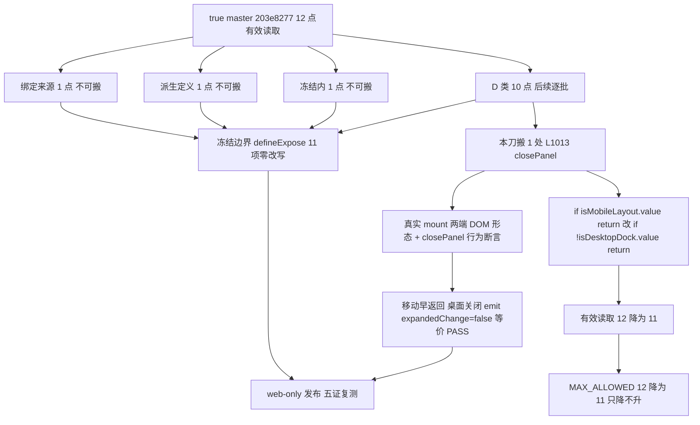

# `isMobileLayout` 读取域逐处搬 · 第三批（D 类第一批）设计规格（路线 ③ 第 5 刀）

状态：方向已批准（2026-11-10 用户选定「D类 12→11（推荐）」）
前置：`docs/ops/2026-11-09-is-mobile-layout-scope-runbook.md` §6 四条准入；第二批规格/计划/runbook/证据（PR #806/#807，上限 15→12）；母规格 §10 / §15.9；Phase 3 结项规格 §4
实施计划：`docs/superpowers/plans/2026-11-10-is-mobile-layout-migration-batch3.md`
真值基线：`ecf4ee0dd1aa36cec6db79bbad6a630de1ce622f`（推送前重新核对 + `MASTER_MOVED_SAFE`；2026-11-10 复核：相对 #807 的 `203e8277` 仅因 PR #802 纯文档合入前移，SFC 与门禁脚本 blob 不变）
分支约定：feature 分支 + PR + squash；推送全走 `gh api` Git Data API

## 0. 配图索引

本文档只有结构图，一律 Mermaid 内嵌，无像素附件。

| 编号 | 形式 | 内容 | 位置 | 用途 |
| --- | --- | --- | --- | --- |
| 图 1 | 内嵌 Mermaid `flowchart TD` | true master 上 12 点有效读取的三类分派（绑定 1 / 派生 1 / 冻结内 1 / D 类 10）、本刀搬 D 类 1 处（L1013 closePanel）后上限 12→11、行为级等价性出口与冻结边界 | §5 | 作为「为什么本批只降 1 点、为什么上限是 11 而不是 10、为什么 closePanel 改动是零行为变更」的验收基准 |

## 1. 目标（3 条以内，均可验收）

1. **按 true master 重取证并逐条分类 12 点**：并行窗口上轮已把 master 推到 `203e8277`（#806/#807）。必须先重新精算剥离注释后的有效读取点，确认仍是 12/12、`MAX_ALLOWED = 12`、方向判据在位，再逐行列出分布（绑定来源 1 / 派生定义 1 / 冻结内 1 / D 类 10）。
2. **D 类第一批搬 1 处并收紧棘轮到 11**：把 `closePanel` 中 `if (isMobileLayout.value) return` 改为 `if (!isDesktopDock.value) return`（复用第一批已建立的单一派生真源，**不新增 computed、不新增读取点**），有效读取点 12 → 11，`MAX_ALLOWED` 同步从 12 降到 11（V3 方向判据双处同步）。
3. **行为级等价性证明（零行为变更）**：新增真实 mount 契约测试，在 PC（`matchMedia.matches=false`）与移动（`matches=true`）两端断言整体 DOM 形态与搬迁前完全一致；并断言 `closePanel` 在移动端早返回、桌面端关闭（emit `expandedChange=false`）的行为不变；变异验证能精确 RED。

## 2. 范围（含明确不做）

**做**：

- 改 `apps/web/src/components/agent/AgentSideRail.vue`：脚本函数 `closePanel` 内 `if (isMobileLayout.value) return` → `if (!isDesktopDock.value) return`。
- 改 `scripts/verify-is-mobile-layout-scope.py`：`MAX_ALLOWED` 12 → 11，V3 方向判据里的硬编码同步。
- 新增 `apps/web/src/components/agent/AgentSideRail.closePanelDock.test.ts`（行为级 mount 契约 + 源码契约 + 冻结边界）。
- 新增 13 章规格、实施计划、runbook、证据；合并后 Issue #755 只追加回填。
- 变异测试 ≥ 6 组；`vue-tsc -b`；CI 三必需；生产发布后的 bundle 级复测。

**明确不做**：

- **不搬**其余 11 点（绑定来源 1、派生定义 1、冻结内 1、D 类剩余 9：L469/L737/L839/L859/L1005/L1217/L1228/L1236/L1259），留后续批次逐处降上限。
- **不新增** `isMobileDock` 或任何第二个 computed；不把读取藏进 composable 冒充架构收敛。
- 不改 `presentation/**` 与 `packages/shared/**`（门禁 V2 零容忍区）；不改 `useAgentMobileLayout()` 定义点位置（门禁 V4 唯一）。
- 不碰 `sendMessage` / `handleEvent` / `canvas_command` / `defineExpose` 11 项冻结边界；不按功能簇拆；不改任何网络调用、CSS、props、emit 的**语义**（仅 `closePanel` 内部取反等价改写）、Teleport 结构。
- 不改母规格、`ci.yml` 挂载行、`package.json` / `deploy.yml` / `pc-visual-baseline.json`；不新建 required check。
- 不宣称 12 点全部搬迁、不宣称布局分支移出 Shell、不宣称像素或真机视觉复测。

## 3. 与既有规格的关系

- **承接**母规格 §10「仅 Shell 读布局断点」与 §15.4 第 3 项：`AgentSideRail.vue` 本身就是 Shell，读布局断点**合法**；本刀是 Shell 内把一处脚本逻辑读取收口到第一批已建立的单一派生真源，`isDesktopDock` 仍是局部 computed，**不宣称布局分支被移出 Shell**。
- **严格按** #793 runbook §6 四条准入：先分类、每批降上限、行为级契约 + 变异、冻结边界不动。
- ⭐ **方案差异显式登记（规格-实现漂移回填）**：第二批（#806/#807）规格 §1 预告「后续 D 类 10 处脚本逻辑读取逐处降上限（12→11→…→2）」。本刀是该路线的**第一刀**：只取 1 处最干净、完全自包含、非冻结、非 composable 传参、非 watch/computed 的读取（L1013 `closePanel`），上限 12 → **11**（而非一步到 10），保持「每批最小增量、独立 PR」。第二批规格 §12 的「第三批：脚本逻辑 10 处逐处搬」历史时点结论不追溯改写，本节为其后继状态。
- ⭐ **前序风险锚已消解（只追加状态回填）**：第二批证据 §8 已登记并行 #800 风险锚消解（重建 TRUE MASTER + rebase #799 + 两 Teleport 复用 `isDesktopDock` + 冻结 11 项恢复）。本刀不改写该结论。
- **正交于**路线 ② 的删除域裁决（`NO_MERGE` / `DELETE_ACTION_CLOSED_NO_TARGET`）：本刀零文件相交。
- **不复活**母规格 §6.3「删 29 处 + 降级 PCDockShell」：Phase 3 结项 §4 已判定路线换轨。

## 4. 规范与判据（可复用）

- **判据 A（真值源）**：`AgentSideRail.vue` 必须从 `gh api` true master 取回后编辑；本地主仓工作树长期脏且脱节（local HEAD `27b06658`），不可信。本刀实测取回字节与 master 逐字节相等，但仍须逐文件核裸 blob sha。
- **判据 B（严格等价）**：由 `isDesktopDock = computed(() => !isMobileLayout.value)` 可得 `!isDesktopDock === isMobileLayout.value`；`closePanel` 内 `if (isMobileLayout.value) return` 与 `if (!isDesktopDock.value) return` 在任一 `matchMedia` 取值下等价（派生 computed 无副作用、无异步、无缓存失效差异）。禁止夹带第二条件，禁止改成不带 `!` 的 `isDesktopDock`（那会反转语义）。
- **判据 C（棘轮方向）**：`MAX_ALLOWED` 只降不升；V3 判据内的 `^MAX_ALLOWED = 11$` 必须与常量同步，否则「改了上限但方向判据没改」会假红或恒绿（第二批 M3 变异实证）。
- **判据 D（行为级而非仅源码级）**：测试必须真实 `mount(AgentSideRail)`，在两端 `matchMedia.matches` 下断言 DOM；PC 端先做有效性断言防空集假绿；`closePanel` 行为（移动早返回 / 桌面 emit `expandedChange=false`）在改前改后都必须一致。
- **判据 E（冻结边界）**：搬迁前后 `defineExpose` 11 项、`getIsMobileLayout` 契约、`sendMessage` / `handleEvent` / `canvas_command` 逐项零改写；由测试断言与推前逐路径 diff 双重守护。
- **判据 F（注释剥离与计数）**：计数前先 `strip_comments`；新写的 Vue 注释里不得出现 `isMobileLayout` 字面量，否则门禁计数漂移。`closePanel` 上方既有注释写的是「移动端裸条常驻…」中文，**不含 `isMobileLayout` 字面量**，可保留不改。
- **判据 G（生产发布）**：`deploy.yml` 的 `push.paths` 含 `apps/web/**` ⇒ 本刀必然触发 web-only 生产发布，必须配 bundle 级下钻复测 + `/api/health`；⭐ `isDesktopDock` 仍是 setup 局部 const，被 esbuild 压缩成短名，**生产 chunk 里字面量为 0 不代表未部署**，须用「chunk hash 变化 + setup 派生结构 + 渲染条件 + DOM 锚点 + health」五证。

## 5. 架构与契约（配结构图）

见 图 1：true master 上 12 点分三类不可搬 + 一类 D 类可搬；本刀只搬 D 类 1 处（L1013），搬完后 Shell 脚本区少一处直读、多一处对派生真源的取反，上限随之从 12 降到 11；剩余 9 处 D 类留后续批（每刀独立降上限，目标地板 2 = 绑定 1 + 派生 1）。

**图 1 · 12 点分类、第三批（D 类第一批）收敛到 11 与等价性出口**

*图 1 · 这张图说明本刀只搬 D 类 1 处、为何上限是 11 而不是 10（保留最小增量、其余 9 处留后续批），以及行为级测试如何覆盖 PC / 移动两端与 closePanel 语义；验收时用变异证明「少了取反」「少替换一处」「上限被抬高」「冻结边界被改」都会精确 RED。*

**契约边界**：`isDesktopDock` 仍是 `AgentSideRail.vue` 的局部 computed，不出组件、不进 props、不进 expose；`useAgentMobileLayout()` 唯一定义点不动。

## 6. 主场景规格（逐项可验收）

- **S1 重取证**：从 `gh api` true master 取回 SFC 与门禁脚本，裸 blob sha 校验通过；剥离注释后有效读取点恰 **12**，分布逐行可核对（绑定 1 / 派生 1 / 冻结内 1 / D 类 10）。
- **S2 搬迁完整性**：L1013 `closePanel` 的 `if (isMobileLayout.value) return` 全字替换为 `if (!isDesktopDock.value) return`；SFC 脚本区该处不再出现 `isMobileLayout`；`isDesktopDock` 总消费 13 → **14**。
- **S3 棘轮下降**：`MAX_ALLOWED = 11` 且 V3 方向判据 `^MAX_ALLOWED = 11$` 同步；门禁 `VERDICT ALL_PASS`，`--json` 显示 Shell 计数恰为 11。
- **S4 PC 端形态（行为级）**：`.agent-resize-handle` / `.agent-subtitle` / `[title="收起助手"]` 各 1；`.agent-panel-mobile-dock` 0；调用 `openThreadHistory()` 后 `.thread-history-layer` 0（继承并复用第二批形态锚点）。
- **S5 移动端形态（行为级）**：三个桌面锚点各 0；`.agent-panel-mobile-dock` 1；调用 `openThreadHistory()` 后 `.thread-history-layer` 1。
- **S5b closePanel 行为（行为级）**：移动端调用 `closePanel()` 不得 emit `expandedChange=false`（早返回）；桌面端调用必须 emit `expandedChange=false`（关闭）。改前改后一致。
- **S6 冻结边界**：`defineExpose` 11 项、`getIsMobileLayout`、三个冻结命令在搬迁前后逐项相同。
- **S7 生产复测**：web-only 发布 success；`/api/health` `{"ok":true}`、web 200；bundle 五证确认替换已 live 且未回退并行改动。

## 7. 数据与状态变更

- 不新增 store 字段、不改接口、不动 DTO、不改路由、不改 CSS 变量名。
- **不新增**任何 computed / ref；只是把 `closePanel` 一个 `if` 条件换成对既有 `isDesktopDock` 的取反。
- `MAX_ALLOWED` 从 12 变为 11，是门禁的方向性收紧，不是放宽。
- 生产发布一次（web-only），API 构建按既有 workflow 跳过。

## 8. 纯函数与算法

- 等价关系：`isDesktopDock = computed(() => !isMobileLayout.value)` ⇒ `!isDesktopDock === isMobileLayout.value`，无副作用、无异步、无缓存失效差异。
- `strip_comments(src)` / `count_hits(text)` / `within_ratchet(count, limit)`：沿用既有门禁脚本，不做算法改动；只改常量与其方向判据字面量。
- 行为级测试用 `vi.stubGlobal('matchMedia', ...)` 分别返回 `matches:false` / `true`，其余 stub 沿用第二批 `mobileDockDerived.test.ts` 的 `mountRail()` 范式（pinia + memory router + sessions/provider/mermaid mock + `ResizeObserver` stub + `fetch` stub）。
- `closePanel()` 是 `defineExpose` 暴露的既有方法，测试直接调用 `w.vm.closePanel()` 观测 `w.emitted('expandedChange')`；其内部 `open.value=false` 的副作用通过 emit 间接观测，不依赖未暴露的局部 ref。

## 9. 文件级改动清单（按内容锚点定位，不用行号）

| 文件 | 动作 | 责任 |
| --- | --- | --- |
| `apps/web/src/components/agent/AgentSideRail.vue` | 修改 | `closePanel` 内 `if (isMobileLayout.value) return` → `if (!isDesktopDock.value) return` |
| `scripts/verify-is-mobile-layout-scope.py` | 修改 | `MAX_ALLOWED` 12 → 11 + V3 硬编码同步 |
| `apps/web/src/components/agent/AgentSideRail.closePanelDock.test.ts` | 新增 | 行为级两端形态 + closePanel 行为 + 源码契约 + 冻结边界断言 |
| `docs/superpowers/specs/2026-11-10-is-mobile-layout-migration-batch3-design.md` | 新增 | 本文 |
| `docs/superpowers/plans/2026-11-10-is-mobile-layout-migration-batch3.md` | 新增 | 实施计划 |
| `docs/ops/2026-11-10-is-mobile-layout-migration-batch3-runbook.md` | 新增 | 准入 / 变异 / 生产复测步骤 |
| `docs/ops/2026-11-10-is-mobile-layout-migration-batch3-evidence.md` | 新增 | 重取证、RED→PASS、变异、发布复测 |

**零改动**：母规格、`ci.yml`、`package.json`、`deploy.yml`、`presentation/**`、`packages/shared/**`、`pc-visual-baseline.json`、路线 ② 全部交付文件、第二批规格/计划/runbook/测试/门禁脚本之外的任何产品代码。

## 10. 测试策略与验收标准

- **T1 行为级 RED→PASS**：先写 `AgentSideRail.closePanelDock.test.ts` ⇒ 改产品代码前精确 RED（5 用例中仅 ③ 源码契约失败，①②④⑤ 先绿，证明基线正确）；改后 5/5 PASS。
- **T2 变异 ≥ 6 组**（临时改后恢复，恢复后核 3 个目标文件裸 blob sha 全等）：把 `!isDesktopDock` 写成 `isDesktopDock` ⇒ 行为级 ③ + ⑤ 可能 RED；少替换一处（还原 L1013 为 `isMobileLayout`）⇒ 契约 ③ RED + 门禁 V3 RED；只把 `MAX_ALLOWED` 抬回 12 ⇒ 门禁 V3 RED；删 1 个 `defineExpose` 项 ⇒ 冻结边界 ④ RED；Vue 注释写 `isMobileLayout` ⇒ 对照绿（门禁剥离注释）；新增一处读取 ⇒ 门禁 V3 RED。
- **T3 门禁**：`verify-is-mobile-layout-scope.py` `VERDICT ALL_PASS` 且计数 11；三条棘轮全绿；`verify-agent-rail-gates` 11/11；`verify-spec-figures` 本规格 0 error；`claims` / `links` / `web-upload` 回归。
- **T4 编译与测试**：`vue-tsc -b` exit 0；相关回归集（第二批 + 本批 + 既有文件）全 PASS；`pnpm -r build` 编译 `*.test.ts` ⇒ 断言禁 `as never`，推前 `npx tsc --noEmit`。
- **T5 交付**：推前逐路径 `MASTER_MOVED_SAFE` 核对；CI 三必需全 success；squash 后按真实 parent 核对合并树差异恰为改动路径、`MASTER_EQ_PRHEAD True`、`ALL_PARALLEL_KEPT True`；生产发布 success + bundle 五证 + health 200；Issue #755 只追加回填。
- **完成定义**：T1–T5 全绿 + 诚实边界登记。**不宣称** 12 点全部搬迁、**不宣称**布局分支移出 Shell、**不宣称**新增 required check、**不宣称**像素或真机视觉复测。

## 11. 风险

- **R1 并行工作树冲突**：`AgentSideRail.vue` 是并行/本窗口高频活跃区 ⇒ 从 true master 取回后编辑；推前核裸 blob sha，若前移则按 `MASTER_MOVED_SAFE` 重新取回重做，不追溯改写结论。
- **R2 等价性被写坏**：`closePanel` 替换若漏了 `!` 会直接反转移动/桌面语义 ⇒ 行为级 ⑤（emit 断言）与 ③ 源码契约 + 「把取反删掉」变异锁死。
- **R3 上限方向被改坏**：V3 里 `^MAX_ALLOWED = 12$` 硬编码忘同步 ⇒ 用 S3 + M3 变异锁死。
- **R4 Teleport / v-show 误判**：面板与抽屉 Teleport 到 body，wrapper 查询取不到 ⇒ 统一从 `document.body` 查询，并加 PC 端有效性断言防「两端都不存在」假绿。
- **R5 注释计数漂移**：新 Vue 注释写 `isMobileLayout` 字面量 ⇒ 门禁计数变 13 假红 ⇒ 判据 F 显式禁止，并用 M5 对照绿验证 `strip_comments`；既有 L1012 中文注释不含该字面量，保留不改。
- **R6 生产发布遗漏复测**：`apps/web/**` 触发 deploy ⇒ T5 强制 bundle 五证 + health，且核对零回退并行改动；⭐ 不得用 `isDesktopDock` 字面量命中与否判活（局部 const 被 mangle）。
- **R7 跨窗口发布覆盖**：并行窗口曾用生产做真机复测（#800–#804）；本刀方向由用户 2026-11-10 选定，仍须核最近 deploy run 与 health，避免叠加发布窗。
- **R8 伪收敛**：把读取点「藏」进 composable 而不改变语义 ⇒ 本刀明确登记为 Shell 内 DRY 语义化，不宣称架构收敛完成；`closePanel` 改动在 Shell 内、未触及 `useAgentDock` 传参（L859 留后续批）。

## 12. 后续路线

1. **D 类剩余 9 处**：L469（冻结内，需谨慎评估是否值得改或永久保留在冻结边界语义内）、L737/L1259（computed）、L839（watch）、L859（传参 `useAgentDock`）、L1005/L1217/L1228/L1236（函数）。每处独立降上限，须逐点补行为级契约；上限从 11 起逐批下降，地板 2（绑定 1 + 派生 1）。
2. **路线 ②** 已裁决 `NO_MERGE`、删除动作终止；两刀零相交。母规格 Phase 4「删 PC 冗余渲染」功能仍 ⏳ 未闭环，本刀不宣称改变该状态。
3. **独立窗口**：PR #802（SP-E 决策门规格阶段 0，纯文档、已于 2026-11-10 合入 master `ecf4ee0d`、零文件相交、正交）、PR #625（老规格，仍 open）、A-6 真机复测；按用户既定口径不进主序列。
4. 冻结边界不变；不按功能簇拆。

## 13. 配图规范自检

- 图 1 为 Mermaid 内嵌 `flowchart TD`，非空且首行受支持；§0 索引列出图 1；图注为 `*图 1 · …*`；正文 §5 引用「图 1」两次以上。
- 无 PNG/JPG/SVG 附件，不触发 R6/R8。
- 本刀不改 `docs/superpowers/SPEC-CONVENTIONS.md`；`pnpm verify-spec-figures` 结果登记在证据文档。
