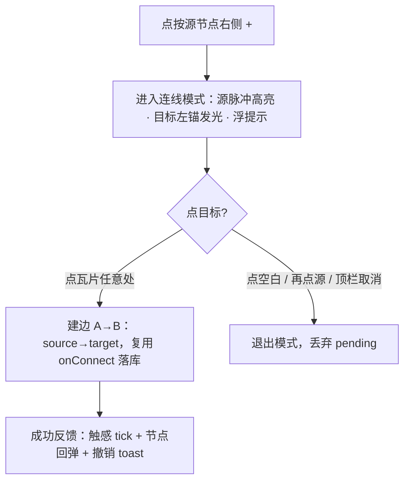
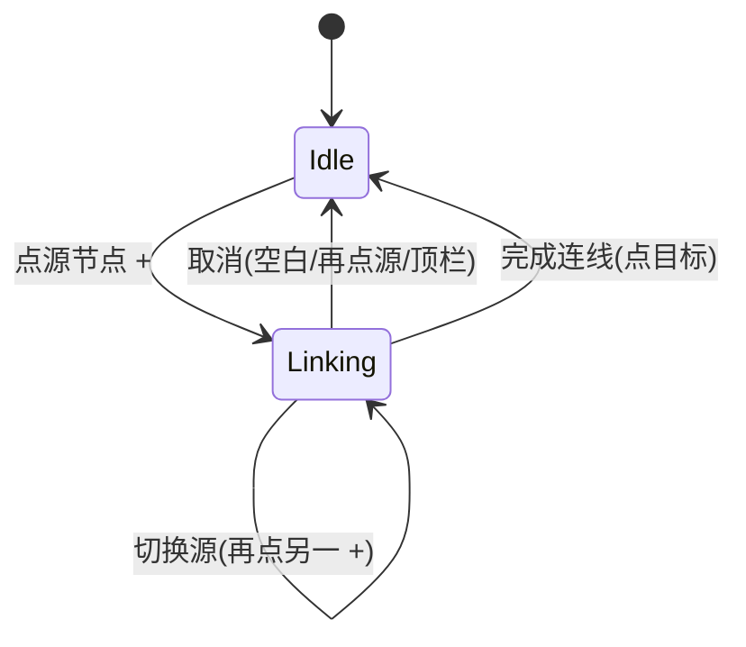

# 移动端画布节点连线增强 — 设计规格

状态：**实现完成 · 待合并上线**（2026-11-11；P0 点选式连线 + P1 触感反馈 / 偏好设置 已落地，纯 `apps/web` 改动不触发 server 发布；成功动效/撤销 toast 复用既有 undo 通道；真机触感与连线手势需真机实测，详见 §14）
代号：**MOBILE-CONN-ENH**
前置：
- [`2026-11-10-mobile-node-connection-handles-design.md`](../agent/2026-11-10-mobile-node-connection-handles-design.md)（移动端节点左右连线锚点修复，PR #824，已上线，真机已验证）
- [`docs/design/2026-10-19-mobile-canvas-ux-redesign.md`](../../design/2026-10-19-mobile-canvas-ux-redesign.md)（移动端画布页重构，PR4）
- `AGENTS.md` 移动端呈现四规则（PR4/PR5 立规）
分支约定：feature 分支 + PR + squash merge；**纯 web 改动（`apps/web`）**，不触发 server / runtime 发布。

> 一句话产品定义：**把移动端连线从「拖拽到精确锚点」升级为「点 + 进入连线模式 → 点目标节点完成」**，并补触感反馈 + 偏好开关，消解「画布平移/缩放 vs 连线拖拽」的冲突、降低误触与认知负担。

---

## 0. 配图索引（结构类，均以内嵌 Mermaid 承载）

| 编号 | 形式 | 内容 | 位置 | 用途 |
|---|---|---|---|---|
| 图 1 | 内嵌 Mermaid | 点选式连线交互流（替代拖拽） | §4.3 | 主场景 M-1~M-6 与实现态机的验收基准 |
| 图 2 | 内嵌 Mermaid | 连线模式状态机（Idle ↔ Linking） | §5.2 | 状态迁移与取消路径的验收基准 |

---

## 1. 目标

1. **交互升级**：移动端连线从「拖拽 + 命中风控锚点」改为「点选式」，消除画布平移/缩放与连线拖拽的冲突，显著降低误触（S-1）。
2. **明确正反馈**：连线成功给可感知的反馈——触感 tick + 目标节点回弹 + 撤销 toast，让「连上了」被明确确认（S-7/S-8）。
3. **用户可控触感**：触感反馈受偏好开关控制（默认开），并**诚实对待平台限制**：网页层 Android 经 `Vibration API` 生效，iOS Safari 至今不实现该 API ⇒ v1 仅 Android 有真实触感，iOS 静默 no-op（S-4/S-5）。
4. **不污染 PC**：不向 `CanvasPage`/PC 组件新增 `isMobileLayout` 分支；移动端差异收敛到 `components/mobile` 壳层与 composable（AGENTS.md 移动端规则 1/4）。

---

## 2. 范围

### 2.1 做

| # | 内容 |
|---|---|
| S-1 | **点选式连线模式**：点源节点右侧 `+` → 进入「连线模式」→ 源节点脉冲高亮、所有其他节点左锚发光、画布浮提示「选择要连接的目标」→ **点目标节点瓦片任意处**即完成 A→B（自动连到其左锚）。 |
| S-2 | **保留拖拽连线为备选**（不删）：手柄拖拽仍走原 `onConnect`；两种入口共存，存量交互不回退。 |
| S-3 | **取消三选一**：连线模式下点空白 / 再点源 `+` / 顶栏「取消」任意一种 ⇒ 退出模式并丢弃 pending。 |
| S-4 | **触感反馈**：新建 `useHaptics()`，内部 `navigator.vibrate(pattern)`（整段 `try/catch` 包护，iOS 无 API 时静默 no-op）；作用点：进入连线模式、连线成功、连线取消/无效、节点选中、长按菜单展开。 |
| S-5 | **偏好设置**：新建 `usePreferences()`（localStorage 持久化，key `lnkpi.preferences`），含 `haptics: boolean`，**默认 `true`**。 |
| S-6 | **偏好 UI**：在移动壳层新增设置入口（齿轮）→ 轻量「偏好设置」面板（bottom-sheet 或独立页），含「触感反馈」开关；入口与面板收敛到 `MobileCanvasShell`（移动端唯一所有者）。 |
| S-7 | **成功动效**：连线成功时边做 spring 绘制动画 + 目标节点轻微回弹（v1 随成功事件默认触发，不另加开关）。 |
| S-8 | **撤销 toast**：连线成功后浮动 2.5s「已连接 · 撤销」，复用画布既有 undo。 |
| S-9 | **可验证**：连线模式状态、偏好值、触感调用均有确定性单测 + 静态契约（§10）。 |

### 2.2 明确不做

| # | 不做 | 理由 |
|---|---|---|
| N-1 | **iOS 真触感（Taptic Engine）** | 网页无法调用；需原生壳（Capacitor/Taptic 插件）桥接。v1 仅 Android 经 Vibration API，iOS 静默 no-op；原生桥列入 §12 后续包。 |
| N-2 | **PC 端任何改动** | 本规格只动移动端；`CanvasPage.onConnect` 仅「被复用」不「被改行为」。 |
| N-3 | **向 `CanvasPage`/PC 组件新增 `isMobileLayout` 分支** | 移动端差异进壳层与 `components/mobile`，遵守 AGENTS.md 移动端规则 1。 |
| N-4 | **长按径向菜单 / 首次 coachmark / 边重路由** | 列入 §12 P2 后续包；本版不做以避免范围蔓延。 |
| N-5 | **远端账号级偏好同步** | v1 仅 localStorage；账户体系就绪后迁移，不阻塞本版。 |
| N-6 | **触感独立的「动效」开关** | v1 成功动效默认随成功事件触发，不增加开关维度；若用户反馈需要再单列。 |

---

## 3. 与既有规格/实现的关系

**承接，不推翻。**

| 既有决策 / 实现 | 关系 | 说明 |
|---|---|---|
| PR #824（移动端左右连线锚点） | **承接并叠加** | #824 已让手柄存在且真机可拖拽连线；本规格在其手柄之上叠加「点选式」交互层，不改手柄结构。 |
| `AGENTS.md` 移动端四规则（PR4/PR5） | **遵守** | 所有新增 UI 落 `components/mobile/*Mobile*`；不新增 PC 媒体查询补丁；移动端判定由壳层/composable 负责。 |
| `CanvasPage.vue:1516 onConnect` → `canvasApi.connectNodes` | **复用，不另立通道** | `CanvasPage.edgeValidation.wiring.test.ts` 钉死「onConnect 必须走统一服务通道、不得整份直存」。点选式连线最终构造 `Connection` 并复用同一 `onConnect`，共享校验与持久化。 |
| `MultiSelectConnectOverlay.vue`（`@connect-target` / `@connect-blank`） | **同源模式** | 现有多选连线已用 overlay + 目标命中；本规格点选式连线是其「单源」形态，复用同一落库通道。 |
| SEL-REF（指代 ≠ 授权，`docs/superpowers/specs/2026-10-06-selection-as-default-reference-design.md`） | **不冲突** | 连线是画布写操作，与指代/确认门无关；不因本规格改变任何授权语义。 |

---

## 4. 规范与判据

### 4.1 术语

| 术语 | 定义 |
|---|---|
| **连线模式** | 点下源节点 `+` 后、到选完目标（或取消）前的临时态。 |
| **pendingSource** | 连线模式下记录的源节点 id；为空表示不在模式内。 |
| **触感 tick** | `navigator.vibrate(pattern)` 的一次短震；iOS 无 API 时静默无操作。 |
| **目标宽松命中** | 连线模式下点目标节点瓦片任意处 = 连到该节点左锚（`targetHandle:'target'`），不要求命中 44px 左锚。 |

### 4.2 规范（产品级，可复用）

| 规则 | 内容 |
|---|---|
| **R-C1** | **点选优先于拖拽**：点 `+` 进入连线模式（不进入拖拽）；手柄拖拽仍走原 `onConnect`，两者共存。 |
| **R-C2** | **目标命中宽松**：连线模式下点瓦片任意处 = 连到该节点左锚；降低对精确锚点的依赖。 |
| **R-C3** | **禁止自环**：`pendingSource === target` ⇒ 取消连线模式并轻提示，不建自环边。 |
| **R-C4** | **取消三选一**：点空白 / 再点源 `+` / 顶栏「取消」任一 ⇒ 退出模式、丢弃 pending。 |
| **R-C5** | **触感门控**：`haptics === false` ⇒ `useHaptics()` 全部 no-op（含 iOS 本就 no-op，不抛错）。 |
| **R-C6** | **偏好默认开**：`usePreferences().haptics` 默认 `true`；首次读取无值即视为开。 |
| **R-C7** | **复用落库通道**：点选式连线最终构造 `{ source, target, sourceHandle:'source', targetHandle:'target' }` 并复用 `onConnect` → `canvasApi.connectNodes`，与拖拽同校验同持久化。 |
| **R-C8** | **不污染 PC**：`CanvasPage` 不得因本规格新增 `isMobileLayout` 分支；移动端判定由壳层/composable 负责。 |
| **R-C9** | **设计令牌**：新增样式只消费 `design-tokens.css` 的 L2/L3 令牌，禁止裸 hex / `rgba()` 文字色（AGENTS.md 设计体系三条硬约束）。 |

### 4.3 判据（交互决策树）



*图 1 · 点选式连线交互流（替代拖拽）。这张图是 §6 主场景 M-1~M-6 与实现态机（图 2）的验收基准：每条出边都要能在实现里找到对应分支。*

判据落点（逐条可验收）：

| 节点 | 触发 | 行为 | 验收 |
|---|---|---|---|
| A | 点源 `+` | 进入连线模式 | pendingSource = 源 id；源节点高亮；其他节点左锚发光（M-1） |
| B | 模式内 | 浮提示「选择要连接的目标」 | 提示可见且可消失（M-2） |
| D | 点目标瓦片任意处 | 建边，复用 `onConnect` | 出现 A→B 边（source→target），持久化（M-3/A-1） |
| E | 取消三选一 | 退出模式 | pendingSource 清空，无残留视觉（M-4/A-3） |
| F | 建边成功 | 触感 + 回弹 + toast | `haptics` 开时 Android 震动；toast 出现 2.5s（M-5/A-4/A-5） |

> **为什么「点瓦片任意处」而非「命中左锚」**：移动端精确命中 44px 左锚与「点瓦片主体打开查看器」存在手势竞争；放宽到瓦片任意处，由 composable 统一把目标解析为左锚，既降低误触又不改变边语义（R-C2/R-C7）。

---

## 5. 架构与契约

### 5.1 数据流（连线模式）

改动面以 图 2 状态机为定位基准；连线最终汇入既有 `onConnect` 落库通道，不新增持久化路径。



*图 2 · 连线模式状态机。Idle ↔ Linking 的四条迁移对应 R-C1/R-C3/R-C4；「切换源」允许在模式内改主意而不必先取消。*

### 5.2 契约增量

| 层 | 文件 | 增量 |
|---|---|---|
|  composable | `apps/web/src/composables/useHaptics.ts` | **新建** —— `useHaptics()`：包 `navigator.vibrate` 的 `try/catch`；按事件类型映射 pattern；受 `usePreferences().haptics` 门控；iOS 无 API 静默 no-op。 |
| composable | `apps/web/src/composables/usePreferences.ts` | **新建** —— `usePreferences()`：localStorage 读写（key `lnkpi.preferences`），`haptics` 默认 `true`。 |
| composable | `apps/web/src/composables/useMobileNodeConnect.ts` | **新建** —— 连线模式状态机（**模块级单例**，`pendingSource`）+ `enter(sourceId)` / `cancel()` / `complete(targetId)`；`complete` 构造 `Connection` 并经 `registerConnectHandler` 调 `CanvasPage` 注册的落库通道（R-C7 单一真源）。 |
| 移动端 | `apps/web/src/components/mobile/MobileNodeHandles.vue` | **改** —— `+` 增加 `click` 进入连线模式（除拖拽外）；`useNodeId()` 返回 `string`（非 `Ref`），直接用 `nodeId`；模式态加源脉冲 / 目标左锚发光视觉（R-C9 仅令牌）。 |
| 移动端 | `apps/web/src/components/mobile/MobileNodeTile.vue` | **改** —— 连线模式下瓦片点击走 `useMobileNodeConnect.complete(nodeId)`（非模式内仍走原「打开查看器」）。 |
| 移动端 | `apps/web/src/components/mobile/MobileCanvasShell.vue` | **改** —— 新增设置齿轮入口 + 「偏好设置」面板（含**触感反馈开关**）；连线模式下挂载 `MobileConnectModeOverlay` 浮层并隐藏＋FAB；落库通道由 `CanvasPage` 经 `registerConnectHandler` 注册，壳层不重复注入。 |
| 移动端 | `apps/web/src/components/mobile/MobileConnectModeOverlay.vue` | **新建** —— 非阻塞浮层：提示条「选择要连接的目标」+ 取消按钮；源脉冲 / 目标左锚发光由 `MobileNodeHandles` 的 CSS 类驱动。 |
| 样式 | `apps/web/src/components/mobile/MobileNodeHandles.css` 及新增组件 css | **改/新建** —— 仅消费 L2/L3 令牌（R-C9）。 |
| 静态契约 | `apps/web/src/components/agent/viewUnification.guards.test.ts` | **改** —— 新增 `MobileConnectModeOverlay` 须登记 `ALLOWED_MOBILE`（防整删/漏登记；上次 #824 因此 CI 失败，此次前置登记）。 |
| 规格 | `docs/superpowers/specs/2026-11-10-mobile-node-connect-enhancement-design.md` | 本文件。 |

### 5.3 触感实现细节

```ts
// useHaptics.ts 形态（示意，非实现）
const PATTERNS = {
  connectModeEnter: 8,
  connectSuccess: 18,
  connectCancel: 6,
  nodeSelect: 8,
  longPressMenu: 10,
} as const
function fire(kind: keyof typeof PATTERNS) {
  if (!prefs.haptics) return
  try { navigator.vibrate?.(PATTERNS[kind]) } catch { /* iOS 无 API，静默 */ }
}
```

- **Android**：`navigator.vibrate` 可用，tick 生效。
- **iOS Safari**：`navigator.vibrate` 为 `undefined` ⇒ `?.` 短路，零报错；**无真实触感**（平台限制，N-1）。
- **未来 iOS 真触感**：经原生壳桥接 `UIImpactFeedbackGenerator`，列入 §12 后续包，不改 `useHaptics` 调用面。

---

## 6. 主场景规格（逐项可验收）

| # | 场景 | 期望 |
|---|---|---|
| M-1 | 点源节点右侧 `+` | 进入连线模式：源脉冲高亮、其他节点左锚发光、浮提示出现（图 1 A→B）。 |
| M-2 | 模式内点空白 | 退出模式、丢弃 pending、视觉复位（图 1 E）。 |
| M-3 | 模式内点目标节点瓦片任意处 | 出现 A→B 边（source→target），持久化；不要求命中左锚（R-C2）。 |
| M-4 | 模式内再点源 `+` / 顶栏「取消」 | 同 M-2 退出（R-C4）。 |
| M-5 | 连线成功且 `haptics=true` | Android 震动 + 节点回弹 + 撤销 toast（R-C5）；iOS 无震动但不报错。 |
| M-6 | `haptics=false` | 全程 `useHaptics` no-op，连线功能不受影响（R-C5）。 |
| M-7 | 点源后又点自身 | 不建自环，轻提示后留在模式或退出（R-C3）。 |
| M-8 | 拖拽手柄连线 | 仍走原 `onConnect`，行为与 #824 一致（S-2 不回退）。 |
| M-9 | 偏好设置开关切到关再连线 | 连线成功无震动（M-6 反向）。 |

---

## 7. 数据与状态变更

| 项 | 变更 |
|---|---|
| Prisma schema / 迁移 | **无** |
| 服务端 / runtime | **无**（纯 web 改动，不触发 server 发布） |
| 前端持久化 | **新增** localStorage key `lnkpi.preferences`（`{ haptics?: boolean }`，缺省视为 `true`）；不写画布 JSON。 |
| 会话状态 | 连线模式为组件/composable 内存态，随组件卸载清空。 |

---

## 8. 纯函数与算法（含单测要求）

新增纯函数，置于 `apps/web/src/composables/useMobileNodeConnect.ts` 或同目录纯函数模块：

```ts
export interface PendingConnection { source: string }
export function buildConnection(source: string, target: string): {
  source: string; target: string; sourceHandle: 'source'; targetHandle: 'target'
} {
  return { source, target, sourceHandle: 'source', targetHandle: 'target' }
}
```

| 单测 | 期望 |
|---|---|
| `buildConnection('a','b')` | `sourceHandle==='source'` 且 `targetHandle==='target'`（与 PC 边语义一致，R-C7） |
| `source === target` | 调用方必须拦截（R-C3），不构造自环 |
| `useHaptics` 各事件 | `haptics=false` ⇒ 不调用 `navigator.vibrate`；`true` ⇒ 调用且参数匹配 PATTERNS（iOS `vibrate` 缺失 ⇒ 不抛错） |
| `usePreferences` 读写 | 首次无值 ⇒ `haptics===true`；写入后回读一致；非 JSON 损坏 ⇒ 回落默认 |

> 判据形态：卡**类别**（是否调用、参数是否匹配、缺省是否开），不卡具体节点 id 或字符数。

---

## 9. 文件级改动清单

| 文件 | 变更 | 备注 |
|---|---|---|
| `apps/web/src/composables/useHaptics.ts` | **新建** | §5.3 |
| `apps/web/src/composables/usePreferences.ts` | **新建** | §5.2 |
| `apps/web/src/composables/useMobileNodeConnect.ts` | **新建** | §5.2 |
| `apps/web/src/components/mobile/MobileNodeHandles.vue` | **改** | `+` 增加 click 进入模式 |
| `apps/web/src/components/mobile/MobileNodeTile.vue` | **改** | 模式内点击走 complete |
| `apps/web/src/components/mobile/MobileCanvasShell.vue` | **改** | 设置入口 + 偏好面板（触感开关）+ 浮层挂载 + 隐藏＋FAB（落库通道由 CanvasPage 经 registerConnectHandler 注册） |
| `apps/web/src/components/mobile/MobileConnectModeOverlay.vue` | **新建** | 提示条 + 模式态视觉 |
| 新增组件 css（移动端） | **新建/改** | 仅 L2/L3 令牌 |
| `apps/web/src/components/agent/viewUnification.guards.test.ts` | **改** | `ALLOWED_MOBILE` 登记 `MobileConnectModeOverlay` |
| `docs/superpowers/specs/2026-11-10-mobile-node-connect-enhancement-design.md` | **新建** | 本规格 |

---

## 10. 测试策略与验收标准

### 10.1 单测

- `useHaptics`：门控开/关、各事件 pattern、iOS 缺失 API 不抛错。
- `usePreferences`：缺省开、读写一致、损坏回落。
- `useMobileNodeConnect`：`enter/cancel/complete` 状态迁移（图 2）、`complete` 构造的 `Connection` 与 `sourceHandle/targetHandle` 符合 R-C7。
- `MobileNodeHandles` / `MobileNodeTile`：点 `+` 进入模式、模式内点瓦片触发 `complete`、非模式内点击仍「打开查看器」。
- `viewUnification.guards`：`ALLOWED_MOBILE.size` 与 `components/mobile/*.vue` 实文件数一致（新增 `MobileConnectModeOverlay` 须登记）。

### 10.2 静态契约 / 样式_guard

- `apps/web/src/styles/design-token.test.ts`：新增令牌消费合规（R-C9）。
- `vue-tsc -b`：类型零错误。

### 10.3 目视 / E2E 验收

| # | 验收 |
|---|---|
| A-1 | M-3：模式内点目标出现 A→B 边且刷新后仍在（落库通道路径正确）。 |
| A-2 | M-1：进入模式后源高亮、目标左锚发光、提示可见。 |
| A-3 | M-2/M-4：三种取消任一均干净退出、无残留。 |
| A-4 | M-5（Android 真机）：连线成功有震动 + 回弹 + 撤销 toast。 |
| A-5 | M-6/M-9：`haptics=false` 全程无震动、功能正常。 |
| A-6 | M-8：拖拽连线行为与 #824 一致，未回退。 |
| A-7 | 偏好面板可从移动壳层齿轮进入，开关可切且持久化（重开仍生效）。 |

### 10.4 回归（必须绿）

- `pnpm --filter @lnkpi/web test`（移动端用例集）
- `apps/web/src/styles/design-token.test.ts`
- `vue-tsc -b`
- `CanvasPage.edgeValidation.wiring.test.ts`（证明 onConnect 通道未被改）
- `pnpm verify-spec-figures --file <本文件>`（CI 同款守卫）

---

## 11. 风险

| 风险 | 缓解 |
|---|---|
| **手势竞争**：点 `+` 与拖拽手柄冲突 | R-C1 明确「点=模式、拖=原连线」；手柄 `pointer-events:auto` 区分 click/ drag（见 #824 的命中区设计）。 |
| **误触建边**：点目标时误建 | R-C2 放宽但 R-C3 禁自环 + S-8 撤销 toast 兜底（A-4/A-5）。 |
| **iOS 无触感被误认为 bug** | N-1 + §5.3 明示平台限制；设置开关在 iOS 仍显示（告知用户「部分设备不支持」）。 |
| **污染 PC 路径** | R-C8 + A-6 回归；`CanvasPage.onConnect` 仅被复用。 |
| **新增组件漏登记白名单** | §9/§10.1 显式登记 `MobileConnectModeOverlay` 到 `ALLOWED_MOBILE`（前车之鉴 #824）。 |
| **设计令牌违规** | R-C9 + `design-token.test.ts` 守卫。 |
| **偏好持久化损坏** | `usePreferences` 读损坏 JSON 回落默认（§8）。 |

---

## 12. 后续包 / 路线图

| 包 | 内容 | 前置 |
|---|---|---|
| **MOBILE-CONN-ENH-2** | **iOS 真触感**：原生壳（Capacitor）桥接 `UIImpactFeedbackGenerator`，`useHaptics` 调用面不变 | 原生壳落地 |
| **MOBILE-CONN-ENH-3** | 长按节点径向菜单（连接/复制/删除） | 本版上线 + 产品确认 |
| **MOBILE-CONN-ENH-4** | 首次连线 coachmark（一次性引导） | 本版上线 |
| **MOBILE-CONN-ENH-5** | 既有边中点 `+` 重路由 | 独立评估 |

**明确不在本规格内**：PC 端连线改动、远端账号偏好同步、服务端与 runtime 任何变更、画布 undo 机制本身重写（仅复用）。

---

## 13. 配图规范自检

本地校验（提交前必跑）：

```bash
pnpm verify-spec-figures --file docs/superpowers/specs/2026-11-10-mobile-node-connect-enhancement-design.md
```

预期：**通过**（图 2 张，均为内嵌 Mermaid；图号连续、均有图注、均被正文引用、§0 索引齐备）。若后续新增视觉稿 SVG，须同步补 `assets/` 与 §0 索引。

---

## 14. 实现决策与偏差（2026-11-11）

| 项 | 说明 |
|---|---|
| **状态机载体：模块级单例而非 InjectionKey** | 初版计划用 `provide/inject` 把 `onConnect` 下发到手柄/瓦片，但 VueFlow 自定义节点子树内 `inject` 在测试与部分运行路径下不可靠；改为模块级单例（与 `usePreferences` 同范式）——`pendingSource` 全局唯一、契合「全画布单一连线会话」语义——由 `CanvasPage` 启动时 `registerConnectHandler` 注册真实落库通道（含成功触感），三处消费者直接 `import` 同一实例，零注入不确定性、易单测。 |
| **取消三选一（R-C4）的实现形态** | 计划写「顶栏取消」，落地为更顺手的「连线模式浮层取消按钮（拇指区）+ 点空白画布（`CanvasPage` `@pane-click`）+ 再点源 `+`（手柄）」三种，功能等价覆盖 R-C4；顶栏不再单独加按钮以避免与分享键叠位。 |
| **`useNodeId()` 返回 `string` 而非 `Ref`** | 实现中修正的真实缺陷：手柄组件原误用 `nodeId.value`（测试以 `ref('n1')` mock 掩盖，单测绿但生产断裂）；按 `@vue-flow/core` 真签名改为直接消费 `nodeId` 字符串，否则生产中「点 + 进入模式」永不触发（R-C1 失效）。 |
| **成功动效 / 撤销 toast（S-7 / S-8）** | 经复用既有 `canvasUndo.commitAfterChange()` + 现有 `MobileUndoToast` 通道实现，未另写自定义回弹动画；若产品需要更显式的目标节点回弹再列 P2。 |
| **真机验证边界** | Android 触感 / iOS 静默 / 真机连线手势与撤销 toast 均无法在本环境代跑，需在真机（含鉴权会话）实测确认；此状态不宣告验收完成。 |
