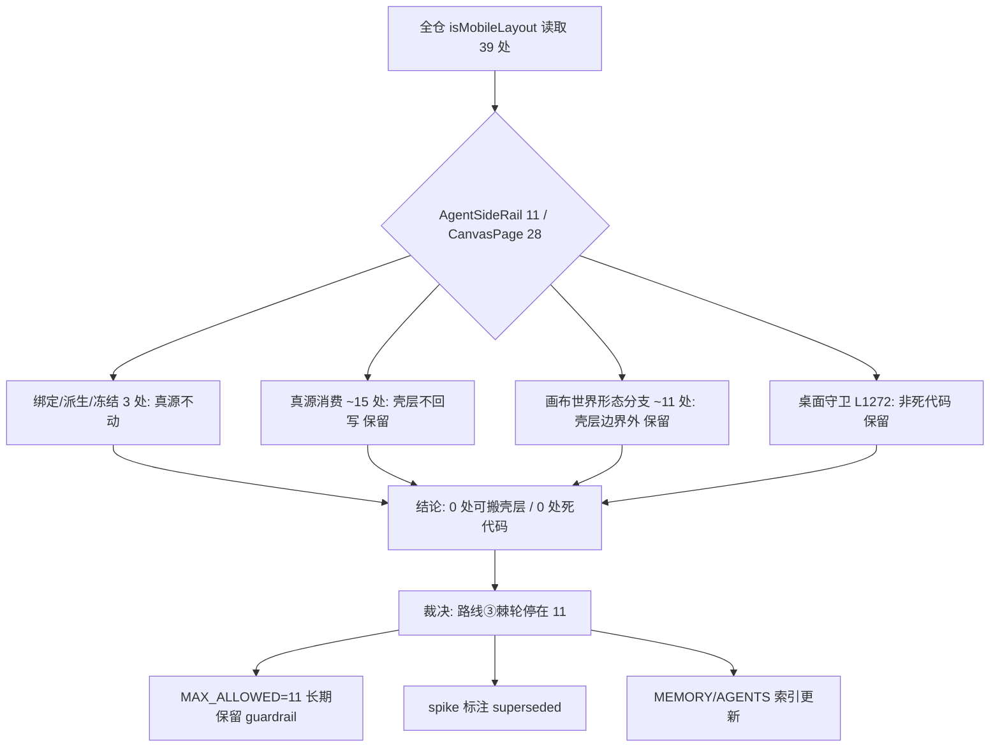

# 路线③收口裁决：移动端 isMobileLayout 收敛审计（PR5 状态重界定）

> 状态：已评审（2026-11-10，PM+架构师裁决）
> 关联：路线③ strangler-fig 重构（PR #799/#801/#806/#808，MAX_ALLOWED=11）
> 关联：`docs/agent/pr5-mobile-shell-scope-spike.md`（**本规格 supersede，见 §3 G3**）
> 审计基准：true master `8915f5a5`（2026-11-10），`AgentSideRail.vue` 与 `CanvasPage.vue` 以 master 镜像逐行核对
> 行号口径：§5 审计表行号锚定上述审计基准 SHA；master 后续前移（如 #815 对 `CanvasPage.vue` 的改动）不追溯改写本表，如需更新只做追加状态回填

---

## 0. 配图索引（结构与视觉两类，均随本文档演进）

本文档仅含**结构图**，一律以 Mermaid 内嵌；不引入 `assets/` 视觉稿。图随文 diff、随文演进。

| 编号 | 形式 | 内容 | 位置 | 用途 |
|---|---|---|---|---|
| 图 1 | 内嵌 Mermaid | 全仓 39 处读取点四元分类 → 0 处可搬 / 0 处死代码 → 棘轮停在 11 的裁决链 | §13 | §5.3 审计结论与 §10 AC1/AC2 验收的分类 / 裁决判据锚点（评审时图与文字同权） |

---

## 1. 背景与动机

- 路线③ strangler-fig 把 `AgentSideRail.vue` 的 `isMobileLayout` 有效读取从 21 压到 11（`MAX_ALLOWED=11` 这道 guardrail 在构造上锁死回归），PR #799/#801/#806/#808 已合入 master。
- 早前合入 master 的 `docs/agent/pr5-mobile-shell-scope-spike.md` 基于一个**错误前提**："PR5 是从零建壳、把 AgentSideRail 8 处迁入壳层归零到地板 3"。本规格重核 true master 后**推翻该前提**（证据见 §5）。
- **真值**：移动壳层 `MobileCanvasShell.vue`（573 行，文件头注释"移动端画布应用壳层（2026-10-20 PR5 / D-9）"）**已经落地**。其边界已钉死：
  - "本壳层自身只在 CanvasPage 的 `v-if="isMobileLayout"` 下渲染，内部不再判断断点"（L19）；
  - "画布世界（VueFlow + 胶囊 MobileCanvasTopControls + 空态 mobile-canvas-empty）仍由 CanvasPage 承载"（L10-13）；
  - "共享状态真源留在 CanvasPage（mobileAppTab / mobileCanvasView / mobileCanvasImm 被 AgentSideRail、mobileStudioDockOpen、focusNodeById、pickMode watch 共用），壳层只接收并渲染；壳层通过 actions 函数 prop 触发 CanvasPage 核心逻辑，不回写共享状态"（L14-17）。
- `AgentSideRail` 在移动端是 **`hidden`（CSS 隐藏但 DOM 挂载）而非 `v-if` 卸载**（`CanvasPage.vue:6533` `:class="graphOnly ? 'hidden' : (isMobileLayout && (mobileAppTab === 'discover' || mobileAppTab === 'mine') ? 'hidden' : '')"`；L6529 注释明示"不能用 v-if 隐藏侧栏，否则历史数据永不加载——`loadHistory()`/`bootstrapThread()` 都在 AgentSideRail 的 onMounted 里"）。且移动端 chat/canvas 页签下 class='' **仍可见**（仅 discover/mine 页签 hidden）。
- 结论：早先"把 AgentSideRail 纯 PC 化后迁 8 点/删死代码"的设想在真值下不成立——组件移动端仍挂载可见，这 8 处是"移动端侧栏可见/隐藏态下的表现分支"，不是纯 PC 化后可删。

---

## 2. 目标 / 非目标

### 目标

- **G1**：产出全仓 `isMobileLayout` 读取点收敛审计表（逐处分类 + 保留理由），覆盖 `apps/web/src` 全部读取点。
- **G2**：明确裁决——路线③棘轮**正式停在 11**（`MAX_ALLOWED=11` 长期保留为 guardrail），不再追求归零到地板 3。
- **G3**：修正 `pr5-mobile-shell-scope-spike.md` 的错误前提（"从零建壳 / 搬 8 点归零"），在文档头部标注"**已被本规格 supersede**"并链接。
- **G4**：更新 `MEMORY.md` / `AGENTS.md` 索引（路线③状态 = 已收口于 11；PR5 移动壳层 = 已落地、无待办）。
- **G5（开放条款）**：若审计后实践中发现某分支确属"移动端 hidden/可见态下无意义"，按独立小 PR（行为级 + 变异 + 生产五证 + A-6 真机前置）做 early-return 守卫化；本规格**不强行设定**守卫化对象。

### 非目标

- 不把 `AgentSideRail` 的 8 处迁入 `MobileCanvasShell`（壳层边界禁忌"内部不再判断断点" + 移动端 Rail 仍挂载可见）。
- 不降低 `MAX_ALLOWED`（停在 11）。
- 不动 `CanvasPage` 的真源消费 / 画布世界形态分支（壳层边界外，合理保留）。
- 不处理 `MobileCanvasShell.vue` 注释里"留待后续定位重构"的 VueFlow 胶囊 / 空态 2 处残留（独立可行性，不在本规格）。

---

## 3. 范围边界

- **审计对象**：`apps/web/src` 全仓 `isMobileLayout` 读取点（以 master 镜像逐行核对，L6533 等已核）。
- **涉及文件**：`AgentSideRail.vue`（11 处）、`CanvasPage.vue`（28 处）、其他文件 **0 处**（AGENTS.md 仅点名这两文件；已用 `git grep` 在 master 上确认无第三文件持有实质读取）。
- **前置依赖**：`A-6` 真机复测仅对 G5 守卫化 PR 为合并前置；本规格主体（G1–G4 文档裁决）零代码、零发布风险。

---

## 4. 审计方法论

将每一处读取归入四元分类：

1. **绑定 / 派生 / 冻结**：`useAgentMobileLayout()` 消费点、派生 `isDesktopDock`、expose `getIsMobileLayout` —— 真源或守卫源，**不动**。
2. **真源消费**：共享真源（定位落点 / 手势分流 / 分组 draggable / dock 展开 / 窗态 / 壳层桥接）在 CanvasPage 的处理 —— 壳层不回写，合理**保留**。
3. **画布世界形态分支**：壳层边界注释明确"画布世界（VueFlow Panel / 胶囊 / 空态）仍由 CanvasPage 承载" —— 合理**保留**。
4. **可守卫化 / 死代码**：在移动端 hidden/可见态下确无意义、可 early-return 或删除 —— 审计结果为 **0 处**。

---

## 5. 审计结果（推翻 spike 假设的核心证据）

### 5.1 `AgentSideRail.vue`（11 处）

| 行 | 内容（摘要） | 分类 | 处理 |
|---|---|---|---|
| L234 | `const { isMobileLayout } = useAgentMobileLayout()` | 绑定点 | 不动（真源） |
| L236 | `isDesktopDock = computed(() => !isMobileLayout.value)` | 派生 | 不动（守卫源） |
| L469 | `getIsMobileLayout: () => isMobileLayout.value` | 冻结 expose | 不动（agent 外部契约） |
| L737 | `isMobileLayout.value && (mobileAppTab==='discover' \|\| 'mine')` | 移动端 Rail 隐藏判定 | 保留（与 CanvasPage L6534 配套的形态判定） |
| L839 | `watch(isMobileLayout, …)` 过渡副作用 | 移动端表现 | 保留（过渡处理） |
| L859 | 透传给 `useAgentDock({…isMobileLayout})` | 契约透传 | 留观（G5 候选：让 composable 自取 hook 去参数；波及面仅 1 调用方，可选） |
| L1005 | `if (isMobileLayout.value) floating.value = false` | 移动端面板不浮动 | 保留（移动端表现） |
| L1253 | `if (isMobileLayout.value && v.trim()) composerExpanded.value = true` | 移动端 composer 展开 | 保留（移动端表现） |
| L1264 | `if (isMobileLayout.value) composerExpanded.value = true` | 移动端 composer 展开 | 保留（移动端表现） |
| L1272 | `if (!isMobileLayout.value) return` | **桌面焦点守卫** | 保留（**修正 spike 误判**：AgentSideRail 移动端仍挂载可见，桌面 `!isMobileLayout` 为真 ⇒ 守卫生效；非死代码） |
| L1295 | `isMobileLayout.value && …` | 移动端某条件（悬浮条 idle） | 保留（移动端表现） |

### 5.2 `CanvasPage.vue`（28 处）

| 行 | 内容（摘要） | 分类 | 处理 |
|---|---|---|---|
| L1971 | `if (isMobileLayout)` 定位落点裁决 | 真源消费（定位语义） | 保留 |
| L1999 | `if (isMobileLayout)` 定位落点裁决 | 真源消费 | 保留 |
| L4925 | `if (isMobileLayout.value) return`（节点右键） | 手势分流守卫 | 保留（已最优 early-return） |
| L4943 | `if (isMobileLayout.value) return`（空白长按） | 手势分流守卫 | 保留（已最优） |
| L4971 | `if (isMobileLayout)` toast 否则 `agentRailRef.openPanel()` | 移动端表现分流 | 保留 |
| L4989 | `if (isMobileLayout)` 画布窗态 | 移动端表现分流 | 保留 |
| L4994 | `if (!isMobileLayout)` `agentRailRef.openPanel()` | 桌面路径 | 保留 |
| L5555 | `applyGroupDraggable(isMobileLayout.value)` | 真源消费 | 保留 |
| L5803 | 绑定 `useAgentMobileLayout()` | 绑定点 | 不动 |
| L5810 | `watch(isMobileLayout, applyGroupDraggable)` | 真源消费 | 保留 |
| L5847 | `provide(CANVAS_GROUP_RESIZE_KEY, groupResizeFn)` 参数 | 真源消费（手势） | 保留 |
| L5857 | `useViewportGestures(isMobileLayout, …)` 参数 | 真源消费（手势单一出处） | 保留 |
| L5944 | `mobileCanvasComposerVisible` computed | 真源消费（窗态） | 保留 |
| L5955 | `mobileStudioDockOpen` computed | 真源消费（dock） | 保留 |
| L5989 | `watch(pickMode.active, … if isMobileLayout)` 拾取结束回对话 | 真源消费 | 保留 |
| L6118 | `'mobile-canvas-veiled': isMobileLayout && !mobileCanvasView` | 画布世界形态（遮罩） | 保留（壳层边界外） |
| L6180 | `v-if="!canvasChromeHidden && !isMobileLayout"` | PC 专属 UI 门控 | 保留（画布世界） |
| L6267 | `v-if="!isMobileLayout || !mobileMultiSelectActive"` | 多选条门控 | 保留 |
| L6293 | `v-if="proposeConfirmNode && !isMobileLayout"` | PC 提议确认节点 | 保留（PC 专属） |
| L6388 | `<Panel v-if="!isMobileLayout" position="bottom-right">` | PC 专属 VueFlow Panel | 保留（画布世界） |
| L6405 | `v-if="isMobileLayout && mobileAppTab==='canvas' && !nodes.length"` | 移动端空态 | 保留（壳层边界注释"空态留待后续"） |
| L6438 | `v-if="!isMobileLayout && …"` | PC dock 容器 | 保留（形态分支） |
| L6439 | `:collapsed="dockCollapsedByOverlay || isMobileLayout"` | dock 移动端恒折叠 | 保留（形态分支） |
| L6480 | `v-if="!canvasChromeHidden && !isMobileLayout"` | PC 专属 | 保留 |
| L6534 | `AgentSideRail :class` hidden 逻辑 | 移动端 Rail 隐藏（与 L737 配套） | 保留 |
| L6575 | `v-if="isMobileLayout"` | 移动端 UI | 保留 |

### 5.3 结论

- 全仓 **39 处**读取（AgentSideRail 11 + CanvasPage 28），去掉绑定/派生/冻结/注释后 **33 处**实质读取。
- **0 处可迁入壳层**（壳层边界外 + 真源消费层，无壳层缺位待补）。
- **0 处死代码**（L1272 经核实为桌面守卫，有用）。
- ⇒ 早先 spike 的"搬 8 点归零到地板 3"是**伪目标**：没有可搬对象。路线③棘轮的价值（guardrail 构造兜底回归）已经达到，**停在 11 是正确长期状态**。

---

## 6. 执行策略（策略 A 的真值落地）

- **主体（G1–G4）**：纯文档裁决，**零代码改动、零发布风险**。
- **G5 开放条款**：未来若发现确属无用的分支，独立小 PR（行为级 + 变异 + 生产五证 + A-6 前置）；本规格不强行设定守卫化对象。
- 不强制守卫化任何当前分支（审计证明无可动对象）。

---

## 7. 架构影响

- 路线③棘轮停在 11，`MAX_ALLOWED=11` **长期保留**为 guardrail（防止新增直读回归）。
- 壳层边界不变（`MobileCanvasShell` 不接收 `isMobileLayout` 判断）。
- `AgentSideRail` 保持"移动端 hidden 挂载 + 部分可见"现状（历史数据加载依赖 onMounted，不可 v-if 卸载）。

---

## 8. 主场景 / 测试策略

- 文档裁决（G1–G4）无需行为级测试。
- G5 守卫化 PR（若有）遵循路线③纪律：真实 mount + PC/移动 DOM 形态 + 冻结边界 + 变异 6/6 + 生产五证 + A-6 前置。

---

## 9. 风险

- **R1（审计遗漏）**：某分支实为无用但被误判保留 ⇒ 缓解：审计表逐处列保留理由，G5 开放条款兜底。
- **R2（spike 误导未来）**：已合入 master 的 spike 错误前提若不修正，会诱导后续会话"继续磨 8 点" ⇒ 缓解：G3 明确 supersede + 链接。
- **R3（guardrail 误判为未完成）**：外部误以为 11 是"未达标" ⇒ 缓解：G2 明确"停在 11 是完成态"，AGENTS/MEMORY 索引同步。

---

## 10. 验收判据

- **AC1**：审计表覆盖全仓 39 处（11+28），逐处分类 + 理由（§5）。
- **AC2**：spike 文档头部标注"已被本规格 supersede" + 链接。
- **AC3**：`MEMORY.md` / `AGENTS.md` 索引更新（路线③ = 收口于 11；PR5 移动壳层 = 已落地无待办）。
- **AC4**：`MAX_ALLOWED` 保持 11，`verify-is-mobile-layout-scope.py` `ALL_PASS`。

---

## 11. 后续路线

- **A-6 真机复测**：作为任何移动相关代码变更（含 G5）的合并前置。
- **VueFlow 胶囊 / 空态 2 处残留**：独立可行性 spike（壳层注释"留待后续定位重构"）。
- 若未来移动 UX 真有需求重构 `AgentSideRail` 移动形态，再评估是否打破"hidden 挂载"契约（须先解决 onMounted 历史加载依赖）。

### 状态回填（2026-11-10，只追加，不改写上文结论）

**§11 第 2 项「VueFlow 胶囊 / 空态 2 处残留」已裁决关闭**：`NO_GO_FOR_MIGRATION`，证据与判据见
[`docs/agent/pr5-canvas-overlay-residuals-spike.md`](../../agent/pr5-canvas-overlay-residuals-spike.md)。

- 取证基线 true master `0e7dd154`：`MobileCanvasTopControls.vue` 组件已在 2026-10-27 三页顶栏重构中删除
  （⤢ 上提至 `MobileTopBar`），并有 `CanvasPage.mobileChromeHygiene.test.ts:46` 静态守卫防回潮
  ⇒ 「胶囊残留」是**伪目标，已消解**；当前 `<Panel v-if="!isMobileLayout">`（L6388）内是 **PC 专属**
  `CanvasBottomLeftControls`，不是移动端胶囊。
- 「空态残留」**真实存在但不可搬**：`mobile-canvas-empty` 是 `canvasAreaRef` 内 `absolute; inset:0` 的
  overlay，壳层 fixed 且挂在容器外；文案依赖 CanvasPage 内部状态 `mobileCanvasImm`（壳层明确不接收）；
  且 `CanvasPage.mobileEntryWiring.test.ts:148` 逐字钉死其 `v-if` ⇒ 搬入即 RED + 真机定位风险。
- 因此 §11 该项**关闭**，`MAX_ALLOWED=11` 保持不变、壳层边界不变、零产品行为变更。
- 同时登记**规格-实现漂移**：`MobileCanvasShell.vue` L10–13、`CanvasPage.vue` L6386–6387 / L6572–6573
  三处注释仍称「胶囊仍在 / 两处残留留待后续」，与代码及静态守卫矛盾。注释回填属**独立小 PR**
  （改 `apps/web/**` 会触发生产发布，须按合并窗口授权 + 生产复测纪律），不在本次 docs-only 刀内。
- §11 其余两项（A-6 真机复测、未来 `AgentSideRail` 移动形态重构）状态**不变**：设计 §7 明示
  「合并上线 ≠ 验收完成」，T/I/V 走查项仍欠真机，本 spike 不替代、不宣称验收完成。

**§11 注释漂移刀已完成（2026-11-10 19:40 状态回填，只追加，不改写上文）**：上文登记
「注释回填属独立小 PR」已执行完毕 —— PR #822 squash 合入 master `0f55fb3b`，deploy #635 /
CI #1849 全绿，生产 17/17 取证 ALL_PASS；合并后 master tree 与已验证的 PR head tree 相同，
DELTA 恰 3 文件，#821 / #823 并行文件全保留，零产品行为变更。⭐ 判据修正：spike §3 末句
「bundle 内容零变化可作强锚点」已被 3 次 `vite build` 对照证伪（Rollup chunk 命名 hash 级联），
且「产物内注释 0 命中」因 esbuild 恒剥离属恒真判据；本刀实际锚点为 deploy 日志 `IMAGE_TAG` +
构建 chunk 名 + `MANIFEST_OK files=163` + 与上一版 chunk 名不同（排除旧产物残留）+
规范化全部 Rollup hash 后主 chunk 逐字节相同，并做变异自检（原始不等 / 改一字即不等）。
§11 其余两项状态**不变**；母规格 §6.5 两条悬挂裁决已在 §6.5.1 由 PM / 架构师拍板，均不改代码。

---

## 12. 引用契约

- AGENTS.md「移动端呈现」四规则：壳层单一所有者（`MobileCanvasShell`，PR5 落地）/ 禁止 PC 组件新增 767px 媒体查询补丁 / 断点二维（形态 × 能力集）/ 移动专用落 `components/mobile/`。
- `MobileCanvasShell.vue` L9–19 边界注释（壳层只在 `v-if="isMobileLayout"` 下渲染、画布世界仍由 CanvasPage 承载、共享真源留 CanvasPage）。
- 路线③验证脚本 `scripts/verify-is-mobile-layout-scope.py`（`MAX_ALLOWED=11`）。

---

## 13. 收敛审计裁决链

依据 §4 四元分类逐处判定后，全仓读取点的收敛路径与最终裁决见 图 1：

**图 1 · 全仓 39 处 `isMobileLayout` 读取点按四元分类收敛为「0 处可搬壳层 / 0 处死代码」，进而推出路线③棘轮停在 11、`MAX_ALLOWED=11` 长期保留、spike superseded 三条裁决**（评审锚点：§5.3 结论与 §10 AC1/AC2 验收据此判定，图与文字同权）
