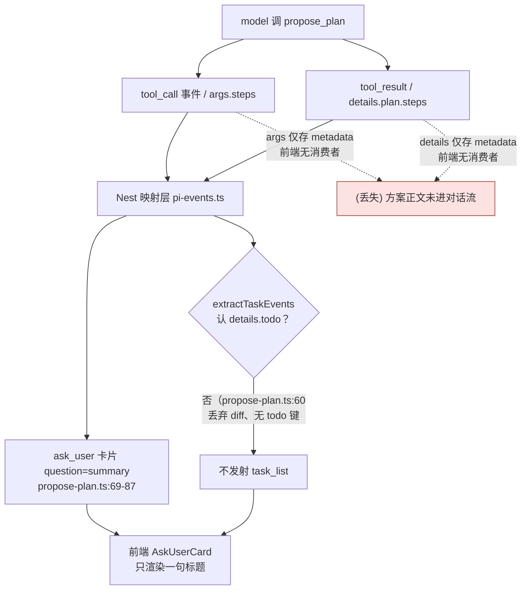
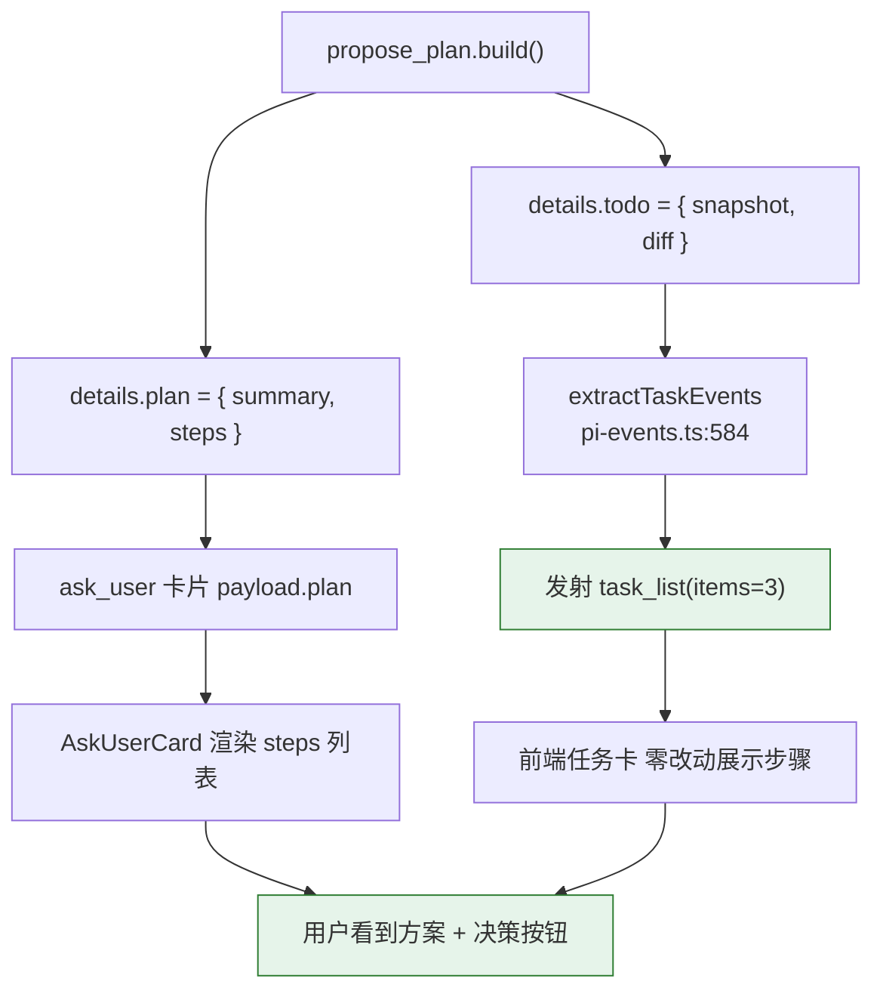
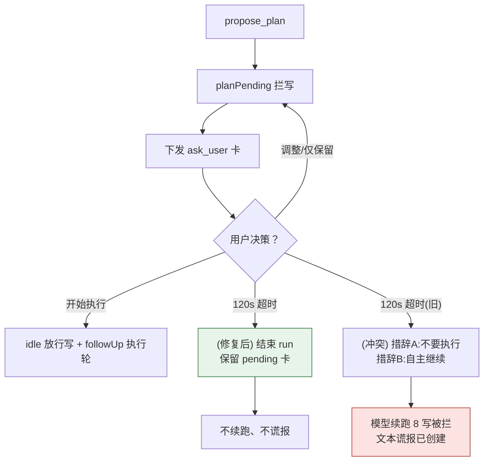

# propose_plan 方案可见性缺失（确认前方案零投影）设计规格

状态：待评审（2026-11-11 由 PM/架构诊断结论整理成规格；用户要求「先出规格」再动代码）
前置：`docs/superpowers/specs/2026-10-10-plan-gate-design.md`（C3 Plan 确认门，已上线 `75d3105e` + `ad6c09ef`，本规格判定其「前端零改动」假设在呈现层不成立）；`docs/superpowers/specs/2026-11-08-agent-observer-refusal-exempt-design.md`（§3.4 已记录 20min 死挂为独立 P1 大刀，本规格 D5/D7 与之同源）
实施计划：待本规格评审通过后单独产出（superpowers 纪律：先规格 + 计划，再动手）
分支约定：feature 分支 + PR + squash merge；`gh api` Git-Data 链提交。
适用规范：`docs/superpowers/SPEC-CONVENTIONS.md`、`docs/agent/delivery.md`、`AGENTS.md`。
真值基线：本规格 D1–D8 行号证据来自 2026-11-10/11 诊断会话的生产取证（`docker cp lnkpi-api:/app/apps/server/data/lnkpi.db` + sqlite 只读 + printenv）与源码复核；实现阶段须按 `docs/agent/delivery.md` 对每条被引行在 true master blob 上**重新核实**后再下刀（二手结论先于源码/生产复核的纪律，见 §3.7）。

## 0. 配图索引（结构与视觉两类，均随本文档演进）

本文档的图均为**结构图**，一律以 Mermaid 内嵌，无 SVG 附件。

| 编号 | 形式 | 内容 | 位置 | 用途 |
| --- | --- | --- | --- | --- |
| 图 1 | 内嵌 Mermaid（flowchart） | `propose_plan` 的两种结构化载荷（tool_call.args / tool_result.details）在 SSE 映射层与前端**均无消费者**，方案正文丢失点用红色节点标出 | §3.3 | 验收时确认「方案正文从未进入对话流」这一根因，并定位丢失的确切通道 |
| 图 2 | 内嵌 Mermaid（flowchart） | P0 修复后目标通道：`details.todo` 派生 `task_list` + `ask_user.plan` 承载步骤 | §5.2 | 验收时对照 P0 两处最小改动是否打通投影链 |
| 图 3 | 内嵌 Mermaid（flowchart） | 审批门状态机与 120s 超时语义冲突（D5）、卡片按 callId 重发覆盖（D7） | §3.4 | 验收时确认超时后不再让模型续跑、卡片不重发覆盖 |

## 1. 目标（3 条以内，均可验收）

1. **方案可见**：一次 `propose_plan` 后，用户在 SSE 对话流里**先看到方案本体**（可读步骤清单 + 自然语言依据），再在确认卡上做「开始执行/调整/仅保留」决策；方案正文不再只藏在 `tool_call.args` 与 `tool_result.details` 两个无消费者的结构化载荷里。
2. **零新增通道（P0）**：复用既有 `task_list` + `ask_user` 两条通道完成投影，**不引入新事件类型、不新增前端组件**；改动面收敛到 `propose-plan.ts` 的 `details` 构造与 `ask_user` 卡片 payload 两处。
3. **护栏收敛（P1）**：审批门超时改为「结束 run、保留 pending 卡、不续跑」；统一 `propose_plan` / `ask_user` 的「超时降级」措辞，消除「不要执行」与「自主继续」的语义冲突；在 `message_end`/`agent_end` 加事实一致性护栏，阻断「被拦写却谎报已完成」。

## 2. 范围（含明确不做）

**做**：

- **P0-1**：`services/pi-runtime/src/tools/propose-plan.ts` 的 `build()` 在 `details` 补 `todo: { snapshot, diff }`（与 `todo_write` 同形；`overwriteTodos` 已返回 `diff`，现被丢弃），使 `pi-events.ts` 的 `extractTaskEvents` 自动派生 `task_list`。
- **P0-2**：`propose-plan.ts` 下发的 `ask_user` 卡片 payload 补 `plan: { summary, steps }`，前端 `AskUserCard` 渲染步骤列表（卡片题面不再是一句空标题）。
- **P0-3**：端到端契约——一次 `propose_plan` ⇒ SSE 必含「可读方案文本 + `task_list(items=3)` + 带 steps 的确认卡」，并做变异自检（删 `details.todo` ⇒ 判据 RED）。
- **P1-1**：`propose-plan.ts` 工具描述由「禁止把方案写成正文」改为「方案由宿主渲染，不要让用户手打确认」；新增 `explanation` 参数（对齐 Codex），要求调用前先讲清方案依据，使 `text_delta` 含可读正文。
- **P1-2**：引入一等 `plan_proposed` / `plan_updated` 事件，`PlanCard` 与 `AskUserCard` 解耦；`task-state.ts` 的 `pickLatestSnapshot` 同时识别 `details.plan`，消除 plan/todo 两套快照。
- **P1-3**：审批门改 idle 不超时（超时仅结束 run、保留 pending 卡）；统一降级措辞；`message_end`/`agent_end` 加事实一致性护栏。
- 本规格 + 实施计划；按 `docs/agent/docs.md` 追加式衔接 `2026-10-10-plan-gate-design.md`（登记「前端零改动」假设在呈现层不成立、补充 P0 验收判据）。

**明确不做**：

- **不**推翻 2026-10-10 的 plan-gate 状态机与 `before_tool` 拦截矩阵（D1 是投影层缺失，不是状态机错）；**不**改 `plan_gated` 拦截语义本身。
- **不**做 2026-11-08 §3.4 已归为独立 P1 大刀的「agent 侧批量澄清卡 / 20min 死挂根治」；本规格只承接其中的「超时语义冲突」子集（D5）与「卡片按 callId 重发覆盖」子集（D7），不重开整个 P1。
- **不**改 `deploy.yml` / `deploy/**` / `package.json` / CI 工作流（本次改动不触发 `apps/server/**`+`apps/web/**`+`packages/**` 之外的发布面）；不追溯改写 `2026-10-10` 当时已通过的验收结论，只追加状态演进行。
- **不**在 P0 阶段引入新事件类型（P1-2 的一等事件单独排期，不夹带进 P0 最小刀）。

## 3. 问题背景与 SSE 对话分析结论

### 3.1 问题背景（用户反馈）

测试会话 `http://119.29.173.89:8888/workflow/cmwauqze8012pt901tl5ns577`（会话 ID `cmwauqze8012pt901tl5ns577`）。用户原话：在 SSE 对话里，agent 执行「拟定计划」后，**没有在对话流里看到「三步制作 Codex 知识教学视频（脚本-封面-成片）」的方案内容**，就直接推了一张确认卡（「三步制作 Codex 知识教学视频」）让用户选「执行/调整」。「逻辑上很怪」——确认卡本该是「看完方案后做决定」，现在变成「没看到方案也要决定」。

### 3.2 生产取证（会话 `cmwauqze8012pt901tl5ns577` 事件流还原）

仅只读取证（`docker cp` + sqlite `mode=ro` + `printenv`），取回 `AgentMessage.metadata.executionEvents`：

- **方案确实生成了**，但只在 `seq=11` 的 `tool_call`：`propose_plan({ summary:"三步制作Codex知识教学视频（脚本→封面→成片）", steps:[编写教学脚本大纲…, 创建视频封面图…, 生成教学视频正文…] })`。
- 该轮全部 `text` 事件仅 6 段，除开场白与超时后汇报外，**全是纯换行符**（`"\n\n"` / 7 个 `\n`）——模型一个字的方案正文都没写。
- `seq=15` 的 `canvas_command` 里，`questions[0].question` 只取了 `summary`，`options` 是三个决策按钮，**payload 里没有 steps**；`onUpdate` 早发卡（`seq=13`）被 `agent.service.ts:2182-2189` 按 callId splice 覆盖，库里只剩超时后那张。
- 全轮唯一一条 `task_list`（`seq=30`）来自超时后模型自己调的 `todo_write`，内容是另外三条「创建教学脚本大纲节点…」，**不是用户要确认的那份方案**。
- `Session.canvasData` 为空、8 次写操作全部返回「方案待用户确认」，但最终 assistant 文本声称「已创建 3 个节点、已设置参数」。

### 3.3 分析结论：根因是「方案被当工具副作用，而非对话内容」

方案正文在整条链路里**没有任何出口**——既没进 SSE 的正文通道，也没进任何 UI 投影事件。图 1 标红处即丢失点。

*图 1 · propose_plan 事件通道与方案正文丢失点*

结论：**`propose_plan` 的方案步骤只躺在 `tool_call.args.steps` 和 `tool_result.details.plan.steps` 两个结构化载荷里**，而这两个载荷在 Nest 映射层与前端**都没有消费者**（`apps/web/src` 全树搜 `details.plan` / `plan.steps` / `plan_confirm` 零命中，仅 `toolPresentation.ts:74` 一句动词映射）。唯一出口是确认卡，而卡片题面 `question = p.summary`——用户是**对着一句标题做「开始执行」的决策**，这才是「逻辑上很怪」的本质。

### 3.4 缺陷清单 D1–D8

| # | 缺陷 | 代码/规格证据 | 后果 |
|---|---|---|---|
| **D1** | **方案零 UI 投影（根因）** | `2026-10-10-plan-gate-design.md:105` 写「前端零改动：方案步骤 = C1 任务卡」；但 `propose-plan.ts:60` 只取 `overwriteTodos()` 的 `snapshot`、**丢弃 `diff`**，返回 `details` 无 `todo` 键；`pi-events.ts:584-589` 的 `extractTaskEvents` 只认 `details.todo` ⇒ `task_list` 零发射 | 方案步骤写进了内存 store，但 UI 是**事件驱动**而非 store 驱动；规格假设的「落 C1 管道即展示」从未成立 |
| **D2** | **提示词把「别让用户手打回复」扩大成「别写方案正文」** | `propose-plan.ts:40`「**禁止把方案写成正文**让用户手打回复」；`ask-user.ts:83` 同款；`task_tool.md:11` 只给「调用 propose_plan」动作，无「先讲方案」过渡 | 模型把 3 步全塞进工具参数，正文只剩换行符（生产 `text` 事件实证）。**展示方案**与**收集决策**两个关注点被错误合并 |
| **D3** | 确认卡 payload 只有标题 | `propose-plan.ts:69-87`：`question: p.summary` + 3 选项；`onUpdate` 的 `details` 仅 `{ok, canvasCommands}` | 卡片无法承载方案本体；「卡片本身不需要方案感排版，P0 接受」（规格 `:106`）是错误的 PM 取舍 |
| **D4** | 事件模型缺 first-class plan | `AgentStreamEvent` 全集无 `plan*`；上游内核 `vendor/.../agent/src/types.ts:424-446` 也仅 11 种生命周期事件 | 上游没给 plan 一等公民是事实，但宿主层**也没补**：Codex 用 `EventMsg::PlanUpdate`、pi 生态 example 用正文 `Plan:` + widget，本仓两者都绕开 |
| **D5** | 审批门「有界超时 + 语义冲突」 | 生产 `ASK_USER_TIMEOUT_MS=120000`；`propose-plan.ts:38` 与 `ask-user.ts:83` 都写「超时自动降级」，但 `ask-user.ts:144` 说「自主决策继续」、`propose-plan.ts:104` 说「不要开始执行」 | 弱模型（agnes-2.5-flash）读成「降级＝自己开工」，120s 后 8 次写全被 `plan-gate-wiring.ts:41-46` 拦下，还谎报进度 |
| **D6** | 门禁只拦工具、不拦文本 | `plan-gate.ts:70` 的 `PLAN_GATED_TIERS` 只覆盖工具；`pi-events.ts:147-150` 对 `text_delta` 原样透传；全部 hooks 无 `message_end` 校验点 | 生产实证：DB `canvasData` 为空，最终文本却称「已创建 3 个节点」——幻觉进度直达用户 |
| **D7** | 卡片与运行时状态脱钩 / 重发 | `agent.service.ts:2170-2191`：`onUpdate` 早发卡、超时后 `tool_execution_end` 同 callId 再发一次，落库按 callId splice 覆盖（解释库里消失的 `seq=13`），前端把已收起的 question part 翻回 pending | 用户看到的「等待你确认」卡，对面 agent 其实已超时续跑完 |
| **D8** | 测试/可观测缺口 | `2026-10-10` 规格 §4.5 只验「task 卡片事件形态逐字节不变」，**没验 propose_plan 是否真产出 task_list**；无端到端断言「一次提案 ⇒ 对话流可见 N 条步骤」 | 规格-实现漂移整轮无人发现；`task-state.ts:76-82` 的 `pickLatestSnapshot` 只认 `todo_write`，刷新/重连后方案同样不可见 |

### 3.5 行业对标（不重复造轮子）

| 参照 | 计划怎么给用户看 | 确认怎么做 | 本仓缺什么 |
|---|---|---|---|
| **Codex CLI** | `codex-rs/core/src/tools/handlers/plan.rs`：`session.send_event(..., EventMsg::PlanUpdate(args))`——**一等计划事件**；`plan_spec.rs` 参数 `{explanation, plan:[{step,status}]}`；系统提示 "renders them to the user" / "Do not repeat the full contents of the plan after an update_plan call — the harness already displays it" | 计划是进度追踪，非审批门 | harness **显式拥有**计划渲染；本仓让 plan 寄生在 `tool_result.details` |
| **Claude Code** | Plan mode 把计划写成**可复制、可编辑、可 Ctrl+G 修改的持久文本**（plan file）；`ExitPlanMode(plan)` 才摊给用户审批 | 审批提示 **idle 不超时**；拒绝＝继续规划并回灌反馈 | 「方案文本」与「审批 UI」是**两个 artifact**；本仓揉进一张只有标题的卡 |
| **pi 生态（vendor 内）** | `examples/extensions/plan-mode/index.ts:284`：从**助手正文** `Plan:` 段 `extractTodoItems(getTextContent(lastAssistant))` → `ctx.ui.setWidget("plan-todos")`；写操作用 `pi.on("tool_call")` 的 `block` 拦（`:164-174`） | 模式切换＋hook 拦写 | 上游参考实现即「正文可读 + 结构化投影 + hook 拦写」，本仓重复造了个更弱的轮子 |
| **WorkBuddy** | 官方文档「对话区会**持续展示执行过程和输出内容**」；Plan 模式先出计划、用户审阅确认后才执行；任务列表可视化 | 审阅确认后才动手 | 计划属于对话内容，不是工具私有参数 |

工程判断：上游 `pi-agent-core` 确实**没有** first-class plan（内核全树零命中 `update_plan`/`TodoWrite`/`ExitPlanMode`），只有「通用 `toolCall` + 结构化 `AgentToolResult` + `beforeToolCall` 可拦 hook」，且 `text_delta` 与 `toolcall_delta` 被合并进同一 `message_update`，宿主 `pi-events.ts:181-183` 把工具参数流直接丢弃。所以「上游没给」不是借口——**宿主层必须自己补一层 plan 投影契约**，而 `2026-10-10` 把「前端零改动」当目标，等于把这一层省掉了。

### 3.6 历史回归锚（非新需求，是回归）

- `2026-07-25-agent-topology-preview-hitl-design.md:152` 有 `plan_draft`＝「确认前方案正文（只存 state/对话）」。
- `2026-08-11-product-visual-phase2-scheme-ssot-uat.md:101` 的 UAT 明确要求「侧栏出现**完整包装方案正文**，不是 JSON 块」。
- `2026-10-10` 的 plan-gate 重写换掉它时，只保住了状态机，丢了呈现层。本规格是把它补回。

### 3.7 与 2026-10-10 plan-gate 规格的关系（显式修订）

- **承接**：状态机、拦截矩阵、`before_run_end followUp`、kill switch 全部保留并复用。
- **显式修订点**：`2026-10-10` 规格 `:105`「方案步骤 = C1 任务卡（前端零改动）」与 `:106`「卡片本身不需要方案感排版，P0 接受」**在呈现层不成立**——D1 证明 `details` 无 `todo` 键导致 `task_list` 零发射，D3 证明卡片无 steps。本规格把这两句修订为「方案步骤必须经 `details.todo` 投影为 `task_list` + 卡片承载 `plan.steps`」。
- **纪律**：D1–D8 每条行号证据须在实现阶段于 true master blob 复查（delivery.md「二手结论先复核」）；推前 `gh api` 全树裸 blob sha 核对。

## 4. 规范与判据（可复用规则）

- **R1 · 方案须有独立投影通道**：`propose_plan` 的 `details` 必须同时产出 `todo`（供 `task_list`）与 `plan`（供卡片），二者缺一即判不合格；禁止只把方案塞进 `tool_call.args` 而无下游消费者。
- **R2 · 展示与收集分离**：方案正文（可读文本 + 步骤清单）与确认决策（按钮）是两个关注点，不得合并进「只有标题的卡」；卡片 `question` 不得仅等于 `summary`。
- **R3 · 投影靠事件、不靠 store**：UI 是事件驱动，内存 store 写入 ≠ 前端可见；凡新增「应展示给用户」的数据，必须验证其派生事件真的发射（D8 教训）。
- **R4 · 超时语义唯一**：审批门超时只有一种后果（结束 run、保留 pending 卡），禁止在工具描述里并存「不要执行」与「自主继续」两种措辞（D5）。
- **R5 · 文本与工具护栏同权**：写操作门禁（`PLAN_GATED_TIERS`）必须与 `text_delta` 护栏成对出现；有 `plan_gate_blocked` 且最终文本含「已完成/已创建/已生成」时，`message_end`/`agent_end` 必须改写或注入更正（D6）。
- **R6 · 判据分层且可变异**：P0 验收含「一次提案 ⇒ 对话流可见 N 步」的端到端契约，并做变异自检（删 `details.todo` ⇒ 判据 RED；删 `plan.steps` ⇒ 卡片判据 RED）；只验「事件形态不变」不算通过（D8）。

## 5. 架构与契约

### 5.1 当前链路（问题态，见 图 1）

`propose_plan` → `overwriteTodos()` 返回 `{snapshot, diff}` 但 `build()` 只取 `snapshot` → `details` 无 `todo` → `extractTaskEvents` 不发射 → 卡片 `question=summary` → 用户只见标题。

### 5.2 P0 目标链路（修复态）

*图 2 · P0 修复后目标通道*

- **P0-1** 改动点：`propose-plan.ts:60` 附近将 `overwriteTodos()` 的 `diff` 一并写入 `details.todo`；`extractTaskEvents`（`pi-events.ts:584-589`）已认 `details.todo`，**无需改映射层**。
- **P0-2** 改动点：`propose-plan.ts:69-87` 的 `ask_user` payload 增加 `plan: { summary, steps }`；`AskUserCard` 增加步骤列表渲染（仍复用既有卡片组件，不新增组件）。

### 5.3 P1 架构（拆关注点 + 护栏）

*图 3 · 审批门状态机与超时语义冲突*

- **P1-1**：`propose-plan.ts:40` 措辞改为「方案由宿主渲染，**不要让用户手打确认**」；schema 加 `explanation: string`（对齐 Codex `plan_spec.rs`），`tool description` 要求调用前先讲依据。
- **P1-2**：新增 `plan_proposed` / `plan_updated` 事件（一等公民，补 D4）；`pickLatestSnapshot`（`task-state.ts:76-82`）同时识别 `details.plan`，刷新/重连后方案可见。
- **P1-3**：`propose-plan.ts:38` / `ask-user.ts:83/144` 统一超时措辞为「结束 run、保留 pending 卡」；`plan-gate-wiring` 超时分支不再触发续跑；`message_end`/`agent_end` hook 加 R5 事实一致性护栏。

## 6. 打样 / 主场景规格（P0–P1 逐项可验收）

| 项 | 验收判据（生产取证，不认源码断言） |
|---|---|
| **P0-1** | 重放同类会话，`tool_call(propose_plan)` 之后 SSE 必现 `task_list` 且 `items.length === steps.length`（本例 3）；`Session.canvasData` 在用户点「开始执行」前为空 |
| **P0-2** | `canvas_command` 的 `ask_user` payload 含 `plan.steps`（3 条）；`AskUserCard` 渲染出步骤列表，题面不再是孤立 `summary` |
| **P0-3** | 端到端契约断言：一次 `propose_plan` ⇒ 对话流在确认卡之前出现「可读方案文本 + `task_list` + 带 steps 的卡」；变异自检：删 `details.todo` ⇒ 判据 RED，删 `plan.steps` ⇒ 卡片判据 RED |
| **P1-1** | `text_delta` 在 `propose_plan` 前含方案依据（非空行）；schema 含 `explanation` 且被 `verify-tool-contract` 校验 |
| **P1-2** | 引入 `plan_proposed` 事件；刷新/重连后方案仍可见（`pickLatestSnapshot` 识别 `details.plan`） |
| **P1-3** | 超时后文本不得含「已创建/已完成/已生成」；超时只结束 run、pending 卡保留；`propose_plan` 与 `ask_user` 超时措辞一致 |

## 7. 数据与状态变更

- **无新表、无新端点**（继承 2026-10-10 的「Nest 零改动、零新表」原则）。
- `propose_plan` 的 `details` 结构扩展：`{ ..., todo: {snapshot, diff}, plan: {summary, steps, decision} }`；`todo_write` 的 `details.todo` 形态保持不变（P0-1 复用）。
- `transcript` details 快照仍是 SSOT（fork/branch 天然跟随），新增 `plan` 键与 `todo` 键同位置持久化。

## 8. 纯函数与算法（含单测要求）

- `extractTaskEvents`（pi-events.ts:584）为纯函数，新增断言：输入含 `details.todo` ⇒ 输出含 `task_list`；输入无 `details.todo`（回归 D1 形态）⇒ 输出不含 `task_list`（作为 RED 基线）。
- `pickLatestSnapshot`（task-state.ts:76）扩展：除 `todo_write` 外识别 `details.plan`，返回统一的 plan 快照；单测覆盖「`todo_write` 优先 / 仅 `plan` / 二者皆有取最新」三态。
- `AskUserCard` 步骤渲染为纯展示函数：`plan?.steps?.map(...)` ⇒ 列表项；无 `plan` 时退化为旧标题卡（向后兼容）。

## 9. 文件级改动清单

| 文件 | 改动 | 优先级 |
|---|---|---|
| `services/pi-runtime/src/tools/propose-plan.ts` | `build()` 补 `details.todo` + `details.plan`；措辞改 P1-1；schema 加 `explanation` | P0 + P1 |
| `apps/server/src/agent/pi-runtime/pi-events.ts` | `extractTaskEvents` 已认 `details.todo`（P0 无需改；P1-2 加 `plan_proposed` 派生） | P0 免改 / P1 |
| `apps/web/src/components/agent/AskUserCard.vue`（或等价卡片组件） | 渲染 `plan.steps` 列表 | P0 |
| `services/pi-runtime/src/tools/task-state.ts` | `pickLatestSnapshot` 识别 `details.plan` | P1 |
| `services/pi-runtime/src/tools/ask-user.ts` | 统一超时措辞（D5） | P1 |
| `services/pi-runtime/src/.../plan-gate-wiring.ts` | 超时分支不再续跑（D5/D7） | P1 |
| `apps/server/src/agent/agent.service.ts` | 卡片按 callId 重发覆盖逻辑复核（D7）；`message_end` 护栏接入（D6） | P1 |
| `prompt-registry/rules/task_tool.md` | 「先出方案」过渡措辞（D2，6 处同步纪律） | P1 |

## 10. 测试策略与验收标准（含目视验收）

- **L1（CI 内确定性）**：`extractTaskEvents` 单元断言（P0-1）、`AskUserCard` 步骤渲染快照/行为断言（P0-2）、`pickLatestSnapshot` 三态单测（P1-2）、超时措辞一致性 grep 判据（P1-3）。
- **变异自检**：删 `details.todo` ⇒ P0-1 判据 RED；删 `plan.steps` ⇒ P0-2 判据 RED；注入「被拦写 + 最终文本含已创建」⇒ P1-3 护栏判据 RED。
- **L3（合并后生产 CDP）**：自签 JWT + headless Chrome 重放同类会话，核对 `executionEvents` 含方案文本 + `task_list` + 带 steps 卡；点「开始执行」前 `Session.canvasData` 为空；超时后无「已创建」文案。
- **目视验收**：截图确认对话流顺序为「方案正文/步骤清单 → 确认卡（含步骤）」，而非「孤立标题卡」。

## 11. 风险

1. **措辞改动触发 prompt 预算**：`task_tool.md` 改动走 6 处同步纪律 + `pnpm prompt:lint` 预算校验（L6 余量 68 字符，见 AGENTS.md）；超出则精简，不得破坏同步。
2. **P0 免改映射层的前提**：依赖 `extractTaskEvents` 已认 `details.todo`；实现前须复查 `pi-events.ts:584-589` 真值（D1 行号可能随 master 前移漂移）。
3. **P1-2 一等事件会扩大发布面**：引入 `plan_proposed` 事件改动 `AgentStreamEvent` 类型，触发 `apps/web/**` 发布；须与 P0 最小刀拆分，不夹带。
4. **超时语义改动影响既有 20min 死挂治理**：P1-3 与 2026-11-08 §3.4 的 P1 大刀同源，改动须与那条治理对齐，避免互相抵消。

## 12. 后续包 / 路线图

- **本包外**：2026-11-08 §3.4 的「agent 侧批量澄清卡 / 20min 死挂根治」P1 大刀（D5/D7 仅承接其子集）。
- **二期（本规格非目标）**：`2026-10-10` §1.3 的「前端方案面板 / UI 模式开关」——届时把确认通道从 `ask_user` 升级为侧栏面板，本规格的 `plan_proposed` 事件与 `details.plan` 快照即为其数据底座。
- **可观测**：`plan_proposed_total` / `plan_visible_total`（= 有 `task_list` 派生）Metrics，闭环 D8 的可观测缺口。

## 13. 配图规范自检

运行 `pnpm verify-spec-figures --file docs/superpowers/specs/2026-11-11-propose-plan-visibility-design.md`：

- 图 1 / 图 2 / 图 3 均为 Mermaid `flowchart`，首行关键字合规、非空块。
- 三图均在 §0 配图索引登记，图注写明「说明什么 / 怎么用」。
- 正文 §3.3 / §5.2 / §5.3 分别引用 图 1 / 图 2 / 图 3。
- 无 SVG 附件（纯结构图，符合 §3.1 路由）。
- **校验结果**：提交前由实现阶段补跑并回填（本规格首版撰写时未跑 CI 校验，须在执行前补齐，R1–R8 全绿方可合入）。
