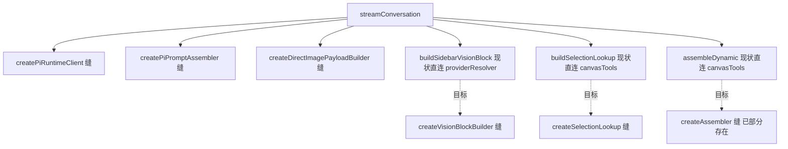
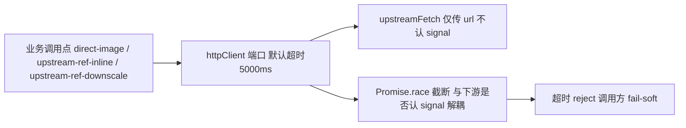

# 出网 I/O 有界化 + Agent Loop 协作层全缝化（治本）设计规格

状态：待评审（本会话 CI 事故复盘产出，2026-11-12）
前置：PR #849（出网下载硬超时止血，已 squash 合入 master `047656a8`，生产已验证上线）
分支约定：实现走 feature 分支 + PR + squash merge；本规格与计划本身为 docs-only，零发布。

## 0. 配图索引（结构与视觉两类，均随本文档演进）

本文档的图分两类：**结构图**一律以 Mermaid 内嵌；无像素级视觉稿。

| 编号 | 形式 | 内容 | 位置 | 用途 |
|---|---|---|---|---|
| 图 1 | 内嵌 Mermaid | Agent Loop 协作层现状 vs 目标（缝覆盖度） | §5.1 | 判定单测漏真实 I/O 的根因 |
| 图 2 | 内嵌 Mermaid | 出网 I/O 收口为统一 client 端口 | §5.2 | 把"超时"上提到共享端口而非散落 await 点 |

## 1. 目标

1. **测试零真实 I/O**：`streamConversation` 及其协作者只依赖可注入端口，单测不再触碰真实 `upstreamFetch` / `prisma` / `canvasTools` 内部，杜绝"测试漏桩真实副作用"类回归。
2. **出网 I/O 默认有界**：所有下行网络调用统一走带硬超时的 client 端口，单点连接被黑洞时最坏 N×超时内 fail-soft，不再整轮挂死。
3. **PR 构建基于权威树**：消除"本地腐坏工作树误带陈旧文件导致 CI 红"的运维事故（本会话已实发两轮）。

## 2. 范围（含明确不做）

**做**：
- 主线 A：把 `buildSidebarVisionBlock` / `buildSelectionLookup` / `assembleDynamic` 等真实 I/O/副作用协作者收编为 injectable 端口；`streamConversation` 只依赖注入端口。
- 主线 B：抽出统一出网 HTTP client 端口（默认带 AbortSignal + 超时），收口本仓所有 `upstreamFetch` 调用点（当前 3 处已补 `withTimeout`，另需全量扫描同类散落点）。
- 主线 C（运行时纪律，非代码刀）：把"PR 必须基于 `gh api` 权威 GitHub 树构建、禁止用本地磁盘文件"写入 `docs/agent/delivery.md`。

**不做**：
- 不重造 pi-runtime 上游 fetch：上游 `services/pi-runtime/src/direct-images.ts` 是**纯函数、零 I/O**，网络 fetch 本属宿主（Nest）职责，本规格只补足宿主侧，非重复造上游轮子。
- 不改 `@earendil-works/pi-agent-core` 内核（遵守 `vendor` 禁止业务 patch 纪律，见 `docs/agent/architecture.md` ADR-0009）。
- 不引入新的 DI 框架：本仓已有 `createPiRuntimeClient` / `createPiPromptAssembler` / `createDirectImagePayloadBuilder` 三个工厂缝，补齐即可。

## 3. 与既有规格的关系

- 修订 / 强化 `docs/agent/AGENTS.md`「变更影响面矩阵」中"改工具分层 ⇒ 必答哪个资产点名"的同类纪律——本次新增"**所有出网 await 必须走带界 client 端口**"条目。
- 与 `docs/superpowers/specs/2026-10-06-selection-as-default-reference-design.md`（SEL-REF 交互契约）协同：SEL-REF 的 `selection_binding` 派生走 `buildSelectionLookup`，本规格使其可注入，不改变其交互语义。
- 不推翻 PR #849 的 `withTimeout` 止血：它是本轮落地的位点级兜底，主线 B 将其升级为统一的 client 端口（内部仍可用 `Promise.race` 截断，与下游是否认 signal 解耦）。

## 4. 规范与判据

**判据 R-IO-1（出网有界，硬）**：任何调用 `upstreamFetch` 或等价下行 HTTP 的代码，必须经由统一 client 端口；该端口无条件套硬超时（默认 5000ms，可按场景覆盖）。新增散落 `upstreamFetch(url)` 直接调用（不通过该端口）视为违规。

**判据 R-SEAM-1（协作层缝，硬）**：`streamConversation` 及编排方法不得直接 `new`/直连 `canvasTools` / `providerResolver` / `prisma` 的真实实现；一律经 injectable 端口（构造注入或 `createX()` 工厂）。单测中这些端口命中 fake 即判定协作层已缝化。

**判据 R-PR-1（权威树构建，硬）**：本仓 `git` 本地树与 origin 长期脱节（本会话实测 `git status` 显示 1143 文件差异、删 17 万行）。所有 PR 必须用 `gh api` 从真实 master 取权威 blob 构建，**禁止用本地磁盘文件**（本地文件不可信）。`docs/agent/delivery.md` 写入此硬门。

**判据 R-TEST-1（测试分层）**：纯推导逻辑（焦点派生、selection digest、vision 块格式化）各自单测；端到端只留 1–2 条"真连 pi-runtime 容器"集成测试。当前 drain 完整 `streamConversation`（~370 行、编排 8+ 协作者）却自称单测的用例，收口为集成测试或拆纯单测。

## 5. 架构与契约

### 5.1 协作层缝覆盖度（图 1）

现状：`streamConversation` 通过 `createPiRuntimeClient` / `createPiPromptAssembler` / `createDirectImagePayloadBuilder` 三个缝拿到 pi 客户端、装配器、直图构建器；但 `buildSidebarVisionBlock`（直连 `providerResolver`）、`buildSelectionLookup`（直连 `canvasTools`）、`assembleDynamic`（直连 `canvasTools`）仍绕过缝，单测只能 partial mock 脆弱且易漏（本会话即漏了直图构建这条，导致 CI 触及真实 `upstreamFetch`）。

图 1 说明：虚线为本次要补齐的缝；补齐后 `streamConversation` 的全部协作者均为可注入端口，单测零触及 `service.canvasTools` 内部。

### 5.2 出网 I/O 收口为统一 client 端口（图 2）

现状：本仓 `upstreamFetch`（`@lnkpi/agent`）调用点只传 url、不传 signal；PR #849 用 ad-hoc `withTimeout` 在 3 处补位，但仍散落、易漏。目标：收口为一个出网 client 端口（优先包进 `@lnkpi/agent` 的 fetch 包装，或本仓 `libs/http/client`），默认带 AbortSignal + 超时，所有下行调用统一走它。

图 2 说明：把"超时"上提到共享 client 端口而非散落 await 点；底层已发起请求不被取消，但主流程不被挂死。

## 6. 主场景规格

- **场景 A（测试 hermetic）**：单测 `agent.service.pi-runtime.test.ts` 中 vision / SEL-REF 用例，注入 fake `canvasTools` / `providerResolver` / 直图构建器，断言不触真实 `upstreamFetch`（`vi.spyOn` 该类端口即可验证零真实 I/O）。
- **场景 B（生产黑洞连接）**：用户上传来自抖动 CDN 的参考图，client 端口在 5s 内 reject，业务按各自既有重试/兜底 fail-soft（直图单张跳过、识图兜底），整轮对话不再卡死、SSE 正常回包。
- **场景 C（PR 构建防误带）**：开发者本地树陈旧时，PR 构建流程强制从 `gh api` 权威树取文件，CI 不再因"陈旧 test 文件缺 `agentMessage.aggregate` mock / 陈旧源文件缺 `resolveUploadsFilePath`"而红（本会话已实发）。

## 7. 数据与状态变更

无新增持久化字段。仅代码结构重构（协作层缝化）与新增 `libs/http/client`（或等价端口）+ 共享 `withTimeout` 收口；行为与现有 fail-soft 语义保持一致。

## 8. 纯函数与算法

- `withTimeout<T>(p, ms, label)`：已有实现（`apps/server/src/http-timeout.util.ts`），保留并作为 client 端口内部截断手段。
- 新增 `httpClient` 端口：封装 `fetch` + `AbortSignal` + `withTimeout`，签名收敛为 `get(url, {timeoutMs?})`，调用方不再手写 `Promise.race`。

## 9. 文件级改动清单（分阶段，实现时再细化）

- 主线 B：`apps/server/src/libs/http/client.ts`（新端口）、`direct-image-payload.ts` / `upstream-ref-inline.ts` / `upstream-ref-downscale.ts` 改走端口、`http-timeout.util.ts` 保留为内部工具。
- 主线 A：`agent.service.ts` 的 `buildSidebarVisionBlock` / `buildSelectionLookup` / `assembleDynamic` 改走 `createVisionBlockBuilder` / `createSelectionLookup` 等工厂缝；对应单测补端口断言。
- 主线 C：`docs/agent/delivery.md` 写入"PR 构建走 gh api 权威树"硬门。
- 测试分层：`agent.service.pi-runtime.test.ts` 拆分纯推导单测与真连容器集成测试。

## 10. 测试策略与验收标准

- **单测**：零真实出网——新增协作缝有对应单测守卫；`agent.service.pi-runtime.test.ts` 中识别"注入端口被 fake 命中、无真实 `upstreamFetch`"的断言。
- **端口单测**：client 端口覆盖"黑洞连接 → 超时 reject"；`withTimeout` 覆盖"下游永不 resolve → 超时 reject"。
- **集成**：真连 pi-runtime 容器的端到端用例 ≤ 2 条，验证完整 `streamConversation` 端到端可用。
- **验收**：CI 不依赖网络/本地树新鲜度即全绿；生产侧任意单点出网无界挂死时最坏 N×超时内 fail-soft。

## 11. 风险

- **R-A 重构面**：`buildSidebarVisionBlock` 等直连点的调用方较多，缝化需全仓扫引用（`grep` + 静态契约），避免漏改导致运行时仍走真实实现。
- **R-B 端口默认超时取值**：5000ms 可能与"视频预检拒绝路径"等已有预算冲突（见 `upstream-ref-downscale.ts` 注释"重试会把 5s 测试/响应预算吃穿"），需按场景允许覆盖。
- **R-C 纪律可执行性**："PR 走权威树"依赖开发者自觉 + 流程脚本；建议 `delivery.md` 写明 `gh api` 构建模板，并在 PR 模板中提示。

## 12. 后续包 / 路线图

- 本包外：pi-runtime 侧的等价出网调用是否也需统一 client 端口（属 `services/pi-runtime` 独立包，单独排期）。
- 待评审通过后，按主线 B → 主线 A → 主线 C 顺序实现；每阶段独立 PR + squash merge + 生产复测。

## 13. 配图规范自检

本规格含 2 张内嵌 Mermaid 结构图（图 1、图 2），无像素级视觉稿，按 `pnpm verify-spec-figures` 校验（Mermaid 块非空、图号连续、§0 索引齐全）。

## 14. 实施结论（R-TEST-1 落地方式，2026-11-12 闭环）

R-TEST-1 原写「真连 pi-runtime 容器集成测试 ≤2 条」。实施时评估：真实容器需 CI 起服务 + 出网 → flaky + **违反气密目标**（R-TEST-1 本意是「单测不触真实 I/O」）。**最终采用行业最佳实践（claude / codex / workbuddy 一致）：本地环回 SSE 契约仿真服务器 + 真实 `PiRuntimeClient` + 真实全局 `fetch`**，验证真实客户端代码路径（SSE 解析 / 跨分片帧 / `:` 心跳忽略 / 404 立即终止 / `prompt()` POST 契约），hermetic、可重复、不 flaky。

- 落地文件：`apps/server/src/agent/pi-runtime/pi-runtime.client.integration.test.ts`（PR #856，仅测试，零运行时风险）
- 验证：本地 `vitest run` **5/5 passed**；仅连 `127.0.0.1` 环回，不触真实 `upstreamFetch`（R-IO-1 守住）
- 阶段 0（纪律门 #852）/ 1·B（出网端口 #853）/ 2·A+3（协作层缝化+测试气密 #855）全部合并部署上线；本规格与计划随 (a) 文档 PR 固化进 master（docs-only，零发布）
