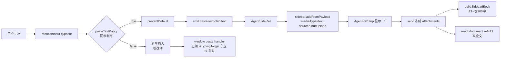

# Composer 长文本粘贴 → 文本素材芯片：需求审视与技术规格

状态：**待审阅（设计规格，未批准、未实施）**
状态回填（2026-11-15，只追加）：规格已获用户批准；实施计划见 `docs/superpowers/plans/2026-11-15-composer-paste-text-chip.md`；代码已在 master 干净树完成并逐刀验证（定向 34/34、四条变异自检、静态门禁全绿）。PR / CI / 合并 / 部署 / 生产复测状态以后续状态行回填为准，未闭环前不宣告上线。
分类：**architectural**（改 composer 输入契约，涉及粘贴语义、芯片数据结构与 prompt 可达性）
取证基线：`master` = `e3c7428148e85cf6f61640970cd2427e2429b6ad`，行号取自该提交的 tarball 快照。
⚠️ 当前工作区 `apps/web` / `packages/agent` / `packages/shared` 是悬空软链，**实施前须先修复工作树**，不要以本地工作树源码判「文件不存在 / 缺接线」。
取证命令：`gh api repos/sev7n4/pi-lnk/tarball/e3c7428148e85cf6f61640970cd2427e2429b6ad > master.tar.gz && tar -xzf master.tar.gz --strip-components=1`

---

## 0. 配图索引（结构图，随本文档演进）

本文档仅含一张内嵌 Mermaid 结构图。

| 编号 | 形式 | 内容 | 位置 | 用途 |
|---|---|---|---|---|
| 图 1 | 内嵌 Mermaid | 粘贴事件从判定、芯片装配到 prompt 与全文读取的完整数据流 | §5.4 | 验收「原生降级 / 拦截提升 / 全文恢复」三条出口齐备，定位 `read_document` 分支是保真判据锚点 |

---

## 1. 需求回写

**用户说的**：composer 对话框中，一旦用户把「项目外部复制的文本」粘贴进来，就把这段文本像「文本节点（内容）」一样作为芯片条加载；并询问是否需要按字节长度设阈值，短文本保持原有粘贴行为。参照 WorkBuddy 的现有能力。要求审视必要性/合理性、给出技术规格、最小实现、不重复造轮子。

**我的假设**（请纠正）：
- A1 痛点是**输入框视觉与素材管理**：4 行 textarea 被长文本撑满，且长文本无法像图片/文件那样成为可 `@T1` 引用的素材；不是要新建画布节点。
- A2 期望是**自动发生**，不额外点确认。
- A3 「文本节点芯片」指 UI 上的 T* 文本素材芯片，允许不创建画布节点。
- A4 短文本（含 URL、代码片段、半句话、补齐一句话）必须**保持 textarea 原生粘贴语义**（插入文本、光标/选区/⌘Z 撤销不变），不受本特性影响。

**成功判据**：长文本粘贴后输入框保持可编辑且不出现原文、芯片条出现一枚 T* 芯片且可 `@` 引用/可移除/可一键还原、发送后 agent 能拿到**全文**；其余所有粘贴行为零回归。

---

## 2. 现状取证（只读）

### 2.1 composer 与芯片已是一套完整资产

| 资产 | 位置 | 现状 |
|---|---|---|
| 输入控件 | `apps/web/src/components/canvas/MentionInput.vue:258-271` | **原生 textarea** + 透明文字 + backdrop 高亮 + ghost；事件仅 `@input/@keydown/@scroll/@click`，**无 `@paste`**；已 expose `insertText(text)` |
| 宿主 | `apps/web/src/components/agent/AgentSideRail.vue:304, 4902-4918, 2623-2634, 2694-2713` | `v-model="input"`，`@submit` → `send()` → `sendMessage()` → `POST /api/agent/chat/conversation`；发送瞬间冻结 `attachments / refOrder / mentionedKeys / selectionNodeIds` |
| 芯片数据结构 | `packages/shared/src/sidebarAttachments.ts:7-19` | `SidebarAttachment`：`mediaType: text\|image\|video\|audio`、`sourceKind: upload\|asset\|canvasNode`、`label`、`url?`、`text?`；**`text` 无长度上限**；`SIDEBAR_ATTACHMENT_MAX = 5` |
| 芯片状态 | `apps/web/src/composables/useSidebarAttachments.ts:76-88` | 模块级单例；`addFromPayload()` **只按 `url` / `sourceNodeId` 去重**；`assignRefKeysFor()` 产出 `T1/T2…` |
| 芯片 UI | `AgentRefStrip.vue` / `AgentSidebarRefChip.vue` | 输入框**上方独立条**；点击插 `@T1`，✕ 移除，可拖排序；文本预览已支持 |
| 画布 text 节点 → T* 芯片 | `useSidebarAttachments.ts:46-70` `nodeToSidebarAttachment()` | 显式入口，已闭环（用户点「加入 Agent 引用」） |

`MentionInput` 另有 2 个使用点（`NodeEditorToolbar.vue:64`、`DockPromptSection.vue:29`）——**粘贴策略不能写死在这个通用组件里**。

### 2.2 粘贴现状：composer 零处理，且存在一个会抢事件的 P0 缺陷

- `git grep -n -E '@paste|onPaste|clipboardData|beforeinput' -- apps/web/src/components` → **0 命中**。
- 全仓唯一 `clipboardData` 处理器在画布：`apps/web/src/composables/useCanvasMedia.ts:227-246` 的 `onPaste()`，其白名单**连 `text/*` 都接**，命中即 `event.preventDefault()` → `ingestMediaFile()` → 在画布**新建 text 节点**。
- 挂载点是 `window`：`apps/web/src/pages/CanvasPage.vue:6156` `window.addEventListener('paste', mediaHandlers.onPaste)`，**无编辑目标守卫**。
- `apps/web/src/composables/useCanvasKeyboard.ts:17-22` 已有 `isTypingTarget()`，但只用于键盘。

⇒ **代码层面，在画布页往 composer 粘贴纯文本，会被全局 handler 抢走去建画布节点**。用户感知到的「粘贴不对劲」，很可能首先是这个缺陷，而不是缺一个特性。（此条为源码层推断，未做浏览器运行时复现；实施前用一次真实粘贴确认，不影响「必须补守卫」的结论。）而「`paste → addFromFile`」这个入口，从 `docs/superpowers/plans/2026-08-07-agent-sidebar-material-entry.md:977`、`2026-08-07-agent-sidebar-m3-explicit-refs.md:587` 起就登记为 P1 backlog，从未落地；文件 → 芯片目前只有 drop / file input 通路（`AgentSideRail.vue:1453-1486`）。

### 2.3 芯片 → prompt 链路：全文可达性是本需求的真正命门

- 上行：`packages/shared/src/agentContract.ts:645-660`，`attachments: z.array(SidebarAttachmentSchema).max(5)`；`mentionedKeys` 走 `^[TIVA]\d+$`。
- 服务端组装：`apps/server/src/agent/pi-runtime/sidebar-block.ts:30-35` 的 `TEXT_LABEL_MAX = 200`，`labelOf()` 对 text 素材执行 `text.slice(0, 200)`；`buildSidebarBlock()` 产出 `侧栏参考素材：\nT1=<前 200 字>`。该 200 字上限是 F6 评审裁决，不是随手写的。
- 全文读取工具**已存在**：`services/pi-runtime/src/tools/read-document.ts:61-98` 的 `read_document(ref:"T1")`，读 `toolContext.attachments`，`truncateMarkdown` 20k 字符窗口 + `start_index` 续读，仅支持 text；`apps/server/src/agent/pi-runtime/pi-runtime.client.ts:265` 与 `services/pi-runtime/src/session-manager.ts:1351` 每轮透传 `attachments`。
- **但该工具在模型侧不可靠**：`read_document` **不在** `services/pi-runtime/src/tools/tiering.ts:67` 的 `ALWAYS_ON_TOOL_NAMES`（精确串 `"read_document"` 在文件内 0 命中），属延迟集；`prompt-registry/` 全目录搜 `read_document|侧栏参考素材|全文` → **0 命中**（无资产点名）；`dynamic-budget.ts:8-9` 只在 sidebar 块超预算被截断时才在尾注承诺 `read_document`。同文件 `:84`、`:115` 明确写着「tool_search 触发率实测为 0 ⇒ 延迟即不可达」，与 `AGENTS.md` 的生产证据一致。

⇒ 现状下把长文本直接改成芯片，模型**大概率只看到前 200 字**，全文需要从「不一定拿得到 schema」的延迟工具取回。相比现状（粘贴文本全文随 `message` 进对话历史），这是**信息保真退化**，属于静默丢数据的变种。

### 2.4 契约与容量约束

- `AGENTS.md:65` 与 `docs/superpowers/specs/2026-10-06-selection-as-default-reference-design.md:52/72/102`、`2026-08-07-agent-sidebar-m3-explicit-refs-design.md:14`：**指代 ≠ 素材注入，画布节点默认不 silent 进芯片（D-A）**。本需求是用户主动粘贴，不违反 D-A 的字面约束，但「系统替用户决定把文本变成素材」与 D-A 的**反 silent 精神**同源，必须靠阈值 + 可逆 + 提示来消解。
- 容量：`SIDEBAR_ATTACHMENT_MAX = 5` 且 `addFromPayload()` 对纯文本芯片（无 `url` / `sourceNodeId`）**不去重** ⇒ 连续粘贴会悄悄占满槽位，第 6 次起被静默丢弃。
- 体积：`message` 与 `attachments.text` 均无 `.max()`，Nest 仅 `useBodyParser('json', { limit: '10mb' })`；`agent.service.ts:1149` 把 `attachments` 以 `JSON.stringify` 落库。长文本每轮还会随 `turnContext` 重复传给 pi-runtime。
- L6 提示词预算最紧组合 `core+writeTools+genTools+todoTools` 实测 **3197/3200、余量 3 字符**（2026-11-15 `pnpm prompt:lint` 实测；`AGENTS.md` 里的 3132/余 68 是历史值，权威值以 `prompt-registry/PROMPT_SPEC.md` 与实测为准）⇒ **禁止靠加 prompt 条文来补可达性**。

---

## 3. 必要性与合理性审视

### 3.1 必要性：中高，且属于「补入口」而非「造能力」

1. 痛点真实：textarea 视觉上限 96–200px / 4 行；长文本既撑满输入框，又无法像图片/文件那样成为可引用、可移除、可排序的素材。
2. 资产齐备：T* 文本芯片、refKey、`@T1`、服务端 sidebar 块、`read_document` 全文读取、芯片 UI 全部已实现，缺的只是「粘贴」这一个入口；该入口在 2026-08 的两份计划里就已登记为待办。
3. 一致性收益：图片/文件已有 drop / file input 入口，文本素材却只能靠「先存文件再上传」或「画布建节点再显式引用」，路径不对称。

### 3.2 合理性：四条按原描述直接做会出事

| # | 问题 | 依据 / 后果 |
|---|---|---|
| R1 | **「项目外部」不可判定** | `ClipboardEvent.clipboardData` 只暴露 MIME 类型，不暴露来源应用；跨应用复制通常只有 `text/plain` / `text/html`。靠自定义 MIME 只能**自证本项目内部复制**，不能反证「外部」。按字面实现 ⇒ 等价于「所有粘贴」，把基础编辑操作整个换掉。 |
| R2 | **自动替换破坏 textarea 语义** | 粘贴是高频基础操作：短句、URL、代码、半句话、选中文本替换、原生 ⌘Z 撤销栈。静默把文本挪到芯片条后，光标插入/选区替换/IME 组合/撤销全部失效，且用户拿不回原文（textarea 里没插入过 ⇒ 原生 undo 无事可撤）。 |
| R3 | **保真退化（最关键）** | 见 §2.3：现状全文进 `message`；转芯片后只剩 200 字标签 + 一个延迟且未点名的 `read_document`。静默丢数据。 |
| R4 | **容量与来源冲突** | §2.2 的 window 级 paste 抢事件；§2.4 的 5 槽上限 + 纯文本不去重 ⇒ 第 6 次静默丢文本。 |

### 3.3 裁决

**支持「长文本粘贴 → 文本素材芯片」这个能力；不支持原触发条件。**
改为：**在 composer 中粘贴纯文本、字符数达阈值、无选区、且芯片槽位可用时，自动提升为一枚 T* 芯片；其余粘贴一律保持原生。** 同时把 R2/R3/R4 的三个前置修复列为**同一刀的必做项**，不允许只上「自动转芯片」的漂亮部分。

---

## 4. 方案对比

| 方案 | 做法 | 取舍 | 裁决 |
|---|---|---|---|
| **A（推荐）** | 阈值自动提升为 T* 芯片 + ⌘Z 还原 + 提示；同刀修 paste 守卫与 `read_document` 可达性 | 一次改动覆盖 4 个风险，行为可预测，符合「像 WorkBuddy 一样自动」的诉求；动到 pi-runtime tiering（1 行 + 测试） | **推荐** |
| B | 超阈值时不自动，输入框下方出一条「作为素材加入？」轻量确认 | 零误伤、不需要改模型链路；多一步点击，与自动诉求有差距 | 备选（若更看重零误伤） |
| C | 只修全局 paste 守卫；提供「选中文本 → 显式命令转芯片」 | 最保守、零产品风险；体验弱，没有解决「粘贴即素材」 | 降级（若暂不想动模型链路） |
| D | 新建「文本节点芯片」类型 / 粘贴即建画布 text 节点 / 新增服务端附件协议 | 与现有 `SidebarAttachment(text)` + `read_document` 完全重复 | **No-Go** |

---

## 5. 技术规格（方案 A）

### 5.1 术语澄清

「文本节点」在本仓是**画布一等节点**（`DockNodeType` 含 `'text'`，`packages/shared/src/textNodeFormat.ts`）。本规格要的是 **`mediaType:'text'` 的 `SidebarAttachment`（T* 文本素材芯片）**，**不创建任何画布节点**。现有 `nodeToSidebarAttachment()` 是「已有画布 text 节点 → 芯片」的反向路径，不要复用成「粘贴 → 建节点 → 转芯片」。

### 5.2 触发条件（唯一判据，纯函数）

新增 `apps/web/src/composables/pasteTextChip.ts`，导出类型与纯函数：

```ts
export interface PasteTextContext {
  text: string                    // clipboardData.getData('text/plain')
  itemTypes: readonly string[]    // items 的 type 列表
  hasFiles: boolean               // clipboardData.files.length > 0
                                  //   || items.some(i => i.kind === 'file')
  selectionStart: number
  selectionEnd: number
  isComposing: boolean
  pendingCount: number            // sidebar.pendingAttachments.length
  maxCount: number                // SIDEBAR_ATTACHMENT_MAX
}
export function shouldPromotePasteToTextChip(
  ctx: PasteTextContext,
  minChars = PASTE_TEXT_CHIP_MIN_CHARS,
): { promote: boolean; reason: 'ok' | 'too-short' | 'empty' | 'has-files' |
       'has-selection' | 'composing' | 'capacity-full' } 
```

全部满足才 `promote: true`：
1. `text.trim().length > 0`；
2. `!ctx.hasFiles`，且 `itemTypes` 中**没有** `image/*` / `video/*` / `audio/*`（富文本粘贴带来的 `text/html` 不排除，取 `text/plain`）；
3. `selectionStart === selectionEnd`（有选区 = 用户在做「替换」，保持原生）；
4. `!isComposing`（IME 组合期不接管）；
5. `[...text].length >= minChars`（**按 Unicode 码点计字符，不按字节**）；
6. `pendingCount < maxCount`（容量满 ⇒ 降级为原生粘贴，原文进输入框，绝不静默丢弃；不为此新增事件通道，见 §5.7）。

### 5.3 阈值与单位

- **用字符数，不用字节数**。理由：UTF-8 中文 3 字节/字、emoji 4 字节，按字节会让同一屏幕长度的文本阈值差 3–4 倍；真正约束是 UI 占用（字符/行数）与上下文预算（token/字符），都不是字节。本项目既有阈值也全用字符：`TEXT_LABEL_MAX = 200`、`truncateMarkdown` 20k 窗口、记忆 6000 字预算。
- `PASTE_TEXT_CHIP_MIN_CHARS = 1000`（常量集中在 `pasteTextChip.ts`，可配置）。依据：textarea 4 行 ≈ 200–300 字明显撑满；1000 字 > 200 字标签上限，正好是「不转就撑爆输入框、转了就必须靠工具读全文」的交叉点，低于它转芯片收益不足而误伤概率高。
- **不设上限闸门**：超长文本转芯片反而比留在 `message` 里更省（芯片走每轮动态块，不进对话历史）；但须在 §7 验收记录 >20k 字符需 `read_document` 续读，上行体积与 `attachments` 落库成本已登记在 §2.4。
- 阈值是**必要条件而非充分条件**：达阈值仍需 §5.2 的其余 5 项 + §5.6 的可逆性。

### 5.4 数据流

图 1 给出一次 ⌘V 从判定到发送、再到全文恢复的完整链路，验收时按三条出口逐条核对。



*图 1 · 粘贴事件的完整数据流：判定为 false 时保持原生插入（window 级 paste 处理器由 `isTypingTarget` 守卫跳过，不抢 composer）；判定为 true 时提升为 T* 芯片；发送后芯片进 prompt 只有前 200 字标签，全文必须经 `read_document(ref:"T1")` 取回——此分支即「不静默丢数据」验收的判据锚点。*

### 5.5 改动清单（逐文件，最小面）

| # | 文件 | 改动 | 性质 |
|---|---|---|---|
| 1 | `apps/web/src/composables/useCanvasMedia.ts:227` | `onPaste()` **函数入口**加 `if (isTypingTarget(event.target)) return`（复用 #2 的共享 util） | **P0 缺陷修复**，必须同刀 |
| 2 | `apps/web/src/utils/isTypingTarget.ts`（新建）+ `useCanvasKeyboard.ts:17` | 把已有 `isTypingTarget()` 抽成共享 util，键盘侧改为 import（避免第二份实现） | 复用，不改行为 |
| 3 | `apps/web/src/composables/pasteTextChip.ts`（新建） | §5.2 纯函数 + 常量 | 新增纯逻辑 |
| 4 | `apps/web/src/components/canvas/MentionInput.vue` | 新增**可选** prop `pasteTextPolicy?: (ctx: PasteTextContext) => boolean`（默认不接管；宿主传 `shouldPromotePasteToTextChip(ctx).promote`，组件无需认识 `reason`）与 emit `paste-text-chip(text)`；`@paste` handler 同步调 policy，命中才 `preventDefault()` + emit。**组件内不 import sidebar** | 通用能力，另 2 个使用点不传 policy ⇒ 行为零变化 |
| 5 | `apps/web/src/components/agent/AgentSideRail.vue` | 传 `:paste-text-policy`（引用纯函数 + `sidebar.pendingAttachments.length`）；监听事件 → 构造 `{ id: randomId(), mediaType:'text', sourceKind:'upload', label: '粘贴文本 · N 字', text }`（N = `[...text].length` 码点数） → `sidebar.addFromPayload()`；维护 `lastPromotion` 供 ⌘Z 还原，6 秒定时器在组件卸载时清理；成功 toast「已作为 T1 素材加入 · ⌘Z 还原为文本」 | 宿主策略与唯一副作用点 |
| 6 | `services/pi-runtime/src/tools/tiering.ts:67` | `ALWAYS_ON_TOOL_NAMES` 增加 `read_document`，理由复用 `read_media` / `view_canvas_media` 的先例「恢复路径必须无门槛可达」 | **保真前置**，见 D3 |
| 7 | `services/pi-runtime/src/tools/tiering.test.ts` | 声明 `read_document` 归属 | 判据 |

**明确不改**：`packages/shared` 的 schema 与枚举（`sourceKind` 借 `upload` 表达「用户从外部带入」，不新增枚举值；若后续要按来源统计，另立独立刀）；`apps/server` 全部；`prompt-registry` 全部（L6 实测 3197/3200、余量 3 字符，禁止加条文）；`buildSidebarBlock` 的 `TEXT_LABEL_MAX`（F6 已拍板裁决）；芯片 UI 组件（复用 `AgentRefStrip` / `AgentSidebarRefChip` 已有 T* 渲染、`@` 插入、✕ 移除）；画布节点创建链路。

⚠️ 改 `tiering.ts` 时遵守该文件 `:101-102` 的铁律：**注释里不要出现带引号的工具名**，`verify-tool-tiering` 会把注释解析成 Set 成员报幽灵项。

### 5.6 契约与不变量

- **C1 零静默丢失**：`text` 字段必须写入**完整原文**，禁止 `slice/truncate/预览值`；原文只能存在于芯片里，不得同时留在输入框（避免重复注入）。
- **C2 可逆**：转芯片后 `lastPromotion = { id, text }`；下一次 `input` 事件或 6 秒后失效。有效期内 ⌘/Ctrl+Z 由 composer keydown 拦截 → `sidebar.remove(id)` + `composerRef.value?.insertText(text)` → 文本回到输入框，等价于原生撤销。toast 文案明示「已作为 T1 素材加入 · ⌘Z 还原为文本」。芯片 ✕ 移除仍只删芯片（不插回文本），与既有语义一致。
- **C3 指代契约不动**：`selectedNodeIds` 与 `attachments` 继续是两个独立上行字段；粘贴提升不得写入 `selectionNodeIds`，不得调用 `mergeFocusNodeRef()`（D-A）。
- **C4 单一副作用点**：只有 `AgentSideRail` 能改 `pendingAttachments`；`MentionInput` 保持纯展示/事件组件。
- **C5 不建画布节点**：本刀不调用 `addNode()` / `ingestMediaFile()`；画布空白处的粘贴仍按既有行为建节点（守卫只排除可编辑目标）。
- **C6 来源语义降级**：§5.2 用「在 composer 内粘贴 + 达阈值」近似用户说的「项目外部」，**不做来源溯源**，也不写自定义 MIME 自证；该近似须在 UI 文案与本文档中明示，不得宣称「识别了外部来源」。

### 5.7 边界与降级

| 情形 | 行为 |
|---|---|
| 剪贴板含图片/文件 | 不接管 ⇒ 走既有 `useCanvasMedia` 画布通路（`isTypingTarget` 守卫只挡可编辑目标，画布空白粘贴不受影响） |
| 富文本粘贴（带 `text/html`） | 取 `text/plain` 参与判定，可提升；不保留格式 |
| 有选区 / IME 组合中 / 空白文本 | 不接管，原生粘贴 |
| 5 枚芯片已满 | 不接管 ⇒ 原生粘贴，原文在输入框可见；**不新增降级事件通道**（YAGNI），用户可见即不构成静默丢失 |
| 其他两个 `MentionInput` 使用点 | 未传 `pasteTextPolicy` ⇒ 完全原生 |
| `readOnly` / `isUploading` | 不接管（textarea 已 disabled） |
| 超 20k 字符 | 正常提升；模型需 `start_index` 续读，§7 记录 |

### 5.8 不重复造轮子清单

复用 `SidebarAttachment(text)` 数据契约 → `useSidebarAttachments.addFromPayload` 单例状态 → `assignRefKeysFor` 的 T* 编号 → `AgentRefStrip`/`AgentSidebarRefChip` 的渲染/点击/移除/排序 → `sendMessage` 既有 `attachments` 冻结 → `agentContract` 上行 schema → `buildSidebarBlock` 的 prompt 注入 → `read_document` 的全文读取 → `useCanvasKeyboard.isTypingTarget` 守卫判定 → `ElMessage` 提示 → `randomId`。**新增代码只有：1 个纯函数文件、1 个共享 util、2 处组件接线、1 处宿主 handler、1 行 tiering 声明，以及对应测试。**

---

## 6. 测试与判据（vitest + jsdom，遵循本仓惯例）

| 测试 | 位置 | 判据 |
|---|---|---|
| 纯函数边界 | `composables/pasteTextChip.test.ts`（新建） | 999/1000/1001 字符、中文 400 字（≈1200 字节）应判 `promote=false`，若实现改用 `byteLength` 则此例误变 `true`（**计量单位变异自检**）、emoji、`trim()` 后空、`hasFiles`/含 image item、有选区、`isComposing`、容量 4/5、默认阈值可覆盖，逐项断言 `reason` |
| 组件行为 | `components/canvas/MentionInput.test.ts`（增补） | mount + `trigger('paste')` 构造 `clipboardData` stub：短文本**不** `preventDefault()`、不 emit；长文本 `preventDefault()` + emit 且 payload 为**完整原文**；未传 policy 时零接管 |
| P0 守卫 | `composables/useCanvasMedia.test.ts`（新建） | `target` 为 textarea ⇒ 不 `preventDefault()`、**不**调 `onMedia`；`target` 为画布 div ⇒ 照旧建节点。**变异自检：删掉守卫必须 RED** |
| 宿主接线 | `components/agent/AgentSideRail.pasteTextChip.test.ts`（新建，静态源码断言） | `:paste-text-policy` / `@paste-text-chip` 接线存在；handler 调 `addFromPayload` 且 `mediaType:'text'`；**不得**出现 `addNode(` / `addFromFile(` / `ingestMediaFile(` / `mergeFocusNodeRef(`；`text` 写入处不含 `slice(`。配对肯定+否定断言，先剥离 HTML 注释锚（沿用 `bareBar.test.ts` 纪律）。**变异自检：把 `text` 改成 `text.slice(0, 200)` 必须 RED**（防静默截断） |
| 工具可达性 | `services/pi-runtime/src/tools/tiering.test.ts` | `read_document` ∈ `ALWAYS_ON_TOOL_NAMES`；删声明 RED |
| 回归 | `useSidebarAttachments.test.ts`、`AgentSidebarRefChip.annotate.test.ts`、`MentionInput.test.ts` 既有用例、全量 `vitest` | 全绿 |

**防伪要求**（沿用项目纪律）：所有「没丢数据」的断言必须在**真实长文本记录**上求值，且变异自检用行级突变（对象字面量条件恒 falsy / 删除守卫），判 RED 以完整 stdout 的 `AssertionError` 为准，不用管道吞退出码。

---

## 7. 验收与生产取证

1. 本地：上述测试全绿 + 变异自检逐条 RED；`pnpm prompt:lint` 无变化；`vue-tsc -b` 通过。
2. 手工走查：300 字短文本 → 原样进输入框、光标/选区/⌘Z 正常；3000 字 → 输入框不出现原文、T1 芯片出现、点芯片插 `@T1`、⌘Z 还原、✕ 移除；带图粘贴 → 原有画布通路；画布空白粘贴长文本 → 仍建 text 节点；连续粘贴 6 次 → 第 6 次降级为原生且原文不丢。
3. **保真 e2e 探针（能证伪，未通过不得宣告完成）**：粘贴超过 §5.3 阈值的文本 → 发送「请复述 T1 的最后一段」→ 检查 transcript 出现 `read_document(ref:"T1")` 且回答含末段内容。若模型只读了 200 字标签、未调工具 ⇒ §5.5 #6 的保真前置未闭环，特性必须停在合并前。
4. 上线后观测（可选）：`paste_text_chip_total{outcome=promoted|reverted|degraded}`，用还原率校准 §5.3 阈值；还原率持续偏高即说明阈值或自动策略需回退到方案 B。

---

## 8. 待你裁决的决策点

| ID | 决策 | 推荐 | 备选 |
|---|---|---|---|
| D1 | 自动提升 vs 超阈值出确认条（方案 A / B） | **A（自动 + ⌘Z 可逆 + toast）** | B：多一次点击，零误伤 |
| D2 | 阈值取值与单位 | **1000 字符（码点），常量可配** | 500 / 2000；**不建议按字节** |
| D3 | 模型侧全文可达性怎么补 | **把 `read_document` 提回常驻集**（1 行 + 测试，符合 `read_media` 先例） | 不动工具集，但 e2e 探针必须证明模型能取回全文；**不建议**改 `TEXT_LABEL_MAX`（推翻 F6 裁决、撑大动态块并触发断头路尾注） |
| D4 | P0 守卫是否单独先上一刀 | **建议单独先上**（纯缺陷修复、零产品决策、可独立取证） | 与本特性同刀，但不得省略守卫 |

---

## 9. No-Go 清单

- 不判定/宣称「剪贴板内容来自项目外部」。
- 不新建芯片类型、不新增 `sourceKind` 枚举值、不改 `SidebarAttachmentSchema`、不改上行协议。
- 不新建服务端接口、不改 `buildSidebarBlock` 的 200 字裁决、不改 `prompt-registry`（含内嵌 fallback 常量）。
- 不因粘贴创建画布 text 节点，不调用 `addFromFile()`（不上传、不落文件）。
- 不静默丢弃或截断原文；不在芯片之外再复制一份原文进 `message`。
- 不把粘贴策略写进通用组件 `MentionInput` 的业务分支（只留可选 policy + emit）。
- 未在 §7.3 探针证明全文可达前，不宣告本特性闭环。
