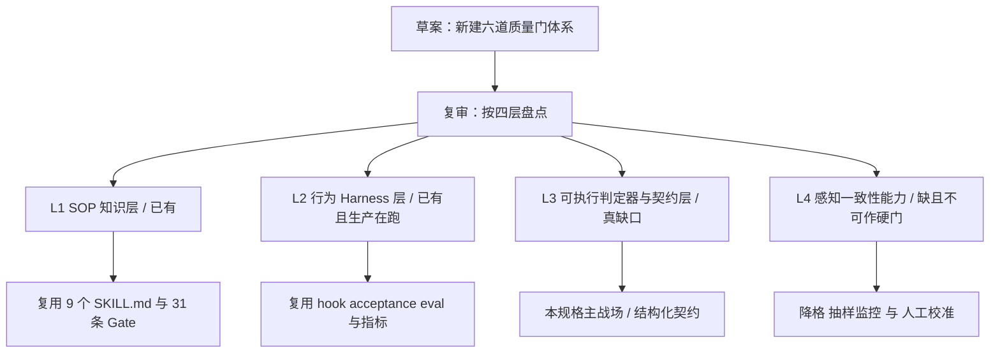
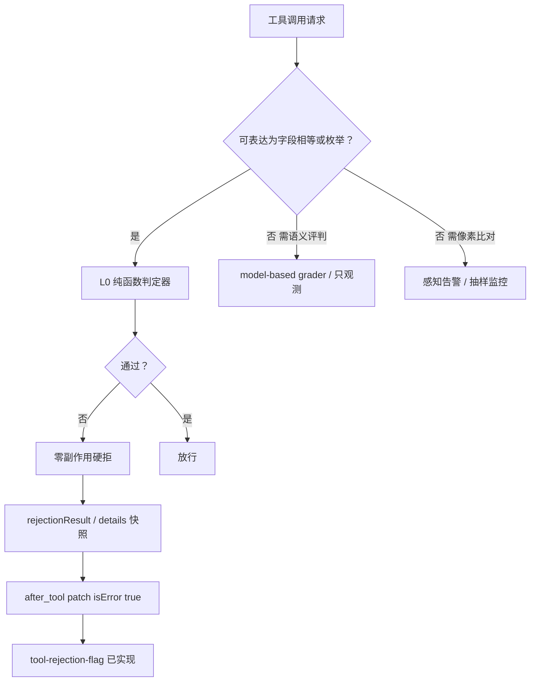
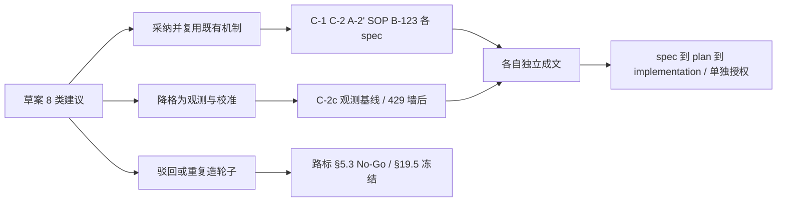

# 创作域 Harness 质量保障体系复审与立项规格 — 短剧链路

- **状态**：设计稿·待评审（brainstorming architectural 路径产出；**停在用户审阅 gate，未 commit / 未推 PR / 未动产品代码 / 未改任何既有文档**）
- **v1.1 状态回填（2026-11-15 09:04Z 二次复核）**：按「历史时点结论只做只追加状态回填」纪律，本文正文**保持原取证时点快照不改**；二次复核发现的过时数据 / 内部矛盾 / 悬空引用 / 未覆盖项，以及外部「工具完善度诊断」13 组工具建议的逐条裁决，统一登记在**附录 C**，**权威修正值以附录 C 为准**。入库 PR 时按附录 C 就地替换对应正文行；本轮仍停在审阅门，未 commit / 未推 PR。
- **v1.2 状态回填（2026-11-15 13:47:42Z 三次复核）**：master 再前移 6 提交至 `d6c44f3b`（#895），生产 Nest/K3s 到 `d6c44f3b` / `786624f6`，`plan_gate_blocked_total` 由零数据行变为有数据。按同一只追加纪律，正文与附录 C.1–C.7 快照不改，**新一轮时点事实与裁决登记在 C.8**，权威修正值以 C.8 为准。
- **定位**：**独立立项规格（决策门性质，docs-only）**。遵循路标 v1.3 §19.5「规格生命周期冻结」：本文**不是**与路标并列的第二份体系总纲，不重述已终审的方向 / No-Go / 优先级，不回写路标 SSOT；它是「创作域内容质量」这条**不在 §7 立项队列内**的工程线的差距审视与立项决策门。
- **触发依据**：§19.5 原文「冻结不关闭：新证据（**生产数据** / 上游大版本 / 部署形态变化）触发重审时按既有触发条款（§16.3 / §16.9 / §18.2）执行」。本次以 §4.4 的生产新证据登记**状态级纠偏**，不重开方向。
- **前置**：`2026-11-11-task-planning-engineering-roadmap-design.md`（v1.3 冻结 SSOT）、`docs/adr/0016-creative-skills-ecosystem-compatibility.md`（Accepted）、`2026-11-10-creative-skills-ecosystem-discovery-loading-design.md`（待评审）、C-1 / C-1a / C-1b / C-2a / C-2b / C-2c / A-2' / A-3 / SOP / B-123 / B-3 各立项 spec、`AGENTS.md`、`docs/agent/delivery.md`、`docs/agent/architecture.md`、`docs/superpowers/SPEC-CONVENTIONS.md`。
- **取证时点**：2026-11-15。真实 master = `ac61f4cd`（`gh api`，#880，2026-11-15T03:39:48Z）；生产 pi-runtime = `1010f1fd`（uptime 5877.3s）；生产 Nest = `lnkpi-api:6371372b`；K3s `pi-lnk-runtime` pod Running。⚠️ 主工作区检出的是路标 §17.1 点名的陈旧分支 `5926ac72`（vendor 0.85.1），**本文所有版本 / 实现结论以 CI 权威 0.99.2 树与生产为准**。
- **分支约定**：后续实施走 feature 分支 + PR + squash merge；每把代码刀独立 spec → plan → implementation + **单独授权**。
- **引用约定**：凡写「路标 §N」者指 `2026-11-11-task-planning-engineering-roadmap-design.md`；不带前缀的 §N 指本文档章节。`§5.3` 在两份文档都存在，故**指 No-Go 清单一律写「路标 §5.3」**，不带前缀者恒指本文 §5.3「判定器三分与零副作用拒绝路径」。
- **配图**：3 张内嵌 Mermaid 结构图，符合 `SPEC-CONVENTIONS.md` R1–R8；自检结果见 §13。

---

## 0. 配图索引（结构与视觉两类，均随本文档演进）

本文档只含结构图，一律 Mermaid 内嵌；**无视觉稿、无 SVG 附件**（表达的是判据分层与立项分流，不依赖真实比例 / 位置）。

| 编号  | 形式         | 内容                  | 位置   | 用途                      |
| --- | ---------- | ------------------- | ---- | ----------------------- |
| 图 1 | 内嵌 Mermaid | 四层现状盘点：哪些已有、哪一层是真缺口 | §5.1 | 否决「新建六门体系」的事实锚；判定本规格主战场 |
| 图 2 | 内嵌 Mermaid | 判定器三分与零副作用拒绝路径      | §5.3 | 后续每把代码刀的实现契约；防「模型自评当硬门」 |
| 图 3 | 内嵌 Mermaid | 草案建议 → 立项分流         | §12  | 防止细化落错 spec，避免重开路标      |

---

## 1. 目标（3 条，均可验收）

1. **纠偏**：把外部草案「为短剧新建一套质量门体系」的命题，用仓库代码 + 生产取证 + 上游 / 生态一手资料逐条裁决，产出一张无悬空引用的裁决表（§4）。验收：表中每一行的「证据」列都能用本文给出的路径 / 行号 / 命令复现。
2. **收敛**：给出本项目**真实缺口**的分层清单与最小立项队列，且每条必须复用上游原语或既有机制，不新建平行门框架、不新增 Prisma model（§5 / §7 / §12）。验收：§12 每把刀都能指到一个已存在的立项 spec 或明确标注「需单独立项」。
3. **可证伪**：定义后续代码刀必须满足的判据纪律（L0 契约机检、变异自检、生产取证、fake-0 排除、未闭环不 ALL_PASS），使规格本身不会变成又一份「有设计无实现」的文档债（§8 / §10 / §11）。

---

## 2. 范围（含明确不做）

### 2.1 本刀交付

一份规格文档：复审结论 + 事实基座 + 草案逐条裁决 + 分层缺口清单 + 复用式架构契约 + 立项分流 + 判据纪律。**零代码改动、零数据变更、零生产发布**。

### 2.2 明确不做

| 不做                                                                | 依据                                                                     |
| ----------------------------------------------------------------- | ---------------------------------------------------------------------- |
| 不新建「质量门引擎 / 框架 / gate DSL」、不新增事件类型                                | 路标 §5.3「不新增工具 / 数据库表 / 事件类型」（§19.1、§11.2-5）                            |
| 不新建 Prisma model（Gate / Passport / Asset 表）                       | 路标 §5.3 第 4 行、总纲 §2.2 / §5 红线；ADR-0016 `:58` 已把三张表列为「待新建的代价」，本刀只登记候选   |
| 不把 LLM / VLM judge 做成阻塞门、不引入 face embedding 相似度阈值作硬门              | §10.3-1 / §14.2 / §13.3；生态一手见 §4.3                                     |
| 不重开路标方向 / No-Go / 优先级，不向路标追加整章                                    | §19.5、§14.6 标题「仅追加状态行，不重述设计」                                           |
| 不 patch vendor、不新建 Task 表、不引入 `task_create` 三工具族、不建独立 Planner 子代理 | 路标 §5.3 第 1/2/4 行、`AGENTS.md:180`                                      |
| 不往 prompt-registry 加规划 / 质量规则条文、不把 `ask_user` 做成强制阶段              | 路标 §5.3 第 3/5 行、§13.2 通道裁决表（skills/ 按需加载为唯一可行通道）                       |
| 不把真模型 eval 接进 PR 卡门、不在 429 墙未解封时拍阈值 / 建基线                         | §18.2、§14.6 C-2c 行                                                     |
| 不照抄 coding agent 的「少设阻塞门」合并哲学                                     | OpenAI `harness-engineering` 一手前提是「代码可廉价重跑 + 测试可廉价复验」，创作域一次视频生成有真实算力成本 |
| 不改 `docs/README.md`、不重跑索引生成器、不 commit                             | 用户分阶段授权：先审产物内容；入库动作列为 §9「入库前需补」，等审阅批准后执行                               |

---

## 3. 与既有规格的关系（显式修订 / 显式推翻）

### 3.1 显式不修订

路标 `2026-11-11-task-planning-engineering-roadmap-design.md` v1.3 **正文不动**。本文若被采纳，只允许按 §19.5 / §14.6 做**状态行回填**，且回填内容仅限 §4.4 登记的三条生产新证据纠偏，不重述设计。

### 3.2 显式推翻（对象是外部草案，不是仓库既有规格）

| # | 草案隐含前提                       | 裁决            | 依据                                                                                                                                                                                          |
| - | ---------------------------- | ------------- | ------------------------------------------------------------------------------------------------------------------------------------------------------------------------------------------- |
| 1 | 「本项目还没有创作质量门，需要设计六道门」        | **推翻**        | 已有 9 个 `SKILL.md`（7 个 `drama-*`）承载 31 条编号 Gate + `drama-qc-review` L1–L4 四层审计 + 三色结论 + 传导规则；生产 7 个 drama skill 全部在线，`pi_runtime_skill_loads_total{skill="drama-storyboard",outcome="ok"} 2` |
| 2 | 「确定性判定器这一层是新增能力」             | **推翻**        | C-1 eval 的 `judgeCanvasCounts`（单一真相源）、C-2a/C-2b acceptance oracle、L0 契约机检、`verify-*` 脚本族、`prompt-registry` L0–L11 完整性门禁已上线；生产 `plan_gate_blocked` 9 次为真实拦截证据                                |
| 3 | 「VLM / 面部嵌入可以当与编译器同级的门」      | **推翻**        | Anthropic 一手：model-based graders `Non-deterministic / Requires calibration with human graders`；身份一致性的一手机制是生成时条件注入，非生成后打分（§4.3）                                                              |
| 4 | 「Harness 要新建策略层支持精简 / 完整双模式」 | **推翻为收敛**     | 已有 `PI_RUNTIME_TODO_TOOL` / `PI_RUNTIME_PLAN_GATE` / `PI_RUNTIME_ACCEPTANCE` 三个 kill switch + tiering 全量激活开关                                                                                |
| 5 | 「质量门 = 内容质量评分」               | **推翻为「契约合规」** | 路标 §10.3-1 禁主观完成描述、§14.2 自由文本禁入、§13.3 SOP 条文须一一映射 C-1 判据（不可证伪条文打回）                                                                                                                          |

### 3.3 与相邻资产线的边界

- **`2026-11-10-creative-skills-ecosystem-discovery-loading-design.md` + ADR-0016**：那条线是「技能发现 / 双通路加载 / 兼容分级 C0–C3 / `SkillCatalog`+`UserInstalledSkill` 控制面」，状态待评审、零实现；本文是「质量判定器与创作资产契约」，**互补不替代**。该 spec `:6` 自述「生产行为未在本轮验证」，本文 §4.4 补齐了生产侧取证。
- **C-1 / C-2 / A-2' / SOP / B-123 / A-3**：本文的细化产物**分流回这些既有立项 spec**（见 §12 与 图 3），不在本文展开实现设计。
- **`2026-09-14-codex-style-tool-plan-harness-design.md`**：已自标 V7 废止；路标 §4 G5 把这类「有设计无实现」列为文档债。本文不得成为同类，故 §10 要求可证伪判据。

### 3.4 按 §19.5「生产新证据」触发的状态级纠偏（登记，不重开方向）

| 项             | 既有断言                                                                                   | 2026-11-15 生产实测                                                                                                                 | 处置                                                                                                                                     |
| ------------- | -------------------------------------------------------------------------------------- | ------------------------------------------------------------------------------------------------------------------------------- | -------------------------------------------------------------------------------------------------------------------------------------- |
| DTL 触发率       | `AGENTS.md:133-136`、`tiering.ts:29-33`、路标 / 记忆均记「官方 Dynamic Tool Loading 触发率**至今为 0**」 | `pi_runtime_tool_search_calls_total{outcome="hit"} 26` / `miss 7` / `pi_runtime_tool_search_activated_total 45`（uptime 5877.3s） | **断言已时点过期**（#858 基线修复后生产行为改变）。按 §19.5 例外登记一次状态回填候选；`AGENTS.md` / `tiering.ts` 注释 / `tool-capability-catalog.md` 三者同步核，避免再按「0 触发」排期下沉工具 |
| acceptance 机制 | C-2a #866 已合、生产复测「硬拒生效」                                                                | `pi_runtime_acceptance_total` / `pi_runtime_acceptance_kind_total` **只有 `# TYPE` 行、零数据行**                                       | 「声明即校验不强制」在当前生产窗口**零触发**（`declared=0`）。这是观测缺口而非功能缺陷；登记为 C-2c 观测基线输入，**不改 DSL、不强制声明**                                                   |
| 生产镜像          | 路标 §4 G4 曾记「生产镜像落后 master 17 提交」                                                       | master `ac61f4cd` / 生产 `1010f1fd`（#876）                                                                                         | 生产确落后于真实 master；后续任何「质量门已上线」结论必须先核 build_info，**禁止只看 workflow 绿**                                                                      |


---

## 4. 规范与判据：草案逐条裁决

### 4.1 裁决表

| #   | 草案主张                                                           | 裁决                   | 证据                                                                                                                                                                                                                                                                                              | 处置                                                                                                                                              |
| --- | -------------------------------------------------------------- | -------------------- | ----------------------------------------------------------------------------------------------------------------------------------------------------------------------------------------------------------------------------------------------------------------------------------------------- | ----------------------------------------------------------------------------------------------------------------------------------------------- |
| C-1 | 对标 CI/CD：用**确定性验收**把非确定性输出压进可预测轨道                              | **采纳，落点纠正**          | 方向正确且本项目已在做（`judgeCanvasCounts`、acceptance oracle、L0 机检、`verify-*`）。但 Anthropic 一手：*「Deterministic graders are natural for coding agents because software is generally straightforward to evaluate: does the code run and do the tests pass?」* ⇒ 创作域无 `tsc --noEmit` 等价物，只能迁移「**结构化契约**」子集      | 判定器锚定画布终态 / 工具调用契约 / 字段枚举，不锚定审美与像素                                                                                                              |
| C-2 | 分六道质量门（剧本锁定 / 资产定义 / 资产视觉 / 分镜逻辑 / 视频前置 / 视频质检）                | **驳回「新建」，改「映射」**     | 六门对应的判据已逐条存在于 7 个 drama skill 的 Gate 1–7 + `drama-qc-review` L1–L4；生产 drama skill 在线                                                                                                                                                                                                            | 见 §6 映射表；不新增门 ID / 门状态机，先补**可执行层**                                                                                                              |
| C-3 | 剧本评分门（hook_payoff / causality / character，LLM-as-judge + 人工校准） | **降格为观测 / 抽样**       | 踩 §13.3（SOP 条文须一一映射 C-1 判据）、§10.3-1（禁主观完成描述）、§14.2（自由文本禁入）、路标 §5.3 第 3 行。一手：model-based graders *「Requires calibration with human graders for accuracy」*；Anthropic `harness-design-long-running-apps`：自评存在系统性 leniency、须生成/评判分离                                                                 | 不得作硬门；若要开展，前置条件 = human gold set + TPR/TNR 校准 + 与生成器分离，且**排在 C-1c 基线之后**（当前 429 墙未解，C-1a/C-1b 基线仍欠）                                             |
| C-4 | 资产视觉生成门：VLM 跨图一致性 + 面部嵌入余弦阈值 0.8                               | **驳回为硬门**            | 一手机制：InstantID / PuLID / IP-Adapter FaceID 在**扩散 cross-attention 阶段注入身份**，Runway Gen-4 `@reference` 具名复用 + I2V 首帧锚定；不是生成后 VLM 打分。ShotLock 作者自述「能管数据一致性，管不了图形一致性」。本项目全仓唯一 embedding 是 `deploy/docker/segment/main.py` 的 SAM 分割 embedding                                                         | 改为「**引用完整性 / 契约一致性**」确定性判定（ShotLock SL004/SL006/SL007 形态）：身份 ID 声明一次、镜头按 ID 引用、同一角色复用同一基准图、版本钉住。VLM 降为抽样监控 + 人工校准                               |
| C-5 | 画布操作图：依赖新鲜度 / readiness state / 局部返工                           | **采纳，且是真缺口，但复用既有机制** | 已有 `attach_refs`→`add_edge`+`refOrder`、`canvas-id-binding.ts`（多 upsert fail-closed）、C-2b `canvas_state` acceptance、`judgeCanvasCounts`、RB-D5 `missing_refs` fail-closed。缺的是**资产身份 / 版本 / 血统字段**（节点 id 为 `${type}-${Date.now()}-${++nodeSeq}`）与**跨 skill 机器契约**（现靠文本节点标题 + `recall_memory` 自由文本） | 不新建「操作图验证引擎」；在既有 ref / 节点数据面补结构化字段，判定器复用 `judgeCanvasCounts` 单一真相源范式                                                                            |
| C-6 | 精简 / 完整双模式，质量门做成可组合策略层                                         | **采纳，收敛为既有开关族**      | 已有 `PI_RUNTIME_TODO_TOOL` / `PI_RUNTIME_PLAN_GATE` / `PI_RUNTIME_ACCEPTANCE` 三个 kill switch + `buildToolEnsemble` 全量激活开关                                                                                                                                                                        | 每个判定器自带 kill switch + 指标，不新建策略层 / 配置表                                                                                                           |
| C-7 | Harness 贯穿生命周期（事前约束 / 事后验收 / 定位最早出错层）                          | **采纳，补一条落地硬约束**      | 本项目已注册 7/11 个上游 HookMap hook（`before_tool` block、`after_tool` patch、`before_run_end` followUp 均已跑通）。但 vendor 0.99.2 `execution/tools.ts:148` `executeToolCall` **恒返回 `{result, isError:false}`，不消费 `AgentToolResult.isError`**                                                                  | 任何「零副作用硬拒」必须走 `rejectionResult()` → `after_tool` patch `isError:true`（`tool-rejection-flag.ts` 已实现）；路标 §5.3 禁 patch vendor ⇒ **只能走 after_tool** |
| C-8 | 反馈闭环：黄金样例、拦截率分布、用户手动修正作信号                                      | **采纳，复用 eval 主线**    | C-1a 种子 9 条 / C-1b 补量 / L0 57 例 + 变异自检纪律已在；但 **429 跑批墙未解**（run3 error 6 / fail 3 / pass 0；run4 error 8 / fail 1 / pass 0；DeepSeek BYOK run-1 pass 7 / fail 19 / error 9，归因混杂）                                                                                                                   | 闭环接 C-1 / C-2c，不另建 eval runner；阈值 / 基线在墙解封前**不拍、不宣告闭环**                                                                                         |

### 4.2 草案未触及、但生产数据显示更紧急的三项

1. **acceptance 空转**：见 §3.4。已上线的可执行验收在生产窗口零声明 ⇒ 优先补「声明率 / 门覆盖率」观测，而不是再设计新门。
2. **生成失败无归因**：生产 `GenerationRecord` 共 6536 条 — `completed 4902 / failed 1265 / fallback_pending 368 / processing 1`，**非 completed 约 25.0%**，而全仓无任何质量门结果表 / 指标（`GET /metrics` 指标全集无 `quality` / `consist` / `passport` / `axis` / `identity` / `storyboard` 类）。⇒ **第一优先级是把既有失败数据变成可归因观测面**，不是加门。
3. **门的「有效性」未观测**：`plan_decisions_total{decision="timeout"} 11` 且无 `execute` 数据行，`plan_gate_blocked` 9 次 ⇒ 硬门确实在拦，但「拦完之后是否被有效自纠 / 是否误拦」无观测。与 §19.4-1 登记的 A-2' 自纠观测空白同源。

### 4.3 生态一手判据（本规格的裁决依据）

| 结论                                                                                                                                                                 | 一手来源                                                                                                          |
| ------------------------------------------------------------------------------------------------------------------------------------------------------------------ | ------------------------------------------------------------------------------------------------------------- |
| 确定性 grader 严格依赖 oracle；code-based grader 枚举 = String match / Binary tests / Static analysis / Outcome verification / Tool calls verification / Transcript analysis | <https://www.anthropic.com/engineering/demystifying-evals-for-ai-agents>                                      |
| model-based grader = Non-deterministic、须 human calibration；human graders 用于 calibrate；瑞士奶酪多层防御                                                                     | 同上                                                                                                            |
| 自评存在系统性正向偏置，须**生成 / 评判分离**、few-shot 校准、分数单调 ≠ 质量单调                                                                                                                 | <https://www.anthropic.com/engineering/harness-design-long-running-apps>                                      |
| JSON 结构化契约优于 Markdown（模型更不易误改 JSON）；`feature_list.json` 只许改 `passes` 字段                                                                                            | <https://www.anthropic.com/engineering/effective-harnesses-for-long-running-agents>                           |
| hook 确定性拦截：`PreToolUse` `permissionDecision:"deny"` / `exit 2` / `exit 1` 不阻塞 / `onFailure:"block"` fail-closed / `decision:"block"` / `additionalContext`         | <https://code.claude.com/docs/en/hooks> 、<https://code.claude.com/docs/en/hooks-guide>                        |
| 确定性 vs 非确定性二分：「Non-deterministic = 模型读指令；Deterministic = harness 必须执行（hook / deny rule / managed setting）」                                                         | <https://code.claude.com/docs/en/best-practices>                                                              |
| harness = core agent loop and execution logic；agent loop 定义                                                                                                        | <https://openai.com/index/unrolling-the-codex-agent-loop/>                                                    |
| 自定义 lint + 结构测试把规则写进代码、错误讯息注入修复指令；golden principles + background GC；doc-gardening 保知识库新鲜度；**minimal blocking merge gates**（前提不可迁移）                                 | <https://openai.com/index/harness-engineering/>                                                               |
| harness engineering 术语定义：「发现 agent 犯错 ⇒ 工程化使该错永不复发」；「给它验证手段，它多半会自纠正」                                                                                               | <https://mitchellh.com/writing/my-ai-adoption-journey>                                                        |
| 创作域**已有**可执行判定器（非 SOP 文本）：ShotLock `SL001–SL015` + `ShotSpec v0.1` + `deck.json` + `--fail-on P1` + 退出码 `0/1/2/3`；明确否定 `LLM self-review`                           | <https://github.com/nianjiang888/shotlock>                                                                    |
| `scripts/selftest.mjs`（零依赖、不调模型、覆盖全部确定性逻辑）作为每个 skill 的硬要求；`character-refs` 以单一 anchor + staleness tracked 承担资产新鲜度                                                  | <https://github.com/eternityspring/shuohao-skills>                                                            |
| 混合形态：markdown 规则库 + `validate_prompt.py C1~C26` / `gate_check.py` / `audit_contract.py` 机检                                                                         | <https://github.com/lixiaoxiao9888-create/manju-laoli-skill>                                                  |
| 身份一致性 = 生成时条件注入：InstantID（ID embedding 替换 cross-attention 条件）/ PuLID（ID insertion 不泄漏风格）/ IP-Adapter FaceID                                                        | <https://arxiv.org/abs/2401.07519> 、<https://arxiv.org/html/2404.16022v1> 、<https://arxiv.org/abs/2308.06721> |
| 具名可复用 reference（`@name`、跨会话保存、最多 3 个活跃 reference）                                                                                                                  | <https://help.runwayml.com/hc/en-us/articles/40042718905875-Creating-with-Gen-4-Image-References>             |
| judge 漂移：报 TPR / TNR 而非 raw agreement；train/dev/test 三分；criteria drift 概念                                                                                          | <https://hamel.dev/blog/posts/llm-judge/> 、<https://arxiv.org/pdf/2404.12272>                                 |
| pi 官方：extension lifecycle events（`tool_call` 返回 `{block:true}`）、Dynamic Tool Loading、`pi.appendEntry` / `setActiveTools`；官方**无内建权限系统**                             | <https://raw.githubusercontent.com/earendil-works/pi/main/packages/coding-agent/docs/extensions.md>           |
| pi `packages/evals` 定位是行为回归 / 文档增益 A/B，**不是发布 gate 集**；「One repetition cannot establish stability」                                                                 | <https://raw.githubusercontent.com/earendil-works/pi/main/packages/evals/README.md>                           |


> ⚠️ 生态研究自身标注的一手 vs 二手冲突（不采信二手数字）：shuohao 质量门数二手写「52 道」、一手 README 为 `14/10/10/8/18 = 60` 且新增 `novel-staging`；manju-laoli README 内部 10 vs 12 子技能、48 vs 51 规则库不一致；`reference authority` / `identity lock` **未找到一手来源**（社区口语标签）；Runway「95%+ 一致性」为二手转述。本文只引用其**机制形态**，不引用数量与百分比。

### 4.4 生产取证台账（2026-11-15，只读）

| 命令 / 途径                                                                           | 结果要点                                                                                                                                                                                                                                                                       |
| --------------------------------------------------------------------------------- | -------------------------------------------------------------------------------------------------------------------------------------------------------------------------------------------------------------------------------------------------------------------------- |
| `gh api repos/sev7n4/pi-lnk/commits/master`                                       | `ac61f4cd`（#880，`fix(eval): run-2 归因…`）                                                                                                                                                                                                                                    |
| `ssh deploy-cvm 'docker ps'` + `kubectl get pods -n pi-lnk-runtime`               | Nest `lnkpi-api`、K3s pod `pi-lnk-runtime-86f7f74984-ccvk5` Running 97m ⇒ **两个部署单元都在**（B-4 教训：单单元 0 命中不能下「未部署」结论）                                                                                                                                                           |
| `kubectl get deploy -n pi-lnk-runtime -o jsonpath=...image`                       | `127.0.0.1:5000/pi-runtime:1010f1fd`；`pi_runtime_build_info{version="1010f1fd"}`                                                                                                                                                                                           |
| `curl --noproxy '*' http://127.0.0.1:30100/metrics`                               | uptime 5877.3s；plan_proposed 12 / assumptions present 12 / plan_decisions timeout 11 / plan_gate_blocked 9 / tool_search hit 26 activated 45 / subagent spawned 13 / skills_loaded 11 / prompt_skills_tokens 1387 / acceptance **零数据行** / skill_loads `drama-storyboard` 2 |
| `# TYPE` 全集 + `grep -Ei 'quality\|consist\|passport\|axis\|identity\|storyboard'` | 唯一命中 `pi_runtime_skill_loads_total{skill="drama-storyboard",outcome="ok"} 2` ⇒ **零创作域质量门指标**                                                                                                                                                                               |
| `kubectl exec … -- ls -1 skills`                                                  | 11 个：7 个 `drama-*` + `ecommerce-product-photo` / `html-craft` / `research-delegate` / `task-decomposition`                                                                                                                                                                 |
| `docker cp lnkpi-api:/app/apps/server/data/lnkpi.db` → `sqlite3 'file:…?mode=ro'` | 匹配表仅 `UserAsset` / `GenerationRecord`；**无 gate / quality / passport / skill 表**。状态分布 `completed 4902 / failed 1265 / fallback_pending 368 / processing 1`                                                                                                                  |

---

## 5. 架构与契约

### 5.1 四层现状（见 图 1）

*图 1 · 把草案的「新建体系」拆成四层后，只有 L3 是真缺口；L1/L2 已存在且生产在跑，L4 缺失但按生态一手证据不可作阻塞门。这张图用于判定每一把后续刀该落在哪一层。*



| 层                | 已有资产（路径）                                                                                                                                                                                                                                            | 缺什么                                                                                                                                                                                    |
| ---------------- | --------------------------------------------------------------------------------------------------------------------------------------------------------------------------------------------------------------------------------------------------- | -------------------------------------------------------------------------------------------------------------------------------------------------------------------------------------- |
| L1 方法论           | 9 份 `SKILL.md`，其中 7 份 `drama-*` 承载 31 条编号 Gate；`drama-qc-review` L1–L4、三色结论、传导规则；另有 `ecommerce-product-photo` / `html-craft`                                                                                                                        | Gate 全部是自然语言：**无 Gate ID、无 schema、无断言、无零副作用拒绝、无 PASS/REVISE/REJECT 落库、无指标**。`services/pi-runtime/src/skills/loader.ts:23-53` 只取 `name`+`description`                                   |
| L2 行为 harness    | `gate/generation-gate.ts`（HITL + fail-closed + V-γ 重试预算）、`gate/plan-gate.ts` + wiring、`gate/propose-gate.ts`、RB-D5 `missing_refs`（`agent-canvas-tools.service.ts:1203-1220`）、`tools/canvas-id-binding.ts`、C-2a/b acceptance、C-1 eval、57+ 指标、SSE 一等化 | 生产 acceptance 零声明；门拦截后的自纠 / 误拦无观测；`plan_decisions` 全 timeout                                                                                                                           |
| **L3 可执行判定器与契约** | `attach_refs`/`localRefs`/`refOrder`/`resolveNodeRefs`、`first_last_frame` VideoMode、`evaluateMediaRefPreflight`、`judgeCanvasCounts`、`rejectionResult()` + `tool-rejection-flag.ts`                                                                  | **资产身份 / 版本 / 血统字段**（节点 id 时间戳；`CanvasNode.data` 为无类型开放字典）；**跨 skill 机器契约**（现靠文本节点标题 + `recall_memory`）；**镜头表 schema**（Blocking / 屏幕方向 / 景别枚举）；**ref 权威等级与版本钉住**；**质量门结果落 transcript** |
| L4 感知            | `generateVisionQaJson`（一次请求塞 N 张 `image_url` 输出结构化 JSON）、`image-refine.ts` 单图回流让模型自看、`SidebarAttachment.role` product/model                                                                                                                         | 跨图比对、VLM 一致性判据、face embedding、阈值、逐图 diff；**但按 §4.3 这些只能做抽样监控，且身份一致性应优先在生成时注入**                                                                                                         |

### 5.2 复用矩阵：上游原语 → 创作域质量门（不新建机制）

| 上游原语（0.99.2 vendor 路径）                                                                   | 本项目现状                                                                         | 创作域质量门可直接复用的用途                                                          |
| ---------------------------------------------------------------------------------------- | ----------------------------------------------------------------------------- | ----------------------------------------------------------------------- |
| `before_tool` `{args?, block?:{reason,terminate?}}`（`harness/agent-harness.ts:464-467`）  | **已吃满**，4 处注册（generation-gate / propose-gate / plan-gate / canvas-id-binding） | 门不达标时零副作用拦截；无需新钩子                                                       |
| `after_tool` `{content?, details?, isError?, usage?, terminate?}`（`:468-487`）            | **已吃满**，5 处注册                                                                 | 质量标注 / 证据写 `details`；`isError` 补正（`tool-rejection-flag.ts:53`）          |
| `before_run_end` `{followUp?}`（`:439-442`）                                               | **已吃满**（`plan-gate-wiring.ts:48-57`）                                          | 门失败后自动续跑一轮修正（不是自动 replan，遵路标 §5.2「只观测与门禁、不自动 replan」）                   |
| `appendCustomEntry` + `entryProjectors`（`agent-harness.ts:544` / `:535`）                 | **零消费**（B-2 已立项、未实施）                                                          | 把门结果 / 证据落进 transcript，天然随 compaction / fork 携带 ⇒ **质量门结果持久化的首选载体**     |
| `lane.setActiveTools` 门禁态 overlay（`:578`）                                                | **部分**（仅子代理 fork `session-manager.ts:3280`；B-1 待实施）                           | 门未通过时收缩可用工具集（tiering 保持唯一持有者，遵 B-123 spec D2 单写者）                       |
| `terminate: true`（`types.ts:445`）                                                        | **仅读不写**                                                                      | 批次级提前收尾（候选，需先验证与 followUp 的交互）                                          |
| `before_navigation` + branch summarization、`@earendil-works/pi-evals`、官方 `subagent/` 编排包 | 零消费（evals / subagent 有「不引 coding-agent 宿主层」成文理由）                              | **不迁移**：`eval/transcript.ts:4-17` 已记录理由；本仓 eval 走 vitest-evals + HTTP 面 |
| 未注册 4 hooks：`before_run` / `before_drive` / `after_response` / `before_navigation`       | 零命中                                                                           | 登记候选，不在本规格立项（G3 已有队列）                                                   |

> 注册口径纠偏：路标 §4 G3 写「11 个 HookMap 钩子已吃满」，按源码实测为 **7/11 已注册**（另 4 个为 0 命中）。此为口径不一致，按 §19.5 例外登记状态回填候选，**不改 G3 结论方向**。

### 5.3 判定器三分与零副作用拒绝路径（见 图 2）

*图 2 · 三类判定器的分流与唯一合法的硬拒路径。重点是：只有「可表达为字段相等 / 枚举 / 顺序约束」的分支允许阻塞；另两类只产出观测信号，且硬拒必须经 `after_tool` patch（vendor 不消费工具自设 isError）。这张图是后续每把代码刀的实现契约。*



| 类别                     | 允许形态                                                                  | 禁止形态                      | 本项目落点                                                          |
| ---------------------- | --------------------------------------------------------------------- | ------------------------- | -------------------------------------------------------------- |
| **确定性判定器**（扩大这一层）      | 字段相等 / 闭集枚举 / 顺序与覆盖约束 / 存在性 / 计数与时长预算 / 引用完整性                         | 主观评分、像素相似度                | `judgeCanvasCounts` 范式、L0 契约机检、`verify-*` 脚本族；新判据写成纯函数 + 单一真相源 |
| **model-based grader** | 固定 rubric + human gold set + TPR/TNR 校准 + 生成/评判分离；只做观测 / 抽样 / 回归 eval | 未校准即作阻塞门、自由文本结论、自动 replan | C-1 eval / C-2c 观测基线；**排在 429 墙解封之后**                          |
| **感知告警**               | 抽样监控、定位首次漂移点、人眼 A/B 校准                                                | 阈值硬门、替代最终人工验收             | 现有 `generateVisionQaJson` 单图解析能力可扩，但不得进 L0                     |

**硬拒路径硬约束**：vendor 0.99.2 `harness/execution/tools.ts:148` 恒 `return { result, isError: false }`，`AgentToolResult.isError`（`types.ts:440`）不被消费；`finalizeToolCall:178` 只取 `patch?.isError ?? executed.isError`。⇒ 工具内自设 `isError:true` 在 transcript 里恒为 `False`。唯一合法路径 = `rejectionResult()`（`todo.ts`）+ `after_tool` patch（`tool-rejection-flag.ts`）；**不可抛错**（会丢 `details`），**不可 patch vendor**（路标 §5.3）。

**门的定义（不新建引擎）**：一个门 = `可组合纯函数判定器 + kill switch + 指标 + 结构化回执`，注册在既有 `before_tool` / `after_tool` 面。不新增工具、事件类型、数据库表、配置文件。

---

## 6. 打样 / 主场景规格：草案六门 → 本项目真实资产映射

| 草案门      | 已有 SOP（skills/）                                                                         | 已有代码门                                                                                                                                 | 可机检判据（建议，落 L3）                                                        | 真实缺口                                                                                                                                    |
| -------- | --------------------------------------------------------------------------------------- | ------------------------------------------------------------------------------------------------------------------------------------- | --------------------------------------------------------------------- | --------------------------------------------------------------------------------------------------------------------------------------- |
| 1 剧本锁定   | `drama-script-writing` Gate 1–5、`:40` 定位四件套经用户确认、`:125` 剧本改动传导提示                        | `propose_plan` + `plan-gate`（用户确认）、A-3 `assumptions[]`（生产 `plan_assumptions_total{present="present"} 12`）                             | 剧本产物结构化；`contentHash` 锁定；下游引用锁 hash 而非自由标题                            | 无 lock 状态 / 无 hash / 无 diff；`Story` 表无 lock 字段                                                                                          |
| 2 资产定义   | `drama-storyboard` 阶段一资产表（四类资产、已有/缺失标注，`:39` 不得重复生成）                                    | **RB-D5 `missing_refs` fail-closed**（`canvas-write.ts:521-557`）、`attach_refs`→`add_edge`                                              | 资产 ID 声明一次、镜头按 ID 引用；「已有资产不得重复生成」从文本升级为硬拒                             | 资产表是 Markdown 文本节点；无 schema / 无稳定 ID / 无重复生成硬拒                                                                                          |
| 3 资产视觉生成 | `drama-character-design` Gate 1–5、`drama-scene-worldview` Gate 1–4、fidelity lock 锚点原文   | `image-refine.ts` 单图回流（`imageRefine` 四态）、`evaluateMediaRefPreflight` 技术预检                                                             | **引用完整性**（ShotLock SL004/SL006/SL007 形态）：身份 ID / 锚点字段 / 基准图唯一性与逐字复用   | 无跨图比对、无锚点数据结构、无 hex / 服装拓扑校验；**不应先上 face embedding**                                                                                    |
| 4 分镜逻辑   | `drama-storyboard` Gate 2（180° 轴线 / 视线匹配 / 屏幕方向 / Match on Action）、`drama-qc-review` L2 | `attach_refs`（数据层）/ `connect_nodes`（视觉层）/ `resolveNodeRefs` 合并解析                                                                      | 镜头表 schema：`Shot ID` / 景别 / 角度 / Blocking / 屏幕方向 / 连续性锚点 / 时长；相邻镜枚举比较 | 镜头表只是文本节点；源码 `180° / 轴线 / eye-line` 0 命中                                                                                                |
| 5 视频前置   | `drama-motion-video` Gate 5 首末帧契约、`:23` 先获批静帧                                           | `generation-gate.ts` HITL + 同轮拦截 + `pending_confirm`、`MediaRefPreflight`（5MB/10MB、2048/4096）、`buildVideoReferenceBundle` 四种 VideoMode | 「静帧已验收」作为 `run_video_generation` 前置状态；参考图维度→唯一权威素材映射                  | 已有的是**技术**预检与 HITL，不是「静帧获批」的创作前置；无权威等级 / 版本钉住                                                                                           |
| 6 视频质检   | `drama-motion-video` Gate 1–5、`drama-qc-review` L1–L4 + 绿/黄/红三色结论、`:89` 基准资产变更传导规则      | 无                                                                                                                                     | 抽帧一致性与时长预算的可计算量；传导规则从文本升级为 stale 标记                                   | 无视频抽帧 / 播放态检测 / 音频时长探测 / audio↔video 比对；`lip-sync 未开始`、成片剪辑 / 合成 / 导出已于 2026-10-19 下线（`docs/DOCK_STUDIO_E2E_TRACKING.md:3-7,26,29,226`） |

> **共性缺口**：七份 skill 之间靠「文本节点标题约定 + `recall_memory` 自由文本」交接，无机器可读的资产表 / 镜头表 / IP bible schema，无稳定 ID / 版本 / 下游引用失效检测（`AgentMemory` 仅 `superseded` 标记，无 version / contentHash）。**这才是 §6 六门真正要补的那一层**，而不是再造一遍门。

**可执行判据示例（三条，均须可证伪）**：

1. `ID_REFERENCE_CLOSURE`：每个出场实体首次出现须登记稳定 ID；后续引用必须指向已登记 ID；孤儿引用 / 一名多实体 → 硬拒 + 回执附合法 ID 清单（复用 A-2' `rejectUnknownIds()` 形态）。
2. `AUTHORITY_REF_UNIQUE`：每个镜头的「身份 / 首帧 / 尾帧 / 场景 / 道具」各维度最多一个胜出素材，且必须指向已验收母版；未验收或多重权威 → 硬拒。
3. `DURATION_BUDGET`：`中文台词字数 ≤ 镜头时长 × 4.5`（`render-canvas-view.ts:127` 已有常量，但 `:464` 明说画布无 timing 字段、数字由模型自报）⇒ 判据须读取**真实结构化字段**，不得采信模型自报数字。

---

## 7. 数据与状态变更

**本刀：零数据变更。**

| 项      | 现状事实（取证）                                                                                                                        | 候选（登记，不落地）                                                                             |                                                    |
| ------ | ------------------------------------------------------------------------------------------------------------------------------- | -------------------------------------------------------------------------------------- | -------------------------------------------------- |
| 节点 ID  | `${type}-${Date.now()}-${++nodeSeq}`（`agent-canvas-tools.service.ts:84-88`）；`CanvasNode.data: Record<string, unknown>` 无 schema | 资产身份 ID / `contentHash` / `version` / `sourceRef` / `lineage` 字段化                      |                                                    |
| 参考绑定   | `localRefs` / `refOrder` / `mentionedKeys`；`SidebarAttachment.role` 仅 \`product                                                 | model`；`first_last_frame\` 仅视频模型参数                                                     | ref 维度枚举（身份 / 首帧 / 尾帧 / 环境 / 动作 / 风格）+ 权威等级 + 版本钉住 |
| 生成记录   | `GenerationRecord`（`schema.prisma:273-311`）：`status` 为自由 `String`，`model` 自由字符串，`sessionId`/`nodeId` 是唯一绑定                      | 失败归因枚举（确定性门拦截 / 上游失败 / 超时 / 降级）；**不得新增表**                                              |                                                    |
| 门结果    | 无                                                                                                                               | `appendCustomEntry` + `EntryProjector`（B-2）落 transcript，随 compaction / fork 携带；理由是无需新表 |                                                    |
| Prisma | 40 model / 34 migration，无 `QualityGate` / `Passport` / `Asset` / `Skill`                                                        | 三张表（`SkillCatalog` / `UserInstalledSkill` 等）属 ADR-0016 M0 的**独立代价**，本文不启用              |                                                    |

**严禁**：新增 Prisma model / Task 表（路标 §5.3）、自由文本结论字段（§14.2、§19.1 已砍 `note`）、把 `dependsOn` 做成执行调度（§10.3-2 降级为记录性元数据）。

---

## 8. 纯函数与算法（含单测要求）

1. **判定器纯化**：每个判据 = 纯函数 `(structuredInput) => { verdict, reason, evidence }`，不读网络 / 不调模型 / 不写状态。跨 eval 与生产复用**同一真相源**（`canvas-judge.ts` `judgeCanvasCounts()` 是既有先例，C-1 eval 与 C-2 生产共用）。
2. **聚合优先级**：沿用 C-2a `verifyAcceptance()` 的 `reject > fail_open > pass`；查询故障 fail-open 软提醒 + 计数，证据不足 / 结构非法零副作用硬拒。
3. **零副作用**：校验必须先于任何写入（`todo.ts:278-284` 的 `verifyAcceptance` 先于 `overwriteTodos` 是范式）；拒绝回执必须带当前快照 + `diff.updates:[]` + `rejected:true`。  
   |  |  |  
   | --- | --- |
4. **变异自检（强制）**：用「对象字面量条件恒 falsy」做行级突变；判 RED **必须用完整 stdout 的 `AssertionError` / `failing tests` 标记**（历史踩坑：`| tail` 吃掉退出码 ⇒ 伪变异恒绿）；整文件 fail ≠ 判据 RED，须核 per-test 并先排除模块解析失败。
5. **fake-0 排除**：判「不存在 / 零命中」一律 `grep -E` 或单模式，**禁用 BSD BRE `\|` 轮替**（多次复踩）；并做已知词反向对照（如 `attach_refs` 46 文件、`localRefs` 68、`pending_confirm` 71）证明检索有效。本文 §4.4 的「零创作域质量门指标」即按此口径得出。
6. **判据先贴真实记录求值**：按数据形态分支的修复，判据必须先在真实生产记录上求值 + 变异自检（#815 教训）；禁止「凭印象写判据」。
7. **否定例**：每条新判据必须附至少一条「应该被拦截」的负例 fixture（ShotLock `bad_deck.json` / shuohao `examples/` 形态）。


---

## 9. 文件级改动清单

**本刀**：仅新建 `docs/superpowers/specs/2026-11-15-creative-domain-harness-quality-gates-design.md`（本文）。

**入库前需补（本次未执行，等待审阅批准）**：

| # | 动作 | 依据 |
|---|---|---|
| 1 | `docs/README.md` 追加一行登记（目录 / 是什么 / 为什么放这里） | `docs/agent/docs.md:26,:51` |
| 2 | 从仓库根重跑 `python3 scripts/docs/gen_index.py > scripts/docs/index_data.json && python3 scripts/docs/gen_index_md.py`；**禁止手改 `INDEX.md`**、不写死份数 | `docs/README.md:107,:183-190,:192-205` |
| 3 | `pnpm verify-spec-figures --file <本文路径>`；结果贴 §13 | `SPEC-CONVENTIONS.md §8` |
| 4 | 若同步修订 `AGENTS.md` / `tiering.ts` 注释的 DTL 断言 ⇒ 另跑 `pnpm verify-claims` | `delivery.md:240`、`AGENTS.md:33-36` |
| 5 | 开 docs 分支 → PR → 三个 required check 全绿 → **停在合并前等单独授权** | `delivery.md:9-36,:36`（纯文档 PR 同样触发三个 required check）、用户分阶段授权 |

**后续各刀**的文件面由 §12 分流的各立项 spec 自行成文，本文不预设。

---

## 10. 测试策略与验收标准

### 10.1 本刀（docs-only）验收

- [ ] §4.1 裁决表每行「证据」列可复现（路径 / 行号 / 命令 / URL）；无悬空引用、`verify-links` 在 CI 干净 checkout 下通过。
- [ ] §4.4 生产台账命令可原样重跑；**结论标注取证时点与 uptime**，不写成永恒事实。
- [ ] §2.2 每条「不做」能指向具体条款号。
- [ ] `pnpm verify-spec-figures` 通过（§13）。
- [ ] 本文不宣告任何未闭环项 `ALL_PASS`。

### 10.2 后续代码刀的门禁（沿用既有纪律，不新设）

`pnpm -r build`（vitest 绿 ≠ tsc 绿）→ `pnpm test:runtime` / `test:server:changed` → 引用事实性数字先实测 → 改 `prompt-registry` 跑 `pnpm prompt:lint` → 改规范跑 `pnpm verify-claims` → L0 契约机检全绿 → 变异自检 RED → 合并树核验 → **合并前单独授权** → 生产取证（核 `build_info` 版本，覆盖 Nest + K3s 两个部署单元）→ 行为复测。

### 10.3 诚实边界（不得越过的验收线）

- 跑批墙 429 未解 ⇒ C-1a / C-1b 行为基线仍欠，**不拍阈值、不建基线、不宣告基线闭环**。
- A-6 / §8 真机 UI 走查本环境不可代跑。
- 交付清单 8 项证据（compaction 存活 / fork / resume / 指标建档 / 完成后清空等）仍欠。
- `spawned 7天/200run` 复核、P2 严格重启前后同门对比仍欠。
- 本文**未做端到端 / 真机复测**（§6 诚实边界第 5 条同源），不下「验收完成」结论。

---

## 11. 风险

| 风险 | 影响 | 缓解 |
|---|---|---|
| **规格漂移 / 又一份「有设计无实现」** | 路标 G5 已把 `2026-09-14-codex-style-tool-plan-harness-design.md` 列为文档债 | §10 强制可证伪判据 + §12 每刀分流到既有 spec；本刀零代码，审阅 gate 后才动 |
| **工作树陈旧陷阱** | 主工作区 `5926ac72` / vendor 0.85.1，与 CI 0.99.2 差异大；`apps/web` 等为断链符号链接 | 所有版本 / 实现结论以 `gh api` 真 master + 干净树 / 生产为准；判「不存在」以 HEAD / master 为准（B-4 教训） |
| **生产镜像落后 master** | 生产 `1010f1fd` ≠ master `ac61f4cd` | 任何「已上线」结论先核 `pi_runtime_build_info`；改 `services/pi-runtime` / `skills/` 合并后须手工 dispatch `runtime-deploy.yml` |
| **judge 漂移 / criteria drift** | 未校准 judge 会把门变成「再生成一遍质量意见」 | human gold set + TPR/TNR + 生成/评判分离 + 变更即重校准；排在 C-1c 基线之后 |
| **感知门误判扼杀创作自由** | 无限画布是自由创作，不是固定六阶段流水线 | 门 = 可组合判定器 + kill switch（路标 §5.3）；L4 只做抽样告警；不新增强制阶段（路标 §5.3 第 5 行） |
| **规范断言时点过期** | DTL「触发率 0」已被生产 45 推翻 | 按 §19.5 生产新证据例外做状态回填；三处（AGENTS.md / tiering.ts / tool-capability-catalog.md）同步核 |
| **429 墙** | 行为跑批 / 基线不可用，解锁是用户侧动作（实名 / 换 key） | 短 prompt 放行 ≠ 跑批可用；解锁探针判据必须贴近目标负载；不擅自落 collectors |
| **vendor isError 语义** | 硬拒被当成普通结果 | 只能走 `after_tool` patch；不可抛错、不可 patch vendor |

---

## 12. 后续包 / 路线图：立项分流（见 图 3）

*图 3 · 草案建议的三种去向。采纳项必须落到既有立项 spec；降格项等观测基线；驳回项归入路标 §5.3 No-Go / §19.5 冻结。这张图用于防止把细化写回已冻结的路标 SSOT。*



| 优先级 | 刀 | 内容 | 归属 / 落点 | 前置条件 |
|---|---|---|---|---|
| **P0 · 观测先行**（建议首个立项） | D-0 生产观测回填 | ① 三条状态级纠偏回填（§3.4）；② 生成失败归因枚举 + 门覆盖率 / 声明率指标；③ acceptance 零声明与 plan-gate timeout 的归因采集 | 归 **C-2c**（`2026-11-14-c2c-acceptance-observation-baseline-design.md`）+ 交付清单回填；**只读，不改 DSL** | 无 429 依赖；但 C-2c spec 明令「四 gate 未达不建基线 / 不拍阈值」⇒ 只作 gate 输入 |
| **P1 · 契约层**（本规格真缺口） | D-1 创作资产契约 | 镜头表 schema + 资产身份 / 版本 / 血统字段 + ref 权威等级；三条可执行判据（§6） | **需单独立项**（不在 §7 队列内）；与 A-2' id 契约 / A-3 assumptions 正交 | 必须先出 spec → plan；不新增 Prisma model；变更 `skills/**` 需手工 deploy |
| **P2 · 上游原语吃满** | B-2 / B-1 / B-3 | `appendCustomEntry` 承载门结果；门禁态 `setActiveTools` overlay；`<tool_guidelines>` | `2026-11-15-b123-upstream-primitives-design.md` / `b3-tool-guidelines-design.md`（均待评审、代码刀未实施） | 遵 D1 顺序 **B-3 → B-1 → B-2**；B-3 裁决点待用户拍板 |
| **P3 · 感知能力（降格）** | D-2 抽样监控 | VLM 跨图比对 / 首帧锚定质量信号，仅告警不阻塞 | 登记为 **C-1c 之后**的候选；关联 ADR-0016 M0 的 `skills/**` 重写 | human gold set + TPR/TNR 校准完成；429 墙解封 |
| **不立项** | — | 独立质量门引擎 / face embedding 硬门 / LLM 评分硬门 / 动态 DAG 调度器 / 独立 Planner 子代理 | 路标 §5.3 No-Go、§19.5 冻结 | — |

**执行纪律**：每把刀独立 `spec → plan → implementation` 循环；阶段 A/B/C 代码刀合入前需**单独授权 + 生产复测**；docs-only 刀按用户既有惯例可授权合并-取证-复测全链，但仍须停在合并前确认。

---

## 13. 配图规范自检

- 图 1 / 图 2 / 图 3 均为内嵌 Mermaid `flowchart`，节点 ≤ 12、标签一律引号包裹、判定节点用 `{"…？"}`、无 `<br/>`、无半角括号标签；§0 索引列全三图，正文 §5.1（图 1）/ §5.3（图 2）/ §12（图 3）均有引用，三处图注均说明「这张图在验收 / 决策里干什么」。
- 无 SVG 附件 ⇒ R1 / R6 / R8 不适用；R2（编号 1→3 连续）、R3（图注）、R4（正文引用）、R5（§0 索引）、R7（首行 `flowchart`）逐条自查通过。
**执行记录（2026-11-15 实跑）**：

```bash
cd /Users/4seven/workspace/pi-lnk && \
  env -u NODE_OPTIONS PATH="$HOME/.nvm/versions/node/v24.13.0/bin:$PATH" \
  pnpm verify-spec-figures --file docs/superpowers/specs/2026-11-15-creative-domain-harness-quality-gates-design.md
```

输出：`✓ docs/superpowers/specs/2026-11-15-creative-domain-harness-quality-gates-design.md` / `校验完成：1 篇在范围内，0 篇历史文档跳过（< 2026-09-22），**0 个错误，0 个警告**` / `EXIT=0`。

⇒ 本文配图规范校验通过。注：该结果只覆盖 R1–R8 配图规则，**不等于** `verify-links` / `verify-claims` 与 CI 三 check 通过；后者按 §9 在入库 PR 阶段以 CI 干净 checkout 为权威复核。

---

## 附录 A · 本文引用的仓库关键路径索引

- `services/pi-runtime/src/tools/todo.ts`（`rejectionResult` / `verifyAcceptance` / `rejectUnknownIds`）、`task-state.ts`（双索引 reduce）
- `services/pi-runtime/src/gate/{generation-gate,plan-gate,plan-gate-wiring,propose-gate}.ts`
- `services/pi-runtime/src/tools/acceptance.ts`、`canvas-judge.ts`、`tool-rejection-flag.ts`、`tiering.ts`、`image-refine.ts`、`render-canvas-view.ts`、`canvas-id-binding.ts`、`canvas-write.ts`
- `services/pi-runtime/src/eval/{golden-cases,runner,driver,transcript,cli}.ts`、`src/metrics.ts`、`src/index.ts`（hook 注册）、`src/session-manager.ts`（EVENT_MAP / attachEvents）
- `apps/server/src/agent/agent-canvas-tools.service.ts`（RB-D5 / 节点 id / `listGenerationTasks`）、`apps/server/src/studio/studio.service.ts`（`runVisionQaInternal` / `MediaRefPreflight`）、`apps/server/prisma/schema.prisma`（`GenerationRecord` 40 model）
- `packages/shared/src/{index,agentContract,nodeRefs,sidebarAttachments,mediaInfo}.ts`（均在 CI 0.99.2 worktree 完整）
- `skills/drama-{script-writing,scene-worldview,character-design,storyboard,audio-design,motion-video,qc-review}/SKILL.md`
- `vendor/earendil-works/pi/packages/agent/src/harness/{agent-harness.ts,hooks.ts}`、`harness/execution/tools.ts`、`types.ts`
- `docs/superpowers/specs/2026-11-11-task-planning-engineering-roadmap-design.md` 的 §5.3 / §13.2 / §14.2 / §14.6 / §18.2 / §19.5（均属路标 SSOT）

## 附录 B · 未闭环清单（继承，不宣告 ALL_PASS）

跑批墙 429（C-1a / C-1b 基线）· 交付清单 8 项证据 · A-6 真机走查 · 阶段 A/B/C 代码刀未立项 · `spawned 7天/200run` 复核 · P2 严格重启前后同门对比 · C-2c 四 gate 未达 · ADR-0016 M0–M4 全为路线图 · `lip-sync` 未开始 · 成片合成 / 导出已下线。

---

## 附录 C · 2026-11-15 09:04Z 二次复核状态回填（v1.1，只追加）

> **性质**：本附录是对本文正文的**状态级补正台账**，不是第二份体系总纲，不重开本文方向 / No-Go / 优先级。正文数值为 `2026-11-15T03:39:48Z`（master `ac61f4cd`）时点快照，按用户偏好保留原样；**本附录给出权威修正值与处置**。入库 PR 时按 C.2 逐行就地替换。
> **触发依据**：路标 §19.5「新证据（生产数据 / 上游大版本 / 部署形态变化）触发重审时按 §16.3 / §16.9 / §18.2 执行」。本轮新证据 = 生产部署单元已变更 + master 连续前移 7 提交 + 上游/生态一手复核。
> **本附录不含新增配图**，§0 图索引与 §13 配图自检结论不变（v1.1 未改任何 Mermaid 块）。

### C.1 复核基准（本轮独立重跑，非转述）

| 项 | 正文时点值 | 本轮权威值 | 取证据道 |
|---|---|---|---|
| GitHub 真实 master | `ac61f4cd`（#880，03:39:48Z） | **`64aee361`（#889，08:38:13Z）** | `gh api repos/sev7n4/pi-lnk/commits/master` |
| 滚动链 | — | `ac61f4cd` → `3ddf3e44` → `816dfcf7` → `0acecdb3` → `25b7b230` → `f5ded918` → `ba4309c2` → `6842fdcf` → `64aee361` | `gh api .../commits?sha=master` |
| 生产 pi-runtime | `1010f1fd`（#876） | **`6842fdcf`**（`pi_runtime_build_info{version="6842fdcf"} 1`） | `kubectl get deploy -n pi-lnk-runtime` + `curl --noproxy '*' http://127.0.0.1:30100/metrics` |
| 生产 Nest | `lnkpi-api:6371372b` | **`lnkpi-api:ba4309c2`** | `ssh deploy-cvm 'docker ps'` |
| 本文入库状态 | 未入库 | **仍未入库**（`?ref=master` 404） | `gh api .../contents/<本文>?ref=master` |
| 生产取证时间 | 2026-11-15（未标 UTC） | **2026-11-15T09:04:54Z** | `ssh deploy-cvm 'date -u'` |

⚠️ master 在本轮复核期间仍在滚动（15:43 见 `ba4309c2`、复核中见 `6842fdcf`、末次见 `64aee361`）⇒ 任何「已上线 / 未实现」结论**必须绑定 sha 与 UTC 时点**，且生产与 master 是不同版本，禁止只看 workflow 绿。

### C.2 需修正 / 已过时 / 悬空引用台账

| # | 正文位置 | 原文 | 权威修正值 | 依据 |
|---|---|---|---|---|
| 1 | §0 / §4.4 | master `ac61f4cd` | 见 C.1 | `gh api` |
| 2 | §0 / §3.4 | 生产 `1010f1fd` / `6371372b` | 见 C.1 | C.1 命令 |
| 3 | §3.2 推翻 1 / §5.1 | **9 个 `SKILL.md`** | **11 个**（7 个 `drama-*` + `ecommerce-product-photo` / `html-craft` / `research-delegate` / `task-decomposition`）；「31 条编号 Gate」精确成立、`drama-qc-review` 是 L1–L4 无编号 Gate。本文 §4.4 自己写 11 ⇒ **内部矛盾** | master 干净树 `skills/`；「9」源自同样用陈旧工作树的 ADR-0016 draft |
| 4 | §7 | **40 model / 34 migration** | **45 / 45**（master `schema.prisma`）；40 是工作区 `5926ac72` 的数，与 §0「以 CI 权威树为准」自相矛盾 | `gh api ...?ref=64aee361` |
| 5 | §2.2 / §6 / §12 P3 | `ADR-0016`（Accepted）作前置 | **悬空引用**：`docs/adr/0016-*.md` 在 `?ref=ba4309c2` 与 `?ref=6842fdcf` 均 404、`commits?path=` 空、干净树 `docs/adr/` 只到 0015 ⇒ **从未入库的工作区 draft**。`2026-11-10-creative-skills-ecosystem-discovery-loading-design.md` 同 | `gh api` 存在性判定 |
| 6 | §5.2 | `terminate: true`（`types.ts:445`） | 行号无法在 master 复现：实际在 `agent-harness.ts:466/484`、`execution/tools.ts:27/49/189`；`types.ts:256` 是 `terminated` | master vendor 0.99.2 |
| 7 | §3.4 | DTL「0→45」为 #858 后首次新证据 | 仓库内既有反证：`tool-capability-catalog.md:275` 早在 2026-10-06 记 `activated=42 / ≈11.5% / 基线已取`；`tiering.ts:164-168` 已细化为「零 outcome 标签 = 模型没去搜」。本轮 09:04Z 实测 `hit 5 / miss 3 / activated 7`（新部署 counter 重置），**不是 26/45** | master 代码 + 本轮 `/metrics` |
| 8 | §4.1 C-8 | run-1 `pass 7 / fail 19 / error 9`、「归因混杂」 | **#884**（`0acecdb3`）已回填 BYOK 解墙后 run-1/run-2 干净基线并勘误为 `pass 8 / fail 18 / error 9 / skipped 4`、三分类逐条归因；**#888**（`6842fdcf`）证明 18/18 fail 是 **120s 截断假象**，非 429 / 非 pacing / 非模型能力 | master `2026-11-13-c1b-fullset-multiturn-eval-design.md` §10 + `2026-11-15-eval-observation-fix-design.md` |
| 9 | §10.3 / C-3 / C-8 / §11 / 附录 B | 「429 跑批墙未解 ⇒ C-1a/C-1b 行为基线仍欠」 | **结论保留、理由修正**：agnes 通道 8 条 429（实名认证）确未解；BYOK 通道已解且基线已回填。门槛应改为 **C-2c 四 gate 未达**（`2026-11-14-c2c-*.md:6` 与 #884 §10.2 均自留「不拍阈值」） | master 代码 |
| 10 | §12 P2 | 「B-3 裁决点待用户拍板」 | **已裁决**（#879 `415e4b32`），`b3-tool-guidelines-design.md` §3:68 标题改为「2026-11-15 已裁决」 | master |
| 11 | §4.3 | pi 官方「Choose an integration point」/ State 三行表、「Activate tools dynamically」 | 本轮生态复核：上游 main 与 vendored 版 `extensions.md` **均未检索到**该标题 / State 表（只有「## State Management」独立小节）；官方章节实际标题为 **"Dynamic Tool Loading"**（内容一致）。⇒ 本文 §4.3 该两行应标注「无法验证，仅引用机制形态」，不采信措辞 | 上游 main `packages/coding-agent/docs/extensions.md`（Contents API）+ master vendor |
| 12 | §1 目标 1 | 「表中每一行证据列都能复现」 | **自定验收未达**：§4.3 生态表 14 行属外部 URL、§4.4 台账 6 行属生产时点快照、§13 自检输出属本机执行记录，均无法由仓库代码复现。应补「证据分级：代码可复现 / 外部 URL / 生产时点快照 / 无法复核」 | 本轮 C.3 + 生态复核 |
| 13 | §12 | 分流表无任何 `docs/superpowers/plans/` 落点；D-1 仅「需单独立项」 | **本轮已补齐**：D-1 独立 spec 落盘 `docs/superpowers/specs/2026-11-15-d1-creative-asset-contract-design.md`；D-0 细化进已入库的 C-2c spec；P2 顺序按 B-3→B-1→B-2（B-3 已裁决） | 本轮交付 |
| 14 | §3.2 推翻 3 | 「全仓唯一 embedding 是 SAM」 | 字面不严谨：`sidebar-vision.ts:40`、`packages/agent/src/refs/text-generation.ts:11` 另有 `text-embedding` 模型名字符串命中。结论方向（无身份 embedding 能力）不受影响 | master 代码 |
| 15 | §4.4 台账命令 | `grep -Ei 'quality\|consist\|...'` | 表格单元格内的 `\|` 是 **markdown 转义**，命令本体应为 ERE 轮替 `\|` 去掉反斜杠后的 `|`；直接复制表格文本到终端会匹配字面竖线 ⇒ 恒零命中、判据失效。本轮按 C.3 可复制命令重跑并做已知词反向对照，结论「零创作域质量门指标」仍成立 | 本轮 C.3 命令与输出 |

### C.3 生产取证重跑台账（2026-11-15T09:04:54Z，只读）

| 途径 | 本轮结果 | 与正文差异 |
|---|---|---|
| `ssh deploy-cvm 'docker ps'`、`kubectl get deploy -n pi-lnk-runtime` | Nest `lnkpi-api:ba4309c2` + K3s `127.0.0.1:5000/pi-runtime:6842fdcf`，**两部署单元都在**（B-4 口径） | 正文 `1010f1fd` / `6371372b` 为旧窗口 |
| `curl --noproxy '*' http://127.0.0.1:30100/metrics` | `build_info{6842fdcf}`；`tool_search hit 5 / miss 3 / activated 7`；`skill_loads`: drama-script-writing 1 / research-delegate 3 / task-decomposition 1；`plan_gate_blocked_total` **零数据行**；`pi_runtime_acceptance_total` **只有 `#TYPE` 行、零数据行** | 正文 26/45/9/drama-storyboard 2 为旧部署 counter；**acceptance 零声明结论仍成立** |
| 指标 `grep -Ei 'quality\|consist\|passport\|axis\|identity\|storyboard\|stale\|lineage\|version'` | 仅 `build_info{version="6842fdcf"}` 与 `prompt_info{...Version...}` 命中；**零创作域质量门指标**。已知词反向对照（`tool_search_calls_total` / `acceptance_total` / `build_info`）全部命中 ⇒ 排除 fake-0 | 与正文一致 |
| `docker cp lnkpi.db` → `sqlite3 'file:…?mode=ro'` | `GenerationRecord` **6558 条**：`completed 4924 / failed 1265 / fallback_pending 368 / processing 1`，非 completed ≈ **24.9%** | 正文 6536 / 4902 为旧快照，比例结论不变 |
| 同上 `.tables` | **新发现既有领域数据面**：`Shot`（id/sessionId/title/prompt/order/status/positionX/positionY）、`Story`（status/episodeCount，无 lock/hash）、`Material`（shotId/type/status/**metadata TEXT**）、`SubagentTask`（status/outcomeJson/expiresAt/parentSessionKey）、`UserAsset`（sourceNodeId/metadata）。**无 gate / quality / passport / skill 表** | 正文 §7 未点明；这是「不新增表」的关键既有资产 |
| `gh api` | L6 权威值 `PROMPT_SPEC.md:73-76`：硬线 **3200** / 预警 2720 / 实测 **3111** / **余量 89**（机器生成）；`AGENTS.md:151` 手写 3132/余 68 已过时；常驻 `ALWAYS_ON_TOOL_NAMES` **39** / 注册 **57** / 延迟 18 | 正文未量化工具预算 |

**本轮可复现命令（原样执行；表格内 `\|` 仅为 markdown 转义）**：

```bash
curl -s --noproxy '*' http://127.0.0.1:30100/metrics \
  | grep -Ei 'quality|consist|passport|axis|identity|storyboard|stale|lineage|version'
curl -s --noproxy '*' http://127.0.0.1:30100/metrics \
  | grep -E 'pi_runtime_tool_search_calls_total|pi_runtime_acceptance_total|pi_runtime_build_info'
```

> ⚠️ 时点纪律：以上指标为 `6842fdcf` 部署窗口的 counter 值，会随下一次部署归零；**只作状态回填，不写成恒真事实**。

### C.4 外部「工具完善度诊断」13 组 / 18 个工具建议 —— 正文未覆盖部分的逐条裁决

**事实**：18 个工具名在 master 全部 specs 零命中；正文全文（v1.0，393 行）**未出现任何一个工具名**，即正文只裁决了「草案 8 类主张」，未按工具粒度处置。下表补齐，裁决口径与 §4.1 一致。

| 组 | 建议工具 | 正文覆盖 | 本轮补正裁决 | 应承载层 / 落点 |
|---|---|---|---|---|
| P0-1 | `track_asset_version` | §6 共性缺口、§12 D-1「需单独立项」 | **驳回工具形态，采纳命题**：节点内 `imageVersions.ts` 已有 `parentVersionId` 链，跨节点谱系确无；但版本是写事务，交 LLM 工具 = 把一致性交给概率模型 | 数据模型 + 服务端单一写者 → **D-1 spec §7** |
| P0-2 | `check_script_id_closure` | §6 判据 1 `ID_REFERENCE_CLOSURE` | **采纳命题、复用 `rejectUnknownIds()`**：不新建工具，落 `acceptance.ts` oracle 枚举 | L0 纯函数判定器 → D-1 spec §8 |
| P0-2 | `compare_axis_direction` | **无裁决** | **驳回工具形态，采纳结构化前提**：`Shot` 表无 axis/framing/blocking/screenDirection 列，源码 `180°/轴线/eye-line` 零命中 ⇒ 先字段化，再做 `Shot` 相邻镜枚举比较 | 数据模型 + 确定性判定器 → D-1 spec §7/§8 |
| P0-2 | `validate_visual_lock` | **无裁决**（C-4 只裁决「VLM 不作硬门」） | **驳回硬门形态**：视觉锁应改「引用完整性 / 版本钉住」确定性判定（ShotLock SL004/SL006/SL007 形态），不引入 face embedding 阈值 | L0 判定器 → D-1 spec §8 |
| P0-3 | `scan_dependents` | §6 门 6「传导规则升级为 stale 标记」 | **主断言不成立**：`relationsForNode()` 已有 upstream/downstream（`agent-canvas-tools.service.ts:493-515`），`get_node` 已返回。缺的是自动 stale 传播 | 服务端写路径 → D-1 spec §7 |
| P0-3 | `mark_stale` | 同上 | **驳回工具形态**：失效传播须 build-system 式增量自动触发，不能靠模型「想起来才扫」 | 服务端单一写者事务 → D-1 spec §6/§7 |
| P0-4 | `estimate_generation_cost` | **无裁决**，且漏掉既有落点 | **驳回工具形态**：master 已有 `2026-11-14-pricing-profit-billing-e2e-design.md`、`6371372b 成本自动采集`、`PointHold` 预扣、`turn-budget`、上游 `recordUsage`；缺的是把「预估」升级为 `propose_generation` 前 fail-closed 准入 | gate + 结算层 → D-1 spec §5.4；观测归 C-2c |
| P1-5 | `save_golden_sample` / `run_regression_test` | C-8「复用 eval 主线」 | **驳回工具形态**：已有 12 条 `golden-cases.ts` + `eval/{runner,driver,cli,registry}.ts` + 变异自检纪律；judge 漂移校准（TPR/TNR）确无，属 C-1c 之后 | 离线 fixture + CI grader；正文 §10.3 门槛改 C-2c 四 gate |
| P1-6 | `compute_face_embedding_similarity` | **有明确否决裁决**（C-4 / §2.2 / §12） | **维持否决** | — |
| P1-6 | `compare_clothing_topology` | **无裁决** | **驳回硬门形态**：`generateVisionQaJson` 已有结构化 QA、`image-refine.ts` 已有单图回流；身份一致性优先生成时条件注入（InstantID/PuLID/IP-Adapter FaceID），非生成后打分 | L4 抽样监控；登记 C-1c 之后 |
| P1-7 | `check_audio_video_sync` | **无裁决**（§6 门 6 只登记缺口） | **采纳命题、驳回工具形态**：`lip-sync` 未开始、成片剪辑/合成/导出 2026-10-19 已下线 ⇒ 当前无检测对象，工具无落点；且纯数值判定属服务端脚本 | 登记候选，待成片链路恢复后单独立项 |
| P1-8 | `aggregate_generation_results` | §4.2-2 / §12 D-0 | **主断言不成立**：前端 `useSelectionGenerate.ts:313-324`、`selectionBatchTelemetry.ts:11-25`、`taskHistoryGrouping.ts` 已有 done/failed/cancelled/timeout/skipped/creditCost 全量聚合；`GenerationRecord` 无 `batch_id` 是数据面缺口 | 聚合进只读查询面 `details` + C-2c 观测，不新增工具 |
| P1-9 | `render_prompt_template` | **无裁决** | **主断言不成立**：已有 11 个场景 `promptScaffold` 的 `{{SUBJECT}}` 变量占位符、`packages/agent/src/prompt-modes/`、`studio.service.ts:930-934 expandPromptContent`、`list_generation_scenes` 的 scene_id 分支 | 复用既有模板资产，不新增工具 |
| P2-10 | `generate_harness_report` | **无裁决** | **驳回工具形态**：被评者自己生成审查报告违反「生成/评判分离」（Anthropic 自评 leniency、`/code-review` 用 fresh subagent） | 离线 eval report / 只读查询面；不新增工具 |
| P2-11 | `create_sandbox_session` | **无裁决** | **驳回工具形态**：沙盒是宿主/进程级策略（Codex `sandboxing.rs` traits、CodeBuddy `CODEBUDDY_IS_SANDBOX` 故意做成环境变量），让模型决定是否进沙盒是反模式。#888 已有 `2026-11-15-eval-canvas-provisioning-design.md`（每 run 新画布，#889 已拍板方案 A）作功能最近落点 | 归 eval-canvas-provisioning spec，不新增工具 |
| P2-12 | `orchestrate_agent_pipeline` | **有明确否决裁决**（§2.2 / §5.2 / §12） | **维持否决**（路标 §5.3 动态 DAG 调度器 / 独立 Planner 子代理 No-Go）；补充事实：master 已有 `SubagentTask` 持久单据 + background/`collect_subagent_result`，「单次调研」断言本身也已过时 | 归 `2026-11-14-subagent-contract-d2-nonblock-design.md` |
| P2-13 | `record_user_correction` | **无裁决**（C-8 只有「闭环接 C-1/C-2c」） | **驳回工具形态、采纳命题**：`AgentSideRail.vue:666-688` 点赞/点踩仅前端 ref 无落库；但按 harness-engineering「把规则写进代码」与 Anthropic「用户报告的失败转成 test case」，应落 eval fixture + 规则，不是运行时工具 | C-1 eval fixture / `verify-claims` 类机检 |

**汇总**：18 个工具名中，正文原有明确否决裁决 **2 个**；本轮补正后 **0 个建议按原形态立项**，其中 3 条主断言被既有实现直接推翻（P0-3 / P1-8 / P1-9），6 条有等价物，4 条确无实现但均应由数据模型 / 服务端 / 离线 grader / 策略层承载。**全部 13 组收敛为一个底座 + 只读面**，见 D-1 spec。

### C.5 上游与生态增量（正文 §5.2 的补强，不推翻方向）

- **§5.2 复核准确**：7/11 hook 已注册、`appendCustomEntry`/`entryProjectors` 零消费、`lane.setActiveTools` 仅 `session-manager.ts:3280` 一次、`execution/tools.ts:148` 恒 `{result, isError:false}` —— 全部经 master 干净树（vendor **0.99.2**）复核成立。
- **但未吃满的原语远不止 §5.2 所列**：`recordUsage` + `UsageRow` + `usage` 事件 + `getContextUsage()`（一整套成本/用量账本）、`structuredContent`/`outputSchema`、内建 `validateToolArguments`、`before_run`/`before_drive`/`after_response`/`before_navigation`、`setTools`、`terminate`/`followUp`、`CustomAgentMessages`、`before_compaction.decline`、嵌套 `ctx.executeTool`、`prepareLoadout`/`ToolExposure`、离线 `StructuredOutputJudge` —— 约 10 类零/部分消费。
- **工具膨胀量化**：常驻 39 / 注册 57 / 延迟 18；L6 余量 **89**。若按诊断再加 13 个（按 `AGENTS.md:155`「未被点名必须常驻」）⇒ 常驻 52 / 注册 70，同时踩 5 条红线：`PROMPT_SPEC.md:76` 预算、`ADR-0005:56`「别都塞进常驻」、`ADR-0005:28` 全量 schema 单调增长、`AGENTS.md:177` 延迟即不可达、`verify-tool-tiering` A1/A2/A5。官方解法是 `extensions.md` "Dynamic Tool Loading"：**注册全部、保持 inactive、`setActiveTools` 动态激活**。
- **生态一手补强**：Codex `sandboxing.rs` 的 `ApprovalDecision`/`Approvable` trait + `execpolicy` Starlark `prefix_rule`（`forbidden > prompt > allow` 取最严）+ `tools/README.md`「工具定义层不得耦合 approval flow / runtime execution」；Claude Code best-practices 确定性二分「*If something has to happen every time, make it a hook, a deny rule, or a managed setting*」+ hooks `permissionDecision:"deny"` / `exit 2` / `onFailure:"block"`；Anthropic advanced-tool-use（58 工具≈55K tokens、最常见故障是选错工具/参数错、`defer_loading` 省 85%）；CodeBuddy `CODEBUDDY_SKILL_TIERS` 固定 10000 字符预算与工具结果外部化。
- **创作域不可照搬代码域**：OpenAI `harness-engineering` 的 `minimal blocking merge gates` 前提是 «corrections are cheap / irresponsible in a low-throughput environment»；一次视频生成有真实算力与计费 ⇒ 校验必须**前置成 fail-closed 准入**，不是「生成→失败→廉价重跑」。正文 §2.2 已有此裁决，本条补上一手原文依据。

### C.6 正文仍然成立、不因本附录推翻的结论

§3.2 推翻 2 / 4 / 5；§4.1 C-2 驳回「新建六门」改映射、C-4 驳回 VLM 硬门、C-7 的 `after_tool` 硬拒路径；§5.3 判定器三分与「不可抛错 / 不可 patch vendor」；§6 共性缺口（七份 skill 靠文本节点标题 + `recall_memory` 交接、无稳定 ID/版本/下游失效检测）；§8 判据纪律七条；§10.3 不宣告闭环；§12 D-0 归 C-2c、D-1 不在 §7 队列需单独立项、P2 顺序、不立项清单；附录 B 的未闭环项。

### C.7 诚实边界

本附录只做**只追加状态回填**，未改正文任何历史时点数字、未动产品代码、未 commit / 未推 PR / 未重跑 `verify-links` / `verify-claims`；C.3 的指标与 DB 数字绑定 `2026-11-15T09:04:54Z` 与 `6842fdcf` / `ba4309c2` 两个部署单元，会随下次部署变化；C.4 的裁决是**立项判断**，不是实现结论；C.5 引用的外部 URL 中 `developers.openai.com/codex/config-reference` 抓取 403、pi 上游 main 的「State 三行表」未检索到，均已标注不采信。本文与 D-1 spec 均**停在用户审阅 gate**，不宣告任何未闭环项 `ALL_PASS`。

### C.8 2026-11-15T13:47:42Z 三次复核状态回填（只追加）

> **性质**：C.1–C.7 为 09:04:54Z 快照，按纪律不改；本节只登记新一轮时点事实与裁决，**权威修正值以本节为准**。触发依据同附录 C 头：路标 §19.5「新证据（生产数据 / 上游大版本 / 部署形态变化）触发重审」。

| # | 项 | C.1–C.7 时点值 | 本轮权威值（13:47:42Z） | 证据 / 处置 |
|---|---|---|---|---|
| 1 | GitHub 真 master | `64aee361`（#889，08:38:13Z） | **`d6c44f3b`（#895，13:06:03Z）** | `gh api commits/master`；滚动链新增 `f6a22d4a`(#890) → `cb1d0b4f`(#892) → `f9f616e1`(#893) → `d6dc7b22`(#891) → `786624f6`(#894) → `d6c44f3b`(#895) |
| 2 | 生产部署单元 | Nest `ba4309c2` + K3s `6842fdcf` | Nest **`d6c44f3b`** + K3s **`786624f6`** | `ssh deploy-cvm 'docker ps'` + `kubectl get deploy -n pi-lnk-runtime`；两单元仍在（B-4 口径）。K3s 落后 master 一个提交属预期（#895 为 pricing/web 改动，不触发 runtime-deploy） |
| 3 | `pi_runtime_plan_gate_blocked_total` | 零数据行 | **有数据**：`create_nodes_batch 1 / set_node_text 5 / upsert_media_node 3` | `/metrics`。旧结论作废；此变化由 #894（pending-work barrier + plan-gate wiring 改造）带来，属 counter 时点值，不写恒真 |
| 4 | `pi_runtime_acceptance_total` | 只有 `#TYPE` 行、零数据行 | **仍只有 `#TYPE` 行、零数据行** | `/metrics`；原结论不变，声明即校验不强制 |
| 5 | `pi_runtime_tool_search_calls_total` | `hit 5 / miss 3 / activated 7` | `hit 11 / miss 3`（`activated` 标签本轮未复现） | counter 随 #894 重新部署滚动；DTL「0→45」相关结论仍以 C.2 #7 的仓库内反证为准 |
| 6 | L6 预算 / 工具数 | 3200 / 2720 / 3111 / **余 89**；常驻 39 / 注册 57 / 延迟 18 | **全部不变** | `gh api ...PROMPT_SPEC.md?ref=master` L73–76 + `tiering.ts` `ALWAYS_ON_TOOL_NAMES` 仍 39；#891 删 `task_tool.md` 规则、改走 `promptGuidelines`，未动预算表 |
| 7 | B-3 状态 | C.2 #10「#879 已裁决」 | **已实施上线**：#891 `d6dc7b22` 把工具引导迁入 `<tool_guidelines>` XML 段、`todoTools` 规则组整删 | master commit files + `session-manager.ts` diff；C.2 #10 裁决结论不变，状态由「已裁决」前进到「已合入」 |
| 8 | #893 快照判据假 fail | C.2 #8/#9 归因基线 | **已合入上线**：`f9f616e1` 修 transcript fold 读 vendor `tool_start.args`，9/9 假 fail 修复 | master commit；K3s `786624f6` 在该提交之后 ⇒ 已上线。C-1b 基线口径升级为「同 run 同画布、跨 run 干净」（见本轮 #896） |
| 9 | 开放 PR / 并行窗口 | 未登记 | 开放 PR **仅 #896**（`abacecb7`，P1 每 run 新画布 provisioning，DELTA=5，生产用户路径零接触）；本地 9 个 worktree，`feat-sse-conversation-view-unification` / `feat-visp-read-media` 改 `agent-canvas-tools.service.ts`，`feat-conversation-share` / `s1-cost-console-align` 改 `schema.prisma` | `gh api pulls?state=open` + `git worktree list` + 各 worktree `git status --short`；影响裁决见 D-1 spec §12 状态回填 |
| 10 | 路标「未收尾」 | — | 路标 v1.3 §19.5 **已拍板冻结**，§7 队列余 C-3 upmerge 未立项；本文与 D-1 均仍未入库（`?ref=master` 404） | `gh api .../contents/<path>?ref=master`；冻结条款要求细化只进立项 spec ⇒ **不阻塞 D-1 立项与实施** |

**C.8 可复制命令**（表格外，`|` 无需 markdown 转义）：

```bash
curl -s --noproxy '*' http://127.0.0.1:30100/metrics \
  | grep -E 'pi_runtime_build_info|pi_runtime_acceptance_total|pi_runtime_plan_gate_blocked_total|pi_runtime_tool_search_calls_total'
```

> ⚠️ 时点纪律：本轮指标绑定 `786624f6` 部署窗口，随下次部署滚动；「plan_gate 从零到有」是**状态变化事实**，不是恒真数值。C.4 的 18 工具逐条裁决与 C.6 仍成立结论均不因本节改变。D-1 已获用户授权进入 writing-plans；本文仍停在审阅门、未 commit / 未推 PR。

---

## 附录 D · 2026-11-16 规格复审定稿（v1.3，只追加）

> **性质**：本附录对本文与 D-1 spec 做一次**收敛复审**，正文与附录 A/B/C（历史时点快照）一律不改；**权威结论以本附录为准**。触发：① 三份规格经 #916 入库（`018b0929`，合并树 == CI head 树 `a3ff0124`）后被 #919「恢复 master 到 #915 代码树」回退删除（当前 master `bcbe771b` 上三份 404，`git status=removed`）；② 2026-11-16 D-1 遗留刀逐刀取证暴露**根因**（三 oracle 生产数据面无写者）；③ 用户 2026-11-16 拍板把「吃满上游、不重复造轮子」定为**第一原则**，并要求先复审定稿 + 排全量计划 + 一次性实施。

### D.1 第一原则：吃满上游、不重复造轮子（显式，最高优先级）

**任何质量判据 / 工具 / 数据字段的立项，必须先证明下列三条，缺一即驳回：**

1. **等价物检索**：上游 `pi-agent-core@0.99.2` 与本项目既有代码（hook / oracle / 数据面 / 定价 gate / 既有 model 列）中**没有**可复用的等价物。判「不存在」须 `grep -E` + 已知词反向对照（§8.2-5 fake-0 排除），禁止凭印象。
2. **接线优先于新建**：若存在等价物，只做**接线 / 重新锚定**，不新建平行实现。判据优先锚到**已存在的结构化数据面**（节点 id + `refOrder`/`localRefs`、`SidebarAttachment.role`、`parentVersionId` 链、`generateVideo.duration` 入参 + `pricing.quote` 时点），而不是新造字段。
3. **禁造数与禁自报**：不得为「让门可判定」而新造**无人写入**的字段，不得把**生成指令 / 模型自报数字**冒充判据证据（`prompt` ≠ 台词字数，#815 教训）；创作域无 `tsc --noEmit` 等价物，只能迁移 §4.1 C-1 的结构化契约子集。

**据此一律驳回**（与 §2.2 / §4.1 C.4 / C.4 逐条裁决一致）：新建质量门引擎 / 门 DSL / 事件类型；新增 LLM 工具；face embedding / VLM 硬门；给只读孤儿表（`Shot`）加列；凭 `prompt` 派生台词字数；把模型自评分当硬门。

### D.2 入库状态回填

- #916（`018b0929`）三份规格入库，合并树 == CI head 树 `a3ff0124`、6/6 blob KEPT、parent=新 master。
- #919（`bcbe771b`）「恢复 master 到 #915 代码树」把三份文档 `status=removed`，当前 master 全部 404。
- 本轮按定稿态**重新入库**：仍走 docs-only PR + 三 required check + 合并树核验；遵守只追加纪律，历史快照不改。

### D.3 D-1 遗留根因与收敛裁决（详见 D-1 spec 附录 D.7）

逐刀取证（生产 `lnkpi.db` 只读 + master 代码）暴露：`idClosure` / `authorityRef` / `durationBudget` 三 oracle 当前生产数据面均无真实写者（画布零 `dialogueChars`/`assetId`/`duration`、7 条 Material 零 `authority`、`Shot` 只读孤儿表），构成**同一个根因**——「为门造字段」违反 D.1 第一原则。

**收敛裁决**：不实施「造字段让门可判定」的任何方案；改为把三 oracle **重新锚定到已有结构化数据面**（等价物检索见 D-1 spec D.7），并保留 F2（客户端 stale 传播，写路径闭环、不依赖上述字段）。生产 `acceptance` 零声明（C.8 #4）⇒ 观测先行（D-0 归 C-2c）排在 oracle 接线之前，kill switch + 指标随判据自带（§5.3）。

### D.4 诚实边界

本附录是**复审裁决**，不是实施结论；三 oracle 在重新锚定 + 生产复测前不宣告生效，`durationBudget` 门在存量会话上仍恒 fail-closed（诚实拒绝）。429 墙 / A-6 真机走查 / 429 后 judge 校准等既有欠账不受本附录影响。
