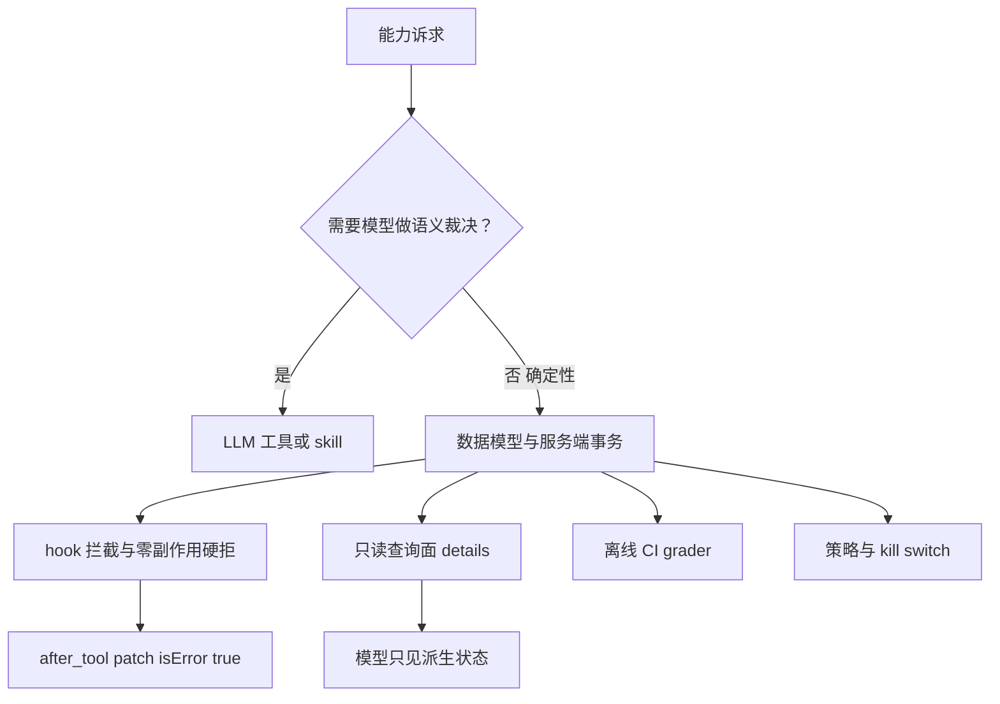
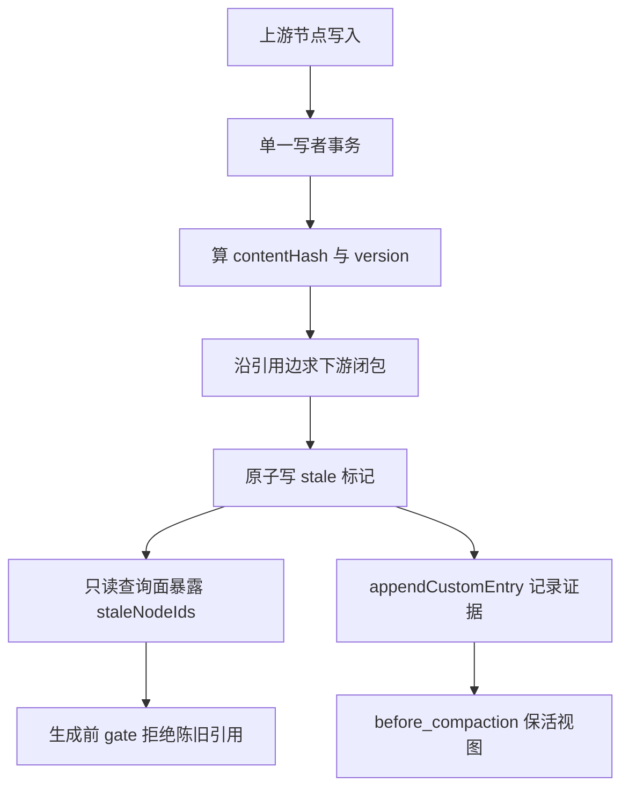
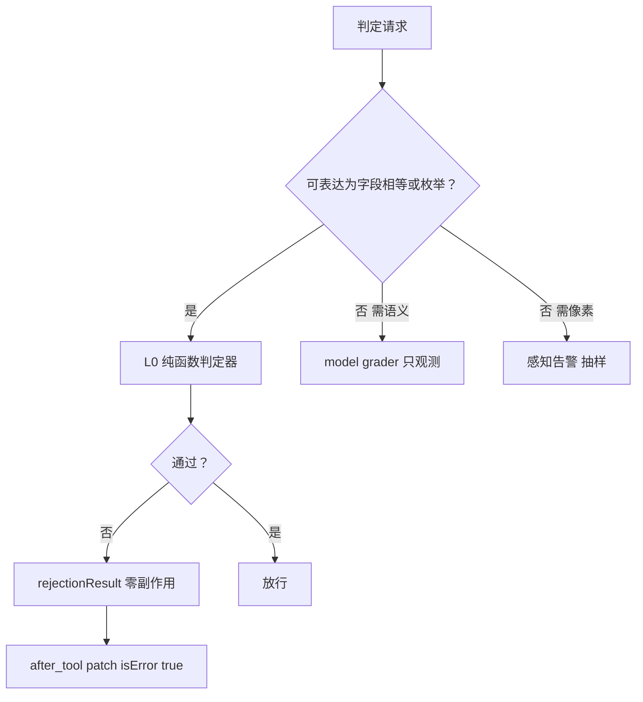

# D-1 创作资产契约与可执行判定层 立项规格

- **状态**：设计稿·待评审（brainstorming architectural 路径产出；**停在用户审阅 gate，未 commit / 未推 PR / 未动产品代码**；对既有文档仅做「只追加」的附录 C 状态回填，见 §9）
- **v1.1 状态回填（2026-11-15 13:47:42Z 三次复核）**：master 再前移 6 提交至 `d6c44f3b`（#895），生产 Nest/K3s 分别到 `d6c44f3b` / `786624f6`。本文正文取证快照（09:04:54Z / `64aee361`）按纪律不改，**新一轮时点事实与并行窗口影响裁决统一登记在附录 C**，权威修正值以附录 C 为准。用户的实施授权已给出，进入 writing-plans 阶段；正文 §12 末「本轮不进入 writing-plans」为该时点状态，以附录 C 为准。
- **定位**：**D-1 独立立项规格**。路标 v1.3 §19.5「规格生命周期冻结」要求后续审视 / 细化产物直接进对应立项 spec、本文件只回填状态行；本 spec 是 `2026-11-15-creative-domain-harness-quality-gates-design.md`（下称「复审规格」）§12 判定为「真缺口、需单独立项、不在 §7 队列内」的 D-1 的**实际落盘产物**。它不是第二份体系总纲，不重述方向 / No-Go / 优先级，不回写路标 SSOT，不修订复审规格正文；复审规格 v1.1 的补正台账见其**附录 C**。
- **前置**：`2026-11-11-task-planning-engineering-roadmap-design.md`（v1.3 冻结 SSOT，§5.3 / §7 / §19.5）、复审规格（docs-only，未入库）、`2026-11-14-c2a-acceptance-generation-oracle-design.md`（#866 已上线）、`2026-11-14-c2b-acceptance-canvas-state-design.md`（#868 已上线）、`2026-11-14-c2c-acceptance-observation-baseline-design.md`（已入库，四 gate 未达）、`2026-11-13-a2-model-side-id-contract-design.md`、`2026-11-15-b123-upstream-primitives-design.md`、`2026-11-15-b3-tool-guidelines-design.md`（#879 已裁决）、`docs/adr/0005-tool-tiering-official-dynamic-loading.md`、`docs/adr/0016`（⚠️ 未入库 draft，仅登记不引用）、`AGENTS.md`、`prompt-registry/PROMPT_SPEC.md`、`docs/superpowers/SPEC-CONVENTIONS.md`。
- **取证时点**：2026-11-15T09:04:54Z。真实 master = `64aee361`（#889，08:38:13Z，`gh api`）；生产 Nest = `lnkpi-api:ba4309c2`；生产 K3s `pi-runtime` = `6842fdcf`（`pi_runtime_build_info` 实测）。⚠️ master 在本轮复核期间连续前移（`ba4309c2` → `6842fdcf` → `64aee361`），且**生产与 master 不是同一版本** ⇒ 所有「已上线 / 未实现」结论均绑定 sha 与 UTC 时点。工作区 HEAD `5926ac72` 与部分断链符号链接目录为陈旧分支，不作判据源。
- **上游版本**：`@earendil-works/pi-agent-core@0.99.2`（master 干净树 `vendor/earendil-works/pi/packages/agent/package.json:3`）。
- **分支约定**：后续实施走 feature 分支 + PR + squash merge；每把代码刀独立 `spec → plan → implementation` + **单独授权**；改 `services/pi-runtime` / `skills/**` 合并后须手工 dispatch `runtime-deploy.yml`。
- **引用约定**：「路标 §N」指 `2026-11-11-task-planning-engineering-roadmap-design.md`；「复审规格 §N」指 `2026-11-15-creative-domain-harness-quality-gates-design.md`；不带前缀的 §N 恒指本文件。
- **配图**：3 张内嵌 Mermaid 结构图，符合 `SPEC-CONVENTIONS.md` R1–R8；自检见 §13。

---

## 0. 配图索引

本文档只含结构图，一律 Mermaid 内嵌；无视觉稿、无 SVG 附件（表达的是承载面、写路径与判定分流，不依赖真实比例 / 位置）。

| 编号 | 形式 | 内容 | 位置 | 用途 |
|---|---|---|---|---|
| 图 1 | 内嵌 Mermaid | 能力诉求的六层承载面分派 | §5.1 | 决定每一项需求「能不能做成 LLM 工具」的准入判据；防止把数据模型问题塞进工具注册表 |
| 图 2 | 内嵌 Mermaid | 写路径的失效传播与证据留存 | §6.2 | 定义「上游变更 ⇒ 下游 stale」的唯一合法写路径；验收时核是否有第二条写入通道 |
| 图 3 | 内嵌 Mermaid | 判定器三分与零副作用硬拒链 | §8.1 | 后续每把代码刀的实现契约；防止模型自评当硬门、防止硬拒被当普通结果 |

---

## 1. 目标（3 条，均可验收）

1. **把真缺口收敛成一个底座而非 13 个工具**：把外部「工具完善度诊断」13 组建议逐条裁决后的真实缺口，落为「数据模型 + 服务端写路径 + 确定性判定器 + 只读查询面 + 离线 grader + 观测」六层契约，**零新增 LLM 可调用工具、零新增 Prisma model、零新增事件类型**。验收：§5.1 承载面表每一层都能指到 master 上的既有文件或本 spec 明确列出的改动面；§9 文件清单中不出现任何 `tools/*.ts` 新增注册。
2. **让判定不可跳过**：把 `acceptance.ts` DSL 从「声明即校验不强制」升级为「同一真相源、离线 eval 与生产 gate 共用、fail-closed 必经」，且硬拒零副作用、transcript 可证。验收：§8 每条判据均有 L0 契约机检 + 负例 fixture + 变异自检 RED；生产 `pi_runtime_acceptance_total` 从「只有 `#TYPE` 行」变为有 `declared` 数据行（**这是观测目标，不是本刀承诺**）。
3. **可证伪、不产生新文档债**：本 spec 每个数字标注证据级别，每把后续刀指到具体 `spec → plan` 落点；不宣告未闭环项 `ALL_PASS`。验收：§4 证据分级表齐备、§12 每把刀有归属 spec 或明确「需单独立项」、§10.3 诚实边界不被后续 PR 静默删除。

---

## 2. 范围（含明确不做）

### 2.1 本刀交付

一份规格文档：事实基座 + 承载面架构 + 数据契约 + 判定器契约 + 失效传播算法 + 测试与判据纪律 + 立项分流。**零代码改动、零数据变更、零生产发布、零 commit**。

### 2.2 明确不做

| 不做 | 依据 |
|---|---|
| 不新增 LLM 可调用工具（含 `track_asset_version` / `mark_stale` / `estimate_generation_cost` / `aggregate_generation_results` 等 18 个建议名） | §4.4 工具预算；`AGENTS.md:155` 点名资产规则；`ADR-0005:56`「别都塞进常驻」；`AGENTS.md:177` 延迟集不可达 |
| 不新建 Prisma model（Gate / Passport / Asset / QualityGate 表），不新增事件类型 | 路标 §5.3 第 4 行；复审规格 §2.2；生产 DB 已有 `Shot` / `Story` / `Material` 可承载（§4.3）。**允许对既有 model 加列 + migration** |
| 不新建质量门引擎 / gate DSL / 策略层 / 状态机，不重开复审规格方向 | 路标 §5.3；复审规格 §3.2 推翻 4；已有 `acceptance.ts` DSL 与三个 kill switch |
| 不把 LLM / VLM judge 做成阻塞门，不引入 face embedding 相似度阈值作硬门 | 复审规格 §3.2 推翻 3 / C-4 / §5.3；Anthropic `demystifying-evals` model-based grader 非确定性且须人工校准 |
| 不建动态 DAG 调度器 / 独立 Planner 子代理 / `task_create` 三工具族 | 路标 §5.3；复审规格 §12 不立项清单 |
| 不 patch vendor、不抛错代替硬拒、不只挂 `before_tool` 承担拦截 | 路标 §5.3；`tool-rejection-flag.ts` 既有路径；`ADR-0005:57` 时序红线 |
| 不往 `prompt-registry` 加规划 / 质量规则条文、不把 `ask_user` 做成强制阶段 | 路标 §5.3 第 3/5 行；`PROMPT_SPEC.md:76` 余量 89 |
| 不把 `skills/**` 的 31 条自然语言 Gate 直接改写成提示词条文 | 复审规格 §5.1 L1 裁决；`skills/` 改动须手工 deploy 且属 L1 资产线 |
| 不照抄 coding agent 的 `minimal blocking merge gates` | OpenAI `harness-engineering` 前提是 «corrections are cheap» / «irresponsible in a low-throughput environment»；创作域单次视频生成有真实算力与计费 ⇒ 校验必须前置 |
| 不改 `docs/README.md`、不重跑索引生成器、不 commit、不推 PR | 用户分阶段授权：先审产物内容；入库动作列为 §9「入库前需补」，等审阅批准后执行 |

---

## 3. 与既有规格的关系（显式修订 / 显式推翻）

### 3.1 显式不修订

路标 v1.3 **正文不动**，本 spec 不触发 §19.5 重审、不追加整章、不回填状态行（回填由复审规格 §3.4 / 附录 C 登记，且需单独授权）。复审规格**正文不动**，其补正以附录 C 只追加形式存在。

### 3.2 显式推翻（对象是外部「工具完善度诊断」，不是仓库既有规格）

| # | 诊断隐含前提 | 裁决 | 依据 |
|---|---|---|---|
| 1 | 「能力缺口 ⇒ 新增 LLM 可调用工具」 | **推翻** | Claude Code best-practices 确定性二分；`acceptance` 生产零声明 = 可跳过机制空转的活证据（§4.3） |
| 2 | 「本项目没有版本追踪 / 没有确定性判定器 / 没有批量聚合 / 没有 prompt 模板」 | **推翻** | `imageVersions.ts` / `UserWorkflowRecipe.version` / `acceptance.ts` / `golden-cases.ts` / `useSelectionGenerate.ts` / 11 个 `promptScaffold`（§4.2） |
| 3 | 「反向追溯依赖缺失」 | **推翻** | `relationsForNode()` 已返回 upstream/downstream（§4.2） |
| 4 | 「13 个工具是必需投入」 | **推翻为「一个底座 + 只读面」** | 常驻 39 / 注册 57 / L6 余量 89（§4.4）；官方解法为注册全部 + inactive + `setActiveTools` 动态激活 |

### 3.3 与相邻资产线的边界

- **C-2a / C-2b / C-2c**：本 spec 复用 `acceptance.ts` 的 DSL 与 `judgeCanvasCounts` 单一真相源，**不新增 DSL**；观测指标细化进 C-2c spec（已入库），不在本文展开。
- **A-2' / A-3**：稳定 id 契约（`rejectUnknownIds`）与 `assumptions[]` 是正交既有资产，本 spec 只复用其形态，不重复设计。
- **B-1 / B-2 / B-3**：上游原语吃满归 `2026-11-15-b123-upstream-primitives-design.md`，顺序 B-3 → B-1 → B-2（B-3 已由 #879 裁决）；本 spec §5.5 只登记挂载点，不设计实现。
- **eval-canvas-provisioning / pricing-profit-billing-e2e / subagent-contract-d2**：分别是沙盒画布、成本计价、非阻塞子代理的既有落点，本 spec 的分流指向它们（§12），不替代。
- **ADR-0016 / creative-skills-ecosystem-discovery-loading**：二者在 master 上 404、从未入库的工作区 draft ⇒ **本 spec 不以其为前置**，只登记为候选（§4.5）。

---

## 4. 事实基座与判据（证据分级）

> **证据级别**：`[代码]` master 干净树可复现；`[生产]` 绑定 09:04:54Z / `6842fdcf` / `ba4309c2` 的时点快照；`[外部]` 官方一手 URL；`[规格]` 仓库内规格文档；`[无法复核]` 明确标注不采信。

### 4.1 诊断 13 组建议的处置分布

13 组 / 18 个工具名在 master 全部 specs 零命中 `[代码]`。逐条裁决见**复审规格附录 C.4**；分布：主断言被既有实现直接推翻 3 组（P0-3 / P1-8 / P1-9）、有等价物 6 组、确无实现 4 组（P1-7 / P2-10 / P2-11 / P2-13）。**0 组按原工具形态立项。**

### 4.2 已有等价物（驳回「从零新建」的事实锚）`[代码]`

| 诉求 | 既有实现 | 位置 |
|---|---|---|
| 版本 / 谱系 | 节点内图片版本链 `ImageVersionEntry.parentVersionId` / `currentVersionId`；`UserWorkflowRecipe.version/parentId/parentVersion/sourceHash`；生产 `Shot` / `Story` / `Material` 表 | `packages/shared/src/canvas/imageVersions.ts:5-70`、`schema.prisma:126-143`、§4.3 |
| 确定性判定 | `acceptance.ts` DSL（`parseAcceptance` 白名单 + `judgeGenerationAcceptance` / `judgeCanvasAcceptance`）、`canvas-judge.ts` `judgeCanvasCounts`、`golden-cases.ts` 12 条 + `evaluateCase` 纯函数、`gate/{generation,plan,propose,turn-budget}`、12 个 `verify-*` 脚本 | `services/pi-runtime/src/` |
| 零副作用硬拒 | `todo.ts` `rejectionResult()` / `verifyAcceptance()` / `rejectUnknownIds()`；`tool-rejection-flag.ts:53` 的 `after_tool` patch；`propose-gate.ts:127` 的 `before_tool` block | 同上 |
| 依赖反向 | `relationsForNode()` 的 upstream / downstream；`GetNodeResponseSchema` 带可选关系三元组 | `apps/server/src/agent/agent-canvas-tools.service.ts:493-515`、`packages/shared/src/agentContract.ts:130-135` |
| 成本 / 预算 | `PriceListEntry.credits` / `PointHold` 预扣 / `PointTransaction`、`estimateTurnCredits`、`pricing.core.ts` `quote()`、`turn-budget.ts`、`dynamic-budget.ts`；上游 `recordUsage` / `UsageRow` | `schema.prisma:731-811`、`agent.service.ts:2094-2115`、`gate/turn-budget.ts` |
| 批量聚合 / prompt 模板 | `useSelectionGenerate.ts:313-324`、`selectionBatchTelemetry.ts:11-25`、`taskHistoryGrouping.ts`；11 个 `promptScaffold` 的 `{{SUBJECT}}` 变量、`prompt-modes/`、`expandPromptContent` | `apps/web/`、`packages/shared/src/imagePromptingGuide/`、`studio.service.ts:930-934` |
| 多 agent 单据 | `SubagentTask`（status / outcomeJson / expiresAt / parentSessionKey）+ `collect_subagent_result` | `schema.prisma`、`services/pi-runtime/src/gate/subtask-ledger.ts` |

### 4.3 生产取证（本轮独立重跑，绑定时点）`[生产]`

| 项 | 实测 | 与复审规格原值 |
|---|---|---|
| 部署单元 | Nest `lnkpi-api:ba4309c2` + K3s `pi-runtime:6842fdcf`，两单元都在（B-4 口径） | 原 `6371372b` / `1010f1fd` 为旧窗口 |
| `acceptance_total` | **只有 `#TYPE` 行、零数据行**（`declared=0`） | 结论不变：声明即校验不强制 |
| `plan_gate_blocked_total` | 零数据行 | 原 9 次为旧部署 counter |
| `tool_search` | `hit 5 / miss 3 / activated 7` | 原 26/45 随新部署归零；**时点数字，不写恒真** |
| 创作域质量门指标 | `quality/consist/passport/axis/identity/storyboard/stale/lineage` 零命中；已知词反向对照全部命中 ⇒ 排除 fake-0 | 结论不变 |
| `GenerationRecord` | 6558 条：`completed 4924 / failed 1265 / fallback_pending 368 / processing 1`，非 completed ≈ **24.9%** | 原 6536/4902，比例结论不变 |
| 既有领域表 | `Shot`（无 axis/framing/blocking/version/lock/hash）、`Story`（无 lock/hash）、`Material`（有 `metadata TEXT`）、`SubagentTask`（无 dependsOn/DAG）；**无 gate/quality/passport/skill 表** | 复审规格 §7 未点明 |

**由 §4.3 推出的第一优先级**：acceptance 零声明 + 25% 生成非 completed + 零质量门指标 ⇒ **先把既有失败数据变成可归因观测面**，不是加门、更不是加工具。该观测刀归 C-2c（§12）。

> **§4.3 时点回填（2026-11-15T13:47:42Z，只追加，不改写上表）**：真 master `d6c44f3b`（#895）；生产 Nest `lnkpi-api:d6c44f3b` + K3s `pi-runtime:786624f6`（#894），两单元仍在；`acceptance_total` **仍只有 `#TYPE` 行、零数据行**（原结论不变）；`plan_gate_blocked_total` **由零数据行变为有数据**（`create_nodes_batch 1 / set_node_text 5 / upsert_media_node 3`）；`tool_search` `hit 11 / miss 3`（原 `activated 7` 标签本轮未复现，counter 随 #894 部署滚动）；创作域质量门指标本轮未复跑零命中扫描，**不得据 09:04Z 快照写恒真**。依据：`ssh deploy-cvm 'docker ps'` + `kubectl get deploy -n pi-lnk-runtime` + `curl --noproxy '*' http://127.0.0.1:30100/metrics` + `gh api`。

### 4.4 工具预算与上游吃满度 `[代码]`

| 项 | 权威值 | 出处 |
|---|---|---|
| L6 硬线 / 预警 / 实测 / 余量 | **3200 / 2720 / 3111 / 89** | `prompt-registry/PROMPT_SPEC.md:73-76`（机器生成）。⚠️ `AGENTS.md:151` 手写 3132/余 68、`PROMPT_SPEC.md:82` 注释「余量 154」均为过时口径，**不采信** |
| 常驻 / 注册 / 延迟 | **39 / 57 / 18** | `services/pi-runtime/src/tools/tiering.ts:67-192`、`scripts/verify-tool-tiering.ts:88-96` 同算法 |
| 加 13 个工具 | 常驻 52 / 注册 70 | 同时踩 5 条红线：`PROMPT_SPEC.md:76`、`ADR-0005:28/56`、`AGENTS.md:177`、`verify-tool-tiering` A1/A2/A5 |
| HookMap | 11 个 hook，项目**已注册 7 个**；`appendCustomEntry`/`entryProjectors`/`recordUsage`/`structuredContent`/`before_run`/`before_drive`/`after_response`/`before_navigation`/`setTools`/`terminate`/`followUp`/`getContextUsage` 零或部分消费 | `vendor/.../harness/agent-harness.ts:430-500`、master `services/pi-runtime/src/` |
| 官方解法 | 「Register every tool first, keep optional tools inactive, use `pi.setActiveTools()`」+ 加性变更、不重建 system prompt | `vendor/.../coding-agent/docs/extensions.md` "Dynamic Tool Loading" |

### 4.5 生态一手判据 `[外部]`

| 结论 | 一手来源 |
|---|---|
| 确定性 / 非确定性二分：「*If something has to happen every time, make it a hook, a deny rule, or a managed setting*」；`prompt`/`agent` hook 也不确定性；`onFailure:"block"` fail-closed；「keep the enforced set small」 | `https://code.claude.com/docs/en/best-practices`、`https://code.claude.com/docs/en/hooks` |
| code-based grader 六类枚举；model-based grader 非确定性、须 human calibration；「grade what the agent produced, not the path it took」；瑞士奶酪多层防御 | `https://www.anthropic.com/engineering/demystifying-evals-for-ai-agents` |
| 58 工具≈55K tokens、最常见故障是选错工具/参数错；`defer_loading` 省 85%；「Keep your three to five most-used tools always loaded, defer the rest」 | `https://www.anthropic.com/engineering/advanced-tool-use` |
| 权限与沙箱是横切层：`sandboxing.rs` 的 `ApprovalDecision`/`Approvable` trait、`execpolicy` `prefix_rule` 取最严、`tools/README.md`「工具定义层不得耦合 approval flow / runtime execution」；「tools must be identical between requests」否则 cache miss | `https://openai.com/index/unrolling-the-codex-agent-loop/`、`https://github.com/openai/codex` main `codex-rs/` |
| `minimal blocking merge gates` 的前提 «corrections are cheap» / «irresponsible in a low-throughput environment»；「promote the rule into code」、custom linters + 错误讯息注入修复指令 | `https://openai.com/index/harness-engineering/` |
| 确定性逻辑放 `scripts/`（不是工具）；三层渐进披露；固定字符预算（Skill 总预算 10000）；`CODEBUDDY_IS_SANDBOX` 故意做成环境变量而非 CLI 参数；工具结果外部化 | `https://www.workbuddy.ai/docs/ide/Features/Skills`、`https://www.codebuddy.cn/docs/cli/env-vars` |
| pi `packages/evals` 是离线行为回归、纯函数 `createJudge`、`judgeThreshold:null`、`noTools:"all"` 最小工具白名单；`extensions.md` 状态应存 tool result `details` 并从 `getBranch()` 重建 | 本地 vendor + 上游 main `earendil-works/pi` |

> ⚠️ `[无法复核]`：`developers.openai.com/codex/config-reference` 抓取 403；pi 上游 main `extensions.md` 未检索到「Choose an integration point」标题与「State 三行表」（官方章节实为 `## State Management` 与 "Dynamic Tool Loading"）；Runway「95%+ 一致性」、shuohao「52 道门」等二手数字不采信。Bazel / Turborepo 增量失效传播为**工程类比**，非引文。

---

## 5. 架构与契约

### 5.1 六层承载面（见 图 1）

*图 1 · 能力诉求的分派准入判据。只有「需模型做语义裁决」一支允许进入 LLM 工具或 skill；其余五支全部落在非工具层。这张图是 §2.2「零新增 LLM 工具」在验收时的核对清单：任何后续 PR 若把确定性逻辑注册成工具，即判违约。*



| 层 | 承载内容 | 既有落点 | 本 spec 改动面 |
|---|---|---|---|
| L0 数据模型 | 资产身份 / 内容哈希 / 版本 / 版本钉住 / 血统 / stale | `CanvasNode.data`（开放字典）、`Shot` / `Story` / `Material`、`Session.canvasData` | §7 字段化 + zod 契约 + 既有 model 加列；**不新增 model** |
| L1 服务端写路径 | 上游变更 ⇒ 下游闭包 ⇒ 原子写 stale | `agent-canvas-tools.service.ts` 单一写者、`canvasData` persists | §6.2 事务与闭包算法；前端 `saveCanvas` 协同 |
| L2 确定性判定 | 引用闭包 / 权威唯一 / 时长预算 / 门结果 | `acceptance.ts` DSL、`canvas-judge.ts`、`tool-rejection-flag.ts`、三条 hook 硬拒链 | §8 在**既有 DSL 内**补 oracle 枚举，不新建 DSL |
| L3 只读查询面 | staleNodeIds / lineage / 预估值 / 批量聚合 | `get_canvas_summary` / `get_canvas_layout` / `list_generation_tasks` 的 `details` | 只扩 `details` 结构，不新增工具、不新增事件类型 |
| L4 离线 grader / 观测 | 负例 fixture、回归、声明率 / 门覆盖率 / 失败归因 | `eval/{golden-cases,runner,driver}.ts`、C-2c spec、`metrics.ts` | 归 C-2c 与 eval 主线，本 spec 只定输入契约 |
| L5 策略与上游 | kill switch、tool tiering、`appendCustomEntry` / `recordUsage` / `setActiveTools` | 三个 `PI_RUNTIME_*` 开关、`tiering.ts`、B-123 spec | §5.5 登记挂载点，实现归 B-123 |

**接口纪律**：层间只经「结构化字段 + `details`」通信；L0/L1 是唯一真相源，L2 是纯函数，L3 只读，L4 离线，L5 横切。任何一层不得反向写入 L0。

### 5.2 零新增 LLM 工具的硬约束

`tools/*.ts` 不新增注册；`ALWAYS_ON_TOOL_NAMES` 不追加；`prompt-registry` 规则正文不追加；`skills/**` 不改自然语言 Gate。若未来确有语义裁决能力需要工具化，必须先回答 `AGENTS.md:155`「哪个资产按名点名了它」+ 跑 `pnpm prompt:lint` 看余量 + 在 `tiering.test.ts` 声明归属 + 过 `verify-tool-tiering` A1/A2/A5，并**单独立项**。

### 5.3 判定器不新建 DSL

`acceptance.ts:12-13` 自认 `noOverlap` / `generationSucceeded` / `user_confirm` 三类 oracle 代码零实现 ⇒ 本刀不注册。D-1 的补充是**在既有 `acceptanceSchema` 枚举与 `judge*`/`verifyAcceptance` 单一真相源内**增加可机检 oracle（§8.2），离线 `golden-cases.ts` 与生产 `todo.ts.execute` 共用同一判定函数。

### 5.4 成本预估的落点是准入 gate，不是工具

`propose_generation`（`canvas-write.ts:506-529`）当前 body 只有 `sessionId/userId/nodeId/sidebarImageCount`，无成本字段。本刀把预估接到 `PointHold` 预扣 + `turn-budget` + 上游 `recordUsage`，在**生成前**做 fail-closed 准入；预估数值经 L3 只读面暴露给模型。禁止「模型先调预估工具再自行决定」——那会引入 TOCTOU 缺口（模型可不预估直接调生成工具）。

### 5.5 上游原语挂载点（登记，不实现）

| 原语 | 用途 | 归属 |
|---|---|---|
| `appendCustomEntry` + `entryProjectors` | 门结果 / 证据落 transcript，随 compaction / fork 携带（无需新表） | B-2（`b123-upstream-primitives-design.md`） |
| `before_compaction.decline` / 自定义 `CompactResult` | 防止谱系视图被压缩截断 | B-2 候选 |
| `recordUsage` + `UsageRow` + `usage` 事件 | 生成成本写进 session 账本 | B-2 候选 |
| `lane.setActiveTools` overlay | 门未通过时收缩可用工具集（tiering 保持唯一持有者） | B-1 |
| `structuredContent` / `outputSchema` / `validateToolArguments` | 判定器机器可读输出与内建参数校验 | B-3（#879 已裁决） |
| `before_run_end.followUp` | 门失败后自动续跑一轮修正（**不是自动 replan**，遵路标 §5.2） | 候选，需先验证与 `terminate` 交互 |

⚠️ 会话 entry 只能承载**派生视图/缓存**，不能当谱系 SSOT：`buildContextEntries` 从最后一次 compaction 起截断、fork 是「多历史」、前端 `saveCanvas` 整份覆盖会抹掉会话内状态（复审规格 §5.2 与上游 `extensions.md` State Management 同款警告）。

---

## 6. 主场景规格：剧本 → 资产 → 分镜 → 视频

### 6.1 三条可执行判据（均须可证伪）

1. `ID_REFERENCE_CLOSURE`：每个出场实体首次出现登记稳定 ID；后续引用必须指向已登记 ID；孤儿引用 / 一名多实体 ⇒ 硬拒 + 回执附合法 ID 清单。复用 A-2' `rejectUnknownIds()` 形态，落 `acceptance.ts` oracle 枚举。
2. `AUTHORITY_REF_UNIQUE`：每个镜头的「身份 / 首帧 / 尾帧 / 场景 / 道具」各维度最多一个胜出素材，且必须指向**已验收且版本钉住**的母版；未验收或多重权威 ⇒ 硬拒。
3. `DURATION_BUDGET`：`中文台词字数 ≤ 镜头时长 × 4.5`（`render-canvas-view.ts:127` 已有常量）。⚠️ 该常量当前 `:464` 明说画布无 timing 字段、数字由模型自报 ⇒ 判据**必须读取 §7 新增的结构化 `durationMs` 字段**，禁止采信模型自报数字（#815 教训：判据须先贴真实生产记录求值）。

### 6.2 写路径与失效传播（见 图 2）

*图 2 · 上游变更到下游 stale 的唯一合法写路径，以及证据留存方式。验收时须核对「是否存在第二条写入通道」（尤其前端 `saveCanvas` 整份覆盖）与「gate 是否真的读 stale 字段」；这张图同时定义了 L1 与 L2/L3 的边界。*



**硬约束**：失效传播是**自动的、确定性的、增量的**（build-system 式），不接受「模型调 `scan_dependents` 才扫」。这与 Claude Code `additionalContext` 的官方示例同构——「*This file is generated. Edit `src/schema.ts` and run `bun generate` instead.*」是 hook 在正确时点注入的**事实**，不是工具返回值。

### 6.3 与六门的关系

不新增门 ID / 门状态机。复审规格 §6 的六门映射表继续有效；本 spec 只补「门要读的结构化字段」与「门结果怎么落 transcript」。L4 感知一致性、LLM 评分门一律降格为抽样监控，按 §5.3 不进 L0。

---

## 7. 数据与状态变更

**本刀：零数据变更。以下为后续代码刀的契约。**

| 面 | 现状 | 目标 | 约束 |
|---|---|---|---|
| 画布节点 | `CanvasNode{id,type,position,data: Record<string, unknown>}`；id 为 `${type}-${Date.now()}-${++nodeSeq}`；`data` 无 schema | `data` 增 `assetId` / `contentHash` / `version` / `pinnedVersion` / `derivedFrom` / `stale`；在 `agentContract.ts` 用 zod 定义 `CanvasNodeDataSchema` | **不新增 Prisma model**；`Session.canvasData` 仍是整份 JSON 字符串；须与前端 `saveCanvas` 协同（§11） |
| `Shot` | 已有 id/sessionId/title/prompt/order/status/positionX/positionY | 加列 `axisSide` / `screenDirection` / `shotSize` / `blocking` / `durationMs` / `contentHash` / `version` / `pinnedAssetId`（闭集枚举 + zod） | 允许**既有 model 加列 + migration**；禁新建表；枚举必须是闭集，禁止自由文本 |
| `Story` | 有 status/episodeCount，无 lock/hash | 加 `contentHash` / `lockedAt` / `lockedVersion` | 同上 |
| `Material` | 有 `metadata TEXT` 开放字段、`shotId` 外键 | 先以 `metadata` JSON schema 承载引用维度 / 权威等级 / 版本钉住；稳定后再考虑加列 | 开放字段须有 zod 解析 + 未知键 fail-closed |
| `GenerationRecord` | `status String` 自由文本；无 `batch_id` / 失败归因 | 增失败归因枚举（确定性门拦截 / 上游失败 / 超时 / 降级），走 `metadata` 或加列 | 不得采信自由文本结论（路标 §14.2）；不新增表 |
| 门结果 | 无 | `appendCustomEntry` + `EntryProjector` 落 transcript（B-2） | 随 compaction / fork 携带；**不是 SSOT**，只是证据 |

**严禁**：新增 Prisma model / Task 表（路标 §5.3）、自由文本结论字段（路标 §14.2）、把 `dependsOn` 做成执行调度（路标 §10.3-2 降级为记录性元数据）、用会话 entry 当谱系真相源（§5.5）。

---

## 8. 纯函数与算法（含单测要求）

### 8.1 判定器三分与零副作用硬拒链（见 图 3）

*图 3 · 三类判定器的分流与唯一合法硬拒路径。只有「可表达为字段相等 / 枚举 / 顺序约束」的分支允许阻塞；另两类只产出观测信号。这张图是后续每把代码刀的实现契约，用于验收「模型自评是否被误当硬门」以及「硬拒是否走了 after_tool patch」。*



**硬拒路径硬约束**：vendor 0.99.2 `harness/execution/tools.ts:148` 恒 `return { result, isError: false }`，`finalizeToolCall:178` 取 `patch?.isError ?? executed.isError` ⇒ 工具内自设 `isError:true` 在 transcript 里恒为 `False`。唯一合法路径 = `rejectionResult()`（`todo.ts`）+ `after_tool` patch（`tool-rejection-flag.ts`）；**不可抛错**（会丢 `details`）、**不可 patch vendor**（路标 §5.3）、**不可只挂 `before_tool`**（`ADR-0005:57` 时序：`prepareToolCall` 之后）。

### 8.2 判定器纯化与聚合

1. 每个判据 = 纯函数 `(structuredInput) => { verdict, reason, evidence }`，不读网络 / 不调模型 / 不写状态。跨 eval 与生产复用**同一真相源**（`judgeCanvasCounts()` 是既有先例）。
2. 聚合优先级沿用 C-2a `verifyAcceptance()` 的 `reject > fail_open > pass`；查询故障 fail-open 软提醒 + 计数，**证据不足 / 结构非法零副作用硬拒**。
3. 零副作用：校验必须先于任何写入（`todo.ts` 的 `verifyAcceptance` 先于 `overwriteTodos` 是范式）；拒绝回执必须带当前快照 + `diff.updates: []` + `rejected: true`。
4. 失效闭包：以 `CanvasData.edges` 为有向图，从变更节点做 BFS/DFS 求可达下游；`contentHash = sha256(structuredFields)` 决定是否需要传播（哈希不变则不标 stale，避免抖动）；写 `stale` 与写新 `version` 必须在同一事务内。
5. **变异自检（强制）**：用「对象字面量条件恒 falsy」做行级突变；判 RED **必须用完整 stdout 的 `AssertionError` / `failing tests` 标记**（历史踩坑：`| tail` 吃掉退出码 ⇒ 伪变异恒绿）；整文件 fail ≠ 判据 RED，须核 per-test 并先排除模块解析失败。
6. **fake-0 排除**：判「不存在 / 零命中」一律 `grep -E` 或单模式，**禁用 BSD BRE `\|` 轮替**；并做已知词反向对照（如 `attach_refs` / `localRefs` / `pending_confirm`）证明检索有效。
7. **判据先贴真实记录求值**：按数据形态分支的修复，判据必须先在真实生产记录上求值 + 变异自检（#815 教训）；禁止凭印象写判据。
8. **否定例**：每条新判据至少一条「应该被拦截」的负例 fixture（ShotLock `bad_deck.json` / shuohao `examples/` 形态）。

---

## 9. 文件级改动清单

**本刀**：仅新建 `docs/superpowers/specs/2026-11-15-d1-creative-asset-contract-design.md`（本文）+ 对复审规格做**只追加**的附录 C 状态回填（已执行）。

**入库前需补（本次未执行，等待审阅批准）**：

| # | 动作 | 依据 |
|---|---|---|
| 1 | `docs/README.md` 追加一行登记（目录 / 是什么 / 为什么放这里） | `docs/agent/docs.md:26,:51` |
| 2 | 从仓库根重跑 `python3 scripts/docs/gen_index.py > scripts/docs/index_data.json && python3 scripts/docs/gen_index_md.py`；**禁止手改 `INDEX.md`** | `docs/README.md:107,:183-190` |
| 3 | `pnpm verify-spec-figures --file docs/superpowers/specs/2026-11-15-d1-creative-asset-contract-design.md`；**已实跑通过，结果见 §13** | `SPEC-CONVENTIONS.md §8` |
| 4 | `pnpm verify-links` / `pnpm verify-claims`（若同步修订 `AGENTS.md` 的 DTL 断言） | `delivery.md:240` |
| 5 | 开 docs 分支 → PR → 三个 required check 全绿 → **停在合并前等单独授权** | `delivery.md:9-36`；用户分阶段授权 |

**后续代码刀**的文件面由 §12 各立项 spec / plan 自行成文，本文不预设；但**不得**出现 `services/pi-runtime/src/tools/` 下新增注册、`prompt-registry/rules/` 下新增规则、`schema.prisma` 下新增 model。

---

## 10. 测试策略与验收标准

### 10.1 本刀（docs-only）验收

- [ ] §4 每个数字标注证据级别；引用事实性数字可复现（路径 / 行号 / 命令 / URL），无悬空引用；`ADR-0016` 与 discovery spec 已标注「未入库 draft」。
- [ ] §2.2 每条「不做」能指向具体条款号；§5.1 承载面表无「新增 LLM 工具」行。
- [ ] §12 每把刀指到已入库 spec 或明确标注「需单独立项」，且至少有一个 `docs/superpowers/plans/` 落点。
- [ ] `pnpm verify-spec-figures --file docs/superpowers/specs/2026-11-15-d1-creative-asset-contract-design.md` 通过（§13 已实跑 `EXIT=0`；入库 PR 阶段以 CI 干净 checkout 复核）。
- [ ] 本文不宣告任何未闭环项 `ALL_PASS`；未 commit / 未推 PR / 未动产品代码。

### 10.2 后续代码刀门禁（沿用既有纪律，不新设）

`pnpm -r build`（vitest 绿 ≠ tsc 绿）→ `pnpm test:runtime` / `test:server:changed` → 引用事实性数字先实测 → 改 `prompt-registry` 跑 `pnpm prompt:lint` → 改规范跑 `pnpm verify-claims` → L0 契约机检全绿 → 变异自检 RED → 合并树核验 → **合并前单独授权** → 生产取证（核 `build_info` 版本，覆盖 Nest + K3s 两个部署单元）→ 行为复测。

### 10.3 诚实边界（不得越过的验收线）

- 本刀**未做端到端 / 真机复测**，A-6 / §8 真机 UI 走查本环境不可代跑。
- C-2c 四 gate 未达 ⇒ 不拍阈值、不建基线、不宣告闭环；agnes 通道 8 条 429（实名认证）未解，BYOK 通道虽已解但基线只作 gate 输入。
- 交付清单 8 项证据（compaction 存活 / fork / resume / 指标建档 / 完成后清空等）仍欠；`spawned 7天/200run` 复核、P2 严格重启前后同门对比仍欠。
- `acceptance` 生产零声明、零创作域质量门指标、25% 生成非 completed 均为 **09:04:54Z 时点快照**，随部署变化，不写成恒真事实。
- `lip-sync` 未开始、成片剪辑 / 合成 / 导出已下线 ⇒ `check_audio_video_sync` 当前无检测对象。
- 复审规格 v1.0 正文的历史时点数字按用户偏好保留，权威值见其附录 C；本文不代为改写。

---

## 11. 风险

| 风险 | 影响 | 缓解 |
|---|---|---|
| **规格漂移 / 又一份「有设计无实现」** | 路标 G5 已把 `2026-09-14-codex-style-tool-plan-harness-design.md` 列为文档债 | §10 强制可证伪判据 + §12 每刀指到既有 spec / plan；本刀零代码，审阅 gate 后才动 |
| **前端 `saveCanvas` 整份覆盖抹掉服务端写的 stale / version** | L0 真相源被旁路，失效传播失效 | §6.2 要求单一写者；前端只读消费这些字段，写入必须经 Nest 事务；L0 契约机检加「禁止前端写 `stale`/`version`」静态守卫 |
| **`CanvasNode.data` 开放字典无 schema** | 字段化后仍可被任意覆盖 / 拼写漂移 | `agentContract.ts` 加 zod `CanvasNodeDataSchema`；未知键 fail-closed；负例 fixture |
| **工作树陈旧 / 生产与 master 不同版本** | 判「不存在 / 已上线」出错 | 所有结论绑定 sha + UTC 时点；判存在以 `gh api ...?ref=master` 为准；生产取证覆盖 Nest + K3s 两单元并核 `build_info` |
| **硬拒被当普通结果** | vendor 不消费工具自设 `isError` | 只走 `rejectionResult()` + `after_tool` patch；不可抛错、不可 patch vendor、不可只挂 `before_tool` |
| **judge 漂移 / criteria drift** | 未校准 judge 把门变成「再生成一遍质量意见」 | human gold set + TPR/TNR + 生成/评判分离；排在 C-2c 四 gate 之后 |
| **感知门误判扼杀创作自由** | 无限画布不是固定六阶段流水线 | L4 只做抽样告警；判定器自带 kill switch；不新增强制阶段 |
| **工具预算被绕过** | 后续 PR 偷偷注册新工具 | `verify-tool-tiering` + `pnpm prompt:lint --check` 进 CI；§5.2 准入四问 |
| **会话 entry 被误当谱系 SSOT** | compaction 截断 / fork 多历史 / 前端覆盖 | §5.5 明确 entry 只是派生视图；真相源恒在 L0/L1 |

---

## 12. 后续包 / 路线图：立项分流

| 优先级 | 刀 | 内容 | 归属 / 落点 | 前置条件 |
|---|---|---|---|---|
| **P0 · 观测先行** | D-0 观测回填 | acceptance 声明率 / 门覆盖率 / 生成失败归因枚举 / `declared` 指标；**只读，不改 DSL** | **细化进已入库的 `2026-11-14-c2c-acceptance-observation-baseline-design.md`**；不另立 spec | 无 429 依赖；C-2c 四 gate 未达 ⇒ 只作 gate 输入，不拍阈值 |
| **P1 · 契约层（本文主体）** | D-1a 数据契约 | §7 字段化 + zod schema + 既有 model 加列 + 单一写者事务 + 失效闭包 | **本文 → writing-plans 生成的 D-1 实施计划**（路径由该 skill 按日期确定；本轮未创建、未进入 writing-plans）→ 独立代码刀 | 用户审阅批准本文 + 单独授权；改 `skills/**` 需手工 deploy |
| **P1 · 判定层** | D-1b 判定器 | 在 `acceptance.ts` 既有 DSL 内补三条 oracle（§6.1）+ 负例 fixture + L0 机检 + 变异自检 | 同上 plan；与 A-2' id 契约 / C-2a acceptance 正交 | 复用 `judgeCanvasCounts` 单一真相源；零副作用硬拒走 `after_tool` |
| **P2 · 上游原语吃满** | B-3 → B-1 → B-2 | `structuredContent` / `setActiveTools` overlay / `appendCustomEntry`+`entryProjectors` / `recordUsage` / `before_compaction.decline` | `2026-11-15-b123-upstream-primitives-design.md`、`2026-11-15-b3-tool-guidelines-design.md`（#879 已裁决） | 遵 D1 顺序；B-3 已落定 |
| **P2 · 成本准入** | D-1c 生成前预算门 | `propose_generation` 前 fail-closed 准入，复用 `PointHold` / `turn-budget` / `recordUsage` | **细化进 `2026-11-14-pricing-profit-billing-e2e-design.md`** | 不得新增工具；预估值走 L3 只读面 |
| **P3 · 感知能力（降格）** | 抽样监控 | VLM 跨图比对 / 首帧锚定质量信号，仅告警不阻塞 | C-2c 之后候选；关联 `2026-11-15-eval-canvas-provisioning-design.md`（#889 已拍板方案 A） | human gold set + TPR/TNR 校准完成 |
| **不立项** | — | 独立质量门引擎 / face embedding 硬门 / LLM 评分硬门 / 动态 DAG 调度器 / 独立 Planner 子代理 / 13 个建议工具 | 路标 §5.3 No-Go、§19.5 冻结、复审规格 §12 | — |

**执行纪律**：每把刀独立 `spec → plan → implementation` 循环；代码刀合入前**单独授权 + 生产复测**；docs-only 刀按用户既有惯例可授权合并-取证-复测全链，但仍须停在合并前确认。本轮**不进入 writing-plans**。

> **§12 状态回填（2026-11-15T13:47:42Z，只追加）**：用户已授权「回填后按 superpowers 规范推动实施落地」⇒ 由 writing-plans 生成 D-1 实施计划（本刀=上表 P1 契约层 + P1 判定层，即 D-1a + D-1b 合并为一刀；D-0/D-1c/B-3→B-1→B-2/P3 维持各自归属，不并入）。**并行窗口核**（本轮实证）：开放 PR 仅 #896（`abacecb7`，eval 每 run 新画布，落 P3 关联 spec，生产用户路径零接触）；本地 `feat-sse-conversation-view-unification` 与 `feat-visp-read-media` 两窗口均在改 `apps/server/src/agent/agent-canvas-tools.service.ts`（本文 §5.2 / §12 L3 只读面目标文件），`feat-conversation-share` 与 `s1-cost-console-align` 均在改 `schema.prisma` ⇒ 进 writing-plans 排刀时按「零交集可换 parent、有交集必须基于新 master 重建单 commit」处理，文件清单与冲突面写进 plan，**不在 spec 层改裁决**。路标 v1.3 §19.5 冻结不变、C-3 upmerge 未立项不阻塞本刀。

---

## 13. 配图规范自检

- 图 1 / 图 2 / 图 3 均为内嵌 Mermaid `flowchart TD`，节点数分别为 10 / 9 / 9（均 ≤ 12），标签一律引号包裹，判定节点用 `{"…？"}` 且出边带标签，无 `<br/>`、无半角括号标签；§0 索引列全三图；正文 §5.1 / §6.2 / §8.1 各有 `见 图 N` 引用，三处图注均说明「这张图在验收 / 决策里干什么」。
- 无 SVG 附件 ⇒ R1 / R6 / R8 不适用；R2（编号 1→3 连续）、R3（图注）、R4（正文引用）、R5（§0 索引）、R7（首行 `flowchart`）逐条自查通过。
- **执行记录**：本轮落盘后须跑

```bash
cd /Users/4seven/workspace/pi-lnk && \
  env -u NODE_OPTIONS PATH="$HOME/.nvm/versions/node/v24.13.0/bin:$PATH" \
  pnpm verify-spec-figures --file docs/superpowers/specs/2026-11-15-d1-creative-asset-contract-design.md
```

**执行记录（2026-11-15 实跑）**：`✓ docs/superpowers/specs/2026-11-15-d1-creative-asset-contract-design.md` / `校验完成：1 篇在范围内，0 篇历史文档跳过（< 2026-09-22），0 个错误，0 个警告` / `EXIT=0`。⇒ 本文配图规范校验通过。

**该结果只覆盖 R1–R8 配图规则，不等于 `verify-links` / `verify-claims` 与 CI 三 check 通过**，后者按 §9 在入库 PR 阶段以 CI 干净 checkout 为权威复核。

---

## 附录 A · 本文引用的仓库关键路径索引

- `services/pi-runtime/src/tools/{acceptance,todo,canvas-write,canvas-read,tiering,tool-rejection-flag,image-refine,render-canvas-view}.ts`、`src/canvas-judge.ts`、`src/gate/{generation-gate,plan-gate,propose-gate,turn-budget,dynamic-budget,subtask-ledger}.ts`、`src/eval/{golden-cases,runner,driver,cli,registry,transcript}.ts`、`src/metrics.ts`、`src/session-manager.ts`
- `apps/server/src/agent/{agent-canvas-tools.service,agent.service}.ts`、`apps/server/src/studio/{studio.service,run-vision-qa-context.test}.ts`、`apps/server/prisma/schema.prisma`
- `packages/shared/src/{index,agentContract}.ts`、`packages/shared/src/canvas/{imageVersions,graph,compositionLint}.ts`、`packages/shared/src/imagePromptingGuide/`
- `apps/web/src/composables/{useSelectionGenerate,useRefineApply,useNodeGeneration}.ts`、`apps/web/src/utils/{selectionBatchTelemetry,taskHistoryGrouping}.ts`
- `vendor/earendil-works/pi/packages/agent/src/harness/{agent-harness,hooks,types}.ts`、`harness/execution/tools.ts`、`harness/runtime/drive/{tools,generation}.ts`、`packages/coding-agent/docs/extensions.md`、`packages/evals/README.md`
- `prompt-registry/PROMPT_SPEC.md`、`docs/adr/0005-tool-tiering-official-dynamic-loading.md`、`AGENTS.md`、`scripts/verify-{tool-tiering,tool-contract,claims}.ts`

## 附录 B · 未闭环清单（继承，不宣告 ALL_PASS）

C-2c 四 gate 未达 · agnes 通道 8 条 429 未解 · 交付清单 8 项证据 · A-6 真机走查 · `spawned 7天/200run` 复核 · P2 严格重启前后同门对比 · `lip-sync` 未开始 · 成片合成 / 导出已下线 · ADR-0016 与 creative-skills-ecosystem-discovery-loading spec 从未入库 · 复审规格与本文均未入库、均停在用户审阅 gate · **D-1 全部代码刀未实施**。
