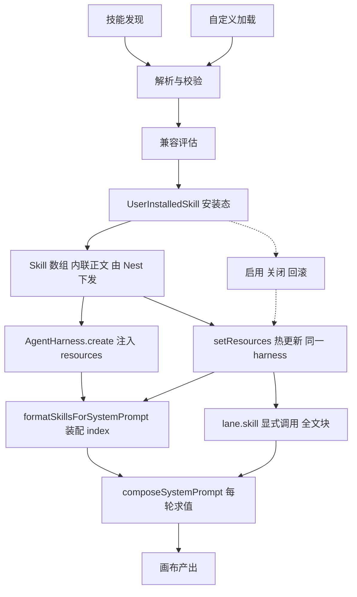
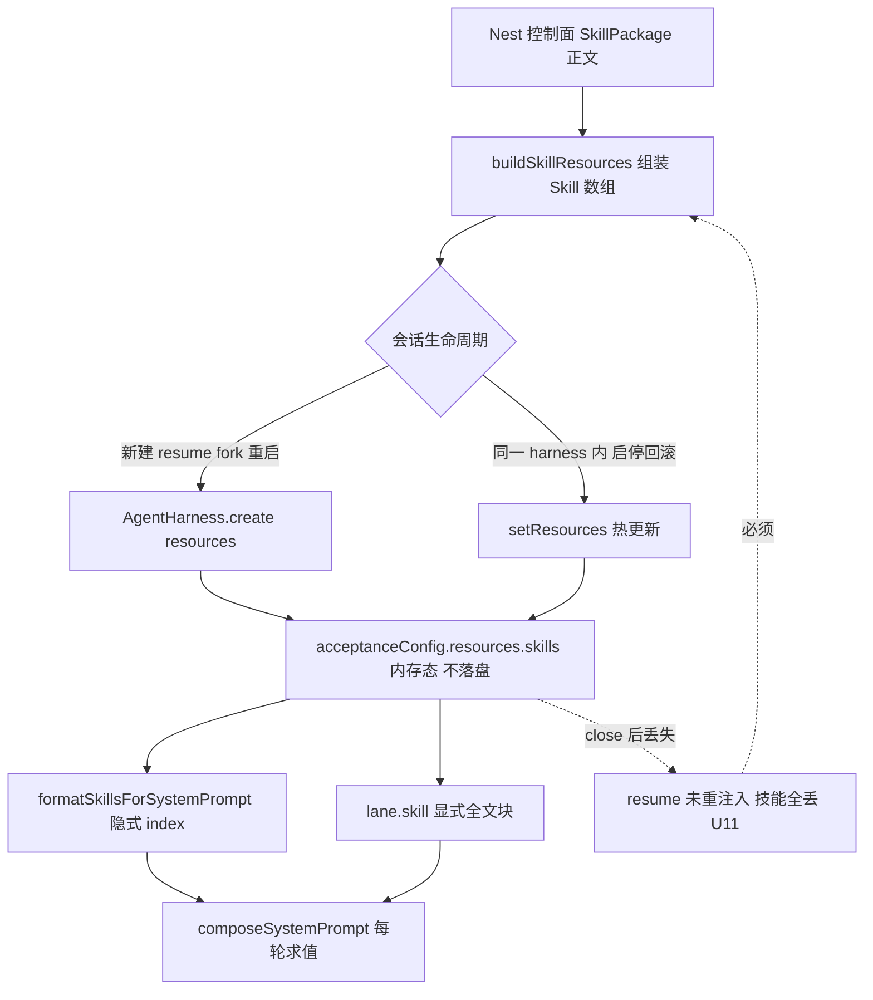

# 创作类 Skills 生态兼容：技能发现与双通路加载设计规格 v2（上游原语接线修订稿，13 章）

> **状态**：修订稿（2026-11-16 产出）；**零产品代码改动、零生产发布**。本稿取代 v1 的**执行面设计**，保留其产品契约、控制面与安全约束。
> **前置**：`docs/adr/0016-creative-skills-ecosystem-compatibility.md`（Accepted，本轮追加「修订记录」）、ADR-0009（先查 vendor 能力面、禁自研等价物）、ADR-0001（vendor pi 作内核）、ADR-0011（单一确认表面）、ADR-0003（提示词资产化）。
> **被修订稿**：`docs/superpowers/specs/2026-11-10-creative-skills-ecosystem-discovery-loading-design.md`（v1，13 章，含 WorkBuddy 北极星 §3.9 / §4.7 / 图 4）。按 ADR-0008 纪律**不追溯改写 v1 正文**，逐节处置见 §0。
> **事实基线（本轮新建）**：true master `01c5ef104384e47ebcfbec6ca2fe0b0b317652b1`（2026-11-16T02:08:03Z）的**干净 tarball 树** + 离线安装的生产同款 `@earendil-works/pi-agent-core@0.99.2` + **M0 可达性探针实跑 11/11 GREEN、变异自检 4/4 RED**（附录 A/B）。生产形态取证引自 2026-11-16 对抗性复审（§3.4 标注本轮未重跑）。
> ⚠️ **v1 与 ADR-0016 在 true master 上均 404**（`gh api .../contents/...?ref=01c5ef10` 实证）⇒ 两者从未合入，只是本地草稿。因此本轮不是「改历史正文」，而是**新落 v2 稿 + 在 ADR 追加修订记录**；v1 的 §3.7 历史文档修订清单无需追溯改写。
> **北极星**：仍以 WorkBuddy 的用户可感知契约为准（v1 §3.9 F38–F55、§4.7 Must/Should/Won't、图 4）。本轮**不改产品行为契约**，只纠正「用什么机制实现它」。
> **配图**：2 张内嵌 Mermaid 结构图，符合 `docs/superpowers/SPEC-CONVENTIONS.md` R1–R8，实跑自检见 §13。
> **授权边界**：本刀只产文档（v2 规格 + ADR 修订记录 + 文档登记）+ 干净树临时探针；不改任何产品代码、不合并、不部署。实施计划另立 `docs/superpowers/plans/`。

---

## 0. 配图索引、修订摘要与逐节差异表（v1 13 节 → v2）

本文档只含结构图，一律 Mermaid 内嵌；**无视觉稿、无 SVG 附件**（表达的是判据与接线，不依赖真实比例/位置）。

| 编号 | 形式 | 内容 | 位置 | 用途 |
|---|---|---|---|---|
| 图 1 | 内嵌 Mermaid | 三层与双通路总览（v2 执行面改道） | §5.1 | 判定安装态是否只产出 `Skill[]`、create 注入与 setResources 是否汇入同一 config，以及有没有回潮出第二套正文传输通道 |
| 图 2 | 内嵌 Mermaid | 上游原语接线与 resume 重注入 | §5.6 | 判定 `resources` 两条入口是否共享内存态 config、resume/fork/重启是否强制重注入（U-11），M0-P11 按此图设断点 |

> v1 的 图 2（兼容评估决策树）、图 3（数据契约）、图 4（北极星生命周期）**沿用为契约与行为基准，本稿不重画**；处置见 §5.2 / §5.3 / §5.5。

### 0.1 一句话结论

v1 的**产品层结论仍然成立**（双通路归一、三档兼容、服务端确定性安装、WorkBuddy 六面行为契约、P0 安全硬约束），但它的**执行面是自研等价物**：`skillBodies` 每轮塞 `/prompt` body、`skillIndex` / `skillIndexSignature` 自建索引缓存、自建 `parseSkillPackage` 修多行 YAML、自建 `forceSkills` 白名单 + fail-soft、把 `setTools` 判成「不需要」。而 pi-runtime 依赖的 `@earendil-works/pi-agent-core@0.99.2` **已原生提供** `Skill[]` 内联正文、`setResources` 热更新、`lane.skill()` 显式调用 + `UnknownSkill` 硬拒、`formatSkillsForSystemPrompt()` 标准 index、`formatSkillInvocation()` 全文块、`disableModelInvocation` 触发控制。按 ADR-0009「先查 vendor 能力面、禁自研等价物」，**这不是打补丁，是结构性改道**：删掉 v1 执行面，把平台控制面接到上游原语上。

### 0.2 逐节差异表

| v1 节 | v1 核心内容 | v2 处置 | 改什么 / 为什么 | 证据锚 |
|---|---|---|---|---|
| §0 配图索引 | 4 图（双通路 / 兼容树 / 数据契约 / 北极星生命周期） | **改写** | 章节改为「配图索引 + 修订摘要 + 逐节差异表」；图 1 删掉 `skillBodies` 节点、数据契约落点改为 `resources.skills`；新增 图 2「上游原语接线与 resume 重注入」；v2 共 2 张内嵌图，兼容树 / 数据契约 / 北极星生命周期**沿用 v1 图 2/3/4 不重画** | §3.1、§5.1、§5.6 |
| §1 目标 | G1–G4（双通路 / 端到端产出 / 兼容可度量 / 北极星） | **保留 + 新增 G5** | G1–G4 逐字保留；新增 **G5「吃满上游原语、零自研等价物」**，验收锚 = §10 的 M0-P 全绿 + 附录 B 变异自检 | ADR-0009、§3.1 |
| §2 范围 | 「明确不做」含 `setTools/setActiveTools 动态增删工具`（理由：纯提示词 skill 不需要） | **删除该不做项 + 新增 3 条不做** | 该判断与 B-1 已消费 `setActiveTools` 冲突，且把 `2026-10-04` 文档的「纠正」方向搞反；新增不做：① 不自建 skill registry / 索引缓存签名；② 不把技能正文复制进 `/prompt` body；③ 不引 `@earendil-works/pi-coding-agent` 的 `DefaultPackageManager` / `DefaultResourceLoader` | §3.3、§3.5、ADR-0001 |
| §3 事实依据 | F1–F55（本地核查 / 生态 / 安全 / 能力鸿沟 / WorkBuddy 北极星） | **大幅改写（本轮主战场）** | §3.1 新建「上游原语清单」事实基座（U1–U11 探针实证）；§3.2 生产现状取证；§3.3 v1 事实勘误表；§3.4 诚实边界；§3.5 保留 F18–F29 生态/安全事实与 F38–F55 北极星证据 | §3 全章 |
| §4 规范与判据 | 三条产品契约 / C0–C3 / 命名版本 / P0 安全 / prompt 预算 / 判据纪律 / §4.7 北极星映射 | **保留 60% + 改写 40%** | 产品契约、C0–C3、命名与 `contentHash`、P0 七条、判据纪律、§4.7 全部逐字保留；§4.3 删「修复多行 description」；§4.5 删「4MB bodyLimit 约束 skillBodies」与「≤12 行 per-user index 自研」，改为「上游 formatter + 条数上限由宿主裁剪 `Skill[]`」；新增 §4.8「上游原语优先」硬约束 | §3.3、§4.8 |
| §5 架构与契约 | 三层 + 双通路 / 兼容树 / 数据契约 / 接口清单 / 图 4 | **执行面重写，控制面保留** | §5.1 图 1 的 `B(skillBodies 每轮注入)` 节点改为 `setResources({skills})`；§5.4 接口清单删 runtime 两条 `skillBodies` / `skillIndex` 扩展，改 `resources` 注入契约；§5.2 兼容树、§5.3 数据契约、§5.5 图 4 生命周期**保留** | §5、图 1 |
| §6 打样 / 主场景 | 四垂类矩阵 / M0 可见性 / M1 三主场景 / 目视验收 | **保留矩阵与目视；改写 M0 主场景** | 四垂类矩阵与打样顺序（HTML→图片→音乐→短剧）逐字保留；M0 主场景从「发现页可见性」改为「上游原语接线探针 GREEN」；M1 主场景 A/B/C 的 `skillBodies` 措辞改为 `resources` 热更新 | §6 |
| §7 数据与状态 | Prisma 三模型 / 状态机与会话生效矩阵 / 注入通道 | **数据契约与状态机保留；§7.3 注入通道重写** | `SkillPackage` / `SkillCatalog` / `UserInstalledSkill` 三模型、§7.2 会话生效矩阵**逐字保留**（这是用户可感知契约）；§7.3 删 `skillBodies` / `skillIndex` / `skillIndexSignature` / `computeIndexSignature`，改「`Skill[]` 内联 → create 注入 / setResources 热更新 → 上游 formatter 装配 index → lane.skill 显式调用」；**新增 resume/fork 重注入硬约束** | §7.3、U11 |
| §8 纯函数 | 11 个自研纯函数 | **删 4 / 改 4 / 留 3** | 删 `parseSkillPackage`（上游 `yaml@2.9.0`）、`resolveSkillBodies`（上游 `Skill.content`）、`buildUserSkillIndex` + `computeIndexSignature`（上游 `formatSkillsForSystemPrompt`）；改 `resolveInvocationMode`（对齐 `_tag` / `disableModelInvocation`）、`applySkillOverride`（对齐 `setResources`）；留 `evaluateCompatibility` / `verifyImport` / `rankCatalog` / `assertUninstallGuard` | §3.1、§8 |
| §9 文件级清单 | Nest / runtime / web / 资产 / 测试 | **重写 runtime 行** | runtime 从「`/prompt` body 类型 + `withForcedSkills.resolveBody` + index」改为「`session-manager.ts` create options 注入 `resources` + `composeSystemPrompt` 调上游 formatter + `setResources` 桥接 + 显式调用收敛到 `lane.skill`」；新增「M0 探针为独立验收资产」 | §9 |
| §10 测试与验收 | M0-A1–A7 / M0-N1–N7 / M1-A1–A11 / M1-N1–N13 | **M0 全换；M1 措辞替换** | **M0 改为「可达性探针判据 M0-P1–P11 + 可转红负例 M0-N1–N10」**（本轮实跑 11/11 GREEN、4/4 变异 RED）；M1 判据保留编号与语义，把 `skillBodies` / `skillIndexSignature` 观测点替换为 `getResources()` / `formatSkillsForSystemPrompt` / `lane.skill` | §10、附录 B |
| §11 风险 | 12 条风险 | **改 3 / 增 4** | 改「静态段固化」「4MB bodyLimit」「索引缓存陈旧」三条（伪问题或机制变更）；新增「`setResources` 不落盘导致 resume/fork 丢技能」「宿主忘记调 formatter 导致 index 恒空」「`UnknownSkill._tag` 误判」「上游 `patch_hash` 升级改变原语语义」 | §11 |
| §12 路标 | M0–M4 | **M0 重定义，M1 吸收原 M0** | **M0 = 上游原语接线探针 + 宿主接线（纯验证、零发布）**；M1 = 双通路 + 控制面 + 生命周期 + 原 M0 的 golden/发现页可见性；M2/M3/M4 与两个北极星对齐线**逐字保留** | §12 |
| §13 配图自检 | 4 图门禁实跑记录 | **改写** | v2 2 图重跑 `pnpm verify-spec-figures --file ...` 与负例自检；索引生成器仍刻意不重跑（理由同 v1：会夹带约 47 篇无关历史变更） | §13 |

**处置统计**：逐字保留 5 节（§1 的 G1–G4、§5.2/§5.3/§5.5、§7.1/§7.2、§6 矩阵、§12 的 M2–M4）、局部改写 6 节、结构性重写 2 节（§3、§7.3）、M0 判据整体替换 1 节（§10）。

---

## 1. 目标（5 条，均可验收）

1. **G1 双通路可用且归一**（v1 逐字保留）：用户能通过「技能发现」与「自定义加载」两条通路获得并使用创作类 skills；两条通路只有 `sourceType` / `trustLevel` 之差，落到同一安装态、同一校验链、同一注入通道、同一回滚机制。验收锚点：§10 的 M1 判据。
2. **G2 端到端产出而非仅加载**（v1 逐字保留）：短剧 / 音乐 / 图片 / HTML 动画网页四类垂类，各至少有一个技能被加载后**产出真实画布节点**。验收锚点：§12 产出北极星。
3. **G3 兼容可度量、风险可收敛**（v1 逐字保留）：每个技能有 C0–C3 兼容评分与可解释的降级/拒绝理由；所有第三方内容经服务端确定性校验，agent 不执行 SKILL.md 前置步骤。
4. **G4 对齐 WorkBuddy 北极星**（v1 逐字保留）：在「发现、自定义安装、启用/关闭、删除/卸载、显式调用、隐式调用」六个面达到 v1 §4.7 全部 **Must** 项；复刻的是**用户可感知行为契约**，不是本地目录安装与用户本人身份执行的信任模型。
5. **G5 吃满上游原语、零自研等价物（v2 新增）**：执行面必须走 `@earendil-works/pi-agent-core@0.99.2` 的 `Skill[]` / `setResources` / `lane.skill()` / `formatSkillsForSystemPrompt()` / `formatSkillInvocation()`；禁止自建 skill registry、索引签名缓存、正文传输通道、frontmatter parser 与「未知名 fail-soft」白名单。**验收锚点：§10 的 M0-P1–P11 全绿 + 附录 B 变异自检 4/4 RED + §4.8 静态守卫零命中**。

---

## 2. 范围（含明确不做）

### 2.1 本规格交付

上游原语清单事实基座（§3.1）、M0 可达性探针判据与可转红负例（§10）、逐节差异表（§0.2）、v2 执行面架构（§5 / §7.3）、修订后的文件级改动清单（§9）与风险表（§11）。**v1 已交付且本轮不重做**：WorkBuddy 北极星实现解剖（F38–F55）、逐能力 Must/Should/Won't 映射（§4.7）、生命周期基准（v1 图 4）、控制面数据契约与 P0 安全硬约束。

### 2.2 明确不做（v2 修订）

| 不做项 | 理由 | 与 v1 的差异 |
|---|---|---|
| 开放 UGC 发布 / 作者体系 / 评分评论 | 属 M4，依赖审核、签名、法务与真实使用数据 | 保留 |
| agent 自主 clone / 解压 / 执行 `scripts/` 与「前置步骤」 | ADR-0016 第 5 条；2026 年恶意技能战役主感染向量 | 保留 |
| 复刻 WorkBuddy 的本地目录安装、`scripts/` 可执行、以用户本人身份执行系统命令、无审核 zip 直装 | 服务端多租户信任边界（F35/F55） | 保留 |
| 把任意第三方 SKILL.md 直接 drop-in `skills/` 目录 | 能力鸿沟（F30–F32）+ 镜像烘焙启动扫描一次 | 保留 |
| ~~`setTools` / `setActiveTools` 动态增删工具：纯提示词 skill 模型下不需要~~ | **v1 判断错误**：B-1 已消费 `setActiveTools`；且 `2026-10-04` 文档的「只能重建会话」结论并非靠「不需要」纠正，而是靠 `setResources` 这类 config 热更新原语 | **删除该不做项**（§3.3 勘误） |
| 进程级脚本沙箱 / seccomp / MCP 连接器网关 / 子代理编排 | 既有 roadmap park | 保留 |
| 企业 RBAC / 租户隔离 / 多技能自动并行调度 | M4 | 保留 |
| **自建 skill registry / 索引缓存签名 / 正文 per-request 传输通道 / frontmatter parser / 未知名白名单** | 上游 `AgentHarnessResources.skills` + `loadSkills(ExecutionEnv)` + `formatSkillsForSystemPrompt` + `UnknownSkill` 已全部覆盖（§3.1）；ADR-0009 禁自研等价物 | **v2 新增** |
| **把技能正文复制进 `/prompt` 请求体（`skillBodies`）** | `Skill.content` 由 `setResources` 内联注入 harness config，不经 HTTP body；4MB `bodyLimit` 不再构成约束 | **v2 新增** |
| **引入 `@earendil-works/pi-coding-agent` 的 `DefaultPackageManager` / `DefaultResourceLoader`** | `services/pi-runtime/DEPENDENCIES.md`、ADR-0001、`eval/driver.ts` 头注释明令不引；只借鉴契约、移植纯逻辑 | **v2 新增** |
| 对历史文档正文的追溯改写 | ADR-0008；v1/ADR-0016 在 master 404 ⇒ 本就是草稿，无需追溯 | 保留（理由更新） |

### 2.3 发布面与授权边界

本刀 docs-only：`deploy.yml` 的 `push.paths` 不含 `docs/` ⇒ 零生产发布。**M0 探针在干净 tarball 树里跑，不进产品仓库、不触发任何 CI**；后续 M0 接线改 `services/pi-runtime/**` ⇒ 需单独授权 + 手工 dispatch `runtime-deploy` + 生产复测（记忆：`services/pi-runtime` 不在 `deploy.yml push.paths`）。

---

## 3. 事实基座：上游原语清单、探针实证与 v1 勘误

> 本章是 v2 的**唯一事实来源**。§3.1 是「上游原语清单」（发起人本轮点名要求），§3.2 是干净树 + 生产取证，§3.3 是 v1 事实勘误，§3.4 是诚实边界，§3.5 保留 v1 中未被推翻的生态/安全/北极星证据。后续每节的设计决定必须能回指本章某条。

### 3.1 上游原语清单（事实基座，U1–U11 探针实证）

**取证方式**：true master `01c5ef10` 干净 tarball 树 → `pnpm install --offline --filter '@pi-lnk/pi-runtime...'`（229 包全离线复用，实体 `node_modules`，无软链写穿）→ `node --import tsx --test src/upstream-skills-probe.test.ts`。探针**只 import 发布包公共 API** 与宿主 `composeSystemPrompt`，**不 import vendor 源码、不 mock harness/lane**，用真 `AgentHarness.create` + `MemorySessionRepo` + faux provider（vendor `test/harness/runtime/accept.test.ts` 官方范式）。结果 **11/11 GREEN**，逐条 stdout 见附录 B。

| # | 上游原语 | 精确锚点（0.99.2） | 探针实证行为 |
|---|---|---|---|
| **U-1** | `Skill` 接口 `{ name, description, content, filePath, disableModelInvocation? }` | `dist/harness/types.d.ts`；根 `export *`（`index.d.ts:20`） | `content` 是**完整正文**且可 **application-provided**：探针用对象字面量内联构造 `Skill[]`，无需文件系统、无需 `SKILL.md` 落盘（U2/U4） |
| **U-2** | `AgentHarnessResources { promptTemplates?, skills?: Skill[] }` | `dist/harness/agent-harness.d.ts`；`AgentHarnessOptions.resources` | `AgentHarness.create({..., resources:{skills}})` 直接生效（**U7**）；等价 `setConfig("resources", …)` |
| **U-3** | `formatSkillsForSystemPrompt(skills)` | `dist/harness/system-prompt.js`；根 `export *`（`index.js:15`） | 产标准 `<available_skills>` XML（name/description/location），**原生过滤 `disableModelInvocation`**、**XML 转义** `< > & " '`、**空集返回 `""`**、只含 metadata 不含正文（U2/U8/U9） |
| **U-4** | `formatSkillInvocation(skill, additionalInstructions?)` | `dist/harness/skills.js:39`；根 `export *`（`index.js:14`） | 产 `<skill name="…" location="…">…全文…</skill>`，含「References are relative to …」基准说明与追加指令（**U3**） |
| **U-5** | `loadSkills(env, dirs, ctx)` / `loadSourcedSkills` | `dist/harness/skills.js:51,86`；`ExecutionEnv` 抽象 | 用 `yaml@2.9.0` `parseFrontmatter`；抽象 `ExecutionEnv`（`fileInfo/listDir/readTextFile/joinPath/canonicalPath`）⇒ **虚拟工作区可用纯内存 env 实现**；支持 ignore 文件、symlink、source 标签、`SkillDiagnostic`；`name` 校验 `^[a-z0-9-]+$` 且须等于父目录名 |
| **U-6** | `harness.setResources(res, ctx)` / `getResources(ctx)` | `dist/harness/runtime/harness.js:231-235`（`setConfig("resources", …)` → `config_update`） | **运行时热更新，无需重建会话**（**U4**：初始 0 → 热更 2 → `lane.skill` 命中）；换集后旧名立即 `UnknownSkill`（**U6**） |
| **U-7** | `harness.lane(name, ctx)` → `AgentLane.skill(name, additionalInstructions, ctx)` | `dist/harness/runtime/lane.js:884`；`accept` 的 `case "skill"` 在 `lane.js:530`（源码 `vendor/.../lane.ts:528-540`） | 从 `acceptanceConfig.resources.skills` 按 `name` 查表；命中注入 `formatSkillInvocation(skill, …)` 的 user message（**U4** 断言注入文本与上游 formatter 逐字相等）；未命中 `Result.err(UnknownSkill)` **零副作用、不 drive LLM**（**U5**） |
| **U-8** | `UnknownSkill extends TaggedError("UnknownSkill")` | `dist/harness/result.js:80`；`TaggedError` 在 `result.js:15-35` | **`_tag` 才是判别标签**；构造里 `Object.assign(this, props)` 会用 `props.name`（= 技能名）覆盖 `this.name` ⇒ 探针实测 `error._tag === "UnknownSkill"` 而 `error.name === "ghost-skill"`（**U5**）。判据不得用 `.name` 判类型 |
| **U-9** | `disableModelInvocation` | `Skill` 字段；`system-prompt.js:4` 的 `filter` | 上游 formatter 原生过滤（**U2/U8**）⇒ 平台**不需要**自建「触发控制」开关；v1 §4.7 P12 的 Must 语义由上游直接满足 |
| **U-10** | 多 lane 共享同一 harness `resources` | `harness.lane()`；lane 预置 `laneConfig` / `laneState` | main 与 fork 型 lane 均读到同一 `resources`（**U10**）；但 lane 必须预置配置，否则 attach 失败（M-U10 变异点） |
| **U-11** | **`resources` 不落盘** | `setConfig` 是 harness 级内存 config | **U11 实测 `RESUME_RESOURCES_PERSISTED=false count=0`**：`harness.close()` 后经 `repo.open()` 重建 harness（create 时不传 `resources`）⇒ `getResources().skills` 为空；而 create 时显式注入则生效。⇒ **每次 `AgentHarness.create`（含磁盘 resume / fork / 重启）必须由宿主重新注入 `resources`**，`setResources` 只负责「同一 harness 生命周期内的热更新」 |

**上游原语没做什么（同样重要，见 §3.4）**：`resources.skills` 只被 `lane.skill()` 显式调用消费；`runtime/drive/generation.ts:62` 把宿主给的 `systemPrompt` **直通求值**，index **不会自动**进 systemPrompt。宿主必须自己调 `formatSkillsForSystemPrompt()` 并把结果拼进 `composeSystemPrompt`（**U8** 的 assemble 闭包即这条接线的最小实证）。

### 3.2 干净树与生产形态取证

| # | 事实 | 锚点 / 方式 |
|---|---|---|
| V-1 | true master = `01c5ef10`（2026-11-16T02:08:03Z，`docs(pricing) #902`），比 v1 产出晚 6 天、60+ 提交 | `gh api repos/sev7n4/pi-lnk/commits/master` |
| V-2 | v1 规格与 ADR-0016 在 master **404** ⇒ 从未合入，本地草稿 | `gh api .../contents/<path>?ref=01c5ef10` |
| V-3 | 干净树 = `gh api .../tarball/01c5ef10` 快照；`pnpm install --offline --filter '@pi-lnk/pi-runtime...'` 装出 **0.99.2（带 `patch_hash=chjyb3jtnudd5ho3imavxe5pae`）** 的实体 `node_modules`；`pnpm-lock.yaml` 未被改动 | 本轮实跑（19s / 229 包 / `Lockfile is up to date`） |
| V-4 | 生产 patch 只动 `execution/tools.js` 与 `runtime/drive/tool-placement.js`（`addedToolNames`），**与 skills 原语无关** | `patches/@earendil-works__pi-agent-core@0.99.2.patch` |
| V-5 | pi-runtime `AgentHarness.create` options **没有 `resources`**；`systemPrompt: () => this.composeEntryAndObserve(entry)` 是**每轮求值函数形态** | `session-manager.ts:1438-1470`（干净树） |
| V-6 | `composeSystemPrompt(staticPart, dynamicBlocks, budget?)` 是宿主纯函数；`turnContext.dynamicBlocks` 是既有动态块通道；B-3 后 `<tool_guidelines>` 为静态段 | `session-manager.ts:875-905`；`2026-11-15-b3-tool-guidelines-design.md` |
| V-7 | `/prompt` body 是显式 TS 类型 `{ text, lane?, forceSkills?, turnContext?, images? }`，Fastify `bodyLimit: 4MB`；**无 `skillBodies` / `skillIndex` / install / download / `POST /skills`** | `app.ts:74,132-149,192-209` |
| V-8 | `SkillRegistry` 构造时 `discoverSkills(root)`、`buildSkillIndexBlock()` 产手写 `## 可用技能（Skills）`；`loadBody(name)` 按 name 全局查找；无 reload / userId / namespace | `skills/registry.ts`、`skills/loader.ts`、`tools/skill-tool.ts` |
| V-9 | 线上 `/app/skills` = **11 个**镜像烘焙 `SKILL.md`（v1 写 9 个已过期；新增 `research-delegate` / `task-decomposition`）；生产 `pi-lnk-runtime:2dcce392` 单 pod Running、Nest `lnkpi-api:b331beac` | 2026-11-16 对抗性复审取证（**本轮未重跑生产**） |
| V-10 | `loader.ts` 手写 `parseSimpleYaml` **已支持** `>` / `|` 块标量与 chomping；只消费 name/description，`version` 丢弃 | `skills/loader.ts` |
| V-11 | `forceSkills` 白名单来自 Nest `client.listSkills()`；`AGENT_SKILLS` 前端仍硬编码 1 项；无 Skill 数据表 / controller / migration | `resolve-force-skills.ts`、`agent.service.ts`、`agent-skill-map.ts` |

### 3.3 v1 事实勘误表（本轮推翻的判断）

| # | v1 陈述 | 实测 / 正确结论 | 处置 |
|---|---|---|---|
| E-1 | 「9 个 `SKILL.md`」（F1 及 §6.2 / §9 / §10.1 多处） | 生产 11 个（V-9） | 勘误为 11；但 v2 不再以「个数」为判据（技能来自 DB，不来自镜像目录） |
| E-2 | 「多行 `description` 解析能力有限」（F3）、§4.3「多行 description 必须正确解析（修复 F3 已知限制）」、§8 `parseSkillPackage` 单测、M0-A5 | `loader.ts` 已支持块标量（V-10）；上游 `loadSkills` 用 `yaml@2.9.0`（U-5） | **撤销整个「修复 parser」工作项**；不得自研 parser |
| E-3 | 「`/prompt` body 加可选 `skillBodies`、`withForcedSkills.resolveBody` 改查请求体」是「已核实的扩展点，无需重构」（§5.1 / §7.3 / §9） | 生产与 true master **均无 `skillBodies` / `skillIndex` / `skillIndexSignature`**（V-7）——它们是 v1 自造的设计，不是既有代码 | **删除整套**；正文改走 `resources.skills`（U-1/U-2/U-6） |
| E-4 | 「每轮 `skillBodies` 受 4MB `bodyLimit` 约束 ⇒ 单技能正文设上限」（§4.5 / §11） | 因正文不经 HTTP body，该约束是**伪问题** | 删除；正文体积上限移到导入校验（仍是必要安全约束，但理由改为 DB/上下文预算） |
| E-5 | 「`setTools` / `setActiveTools` 不需要」（§2.2）、§3.5 F36「该判断在纯提示词 skill 模型下不成立」、§3.7 对 `2026-10-04` 文档的「纠正」 | B-1 已消费 `setActiveTools`（`2026-11-15-b123-upstream-primitives-design.md`）；真正解决「装卸不必重建会话」的是 **`setResources` config 热更新**（U-4/U-6），不是「工具集与安装态无关」 | **撤回 v1 的「纠正」**，改为「该文档结论在 config 热更新原语下不成立」；`setActiveTools` 不再是「不做项」 |
| E-6 | 自建 `buildUserSkillIndex` / `computeIndexSignature` / `skillIndexSignature`（§4.7 P14、§7.3、§8、M1-A11） | 上游 `formatSkillsForSystemPrompt` 原生产 index（U-3），且 `disableModelInvocation` 原生过滤（U-9） | **删除**；P14「免重启生效」改由 `setResources` + 每轮 formatter 求值满足（U-8） |
| E-7 | 自建 `forceSkills` 白名单 + 「用户显式调用了未安装的 skill」fail-soft 文案（F5、§4.7 P11） | 上游 `lane.skill()` 已有 `UnknownSkill` **硬拒 + 零副作用**（U-7/U-8） | **删除白名单与 fail-soft**；显式调用收敛到 `lane.skill()`，拒绝语义由上游提供 |
| E-8 | 「会话静态段在 create 时固化 ⇒ 自动语义触发需要 index 改为按用户/按会话解析，二者实现代价不同」（F37 / §7.2 矩阵） | `systemPrompt` 是每轮求值函数（V-5），`getResources()` 每轮可读（U-8）⇒ **同一 harness 内 index 与显式调用可同时热更新**，无需新建会话 | 改写 §7.2 的实现说明；**用户可感知的「新会话完全生效」契约保留**（WorkBuddy F47），但机制改为「宿主选择在下一轮重算」，不再受静态段固化限制 |
| E-9 | v1 §3.7 逐份声明对 6 份历史文档的修订/推翻 | v1 自身在 master 404（V-2），从未成为仓库事实 | 保留该表作为「v1 曾主张」的记录；v2 不继承其对历史文档的处置，**由 ADR 修订记录重新声明** |
| E-10 | 「不引入 `fs.watch`，改用 DB 订阅集 + 每轮解析 + 缓存签名」（§3.9 末 / §4.7 P14） | 前半保留（不引 `fs.watch`），后半「缓存签名」是重复造轮子 | 改为「DB 订阅集 → `Skill[]` → `setResources` / create 注入」，**无签名** |

### 3.4 诚实边界（不得越界宣称）

1. **探针验证的是「发布包公共 API 在干净树真 harness 上可达」，不是「生产已接线」**。V-5/V-7 证实生产 `create` options 仍无 `resources`；接线是 M0 后续工作，本轮零产品代码改动。
2. **`setResources` 不落盘**（U-11）是本次最重要的新约束。任何「装完永久生效」的设想都必须由宿主在每次 `AgentHarness.create` 重新注入；resume / fork / 进程重启后不重注入 = 技能丢失。
3. **上游 formatter 不会被自动调用**（§3.1 末）。宿主漏调 `formatSkillsForSystemPrompt()` ⇒ index 恒空，且**探针 U8 的 M-U8a 变异证明该漏接可被判据抓红**。
4. **`resources.skills` 只服务 `lane.skill()` 显式调用**；隐式语义匹配仍依赖 index 进 systemPrompt 后由模型自主选择，属概率成功（v1 F52 结论不变）。
5. coding-agent 层的 `DefaultPackageManager`（`pi install npm:/git:/local`）/ `DefaultResourceLoader`（`skillsOverride/reload/getSkills`）**契约可借鉴、代码不可引**（ADR-0001 / `DEPENDENCIES.md`）。
6. 生产形态（V-9）引自 2026-11-16 对抗性复审，本轮**未重跑生产 SSH / kubectl**；实现开工前须按 runbook 复核全部部署单元。
7. 干净树里新增的 2 个探针文件（`_probe-smoke.ts`、`upstream-skills-probe.test.ts`）**只存在于临时 tarball 树**，未写入产品仓库；全文与复跑方式见附录 A。
8. **不宣告闭环**：M0 探针 GREEN 只证明「路通」，不等于 M1 控制面 / 双通路 / 生命周期已实现，更不等于 M2 产出北极星达成。

### 3.5 保留的 v1 事实（未被本轮推翻）

- **生态与供给侧**：F18–F23（`SKILL.md` 开放标准、社区目录规模、短剧 83 包 / `drama-skills` 13 skill、Python/ffmpeg/CLI 依赖、README 前置指令、模型名不一致）。
- **安全实证**：F24–F29（Snyk ToxicSkills、USENIX Security '26、Orca 四原语、Unit 42 BIV、ClawHavoc、本平台放大项）——**全部仍是 P0 硬约束的来源**。
- **能力鸿沟**：F30–F34（私有工具名绑定、验收线只验加载+触发、老 runtime 退役、无模块机制）。
- **信任边界**：F35（CLI 本机 vs 服务端多租户）。
- **WorkBuddy 北极星**：F38–F55 与 v1 §4.7 的 P1–P19 逐能力裁决、图 4 生命周期基准——**用户可感知契约逐字保留**，本轮只换实现机制。
- **平台既有事实**：F9（无 Skill 数据模型）、F10（UI 占位）、F15（per-user 隔离范式）、F16（prompt-registry `contentHash` 范式）、F17（`ValidationPipe whitelist` 剥无装饰 DTO）、F12/F13/F14（HTML/文本节点/能力词表锚点）。

---

## 4. 规范与判据（可复用规则）

### 4.1–4.4（v1 逐字保留，此处只列锚点）

§4.1 三条产品契约（双通路归一 / 兼容分级 / 加载三粒度）、§4.2 C0–C3 兼容分级判据与「兼容性评分 = 可映射动作数 / 声明动作数」、§4.3 命名版本完整性（`<publisher>/<skill>@<contentHash>`、版本不可变、`sha256(body.trimEnd())`、frontmatter 白名单）、§4.4 P0 安全七条硬约束、§4.6 判据纪律、§4.7 北极星逐能力 Must/Should/Won't 映射 —— **全部沿用 v1 原文**，本轮不改一个字。

**唯一例外**：§4.3 中「多行 `description` 必须正确解析（修复 F3 已知限制）」一句**删除**（E-2），改为「frontmatter 解析委托上游 `loadSkills(ExecutionEnv)` / `yaml@2.9.0`，平台不实现 parser」。

### 4.5 prompt 预算与冲突规则（改写）

- 常驻 index 每用户 **≤ 12 行**的上限保留，但实现方式改为：**宿主在构造 `Skill[]` 时裁剪**（`enabled ∪ allowAuto` 且按显式订阅顺序取前 12），再交给上游 `formatSkillsForSystemPrompt()`；**不自建 index 行格式、不自建签名**。
- ~~每轮 `skillBodies` 受 4MB `bodyLimit` 约束~~ → **删除**（E-4）。正文体积上限移到 `verifyImport`（DB 行大小 + 上下文预算），理由不再涉及 HTTP body。
- 显式调用命中时不再追加语义匹配正文（v1 保留），由「同一轮只走 `lane.skill()` 或只走 index」的宿主调度保证；上游 `lane.skill()` 注入的是 `formatSkillInvocation()` 全文块，天然不重复。
- `systemPrompt` 每轮求值顺序：静态段 → `formatSkillsForSystemPrompt(resources.skills)` → `<tool_guidelines>` 等既有动态块（U8 实证顺序断言；B-3 静态段不被挤掉）。

### 4.6 判据纪律（v1 逐字保留）

行为级判据优先于静态 grep；守卫须扫全目录；每条判据必须做**变异自检**（阳/阴性样本证明非恒真/恒假）；静态 ratchet 定位符带唯一锚点；防「伪变异」与「判据自匹配恒绿」；断言禁 `as never`；改 `*.test.ts` 后跑 `npx tsc --noEmit`，改组件后 `vue-tsc -b`；vitest 用 node24 + `--maxWorkers=1 --no-file-parallelism`；pi-runtime 测试用 `node --import tsx --test`（**不是 vitest**）；本机 pnpm 须 `env -u NODE_OPTIONS`；**未闭环项不得宣告 ALL_PASS**。

### 4.7 北极星映射（v1 逐字保留，仅 3 处实现措辞替换）

| v1 项 | 实现措辞替换 | 行为契约是否变化 |
|---|---|---|
| P1 渐进披露 / P10 隐式调用 / P14 免重启生效 | `skillBodies` / `skillIndexSignature` → `Skill[]` + `setResources` + `formatSkillsForSystemPrompt` | **否** |
| P11 显式必达 / P12 触发控制 | `forceSkills` 白名单 → `lane.skill()` + `UnknownSkill`；`disableModelInvocation` 由上游原生过滤 | **否** |
| P5 工具权限收窄 / P8 卸载 ≠ 关闭 | 不变 | **否** |

v1 §4.7 的 **Must 全绿 ≠ 生态兼容完成** 与 **Won't 四类永久偏离**（P16–P19）结论逐字保留。

### 4.8 上游原语优先（v2 新增硬约束，不可协商）

1. 执行面**必须**用 §3.1 的 U-1…U-11；新增「skill 加载 / 索引 / 调用 / 解析」能力前，先查上游是否已有等价原语（ADR-0009）。
2. **禁止**在 pi-runtime 内新增以下自研等价物：skill registry、index 行格式、索引缓存签名、frontmatter parser、`skillBodies` 式正文传输、未知名 fail-soft 白名单。静态守卫须扫 `services/pi-runtime/src/**` 全目录并带唯一锚点。
3. **`UnknownSkill` 判别必须用 `error._tag`**，不得用 `.name`（U-8）。
4. **每次 `AgentHarness.create` 必须显式注入 `resources`**（U-11），`setResources` 只用于同一 harness 生命周期内的热更新；resume / fork / 重启路径必须经同一注入函数，禁止分叉。
5. **宿主必须显式调 `formatSkillsForSystemPrompt()`**，不得假设 `resources` 会自动进 systemPrompt（§3.4 第 3 条）。
6. 上游升级（含 `patch_hash` 变化）时，M0 探针必须重跑；原语语义变化按 ADR-0009 优先对齐上游，不维护自建兼容层。

---

## 5. 架构与契约

### 5.1 三层与双通路总览（图 1，执行面改道）

控制面（Nest）仍负责目录、安装态、校验、内容寻址与审计；交付面把外部包变成受控 `SkillPackage`；执行面（pi-runtime）**从「按请求注入正文」改为「按 resources 注入 Skill[]」**，不持有安装态、不写磁盘、不联网。


*图 1 · 说明 v2 的执行面改道：安装态不再产出「每轮请求体正文」，而是产出 `Skill[]` 交给上游 `resources`；create 注入与 setResources 热更新是同一份数据的两条入口，index 由上游 formatter 装配、显式调用由 `lane.skill()` 承担，二者在每轮求值的 `composeSystemPrompt` 汇合；虚线表示启停/回滚通过换集实现。验收时用它判定有没有回潮出第二套正文传输通道。*

### 5.2 兼容评估决策树（v1 图 2 逐字保留）

见 v1 §5.2 图 2。四分支判定顺序（先排除执行依赖 → 判产物路径 → 判动作可映射性）与「评估在服务端确定性流程内完成、agent 不参与」结论不变。

### 5.3 数据契约（v1 图 3 保留，增一处落点）

`SkillPackage`（内容寻址）/ `SkillCatalog`（平台精选）/ `UserInstalledSkill`（用户态）三层字段归属与单向依赖**逐字保留**。唯一新增：图 3 的 `PROMPT` 节点从「per-user index 与 skillBodies」改为「`Skill[]`（由三层数据契约组装）→ `resources.skills`」。**内容寻址层与用户态层必须分离**的判据不变。

### 5.4 接口清单（v1 §5.4 改 2 行）

Nest 侧 10 个端点（`/api/skills`、`/catalog`、`/mine`、`/import`、`/search`、`/:id/install`、`/:id/enabled`、`/:id`、`/uninstall`、`/:id/invoke`、`/:id/rollback`）**逐字保留**，包括 F17 的同管道透传回归要求与「4 个端点与北极星 P4/P5/P7/P8 直接对应」的告警。

| v1 runtime 行 | v2 处置 |
|---|---|
| `runtime /sessions/:id/prompt` body 扩展 `skillBodies`（可选） | **删除**。无此扩展点；显式调用改由宿主内部调 `lane.skill()` |
| `runtime /sessions` 扩展按用户解析的 index（可选 `skillIndex` + `skillIndexSignature`） | **删除**。改为 `resources: { skills: Skill[] }` 在 `AgentHarness.create` options 内注入（U-7 / U-11） |

新增两条**内部契约**（非 HTTP 端点）：

| 契约 | 作用 | 约束 |
|---|---|---|
| `buildSkillResources(userId, sessionKey) → Skill[]` | 从 `UserInstalledSkill` 订阅集 + `SkillPackage` 正文组装上游 `Skill` 数组（`content` 内联、`filePath` 用虚拟路径、`disableModelInvocation` 透传） | 每次 create 必调；≤12 条裁剪；正文按 `contentHash` 逐字校验 |
| `injectSkillResources(harness, skills)` | 同一 harness 内热更新（`setResources`），供启用/关闭/回滚即时生效 | 不落盘（U-11）；resume/fork 必须回到 `buildSkillResources` |

### 5.5 北极星生命周期与双调用通路（v1 图 4 逐字保留）

v1 §5.5 图 4 仍是 P7/P8/P10/P11/P14 五条 Must 的**唯一结构基准**，M1-A7–A11 按它设断点。三处「与 WorkBuddy 的实现差异」中的第 ②③ 条改写为：② 免重启靠 `setResources` 换集 + 每轮 formatter 求值，非 `fs.watch`；③ 会话生效边界按 §7.2 矩阵，但机制从「每轮由 Nest 下发正文」变成「每轮从 `getResources()` 读 `Skill[]`」。

### 5.6 上游原语接线与 resume 重注入（图 2，v2 新增）


*图 2 · 说明 `resources` 的两条入口（create 注入 / setResources 热更新）汇入同一份内存态 config，再分叉到隐式 index 与显式调用；虚线是 U-11 实证的「不落盘」风险 —— resume/fork/重启必须回到 `buildSkillResources` 重新注入，否则技能全丢。验收 M0-P11 与 M1 会话生效矩阵时按此图逐节点检查。*

---

## 6. 打样 / 主场景规格

### 6.1 四类垂类适配矩阵（v1 §6.1 逐字保留）

短剧 / 音乐 / 图片 / HTML 动画网页四行的社区典型形态、平台锚点、主兼容档、必须补项，以及**打样顺序 HTML → 图片 → 音乐 → 短剧**全部不变。

### 6.2 M0 主场景（改写：可达性为先）

- 在 true master 干净树跑 M0 探针（附录 A），确认 `setResources → lane.skill() → systemPrompt 装配` 11 条判据全绿、关键变异 4/4 转红（**本轮已完成**，附录 B）。
- 宿主接线后，同一探针在**带 `resources` 的 `AgentHarness.create` options** 上重跑仍全绿；`composeSystemPrompt` 的求值闭包里出现上游 formatter 产物。
- 零用户可见功能、零生产发布；发现页与 golden 可见性移交 M1。

### 6.3–6.5 M1 主场景 A/B/C（措辞替换）

场景 A（自定义加载）、B（发现页一键启用）、C（即时生效与回滚）的**用户步骤逐字保留**；把「下一轮 `prompt()` 的 `skillBodies` 命中」改为「下一轮 `getResources()` 含该 `Skill`、index 由上游 formatter 重建、`lane.skill()` 可调用」，把「不写容器文件系统」保留。§6.5 的「会话中途新增技能若未重建 index，UI 必须提示」保留为**产品契约**（WorkBuddy F47），但机制上 v2 已支持同会话即时重算，实现可选择是否延后到新会话。

### 6.6 目视验收（v1 逐字保留）

发现页卡片与筛选、启停开关与版本标识、单一确认弹窗、兼容评分与不可用动作清单、技能下拉动态渲染、HTML 产物渲染、六面补充项全部不变。

---

## 7. 数据与状态变更

### 7.1 新增模型（v1 §7.1 逐字保留）

`SkillPackage` / `SkillCatalog` / `UserInstalledSkill` 三表字段、约束、`@@unique([userId, packageHash])` + `onDelete: Cascade`、`override` 只存覆盖键、`uninstalledAt` 软删除、复用 `AdminAuditLog` —— 全部不变。

### 7.2 状态机与会话生效矩阵（v1 §7.2 逐字保留）

状态机 `parsed → validated → scored → installed(disabled) → enabled ⇄ disabled → rolledback → uninstalled`、agent 工具侧只能到 `disabled`、四行会话生效矩阵、**「当前会话已注入正文不撤回」指模型上下文里已有的内容，不是继续从服务端下发** —— 全部不变。这是用户可感知契约，不因执行面改道而调整。

⚠️ v2 补充实现说明（非契约变更）：由于 `systemPrompt` 每轮求值（V-5）且 `setResources` 可热更新（U-6），「新建会话 index 才完全生效」从**技术限制**降级为**产品选择**；宿主若选择同会话即时重算，不违反 v1 §7.2 矩阵（矩阵约束的是「不得继续注入已关闭技能的正文」，不是「必须等新会话」）。

### 7.3 注入通道变更（结构性重写）

| v1 | v2 |
|---|---|
| `/prompt` body 增 `skillBodies?: Record<skillId, string>` | **删除**。正文内联在 `Skill.content`，随 `resources` 进 harness config；不经 HTTP body、不进对话历史、不落 runtime 磁盘 |
| `/sessions` create 增 `skillIndex` + `skillIndexSignature` | **删除**。改为 `AgentHarness.create({ resources: { skills } })`；无签名 |
| `skillIndexSignature = hash(userId, sorted[...])` + 「新会话按最新集合重建 index」 | **删除**。`buildSkillResources(userId, sessionKey)` 每次 create 从 DB 组装最新 `Skill[]`；热更新走 `setResources`；**无缓存、无签名、无失效判定** |
| `withForcedSkills` 的 `resolveBody` 优先查 `skillBodies`，回落 `SkillRegistry.loadBody`，未命中 fail-soft | **删除**。显式调用收敛到 `lane.skill(name, additionalInstructions, ctx)`：命中注入 `formatSkillInvocation()` 全文块，未命中 `UnknownSkill` 硬拒零副作用（U-7/U-8）。`forceSkills` 作为**用户意图入口**保留（UI → Nest → runtime），但不再承担「白名单 + 正文解析」职责 |
| `override` 只影响 index 组装与显式白名单 | 保留语义；实现改为 `override` 只影响 `buildSkillResources` 的裁剪结果，不写 `body`、不改 `contentHash` |

**新增硬约束（U-11）**：`resources` 是 harness 级内存 config，**不随 session 落盘**。因此：

1. `AgentHarness.create` 的 options 构造必须有且只有一个 `buildSkillResources()` 注入点，**新建 / 磁盘 resume / fork / 进程重启四条路径共用**，禁止分叉。
2. `setResources` 只允许用于「同一 harness 生命周期内」的启用 / 关闭 / 回滚即时生效；不得依赖它做持久化。
3. 多 lane 共享同一 `resources`（U-10）；fork 型 lane 仍需宿主预置 `laneConfig` / `laneState`，这是既有职责，不因本规格变化。
4. 宿主 `composeSystemPrompt` 的动态块组装必须显式调用 `formatSkillsForSystemPrompt(await harness.getResources(ctx)).skills ?? [])` 并把结果作为 `dynamicBlocks` 的一项（U8）；**不得**假设 `resources` 自动进 systemPrompt。

---

## 8. 纯函数与算法（含单测要求）

| 函数 | v1 | v2 处置 | 输入 → 输出 / 必须覆盖的单测 |
|---|---|---|---|
| `parseSkillPackage` | 自研 | **删除** | 委托上游 `loadSkills(ExecutionEnv)`（`yaml@2.9.0`）；平台只做「虚拟 `ExecutionEnv` 实现 + 白名单校验」，单测覆盖路径穿越 / 非标字段容忍 / 体积上限 |
| `evaluateCompatibility` | 保留 | **保留** | C0/C1/C2/C3 各 1 正样本；声明能力与实际扫描不一致（F25/F27） |
| `buildUserSkillIndex` | 自研 | **删除** | 由 `formatSkillsForSystemPrompt` 取代（U-3） |
| `resolveSkillBodies` | 自研 | **删除** | 由 `Skill.content` 内联 + `contentHash` 校验取代（U-1） |
| `verifyImport` | 保留 | **保留** | `scripts/`、前置命令文本、外链资源、无许可证、同名冲突、注入模式；新增「正文体积上限」（理由改为 DB/上下文预算，E-4） |
| `resolveInvocationMode` | 保留 | **改写** | frontmatter + `override` + 调用意图 → `implicit` / `explicit` / `denied`；`disableModelInvocation` 由上游 filter 执行；**未知技能拒绝判据用 `error._tag === "UnknownSkill"`**（U-8），不得用 `.name` |
| `applySkillOverride` | 保留 | **改写** | 覆盖不改 `body` / `contentHash`；重复启停幂等；结果经 `setResources` 生效（U-6） |
| `assertUninstallGuard` | 保留 | **保留** | agent 工具发起卸载必拒；无二次确认必拒；批量逐项审计；软删除后 `buildSkillResources` 不再返回该 `Skill` |
| `computeIndexSignature` | 自研 | **删除** | 无签名（E-10） |
| `rankCatalog` | 保留 | **保留** | 四维排序；热度变化不改变 `trustLevel`（P19） |
| `buildSkillResources` | — | **新增** | `userId` + 订阅集 → `Skill[]`；覆盖：≤12 裁剪、`enabled ∪ allowAuto`、已卸载不出现、`disableModelInvocation` 透传、`content` 逐字等于 `SkillPackage.body`、`filePath` 为虚拟路径、跨用户不可见、**空集返回 `[]`** |
| `injectSkillResources` | — | **新增** | `harness` + `Skill[]` → `setResources`；覆盖：换集后旧名 `UnknownSkill`（U-6）、多 lane 共享（U-10）、**resume 后必须重新注入**（U-11） |
| `assembleSkillIndexBlock` | — | **新增** | `getResources()` → `formatSkillsForSystemPrompt()` → `composeSystemPrompt`；覆盖：空集不产 `<available_skills>`、`disableModelInvocation` 不出现、`<tool_guidelines>` 不被挤掉、每轮重算可见热更新（U-8） |

单测要求沿用 v1 §8 末段（每函数 ≥1 阳 + ≥1 阴、判据体与实现体分离、禁 `as never`、改 `*.test.ts` 后 `npx tsc --noEmit`）。**pi-runtime 侧测试跑法是 `node --import tsx --test`（node:test），不是 vitest**；新增的 M0 探针即此形态。§4.7 的 Must 项凡落到本表函数，仍必须同时有 §10 的行为级判据。

---

## 9. 文件级改动清单（M0/M1 预估，实现期以 plan 为准）

| 层 | 文件 | 动作（v2） |
|---|---|---|
| Nest | `apps/server/src/skills/`（controller / service / import / compatibility / dto）、`prisma/schema.prisma` + migration | 新增（同 v1） |
| Nest | `buildSkillResources(userId, sessionKey)` | **新增**：订阅集 → `Skill[]`，含 `contentHash` 逐字校验与 ≤12 裁剪 |
| runtime | `services/pi-runtime/src/session-manager.ts` | **修改（改道核心）**：① `AgentHarness.create` options 增加 `resources: buildSkillResources(...)`，且新建/resume/fork 共用同一注入点；② `composeEntryAndObserve` / `composeSystemPrompt` 的动态块组装显式调 `formatSkillsForSystemPrompt(await harness.getResources(ctx)).skills ?? [])`；③ 显式调用入口从 `withForcedSkills` 收敛到 `lane.skill()`（保留 `forceSkills` 作为意图入口） |
| runtime | `services/pi-runtime/src/app.ts` | **不改 body 类型**（删除 v1 的 `skillBodies` 扩展）；如新增 service token 仍按 v1 §5.4 告警执行 |
| runtime | `services/pi-runtime/src/tools/skill-tool.ts` / `skills/registry.ts` / `skills/loader.ts` | **不改**（保留为平台内置技能回落 / 观测打点，可选）；不得新增 registry 等价物 |
| runtime | `services/pi-runtime/src/upstream-skills-probe.test.ts` | **新增（M0 验收资产）**：附录 A 全文；CI 用 `node --import tsx --test` 跑；上游升级必重跑 |
| web | `apps/web/src/services/skill-api.ts`、发现页 / 「我的技能」组件、`DiscoverPane.vue`、`AgentSideRail.vue`、`constants/agentSkillMap.ts` | 新增 / 修改（同 v1） |
| 资产 | `skills/**/SKILL.md` golden 按契约重写 | 修改（同 v1；⚠️ 触发 `runtime-deploy`，需单独授权） |
| 测试 | 行为级用例 + 静态 ratchet（§4.8 第 2 条扫全目录）+ 变异自检脚本 | 新增 |
| 文档 | 本 v2 规格、ADR-0016 修订记录、`docs/README.md` / `docs/adr/README.md` 登记 | 本刀 |

**明确删除的 v1 改动**：`app.ts` 的 `/prompt` body 扩展、`/sessions` 的 `skillIndex` + `skillIndexSignature`、`withForcedSkills.resolveBody` 查请求体分支、`computeIndexSignature` / `buildUserSkillIndex` / `parseSkillPackage` / `resolveSkillBodies` 四个纯函数、F3 多行 description 修复。

---

## 10. 测试策略与验收标准：M0 可达性探针判据

### 10.0 纪律前置（v1 §10.0 逐字保留 + 一条）

行为级优先；守卫扫全目录；静态定位符带唯一锚点；每条判据必须变异自检并先排除「伪变异」与「判据自匹配恒绿」；未闭环项不得 `ALL_PASS`。**v2 新增**：判 RED 必须用**完整 stdout** 的 `AssertionError` / `failing tests` 标记（禁止用 `| tail` 吃退出码的假红），且须确认是**目标测试**变红而非整文件模块解析失败。

### 10.1 M0 行为级验收判据（可达性探针 M0-P1–P11）

跑法：true master 干净 tarball 树 + `pnpm install --offline --filter '@pi-lnk/pi-runtime...'` + `node --import tsx --test src/upstream-skills-probe.test.ts`（附录 A）。**本轮实跑结果：11/11 GREEN**（附录 B）。

| ID | 判据 | 行为级观测点 | 阳性样本 / 本轮实证 |
|---|---|---|---|
| M0-P1 | 发布包公共 API 暴露全部上游原语，不依赖 vendor 源码路径 | `import` 成功 + `typeof AgentHarness.create === 'function'` | U1：9 导出 + create 全在 |
| M0-P2 | `Skill[]` 可内联构造；`formatSkillsForSystemPrompt` 产标准 `<available_skills>`、过滤 `disableModelInvocation`、空集返回 `""`、只含 metadata | 真实 formatter 输出断言 | U2：visible=2/3、body 不在 index、`empty_set=''` |
| M0-P3 | `formatSkillInvocation` 把正文与 location 包成 `<skill>` 块，支持追加指令 | 真实 formatter 输出逐字断言 | U3：全文 + location + additionalInstructions |
| **M0-P4** | **真 harness：`setResources` 热更新后 `lane.skill` 命中并注入全文，无需重建会话** | `getResources()` 前后 + `lane.accept({kind:"skill"})` + session entry 里的 user message 与上游 formatter 逐字比对 | U4：initial=0 → hot=2 → `injected_full_body=true` |
| **M0-P5** | 未注册名 → `lane.skill()` 返回 `UnknownSkill` 硬拒，session 零副作用 | `result.error._tag` + `error.name`（=技能名）+ 消息数不变 | U5：`_tag=UnknownSkill` `name=ghost-skill` 零副作用 |
| M0-P6 | 热更新换集即启用/卸载：旧名 `UnknownSkill`、新名可注入，全程不重建会话 | 两次 `setResources` 后分别调 `lane.skill` / `accept` | U6：`old=UnknownSkill new=injected` |
| M0-P7 | `AgentHarness.create` 时传 `resources` 直接生效 | `getResources()` + `accept` 命中 | U7：GREEN |
| **M0-P8** | **宿主 `composeSystemPrompt` 每轮从 `getResources()` 求值，`setResources` 后 index 立即可见** | 空集不产 `<available_skills>`；`alpha`（含 hidden 被过滤）→ `gamma` 两次求值；`<tool_guidelines>` 不被挤掉且顺序在后 | U8：`empty→alpha→gamma per_turn_reeval=true` |
| M0-P9 | 上游 formatter 对 name/description 做 XML 转义（防 prompt 注入） | 含 `<script>` / `&` / 引号的 description | U9：`&lt;script&gt;` |
| M0-P10 | 多 lane（含 fork 型 lane）共享同一 `resources` | main 与 fork lane 各自 `accept` / `UnknownSkill` | U10：`main=true fork=true` |
| **M0-P11** | **探测 config 不落盘：resume 重建 harness 后 `resources` 为空，且 create 时显式注入可恢复** | `repo.open()` 后 `getResources()` + 独立新会话 create-time 注入 | U11：`RESUME_RESOURCES_PERSISTED=false count=0`、`CREATE_TIME_INJECTION_ON_FRESH_SESSION=true` |

**M0 收口判据**：M0-P1–P11 全绿 **且** §10.2 的关键负例逐条可转红 **且** 恢复后基线仍是 11/11。本轮前两项已实证（附录 B），第三项由变异自检脚本的 `BASELINE_RESTORED pass=11 fail=0` 实证。

### 10.2 M0 可转红负例（M0-N1–N10）

| # | 变异点 | 必须 RED 的判据 | 防伪变异说明 | 本轮实跑 |
|---|---|---|---|---|
| **M0-N1** | 删掉 `await harness.setResources(...)` | M0-P4 | 注入点在宿主接线，不在判据体；确认 `getResources()` 读到 0 | **RED**（U4，`fail=1`，`AssertionError`） |
| M0-N2 | 把 `ghost-skill` 换成已注册名 | M0-P5 | 命中会 drive LLM，须给 faux 响应，避免超时被误判为 RED | 未实跑（清单项） |
| **M0-N3** | 删掉第二次 `setResources`（换集） | M0-P6 | 旧名仍可达 ⇒ 卸载语义未落地 | **RED**（U6，`fail=1`，`AssertionError`） |
| M0-N4 | `makeHarness()` 不传 `initialSkills` | M0-P7 | 断言读 `getResources()` 而非文件常量 | 未实跑（清单项） |
| **M0-N5** | 装配层把 `getResources()` 换成恒空快照 | M0-P8 | 注入点在宿主 assemble 闭包；确认不是模块解析失败 | **RED**（U8，`fail=1`，`AssertionError`） |
| M0-N6 | 删掉 `formatSkillsForSystemPrompt(...)` 这一动态块 | M0-P8 | 断言 `<available_skills>` 消失 | 未实跑（清单项） |
| **M0-N7** | HIDDEN 的 `disableModelInvocation` 改为 `false` | M0-P2 + M0-P8 | 同一常量被两处消费 ⇒ **预期 `fail=2`**，不是伪变异 | **RED**（首个 U2，`fail=2`，`AssertionError`） |
| M0-N8 | formatter 去掉 `escapeXml` | M0-P9 | 改上游包会污染验证树，改用等价的宿主 formatter 包装层变异 | 未实跑（清单项） |
| M0-N9 | 不预置 fork-lane 的 `laneConfig` | M0-P10 | 确认是 attach 失败而非整文件崩 | 未实跑（清单项） |
| M0-N10 | resume 重建时「不显式注入 resources」却期望技能可用 | M0-P11 | 直接由 U11 的 `PERSISTED=false` 证伪 | 由 U11 实证 |

### 10.3 变异自检实跑结果（2026-11-16）

```
=== M0 PROBE MUTATION SELF-CHECK ===
RED      M-U4 删掉 setResources（核心热更新接线）       [first_red=U4 fail=1 AssertionError=True module_fail=False]
RED      M-U6 删掉换集（启用/卸载语义）                 [first_red=U6 fail=1 AssertionError=True module_fail=False]
RED      M-U8a 装配层不读 getResources（恒空）          [first_red=U8 fail=1 AssertionError=True module_fail=False]
RED      M-U8c HIDDEN 允许模型自动调用                  [first_red=U2 fail=2 AssertionError=True module_fail=False]
BASELINE_RESTORED pass=11 fail=0
VERDICT mutations_all_red=True baseline_11_0=True
```

`module_fail=False` 逐条确认变异后**没有** `Cannot find module` / `ERR_MODULE_NOT_FOUND` / `SyntaxError` / `Transform failed`，即 RED 来自真实断言失败而非模块解析失败；`first_red` 与目标判据一致（M-U8c 预期同时打红 U2 与 U8，故 `first_red=U2 fail=2` 属预期）。恢复后基线 `pass=11 fail=0`。

### 10.4 M1 行为级验收判据（v1 §10.3 保留，观测点替换）

M1-A1–A11 的**编号、语义、阳性样本、北极星映射逐字保留**（双通路归一、即时生效、回滚、自动触发、安全负例、启停矩阵、卸载、触发控制、目录与搜索约束、版本与免重启）。仅把以下观测点替换为 v2 机制：

| v1 观测点 | v2 观测点 |
|---|---|
| 抓 `/prompt` 请求体的 `skillBodies` | 抓 `harness.getResources().skills`（含 `content` 逐字等于 `SkillPackage.body`）+ `formatSkillsForSystemPrompt` 输出 |
| 抓 `skillIndex` / `skillIndexSignature` | 抓 `buildSkillResources()` 返回的 `Skill[]` + 每轮 `composeSystemPrompt` 求值结果 |
| 断言 `forceSkills` 命中 | 断言 `lane.skill()` 被调用且注入 `formatSkillInvocation()` 全文块；未命中 `error._tag === "UnknownSkill"` |
| 「runtime 容器 `skills/` 目录 mtime 不变」 | 保留，并新增「resume/fork 后 `getResources()` 非空」（U-11 回归） |

M1-N1–N13 可转红负例**全部保留编号**，其中 M1-N1（`resolveBody` 改回只查本地）、M1-N6（index 改回启动期全局快照）、M1-N12（`computeIndexSignature` 恒值）三条按 v2 改为：① 装配层不读 `getResources()`；② `buildSkillResources` 用启动期快照；③ resume 路径漏调 `buildSkillResources()`。

### 10.5–10.7（v1 逐字保留）

§10.5 变异自检规程五步、§10.6 目视验收、§10.7「不宣告闭环的边界」（M0/M1 通过 ≠ 生态兼容完成 ≠ WorkBuddy 全量复刻；产出北极星在 M2；不写 `ALL_PASS`）全部保留。**v2 补充**：M0 探针 GREEN 也不等于 M0 接线完成 —— 探针只证路通，接线是 §9 的产品代码改动，本轮未做。

---

## 11. 风险

v1 §11 的 12 条风险中，**供应链投毒、能力鸿沟、DTO whitelist、改 `skills/**` 触发生产发布、审核/许可证长期成本、社区 skill 漂移、并行窗口脏树、北极星口径冲突、生命周期被简化成单一布尔、误把热度当信任** 10 条逐字保留。

| v1 风险 | v2 处置 |
|---|---|
| 「静态段固化导致装了不生效」（F37） | **改写**：`systemPrompt` 每轮求值（V-5）+ `setResources` 热更新（U-6）⇒ 真正风险变成「宿主漏调 formatter」与「resume 未重注入」，见下表 |
| 「4MB bodyLimit 与正文体积」 | **删除**（E-4 伪问题）；正文体积上限并入 `verifyImport`，理由是 DB 行大小与上下文预算 |
| 「索引缓存陈旧导致装了不生效」 | **改写**：无签名、无缓存；风险变成「`buildSkillResources` 用启动期快照」 |

**v2 新增 4 条风险**：

| 风险 | 证据 | 缓解 | 验收锚点 |
|---|---|---|---|
| **`setResources` 不落盘 ⇒ resume / fork / 重启后技能全丢** | U-11 `PERSISTED=false count=0` | `AgentHarness.create` 单一注入点，四条生命周期路径共用 `buildSkillResources()`；resume 后 `getResources()` 非空为 M1 回归项 | M0-P11 / M1 回归 |
| **宿主漏调 `formatSkillsForSystemPrompt()` ⇒ index 恒空、隐式调用全失效** | §3.4 第 3 条；`generation.ts:62` systemPrompt 直通 | §4.8 第 5 条硬约束 + U8 assemble 闭包 + 静态守卫扫 `composeSystemPrompt` 调用点 | M0-P8 / M0-N5 |
| **`UnknownSkill` 判别用 `.name` 导致误判**（其值是技能名不是错误标签） | U-8（`Object.assign` 覆盖） | §4.8 第 3 条：统一用 `error._tag`；code review 检查项 | M0-P5 |
| **上游 `patch_hash` / 版本升级改变原语语义，自建兼容层悄悄腐化** | V-3/V-4、ADR-0009 | M0 探针纳入上游升级必跑门禁；语义变化优先对齐上游，不维护兼容层 | M0-P1 / §4.8 第 6 条 |

---

## 12. 后续包 / 路线图

| 阶段 | 交付（v2） | 发布面 | 准入 / 完成判据 | 与 v1 差异 |
|---|---|---|---|---|
| **M0** | **上游原语接线探针 + 宿主接线**（`resources` 注入 / formatter 装配 / `lane.skill` 显式调用收敛 / resume 重注入） | 探针零发布；接线改 `services/pi-runtime/**` ⇒ 手工 dispatch `runtime-deploy` + 单独授权 + 生产复测 | §10.1 M0-P1–P11 全绿、§10.2 关键负例可转红、§4.8 静态守卫零命中、resume 回归通过 | **v1 M0（golden 重写 + 发现页可见性）移交 M1**；M0 改为纯可达性门 |
| **M1** | 双通路闭环 + 控制面 + 生命周期 + v1 原 M0 的 golden/发现页可见性 + WorkBuddy 六面 Must | 改 `apps/server/**`、`apps/web/**`、runtime ⇒ 一次生产发布 | §10.4 的 M1-A1–A11 全通过、M1-N1–N13 可转红、v1 §4.7 Must 无判据空项 | 吸收原 M0 |
| **M2** | 四垂类端到端：虚拟工作区 + 能力适配器 + 四类各接一个真实社区 skill | 行为变更发布 | **产出北极星**：四类各跑通一个社区真实 skill 的端到端画布产出（真实画布节点） | 逐字保留 |
| **M3** | 社区 source adapter、兼容自动评估、垂类搜索推荐、套件包级选装、对话式查找安装、AI 创建技能受控版本 | 行为变更发布 | agent 仅检索与申请、服务端确定性安装、单一确认表面 | 逐字保留 |
| **M4** | 开放创建/分享、签名与来源治理、评分、workspace 项目级作用域、租户隔离/审计、法务合规 | 行为变更发布 | 真实使用数据 + 治理能力齐备后单独立项 | 逐字保留 |

**两个北极星不许互相替代**（v1 §12 逐字保留）：① 行为对齐北极星 = §4.7 Must，M1 收口；② 产出北极星 = 四类真实社区 skill 端到端画布产出，M2。M1 全绿不得表述为「已复刻 WorkBuddy 技能系统」或「生态兼容完成」；Won't 四类（P16–P19）是永久偏离。

**与既有 roadmap 的关系（改写）**：M0/M1 属主线 A「能力目录」延伸；**v2 不再把「不引入 `setTools` 依赖」当作结论** —— B-1 已消费 `setActiveTools`，主线 B「技能包化」的 `activeToolNames` 打包与 `setResources` 的 `skills` 是不同 config 维度，可并行。主线 C 不受影响。

**明确登记但本包不做**（v1 逐字保留）：实施计划、开放 UGC、脚本沙箱、MCP 网关、RBAC、多技能自动编排、A-6 真机走查。

---

## 13. 配图规范自检

**实跑结果（2026-11-16，node24 `v24.13.0` + `env -u NODE_OPTIONS`）**：

```
$ pnpm verify-spec-figures --file docs/superpowers/specs/2026-11-16-creative-skills-ecosystem-discovery-loading-design-v2.md
✓ docs/superpowers/specs/2026-11-16-creative-skills-ecosystem-discovery-loading-design-v2.md
校验完成：1 篇在范围内，0 篇历史文档跳过（< 2026-09-22），0 个错误，0 个警告
```
退出码 **0**。

**首轮真实报错与修正（保留为证据）**：初稿把 §0 写成「修订摘要与逐节差异表」、并把第二张图编号为 图 3，门禁报 `error [R2] 图号不连续：期望 图 2，实际 图 3（现有 1, 3）` 与 `error [R5]:1 含图文档缺少 §0 配图索引章节`，退出码 1。⇒ 改为 §0 三段式（索引表 + 摘要 + 差异表）并把 图 3 统一改 图 2 后转绿。**门禁确实能拦住结构缺陷，不是恒绿**。

**负例自检（删掉 图 2 图注另存 `/tmp/spec-v2-negative.md`）**：
```
✗ /tmp/spec-v2-negative.md
    error [R3]:263 缺少图注（应在图的上一行或下一行写「图 N · 说明」）：mermaid@263
校验完成：1 篇在范围内，0 篇历史文档跳过，1 个错误，0 个警告
```
退出码 **1**（`ELIFECYCLE`）。只报 R3 未报 R2 属预期 —— 末图图注缺失不影响已有 图 1 的连续性，与 v1 §13 第二轮负例口径一致。负例文件已删除，本文未改动。

**全量回归**：`pnpm verify-spec-figures` 重跑 `274 篇在范围内，229 篇历史文档跳过，0 个错误，2 个警告`（退出码 0）；2 个警告来自既有文档，本文在单篇与全量两次运行中均为 0 错误 / 0 警告。（篇数 227 → 274 是并行窗口新增文档所致，非本刀引入。）

逐条自检口径（对照 `SPEC-CONVENTIONS.md` §4）：R1 无像素级视觉稿、无附件；R2 图 1–图 2 唯一且连续（v1 图 2/3/4 是外部引用，不计入本文件图号）；R3 每图紧邻 `*图 N · …*` 图注且写明用途；R4 正文 §0.2 / §5.1 / §5.6 / §10 引用图号；R5 §0 标题以「配图索引」开头且索引表列出 图 1 / 图 2；R6 无附件引用；R7 两个 Mermaid 块非空且首行均为 `flowchart TD`；R8 不适用（无 SVG）。

> **§0 的三段式取舍**：发起人本轮点名要「逐节差异表」，而 R5 要求含图文档的 §0 必须是配图索引章节。校验器 `INDEX_HEADING_RE = /^#{2,3}\s*0[.、]?\s*配图索引/`，索引区取到下一个 `###` 为止 ⇒ 采用「§0 标题 = 配图索引、修订摘要与逐节差异表」+ 索引表置于 `### 0.1` 之前 + `### 0.2` 放差异表，两者兼得，不为过门禁牺牲发起人要的交付物。

**索引生成器（本刀刻意不重跑）**：同 v1 §13 理由 —— 只读试算与已入库 `scripts/docs/index_data.json` 相差 466 行，重跑会夹带约 47 篇与本次交付无关的历史文档状态变化。登记只在 `docs/README.md` 与 `docs/adr/README.md` 精确追加。

**`pnpm verify-links`**：主仓脏工作树上会假红（历史断链 / 缺失源码），CI 干净 checkout 才是权威；本规格新增的仓库内路径引用以反引号代码路径为主，未新增 Markdown 外链。

---

## 附录 A · M0 可达性探针全文（可复现资产）

> 探针**只在干净 tarball 树**新增，未写入产品仓库。复跑：取 true master tarball → `pnpm install --offline --filter '@pi-lnk/pi-runtime...'` → `cd services/pi-runtime && node --import tsx --test src/upstream-skills-probe.test.ts`。
> 另需一次性 import 冒烟 `src/_probe-smoke.ts`（验证 12 个导出可解析），全文紧随探针之后列于本附录。

```ts
// 文件：services/pi-runtime/src/upstream-skills-probe.test.ts
/**
 * M0 上游原语接线探针（2026-11-16，发起人要求：先验证再动规格）
 *
 * 目的：确认 `setResources → lane.skill() → systemPrompt 装配` 这条链在 pi-runtime
 * 实际使用的 harness 上真实可达，而不是「读源码觉得应该可以」。
 *
 * 取证纪律：
 * - 只在 true master 干净 tarball 树里跑（HEAD 01c5ef104384e47ebcfbec6ca2fe0b0b317652b1）。
 * - 只 import **发布包公共 API** `@earendil-works/pi-agent-core@0.99.2`（带生产 patch_hash）
 *   与宿主的 `composeSystemPrompt`；**不 import vendor 源码、不 mock harness/lane**。
 * - 用真 `AgentHarness.create` + `MemorySessionRepo` + faux provider（vendor 官方测试范式）。
 * - 每条判据都有可转红负例（见文末 MUTATION 段）。
 *
 * 跑法：cd services/pi-runtime && node --import tsx --test src/upstream-skills-probe.test.ts
 */
import { test } from "node:test";
import assert from "node:assert/strict";
import {
	AgentHarness,
	BACKGROUND_CONTEXT,
	MemorySessionRepo,
	setValue,
	branchTip,
	laneConfig,
	laneState,
	formatSkillsForSystemPrompt,
	formatSkillInvocation,
	type Skill,
} from "@earendil-works/pi-agent-core";
import { createModels, fauxProvider } from "@earendil-works/pi-ai";
import { composeSystemPrompt } from "./session-manager.js";

const CTX = BACKGROUND_CONTEXT;

const ALPHA: Skill = {
	name: "alpha",
	description: "Alpha 创作技能 · 触发词：写分镜",
	content: "DO ALPHA BODY — 把分镜写成画布文本节点。",
	filePath: "/virtual/skills/alpha/SKILL.md",
};
const BETA: Skill = {
	name: "beta",
	description: "Beta 创作技能",
	content: "DO BETA BODY.",
	filePath: "/virtual/skills/beta/SKILL.md",
};
const GAMMA: Skill = {
	name: "gamma",
	description: "Gamma 创作技能",
	content: "DO GAMMA BODY.",
	filePath: "/virtual/skills/gamma/SKILL.md",
};
const HIDDEN: Skill = {
	name: "hidden",
	description: "不可被模型自动调用",
	content: "DO HIDDEN BODY.",
	filePath: "/virtual/skills/hidden/SKILL.md",
	disableModelInvocation: true,
};

let seq = 0;

interface ProbeHarness {
	harness: Awaited<ReturnType<typeof AgentHarness.create>>["harness"];
	lane: Awaited<ReturnType<Awaited<ReturnType<typeof AgentHarness.create>>["harness"]["lane"]>>;
	session: Awaited<ReturnType<MemorySessionRepo["create"]>>;
	repo: MemorySessionRepo;
}

/** 造一个真 harness（预置 lane 状态，照搬 vendor test/harness/runtime/accept.test.ts 的 createSession 范式）。 */
async function makeHarness(initialSkills?: Skill[], extraLanes: string[] = []): Promise<ProbeHarness> {
	const repo = new MemorySessionRepo();
	const session = await repo.create({ id: `m0-probe-${++seq}` }, CTX);
	const writes = [];
	for (const name of ["main", ...extraLanes]) {
		writes.push(
			setValue(branchTip(name), null),
			setValue(laneConfig(name), {
				model: { provider: "faux", modelId: "faux-1" },
				thinkingLevel: "off" as const,
				activeToolNames: [],
			}),
			setValue(laneState(name), { currentOperationId: null, lastOperationId: null, inbox: [] }),
		);
	}
	await session.mutate((mutator) => mutator.commit(writes, CTX), CTX);

	const faux = fauxProvider();
	const models = createModels();
	models.setProvider(faux.provider);
	const { harness } = await AgentHarness.create(
		{
			session,
			models,
			model: faux.getModel(),
			...(initialSkills === undefined ? {} : { resources: { skills: initialSkills } }),
		},
		CTX,
	);
	const lane = await harness.lane("main", CTX);
	return { harness, lane, session, repo };
}

/** 从 lane 的 session 里找注入的 user message 文本。 */
async function injectedUserTexts(lane: ProbeHarness["lane"]): Promise<string[]> {
	const entries = await lane.findEntries(undefined, CTX);
	const out: string[] = [];
	for (const entry of entries) {
		if (entry.type !== "message" || entry.message.role !== "user") continue;
		const content = entry.message.content;
		if (!Array.isArray(content)) continue;
		for (const block of content) {
			if (typeof block === "object" && block !== null && "text" in block && typeof block.text === "string") {
				out.push(block.text);
			}
		}
	}
	return out;
}

// ─────────────────────────── P0 事实基座：上游原语清单 ───────────────────────────

test("U1 · 发布包公共 API 暴露全部上游原语（不依赖 vendor 源码路径）", () => {
	for (const [name, value] of Object.entries({
		AgentHarness,
		MemorySessionRepo,
		formatSkillsForSystemPrompt,
		formatSkillInvocation,
		setValue,
		branchTip,
		laneConfig,
		laneState,
		BACKGROUND_CONTEXT,
	})) {
		assert.notEqual(value, undefined, `缺少公共导出：${name}`);
	}
	assert.equal(typeof AgentHarness.create, "function", "AgentHarness.create 必须是函数");
	console.log("[U1] UPSTREAM_PRIMITIVES_OK 9 exports + AgentHarness.create");
});

test("U2 · Skill[] 可 application-provided 内联构造；formatSkillsForSystemPrompt 产标准 <available_skills> 且过滤 disableModelInvocation", () => {
	const index = formatSkillsForSystemPrompt([ALPHA, BETA, HIDDEN]);
	assert.match(index, /^The following skills provide specialized instructions/);
	assert.match(index, /<available_skills>/);
	assert.match(index, /<name>alpha<\/name>/);
	assert.match(index, /<description>Alpha 创作技能 · 触发词：写分镜<\/description>/);
	assert.match(index, /<location>\/virtual\/skills\/alpha\/SKILL\.md<\/location>/);
	assert.doesNotMatch(index, /<name>hidden<\/name>/, "disableModelInvocation 的技能不得进隐式 index");
	assert.doesNotMatch(index, /DO ALPHA BODY/, "index 只含 metadata，不含正文（渐进披露第一级）");
	assert.equal(formatSkillsForSystemPrompt([]), "", "空集必须返回空串而不是空 XML 壳");
	assert.equal(formatSkillsForSystemPrompt([HIDDEN]), "", "全被禁用时返回空串");
	console.log("[U2] INDEX_OK visible=2/3, body_not_in_index=true, empty_set='' ");
});

test("U3 · formatSkillInvocation 把正文与 location 包成 <skill> 块（渐进披露第二级）", () => {
	const block = formatSkillInvocation(ALPHA, "请写第 3 集分镜");
	assert.match(block, /^<skill name="alpha" location="\/virtual\/skills\/alpha\/SKILL\.md">/);
	assert.match(block, /References are relative to \/virtual\/skills\/alpha/);
	assert.match(block, /DO ALPHA BODY/);
	assert.match(block, /<\/skill>\n\n请写第 3 集分镜$/);
	assert.equal(formatSkillInvocation(ALPHA), block.split("\n\n请写")[0]);
	console.log("[U3] INVOCATION_OK full_body=true location=true additionalInstructions=true");
});

// ─────────────────────────── P1 真 harness：setResources → lane.skill() ───────────────────────────

test("U4 · 【核心】真 AgentHarness：setResources 热更新后 lane.skill 命中并注入全文，无需重建会话", async (t) => {
	const { harness, lane } = await makeHarness(); // create 时**不传** resources
	t.after(() => harness.close(CTX));

	const before = await harness.getResources(CTX);
	assert.equal(before.skills?.length ?? 0, 0, "初始 resources 应为空");

	// 宿主侧热更新：内联 Skill[]（来自 DB 正文，不需要文件系统）
	await harness.setResources({ skills: [ALPHA, BETA] }, CTX);
	const after = await harness.getResources(CTX);
	assert.deepEqual(after.skills?.map((s) => s.name), ["alpha", "beta"], "setResources 未生效");

	const admission = await lane.accept({ kind: "skill", name: "alpha" }, CTX);
	assert.ok(admission.ok, "lane.accept(skill) 被拒 —— setResources 没被 lane 消费");
	const texts = await injectedUserTexts(lane);
	const hit = texts.find((text) => text.includes('<skill name="alpha"'));
	assert.ok(hit, "session 里找不到注入的 <skill> 消息");
	assert.equal(hit, formatSkillInvocation(ALPHA), "注入内容与上游 formatSkillInvocation 不一致");
	assert.match(hit, /DO ALPHA BODY/, "正文未注入");
	console.log("[U4] SET_RESOURCES_TO_LANE_SKILL_OK initial=0 → hot=2 → injected_full_body=true");
});

test("U5 · 【核心】未注册名 → lane.skill() 返回 UnknownSkill 硬拒，且 session 零副作用", async (t) => {
	const { harness, lane } = await makeHarness();
	t.after(() => harness.close(CTX));
	await harness.setResources({ skills: [ALPHA] }, CTX);

	const beforeCount = (await injectedUserTexts(lane)).length;
	const result = await lane.skill("ghost-skill", undefined, CTX);
	assert.ok(!result.ok, "未知技能竟被接受");
	assert.equal(result.error._tag, "UnknownSkill", "错误标签必须是 UnknownSkill");
	// 上游 TaggedError 构造里 Object.assign(this, props) 会用 props.name（=技能名）覆盖 tag，
	// ⇒ 判别标签必须用 `_tag`，`name` 属性承载的是被拒绝的技能名。此形态写入规格事实基座。
	assert.equal(result.error.name, "ghost-skill");
	assert.match(result.error.message, /Unknown skill: ghost-skill/);
	assert.equal((await injectedUserTexts(lane)).length, beforeCount, "拒绝路径不得往 session 追加消息");
	console.log("[U5] UNKNOWN_SKILL_HARD_REJECT_OK _tag=UnknownSkill name=ghost-skill zero_side_effect=true");
});

test("U6 · 热更新换集即「启用/卸载」：换集后新名可达、旧名 UnknownSkill，全程不重建会话", async (t) => {
	const { harness, lane } = await makeHarness();
	t.after(() => harness.close(CTX));
	await harness.setResources({ skills: [ALPHA] }, CTX);

	// 换集前的旧名在换集后必须不可达
	await harness.setResources({ skills: [BETA, GAMMA] }, CTX);
	const old = await lane.skill("alpha", undefined, CTX);
	assert.ok(!old.ok);
	assert.equal(old.error._tag, "UnknownSkill", "已移除技能仍可调用 ⇒ 卸载语义没落地");

	const fresh = await makeHarness();
	t.after(() => fresh.harness.close(CTX));
	await fresh.harness.setResources({ skills: [BETA, GAMMA] }, CTX);
	const admission = await fresh.lane.accept({ kind: "skill", name: "gamma" }, CTX);
	assert.ok(admission.ok, "换集后新名不可达");
	assert.ok((await injectedUserTexts(fresh.lane)).some((x) => x.includes("DO GAMMA BODY")));
	console.log("[U6] HOT_SWAP_OK old=UnknownSkill new=injected no_session_rebuild=true");
});

test("U7 · create 时直接传 resources 也生效（新会话/会话创建路径）", async (t) => {
	const { harness, lane } = await makeHarness([ALPHA]);
	t.after(() => harness.close(CTX));
	assert.deepEqual((await harness.getResources(CTX)).skills?.map((s) => s.name), ["alpha"]);
	const admission = await lane.accept({ kind: "skill", name: "alpha" }, CTX);
	assert.ok(admission.ok, "create-time resources 未生效");
	assert.ok((await injectedUserTexts(lane)).some((x) => x.includes("DO ALPHA BODY")));
	console.log("[U7] CREATE_TIME_RESOURCES_OK");
});

// ─────────────────────────── P2 systemPrompt 装配 ───────────────────────────

test("U8 · 【核心】宿主 composeSystemPrompt 每轮从 getResources 求值，setResources 后 index 立即可见", async (t) => {
	const { harness } = await makeHarness();
	t.after(() => harness.close(CTX));

	const staticPart = "STATIC_SYSTEM_PART";
	const guidelines = "<tool_guidelines>GUIDELINES_BLOCK</tool_guidelines>";
	// 这就是宿主该写的接线：每轮求值，读最新 resources，调上游 formatter，塞进 dynamicBlocks。
	const assemble = async (): Promise<string> => {
		const resources = await harness.getResources(CTX);
		return composeSystemPrompt(staticPart, [formatSkillsForSystemPrompt(resources.skills ?? []), guidelines]);
	};

	const empty = await assemble();
	assert.equal(empty, `${staticPart}\n\n${guidelines}`, "空技能集不得注入空 available_skills 块");
	assert.doesNotMatch(empty, /available_skills/);

	await harness.setResources({ skills: [ALPHA, HIDDEN] }, CTX);
	const first = await assemble();
	assert.ok(first.startsWith(staticPart), "静态段必须保留");
	assert.match(first, /<available_skills>/);
	assert.match(first, /<name>alpha<\/name>/);
	assert.doesNotMatch(first, /<name>hidden<\/name>/, "disableModelInvocation 不得进隐式 index");
	assert.match(first, /<tool_guidelines>/, "既有 B-3 静态段不得被挤掉");
	assert.ok(first.indexOf("<available_skills>") < first.indexOf("<tool_guidelines>"), "skills index 应在 guidelines 之前");

	// 订阅集变更（模拟启用/关闭）：同一 harness、同一闭包、下一轮即见
	await harness.setResources({ skills: [GAMMA] }, CTX);
	const second = await assemble();
	assert.match(second, /<name>gamma<\/name>/, "热更新后的技能未出现在下一轮 systemPrompt");
	assert.doesNotMatch(second, /<name>alpha<\/name>/, "已移除技能仍残留在下一轮 systemPrompt");
	console.log("[U8] SYSTEM_PROMPT_ASSEMBLY_OK empty→alpha→gamma per_turn_reeval=true");
});

test("U9 · 上游 formatter 的 XML 转义防注入（name/description 含尖括号与引号）", () => {
	const evil: Skill = {
		name: "evil",
		description: 'A <script>alert("x")</script> & \'quote\'',
		content: "body",
		filePath: "/virtual/skills/evil/SKILL.md",
	};
	const index = formatSkillsForSystemPrompt([evil]);
	assert.doesNotMatch(index, /<script>/, "description 未转义，存在 prompt 注入面");
	assert.match(index, /&lt;script&gt;/);
	assert.match(index, /&amp;/);
	console.log("[U9] XML_ESCAPE_OK");
});

// ─────────────────────────── P3 cache / fork 形态 ───────────────────────────

test("U10 · 多 lane（含 fork 型 lane）共享同一 harness resources，setResources 后各 lane 均可达", async (t) => {
	const h = await makeHarness(undefined, ["fork-lane"]);
	t.after(() => h.harness.close(CTX));
	const forked = await h.harness.lane("fork-lane", CTX);

	await h.harness.setResources({ skills: [ALPHA] }, CTX);
	const mainAdmission = await h.lane.accept({ kind: "skill", name: "alpha" }, CTX);
	assert.ok(mainAdmission.ok, "main lane 未读到 resources");
	const forkReject = await forked.skill("ghost", undefined, CTX);
	assert.ok(!forkReject.ok);
	assert.equal(forkReject.error._tag, "UnknownSkill");

	const h2 = await makeHarness(undefined, ["fork-lane"]);
	t.after(() => h2.harness.close(CTX));
	await h2.harness.setResources({ skills: [ALPHA] }, CTX);
	const forkLane2 = await h2.harness.lane("fork-lane", CTX);
	const forkAdmission = await forkLane2.accept({ kind: "skill", name: "alpha" }, CTX);
	assert.ok(forkAdmission.ok, "fork lane 未读到 resources");
	assert.ok((await injectedUserTexts(forkLane2)).some((x) => x.includes("DO ALPHA BODY")));
	console.log("[U10] MULTI_LANE_SHARED_RESOURCES_OK main=true fork=true");
});

test("U11 · 探测 config 是否落盘：新 harness attach 同一 session 后 resources 是否仍在", async (t) => {
	const repo = new MemorySessionRepo();
	const session = await repo.create({ id: `m0-probe-resume-${++seq}` }, CTX);
	await session.mutate(
		(mutator) =>
			mutator.commit(
				[
					setValue(branchTip("main"), null),
					setValue(laneConfig("main"), {
						model: { provider: "faux", modelId: "faux-1" },
						thinkingLevel: "off" as const,
						activeToolNames: [],
					}),
					setValue(laneState("main"), { currentOperationId: null, lastOperationId: null, inbox: [] }),
				],
				CTX,
			),
		CTX,
	);
	const faux = fauxProvider();
	const models = createModels();
	models.setProvider(faux.provider);
	const base = { models, model: faux.getModel() };

	const h1 = await AgentHarness.create({ session, ...base }, CTX);
	await h1.harness.setResources({ skills: [ALPHA] }, CTX);
	assert.equal((await h1.harness.getResources(CTX)).skills?.length, 1);
	// harness.close() 会连带关闭 session ⇒ 模拟 resume 必须经 repo.open() 重开，不能复用同一 session 对象。
	await h1.harness.close(CTX);

	const session2 = await repo.open(session.metadata, CTX);
	const h2 = await AgentHarness.create({ session: session2, ...base }, CTX);
	t.after(() => h2.harness.close(CTX));
	const resumed = (await h2.harness.getResources(CTX)).skills ?? [];
	const persisted = resumed.length > 0;
	console.log(`[U11] RESUME_RESOURCES_PERSISTED=${persisted} count=${resumed.length}`);

	// 无论是否落盘，宿主在 create 时显式注入都应生效（这是规格必须写明的兜底）。
	// 用独立新会话，避免与 h2 争抢同一 session 的 attach。
	const h3 = await makeHarness([BETA]);
	t.after(() => h3.harness.close(CTX));
	assert.deepEqual((await h3.harness.getResources(CTX)).skills?.map((s) => s.name), ["beta"]);
	console.log("[U11] CREATE_TIME_INJECTION_ON_FRESH_SESSION=true");
});

/**
 * MUTATION（可转红负例，跑法：逐条改一行后重跑，对应断言必须 RED）
 *  M-U4  : 删掉 `await harness.setResources(...)`            → U4「setResources 未生效」/「找不到注入消息」RED
 *  M-U5  : 把 `ghost-skill` 换成 `alpha`                    → U5「未知技能竟被接受」RED
 *  M-U6  : 删掉第二次 setResources（换集）                  → U6「已移除技能仍可调用」RED
 *  M-U7  : makeHarness() 不传 initialSkills                 → U7「create-time resources 未生效」RED
 *  M-U8a : assemble 里把 `getResources()` 换成一次性缓存快照 → U8「热更新后的技能未出现」RED
 *  M-U8b : 删掉 `formatSkillsForSystemPrompt(...)` 这一项    → U8「<available_skills>」RED
 *  M-U8c : 把 HIDDEN 的 disableModelInvocation 删掉         → U8「不得进隐式 index」RED
 *  M-U9  : formatter 里去掉 escapeXml                       → U9「未转义」RED
 *  M-U10 : 不预置 fork-lane 的 laneConfig                   → U10 fork lane RED（证明 lane 预置是宿主职责）
 *  M-U11 : h3 不传 resources                                → U11 create-time 兜底 RED
 */
```

一次性 import 冒烟 `src/_probe-smoke.ts`（先于探针跑，确认 12 个导出可解析）：

```ts
// 文件：services/pi-runtime/src/_probe-smoke.ts
import {
	AgentHarness,
	BACKGROUND_CONTEXT,
	MemorySessionRepo,
	formatSkillsForSystemPrompt,
	formatSkillInvocation,
	setValue,
	branchTip,
	laneConfig,
	laneState,
} from "@earendil-works/pi-agent-core";
import { createModels, fauxProvider } from "@earendil-works/pi-ai";
import { composeSystemPrompt } from "./session-manager.js";

const names = {
	"AgentHarness.create": AgentHarness.create,
	BACKGROUND_CONTEXT,
	MemorySessionRepo,
	formatSkillsForSystemPrompt,
	formatSkillInvocation,
	setValue,
	branchTip,
	laneConfig,
	laneState,
	createModels,
	fauxProvider,
	composeSystemPrompt,
};
for (const [name, value] of Object.entries(names)) {
	if (value === undefined) throw new Error(`MISSING EXPORT: ${name}`);
}
console.log("IMPORTS_OK", Object.keys(names).length);
console.log("SKILL_INDEX_SAMPLE", formatSkillsForSystemPrompt([
	{ name: "alpha", description: "Alpha skill", content: "DO ALPHA", filePath: "/virtual/skills/alpha/SKILL.md" },
]).split("\n")[0]);
console.log("COMPOSE_SAMPLE", composeSystemPrompt("STATIC", ["<available_skills>BLOCK</available_skills>"]).replaceAll("\n", "|"));
```

**附录 A 关键契约摘要（重建探针必须满足的 8 条）**：

1. 只 import `@earendil-works/pi-agent-core` 根导出 + `@earendil-works/pi-ai` 的 `createModels` / `fauxProvider` + 宿主 `composeSystemPrompt`；**不 import vendor 源码**。
2. 用 `MemorySessionRepo.create()` + `session.mutate(...)` 预置 `branchTip` / `laneConfig` / `laneState`（`thinkingLevel:"off"`, `activeToolNames:[]`, faux model identity）。
3. `AgentHarness.create({session, models, model, resources?}, BACKGROUND_CONTEXT)` → `harness.lane("main", CTX)`；不 mock。
4. `Skill[]` 用对象字面量内联（`content` 为正文、`filePath` 为虚拟路径），至少含一个 `disableModelInvocation:true`。
5. 命中路径用 `lane.accept({kind:"skill", name}, CTX)` 只验准入；用 `lane.findEntries(undefined, CTX)` 读注入的 user message，逐字比对 `formatSkillInvocation(skill)`。
6. 拒绝路径用 `lane.skill("ghost-skill", undefined, CTX)`，断言 `!ok && error._tag === "UnknownSkill"` 且 `error.name === "ghost-skill"`，并比对 `injectedUserTexts` 数量不变。
7. `assemble()` 闭包每轮 `await harness.getResources(CTX)` → `composeSystemPrompt(staticPart, [formatSkillsForSystemPrompt(skills), guidelines])`；空集 / 换集两次求值分别断言。
8. resume 探测：`harness.close(CTX)` → `repo.open(session.metadata, CTX)` → 新 `AgentHarness.create`（不传 resources）→ `getResources().skills` 为空；独立新会话 create-time 注入 `[BETA]` 生效。

## 附录 B · 真实 stdout 与变异自检输出（2026-11-16）

**环境**：true master `01c5ef10` tarball 干净树 `/tmp/pi-verify-master`；`pnpm install --offline --filter '@pi-lnk/pi-runtime...'`（`+229` 包、`reused 229`、`downloaded 0`、18.3s、`Lockfile is up to date`）；node `v24.13.0`；`env -u NODE_OPTIONS`；`@earendil-works/pi-agent-core@0.99.2`（`patch_hash=chjyb3jtnudd5ho3imavxe5pae`）；`node --import tsx --test`。

```
[U1] UPSTREAM_PRIMITIVES_OK 9 exports + AgentHarness.create
[U2] INDEX_OK visible=2/3, body_not_in_index=true, empty_set=''
[U3] INVOCATION_OK full_body=true location=true additionalInstructions=true
[U4] SET_RESOURCES_TO_LANE_SKILL_OK initial=0 → hot=2 → injected_full_body=true
[U5] UNKNOWN_SKILL_HARD_REJECT_OK _tag=UnknownSkill name=ghost-skill zero_side_effect=true
[U6] HOT_SWAP_OK old=UnknownSkill new=injected no_session_rebuild=true
[U7] CREATE_TIME_RESOURCES_OK
[U8] SYSTEM_PROMPT_ASSEMBLY_OK empty→alpha→gamma per_turn_reeval=true
[U9] XML_ESCAPE_OK
[U10] MULTI_LANE_SHARED_RESOURCES_OK main=true fork=true
[U11] RESUME_RESOURCES_PERSISTED=false count=0
[U11] CREATE_TIME_INJECTION_ON_FRESH_SESSION=true
✔ U1 … ✔ U2 … ✔ U3 … ✔ U4 … ✔ U5 … ✔ U6 … ✔ U7 … ✔ U8 … ✔ U9 … ✔ U10 … ✔ U11 …
ℹ tests 11
ℹ pass 11
ℹ fail 0
ℹ duration_ms 3348.571216
```

**首轮两处失败（已修正，保留为证据）**：① U5 最初断言 `error.name === "UnknownSkill"` 得 `'ghost-skill'` ⇒ 发现 `TaggedError` 的 `Object.assign` 覆盖语义（U-8）；② U11 最初复用被 `harness.close()` 关掉的 session 得 `HarnessFault: Session is closed` ⇒ 改用 `repo.open()` 重开。两处都不是链路不通，是探针姿势问题。

**变异自检**（4 条行级突变，逐条恢复后重跑基线）：

```
=== M0 PROBE MUTATION SELF-CHECK ===
RED      M-U4 删掉 setResources（核心热更新接线）       [first_red=U4 fail=1 AssertionError=True module_fail=False]
RED      M-U6 删掉换集（启用/卸载语义）                 [first_red=U6 fail=1 AssertionError=True module_fail=False]
RED      M-U8a 装配层不读 getResources（恒空）          [first_red=U8 fail=1 AssertionError=True module_fail=False]
RED      M-U8c HIDDEN 允许模型自动调用                  [first_red=U2 fail=2 AssertionError=True module_fail=False]
BASELINE_RESTORED pass=11 fail=0
VERDICT mutations_all_red=True baseline_11_0=True
```

## 附录 C · 上游原语清单速查（实现期贴墙用）

| 要做的事 | 用哪个上游原语 | 禁止自建 |
|---|---|---|
| 存技能正文 | `Skill.content`（内联，DB → `Skill[]`） | `skillBodies` / 请求体传输 |
| 装/卸/启停/回滚 | `setResources({skills})` 换集 | 索引缓存签名 / reload 扫描 |
| 新建 / resume / fork / 重启 | `AgentHarness.create({resources})` **每次重注入** | 依赖 `setResources` 持久化 |
| 隐式 index 进 systemPrompt | `formatSkillsForSystemPrompt(skills)` → `composeSystemPrompt` 动态块 | 自建 index 行格式 |
| 显式点名调用 | `lane.skill(name, additionalInstructions, ctx)` | `forceSkills` 白名单 + fail-soft 文案 |
| 未知名拒绝 | `UnknownSkill`（判 `error._tag`） | 自制「用户显式调用了未安装的 skill」 |
| 触发控制 | `disableModelInvocation`（上游 filter） | 平台自建触发开关 |
| 解析 SKILL.md | `loadSkills(ExecutionEnv, dirs, ctx)`（`yaml@2.9.0`） | `parseSimpleYaml` / 多行 description 修复 |
| 虚拟工作区 | 自定义 `ExecutionEnv` 内存实现 | 落盘到容器 `skills/` 目录 |
