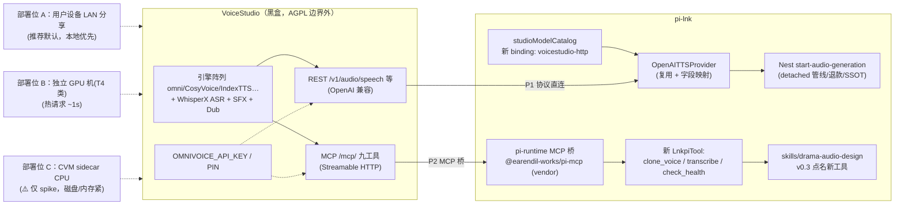

# VoiceStudio × pi-lnk 结合可行性评估

> 评估对象：[debpalash/VoiceStudio v0.5.8](https://github.com/debpalash/VoiceStudio/releases/tag/v0.5.8)（源码深读，commit 见克隆版 `/tmp/VoiceStudio-vs`）  
> 评估基线：pi-lnk master 2026-11-24（`packages/agent/src/tools/audio-provider.ts`、`apps/server/src/studio/*`、`services/pi-runtime/src/tools/generation.ts`、vendor `packages/mcp`）  
> 性质：产品 + 架构双维度可行性评估（讨论稿，未进入任何分支流程）

---

## 0. 结论先行

**可行，且接入成本异常低——因为两边的接缝恰好都是 OpenAI TTS 协议。**

| 判定    | 结论                                                                                                                             |
| ----- | ------------------------------------------------------------------------------------------------------------------------------ |
| 协议可行性 | ✅ **近零适配**：pi-lnk 的 `OpenAITTSProvider` 已按 OpenAI `/v1/audio/speech` 协议实现；VoiceStudio 官方提供同协议兼容端点（`SpeechRequest` 逐字段比对见 §4.1） |
| 架构可行性 | ✅ **进程隔离消费**，不 vendor 源码、不引入 Python 栈；pi-runtime 侧走 vendor 自带 `@earendil-works/pi-mcp`（ADR-0009 vendor-first 的标准落点）            |
| 部署可行性 | ⚠️ **有条件**：生产 CVM 是 CPU 小机且磁盘看门狗紧（AVAIL_FAIL_KB=6.3G），默认不建议 CVM 常驻；推荐「用户设备 LAN 分享」为主、独立 GPU 机为可选                               |
| 许可可行性 | ✅ **AGPL-3.0 可安全消费**：以未修改官方镜像 + HTTP/MCP 通信构成聚合作品边界；禁止把其源码并入本仓                                                                 |
| 产品收益  | ✅ 填三个真实能力缺口：**音色克隆（角色声线一致性）**、**ASR 转写（QC/字幕，pi-lnk 全仓为零）**、**视频配音出海**；并对冲 agnes 429 墙                                         |

**一句话建议**：按「P0 spike → P1 协议直连（1 个 PR 量级）→ P2 MCP 桥补克隆/转写 → P3 配音出海独立立项」推进；生产 CVM 不做默认宿主。

> **⭐ 拍板更新（2026-11-24 01:04，用户三拍板已落，详见 §9）**：
> ① 部署位 **拍板 CVM**（前置条件：内存扩容 ≥8G + 磁盘清理，见 §9.1 实测基线）；范围边界 **拍板「充分吃满该项目能力」**——能力面全景盘点与接线方式见落地规格 §2；
> ② 克隆 **首期开放**（合规三件套：限自有参考音频 + AI 水印 + profile 来源标记）；
> ③ P3 在 P1/P2 完成后独立立项。
> 落地规格：`docs/superpowers/specs/2026-11-24-voicestudio-p1p2-implementation-spec.md`
> **⏰ 时序补充（2026-11-24 01:37）**：内存扩容（前置 A）**推迟至 P1/P2/P3 全部完成后**执行，PR-deploy 顺延；P1 补「env 未配置 ⇒ 模型不注册」决策（prod 阶段零用户可见影响）。

---

## 1. VoiceStudio v0.5.8 源码研究结论

### 1.1 它是什么

本地优先（local-first）的 AI 语音工作室，Python/FastAPI 后端（`backend/main.py`，uvicorn :3900）+ Electron/Tauri 桌面前端 + 移动端 + CLI；核心卖点是**全部推理跑在本机**，646 语言。AGPL-3.0-only。

### 1.2 能力面（与 pi-lnk 相关子集）

| 能力           | 实现                                                                                                                                                     | 对 pi-lnk 的意义                                                       |
| ------------ | ------------------------------------------------------------------------------------------------------------------------------------------------------ | ------------------------------------------------------------------ |
| TTS 语音合成     | 引擎阵列：默认 `omnivoice`（k2-fsa/OmniVoice，权重 ~2.3GB）+ CosyVoice3 / IndexTTS2.5 / MOSS-TTS / dots.tts / Confucius4-TTS / gpt-sovits / sherpa-onnx 等 20+，可热切换 | 云 TTS 的本地/离线替代与降级通道                                                |
| **音色克隆**     | reference audio → voice profile（`clone_voice`），profile 复用                                                                                              | **pi-lnk 缺口**：短剧角色全剧同一音色、IP 声线资产化                                  |
| **音色设计**     | 文本描述 → 属性映射 → 固定种子音色 profile（`describe_voice`/`design_voice`）                                                                                          | drama-character-design 的「角色音色 bible」可落成真 profile                   |
| **ASR 转写**   | WhisperX 默认 + faster-whisper / FunASR / Moonshine / Parakeet，646 语言                                                                                    | **pi-lnk 全仓无 ASR**（grep *`whisper`*`/transcri` 仅误命中）——补 QC、字幕、听写输入 |
| **视频配音**     | dub_translate / dub_generate / dub_export 全管线（对齐原片时间轴）                                                                                                 | 短剧出海（翻译配音）的产品级底座                                                   |
| 音效 SFX       | `moss_sfx` 引擎 + sfx 路由                                                                                                                                 | drama-audio-design 的 `design` kind（音效+氛围）目前靠云端，本地可兜底               |
| 人声分离 / 说话人分离 | Vocal isolation / diarization                                                                                                                          | 参考素材处理（非首期）                                                        |
| AI 水印        | `watermark.py` 路由                                                                                                                                      | 克隆合规辅助                                                             |
| 长音频/批量       | audiobook / longform_jobs / batch 队列                                                                                                                   | 长台词、整集配音                                                           |
| 电话           | telephony_twilio                                                                                                                                       | ❌ pi-lnk 无此场景，不取                                                   |

### 1.3 接口面（三个消费入口）

1. **OpenAI 兼容 REST**（`backend/api/routers/openai_compat.py`，prefix `/v1`）：
   - `POST /v1/audio/speech` —— `SpeechRequest`：`model`（引擎 id：omnivoice/voxcpm2/cosyvoice/…；OpenAI 模型名作别名）、`input`≤4096 字符、`voice`（**支持 voice profile id/名称**，即克隆音色可直接走此字段）、`instructions`（风格指令）、`response_format`（mp3 默认/wav/opus/pcm）、`speed` 0.25–4.0、`stream_format`（audio/SSE 逐句流式）、`language`
   - `POST /v1/audio/transcriptions`、`POST /v1/audio/translations`、`GET /v1/models`、`GET /v1/audio/voices`
   - 工程质量好：显式路由门（无 GPU 时 400 报错、**禁静默 CPU 回退**）、许可证接受门、ffmpeg 预检
2. **MCP Server**（挂载在 `/mcp/`，Streamable HTTP）：`generate_speech / clone_voice / describe_voice / design_voice / transcribe / list_voices / list_personalities / list_languages / check_health` 九个工具；`OMNIVOICE_MCP_OUTPUT_MODE=files` 把音频落盘只回路径（省上下文字节——其文档明确为 agent 场景设计）；`X-OmniVoice-Client-Id` 支持按 agent 绑定音色
3. **鉴权模型**：默认仅 loopback 免鉴权；跨机消费 = `OMNIVOICE_API_KEY`（HTTP+WS）+ 可选分享 PIN + `OMNIVOICE_TRUSTED_NETWORKS` 豁免；管理面（`/system/*`，RCE 级）与消费面严格分离，管理面只认 loopback 或 key。**其文档明确支持「应用后端消费固定私有部署」的 production-private-api 模式** —— 即它把自己设计成可被别的后端当引擎用

### 1.4 部署与硬件

- 官方 `deploy/docker-compose.yml`：cpu / gpu / rocm 三 profile；首跑下载 ~4GB 模型；T4 实测**热请求 ~1s**、显存 ~2GB；首请求默认含 2.3GB 权重下载会撞 300s 预算（有 `POST /models/install` 预装通道 + SSE 进度）
- CPU 模式可用：`OMNIVOICE_CPU_GENERATE_TIMEOUT_S=600` 独立预算（官方按「CPU 合成天然更慢」设计），`OMNIVOICE_CPU_POOL` 线程池

---

## 2. pi-lnk 侧现状解剖（结合架构）

### 2.1 音频链路（本评估的接缝）

```
agent（pi-runtime 工具 run_audio_generation，kind=voice|design|music）
  → Nest /agent/internal/start-audio-generation（detached 异步，job 化 P1-B）
    → studio.generateAudio → 模型目录解析（studioModelCatalog，modality:'audio'）
      → createAudioProvider → OpenAITTSProvider（packages/agent/src/tools/audio-provider.ts）
        → POST {baseUrl}/audio/speech（model/input/voice/speed/volume/pitch/emotion/instruction）
        → 二进制音频 → data:audio/mpeg;base64 落真实文件 → 节点 SSOT + notify
```

要点：

- **`OpenAITTSProvider` 就是标准 OpenAI TTS 客户端**：`{baseUrl}/audio/speech`、Bearer 鉴权、按句切分（StepFun 1000 / 其他 4096）、失败显式抛错（2026-10-04 契约：**禁占位音频兜底**——soundhelix 假成功事故的教训已锁进代码）
- 目录已有三条云 TTS 线：`seed-audio-1.0`、`minimax-speech-2.8-hd`、StepFun 家族，绑定形态是 `providerBinding: 'gateway-openai-compat'` 等字符串 —— **新增一个 binding 是既有模式，不是新模式**
- 参考音频上传已存在（`studio.service.ts:2279` `referenceAudios`）⇒ 克隆的原料入口现成
- 工具分层纪律：54 工具 ×「谁点名」台账（tool-capability-catalog.md）；新增工具必须过「延迟集 ∩ 被点名 = ∅」判据
- 审批：audio 已在用户级自动放行 tier（`resolveAutoApproveTier`），新增音频类工具无需新审批面

### 2.2 基础设施现实

- 单 CVM（Nest Docker `lnkpi-api` + K3s pi-runtime NodePort 30100），磁盘看门狗（registry 3G / sessions PVC 4G / AVAIL_FAIL_KB=6.3G）——**CVM 跑 6–8GB 的 PyTorch 镜像+权重会直接顶到看门狗阈值**
- 已知外痛：agnes 429 实名墙、云 TTS 按字符计费（StepFun ¥0.9/万字符为全表最低，仍有量级成本）

---

## 3. 等价物检索结论表（第一原则合规）

> 按「吃满上游、不重复造轮子」三判据逐项核对：

| 需求                    | 等价物（已存在）                                                                                        | 结论                                                                                    |
| --------------------- | ----------------------------------------------------------------------------------------------- | ------------------------------------------------------------------------------------- |
| MCP 客户端（pi-runtime 侧） | **vendor `@earendil-works/pi-mcp`**（自带 StreamableHttpTransport + MCP→AgentTool 包装配方，README 即模板） | ✅ 必须用 vendor 包；现状 pi-runtime `src` 对其 **0 命中**——属 ADR-0009 意义上的「vendor 有而未吃」欠账，本次一并清偿 |
| OpenAI TTS 协议适配       | `packages/agent` `OpenAITTSProvider`                                                            | ✅ 复用，**禁止新建 provider 类**；至多加参数映射                                                      |
| 音色清单/模型枚举             | VS `GET /v1/audio/voices` + MCP `list_voices`                                                   | ✅ 运行时拉取同步，不在本仓手抄表                                                                     |
| ASR                   | VS `POST /v1/audio/transcriptions`（WhisperX）                                                    | ✅ 直接接线，不自研转写                                                                          |
| 克隆                    | VS MCP `clone_voice`（或 REST profiles）                                                           | ✅ 直接接线                                                                                |
| 部署                    | VS 官方 Docker 镜像/compose（cpu/gpu profile）                                                        | ✅ 用官方镜像黑盒消费，禁自制镜像、禁改其源                                                                |
| 模型预装防超时               | VS `POST /models/install` + `/setup/download-stream` SSE                                        | ✅ 部署 runbook 落这条                                                                      |
| ❌ 不取的部分               | Electron/mobile 前端、telephony、dub UI 层                                                           | 只取 headless 后端服务面                                                                     |

---

## 4. 结合方案（架构）

### 4.1 协议比对（决定性证据，逐字段）

| pi-lnk `OpenAITTSProvider` 发送 | VS `SpeechRequest` 接受           | 判定                               |
| ----------------------------- | ------------------------------- | -------------------------------- |
| `model`                       | ✅ 引擎 id（OpenAI 名作别名）            | 直通                               |
| `input`（≤1000/4096 切分后）       | ✅ ≤4096                         | 直通                               |
| `voice`（音色 id）                | ✅ 音色 profile id/名称              | 直通（**克隆 profile 也走此字段**）         |
| `speed`                       | ✅ 0.25–4.0                      | 直通                               |
| `volume` / `pitch`            | ⚠️ pydantic 忽略额外字段（静默丢弃）        | 语义 gap：需文档声明或映射进 `instructions`  |
| `emotion`                     | ⚠️ 同上                           | 同上；VS 的情绪表达走 `instructions` 风格指令 |
| `instruction`（单数）             | ✅ `instructions`（复数）/`instruct` | **字段名差一个字母**，映射一行                |
| 响应：二进制 → data:audio/mpeg      | ✅ 默认 mp3                        | 直通                               |

⇒ **P1 改动量 = 目录加一行模型 + 一处字段映射**，其余全部复用。

### 4.2 集成架构图



### 4.3 三档接法与部署位

| 档            | 内容                                                                                                                                                                                                                                                                                    | 改动面                      | 判定      |
| ------------ | ------------------------------------------------------------------------------------------------------------------------------------------------------------------------------------------------------------------------------------------------------------------------------------- | ------------------------ | ------- |
| **P1 协议直连**  | 目录新增 `voicestudio-local` 模型行（audioKind:'voice'）+ binding `voicestudio-http` → `createAudioProvider` 侧按 baseUrl/key 构造既有 provider；`/v1/audio/voices` 同步音色下拉；emotion→instructions 映射                                                                                                    | server 1 PR 量级；零新工具      | ✅ 先做    |
| **P2 MCP 桥** | pi-runtime 引 vendor `@earendil-works/pi-mcp`，`StreamableHttpTransport` 连 `/mcp/`，按 vendor README 配方包 4 个工具（`clone_voice`/`transcribe`/`list_voices`/`check_health`）为 `LnkpiTool`；过 tiering 台账（新工具进**延迟集**，由 `drama-audio-design` SKILL 按需点名——SKILL 点名走 `load_skill` 通道，不触发「规则×延迟集」违规） | runtime 1 PR；清 vendor 欠账 | ✅ 第二步   |
| **P3 配音出海**  | dub_translate/generate/export 管线产品化（video 节点 → 转写 → 翻译 → 时间轴配音 → 导出）                                                                                                                                                                                                                  | 独立大规格，另立 spec            | 🔜 单独立项 |

| 部署位                                 | 优势                                                 | 风险                                                                  | 判定                      |
| ----------------------------------- | -------------------------------------------------- | ------------------------------------------------------------------- | ----------------------- |
| **A 用户设备**（VS 桌面版 LAN 分享 + PIN/key） | 零服务器成本；真人参考音频不出本机（隐私）；与 VS「local-first」产品哲学同构；延迟最好 | 用户需自装（摩擦）；不可用时要优雅回退云 TTS（`check_health` 探活）                         | ⭐ **产品默认叙事（BYO 算力）**    |
| **B 独立 GPU 机**（T4 类 16GB）           | 热请求 ~1s；可服务全部用户                                    | 新增硬件/运维面；模型预装 runbook                                               | 可选，按需求量再上               |
| **C CVM sidecar CPU**               | 无新增机器                                              | 顶磁盘看门狗（AVAIL_FAIL_KB=6.3G vs 镜像+权重 6–8GB）；CPU RTF 未知；与 Nest/K3s 抢内存 | ⚠️ 只用于 P0 spike 实测，不做常驻 |

---

## 5. 可行性判定汇总

| 维度 | 判定     | 依据                                                                               |
| -- | ------ | -------------------------------------------------------------------------------- |
| 协议 | ✅ **已实测确认（P0 spike）** | 本机 Docker 实测：speech/models/voices 三端点通、`Authorization: Bearer` 与 pi-lnk 现有实现零改动直通、MCP 九工具握手成功、无 key 401 显式拒绝（详见 §9.3）
| 架构 | ✅ 高    | 黑盒进程消费 + vendor MCP 包；不改 vendor、不加 Python 栈、不碰 Dockerfile COPY 面                 |
| 性能 | ⚠️ **已实测：CPU RTF ≈ 5-8×** | 4 核 Docker VM 实测 OmniVoice：热请求 113s/17 字短句（含 torch import + 权重加载）、首载 ~11min、单 worker 429 排队契约、空闲自动卸载 ⇒ **不可实时、可批产**；实时性须引擎换型或 GPU（详见 §9.3） |
| 资源 | ⚠️ 受限  | CVM 磁盘看门狗决定了 C 不做常驻；A/B 规避                                                       |
| 许可 | ✅ 可控   | AGPL-3.0：未修改镜像 + HTTP/MCP 边界 = 聚合作品；写入 ADR；禁 vendor 源码入仓；如未来需嵌入式分发再议 VS Pro 商业授权 |
| 合规 | ⚠️ 需机制 | 音色克隆涉真人声音：默认只允许克隆**用户自己上传的参考音频**，落 AI 水印；克隆 profile 命名加来源标记                      |
| 安全 | ✅ 结构好  | 消费面/管理面分离；跨机强制 key；我们的调用端持 key、只暴露消费端点                                           |

---

## 6. 产品收益（映射到现有工作流）

1. **角色声线资产化（最高价值）**：短剧全剧「同一角色同一音色」目前只能从固定音色表挑；克隆/design profile 让角色 bible 里的声音描述变成**可复用资产**（`drama-character-design` → `drama-audio-design` 链路直接增强）
2. **成本与韧性**：本地合成零边际成本（对比 StepFun ¥0.9/万字符）；agnes 429 / 渠道故障时音频线不断供——`check_health` 探活 + 云/本地双通道
3. **补 ASR 空白**：`drama-qc-review` 可「转写回读比对台词」做真实 QC（当前只能人工）；视频节点字幕提取；画布语音输入（听写）
4. **出海配音**：P3 用其 dub 管线把短剧视频转译配音——pi-lnk 视频线生成的是无口型对齐约束的短片，配音出海是现成的第二增长曲线
5. **情绪表达升维**：现有 emotion 仅 4 档；VS 的 `instructions` 风格指令（+design 引擎的演绎指导）把「≤500 字整体演绎指导」从说明单变成真实生效参数
6. **隐私卖点**：真人参考音频不出用户设备——BYO 算力叙事同时是合规叙事

**不带来的**：不替代 `music` kind（VS 无歌词音乐生成弱项，BGM 继续走云端）；不动审批/tiering 既有架构。

---

## 7. 风险与对策


| # | 风险 | 对策 |
|---|---|---|
| 1 | AGPL 污染 | 铁律：只消费官方未修改镜像；`vendor/` 禁放 VS 源码；ADR-0010 记录边界判定；镜像 tag pin `v0.5.8` 升级走审计 |
| 2 | CVM 资源击穿 | 部署位 C 仅限 spike；runbook 加「VS 容器磁盘占用」检查项 |
| 3 | CPU 延迟不可用 | P0 实测定阈值；不可用则 P1 仅面向部署位 A/B 用户开启 |
| 4 | 首请求超时（含 2.3GB 下载） | runbook：部署后先 `POST /models/install` 预装 + SSE 盯进度（T4 文档原话：热请求 ~1s） |
| 5 | 弱模型直调新工具吃 `is unavailable` | 新工具进延迟集且仅 SKILL 点名（`load_skill` 通道），按 capability-catalog 判据登记 4 行 |
| 6 | emotion/volume/pitch 静默失效 | 映射层显式转换 + 失败显式报错（遵守 audio-provider 2026-10-04「禁占位兜底」契约） |
| 7 | 克隆合规 | 仅限用户自有参考音频 + AI 水印 + profile 来源标记；用户协议补条款 |
| 8 | 上游引擎矩阵大、版本漂移 | pin v0.5.8 黑盒；只依赖 `/v1` OpenAI 兼容面 + MCP 两层**稳定接口**，不碰其内部引擎 id 之外的细节 |

---

## 9. 拍板落档（2026-11-24）与 CVM 实测基线

### 9.1 CVM 实测基线（2026-11-24 01:00，`ssh deploy-cvm`）

| 资源 | 实测值 | 判定 |
|---|---|---|
| 内存 | 总 3.6Gi / 已用 3.1Gi / **可用 449Mi / swap 已换 2.7G** | 🔴 **硬缺口**：已在重度换页；OmniVoice CPU 推理（2.3GB 权重 + torch runtime）峰值 ~4-5GB ⇒ 现状直跑必崩 |
| 磁盘 | 40G 盘，已用 32G，可用 8.1G（80%） | 🟡 紧但可解：`docker system df` 显示镜像可回收 **9.379GB（81%）** + build cache **3.493GB** ⇒ 清理后 ~20G 可用，容得下 VS CPU 镜像（~4-6G）+ 权重（2.3G）+ ASR 模型（1-3G）且保住看门狗 6.3G 缓冲 |
| CPU / GPU | 4 核 / 无 GPU | CPU-only；4 核生成速度上限已知，P0 spike 实测 RTF |
| 同机负载 | lnkpi 全家 + K3s + pintuotuo 全家桶（redis/postgres/grafana/prometheus/litellm…）14 容器 | 扩容规格须按「全家共存」估算，不能只算 VS |

**⇒ CVM 部署的两个前置条件（拍板①的落地路径）**：
- **前置 A（内存扩容）**：4G → **8G 最低 / 16G 推荐**。16G 的理由：TTS + ASR 双引擎共存（VS 引擎可热切换但驻留要内存）+ 现有全家桶共存 + 避免 swap 抖动把 Nest/K3s 拖垮。
- **前置 B（磁盘清理）**：`docker image prune`（可回收 9.4G，注意只清未在跑容器的悬空/旧镜像）+ `docker builder prune`（build cache 3.5G 可全清）；**不能动** containerd overlayfs（K3s 在跑 Pod 的真实 FS，看门狗纪律）。

**⇒ 未完成前置前，CVM 不常驻任何 VS 引擎**（连轻量引擎也会挤进换页）。P0 spike 在本机 Docker 做（协议链路验证 + RTF 采样，本机 CPU 与 CVM 4 核相近可参考）；代码接线与硬件无关，P1/P2 可先行。

### 9.2 三个拍板项结论

| # | 拍板项 | 结论 | 落点 |
|---|---|---|---|
| ① | P1 面向范围与部署位 | **CVM 部署**（前置 A/B 如上）；范围 **充分吃满 VS 能力面**（TTS/ASR/克隆/音色设计/探活/SFX 盘点，UI/telephony 不吃） | 落地规格 §2 能力面盘点表、§4 PR 切分 |
| ② | 克隆首期开放 | **开放**，合规三件套：限自有参考音频 + AI 水印 + profile 来源标记 | 落地规格 §5 |
| ③ | P3 顺位 | P1、P2 完成后**独立立项** | 落地规格 §6 |

### 9.3 P0 spike 实测结论（2026-11-24 18:28–19:30，本机 Docker VM 5.8G/4 核）

| 探针 | 结果 | 结论 |
|---|---|---|
| 容器启动 | healthy 30s（`OMNIVOICE_SERVER_MODE=1` + API key 强制） | 部署简单 |
| 鉴权门 | 无 key → 401 `{"detail":"API key required"}`；`Authorization: Bearer <key>` 全通 | **与 pi-lnk `OpenAITTSProvider` 现有实现逐字节兼容，零改动**（源码 `backend/core/auth.py` 亦确认 Bearer/query 两条 master 通道） |
| `/health` | 200 `{"status":"ok","device":"cpu","engine":"omnivoice","version":"0.5.8"}` | 探活契约确认 |
| `/v1/models` | OpenAI 别名（tts-1/tts-1-hd/gpt-4o-mini-tts/whisper-1…）+ `alias_for_active_engine` | catalog 的 model 字段可直接用 OpenAI 名或引擎 id |
| `/v1/audio/voices` | openai_alias 音色清单 | 运行时同步可行 |
| OmniVoice 首装 | HF 直连失败（Errno 99/110）⇒ **必须 `HF_ENDPOINT=https://hf-mirror.com`**；plain downloader fallback 后成功（权重 3.1G 落盘） | 部署 runbook 必带 HF 镜像变量；大文件可能多次重试 |
| **OmniVoice CPU RTF** | 热请求 **113s / 17 字短句**（torch import ~20s + 权重加载 + 推理）；首请求全程 >11min | **RTF ≈ 5-8×：不可实时，可批产**；CVM 4 核同量级 |
| 并发契约 | 单 worker（CPU 固定 1），并发 → 429 显式排队提示（`retry in ~176s`） | pi-lnk 侧应串行调用（P1-B detached 管线天然单队列） |
| 内存管理 | idle 超时自动卸载释放（~950MB 驻留） | 5.8G VM 可容纳；CVM 8G 扩容后可容纳 |
| MCP `/mcp/` | init 200（Streamable HTTP + session）+ **九工具**：generate_speech/list_voices/list_personalities/list_languages/transcribe/check_health/clone_voice/describe_voice/design_voice | P2 四工具（clone/design/transcribe/list_voices）全部可用 |
| ASR | 未装模型 → 409 `asr_model_missing` + 推荐 `Systran/faster-whisper-large-v3`（2.9GB）+ 修复指引 | 显式报错契约 ✓；whisperx/faster-whisper 引擎开箱可用，权重需下载 |
| 许可证门 | `GET /models/licenses/acceptance/{repo}` → fingerprint → `POST /models/licenses/accept` | 流程可 API 化进 runbook；**⚠️ OmniVoice = CC-BY-NC（非商业）**——生产商用必须换引擎（候选：CosyVoice3/IndexTTS 等，需逐个查许可）或仅限内部演示 |
| 引擎切换门 | 未装包引擎（moss-tts-nano 等）→ 400 显式报错 + 安装指引 | 错误契约清晰；轻量引擎（kittentts 无克隆）模型下载同受 HF 网络影响 |
| ⚠️ 水印 | `Watermark embedding skipped`（AudioSeal load failed，缺 TorchCodec/FFmpeg 共享库） | **合规三件套的 AI 水印在 CPU 容器不生效**——P2 合规项需补依赖验证或改用云端水印 |
| 字段映射 | （未跑完）——SpeechRequest 源码已确认 `instructions` 复数生效、`emotion/volume/pitch` 为 VS 扩展外字段被 pydantic 忽略 | P1 映射层按规格 §4.1 落 |

**Spike 总结**：协议层全通（P1/P2 可开工）；CPU 性能定性（RTF 5-8×，批产可用实时不可用）；新增三个部署/合规发现（HF 镜像必配、OmniVoice 非商业许可、水印依赖缺失）。kittentts/whisper 的 CPU RTF 因 HF 下载不稳未测完，留 P1 开发期补测（容器保留）。
